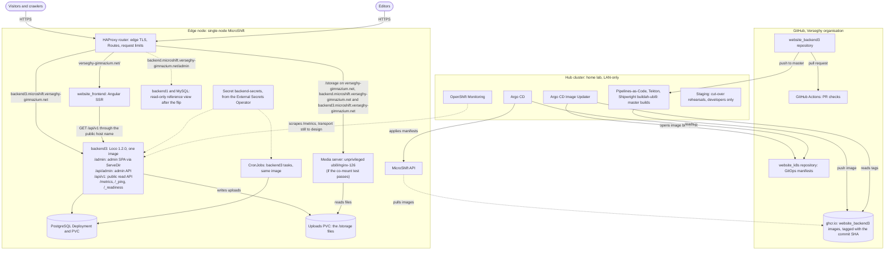
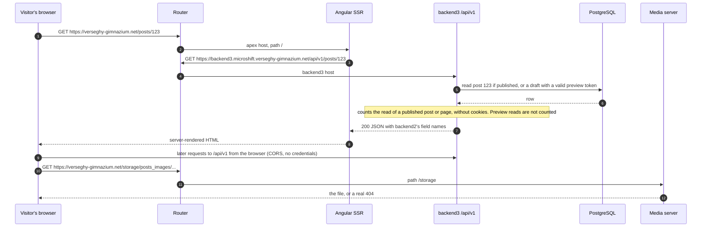
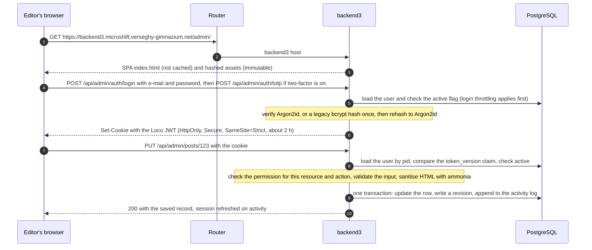
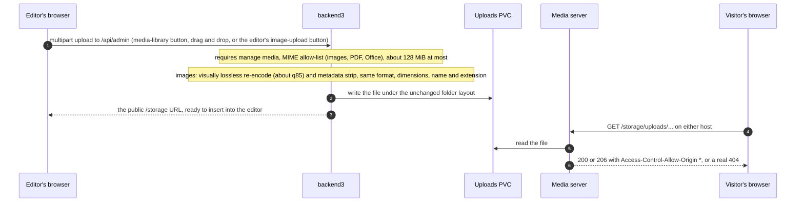

# website_backend3 design

This is the architecture overview of website_backend3 and the index of `docs/design/`. It describes the target system: what it replaces, how its parts fit together, how requests move through it, and where each decision is recorded.

The design was written on 2026-10-24, before any code. Every decision in it comes from the maintainer's answers of that day (research: DECISIONS) and is recorded as an [architecture decision record](#architecture-decision-records). When this overview and an ADR disagree, the ADR wins ([ADR 0001](adr/0001-record-architecture-decisions.md#5-the-source-of-truth-and-precedence)).

## Documents in this directory

| Document | What it is for |
|---|---|
| `README.md` (this file) | Architecture overview, diagrams, index |
| [adr/README.md](adr/README.md) | ADR index, ADR template, how to add or change a decision |
| [adr/](adr/) | The architecture decision records, one file per decision |
| [public-api.md](public-api.md) | The public read REST API (`/api/v1`) that replaces backend2's GraphQL API |
| [openapi-spike.md](openapi-spike.md) | The utoipa spike of ADR 0005 §5: its result, its measurements and the rules for public DTOs |
| [parity.md](parity.md) | The backend1 feature inventory as parity IDs, and which features are retired |
| [data-migration.md](data-migration.md) | How the MySQL data and the stored HTML are imported into PostgreSQL |
| [editor.md](editor.md) | content-v1, the rich-text editor, the Office paste filter, the server sanitiser and the integrity rule for stored HTML |
| [cutover.md](cutover.md) | The rehearsals, the flip, rollback and the read-only parallel run |

## Purpose and scope

website_backend3 is the new backend of the Verseghy Ferenc Gimnázium website. It is one [Loco](https://loco.rs) 1.2.0 application (Rust, Sea-ORM 2, axum) that serves three things from one host, `backend3.microshift.verseghy-gimnazium.net`:

1. the **admin API** at `/api/admin`;
2. the **admin UI** at `/admin`, a React single-page app built on ra-core and shadcn-admin-kit, kept in `admin/` and shipped in the same container image;
3. the **public read API** at `/api/v1`, a REST API that the live Angular site (`website_frontend`) calls instead of backend2's GraphQL endpoint.

It owns a new PostgreSQL database. A separate media server serves the uploaded media under `/storage`, provided a co-mount test passes; otherwise backend3 serves `/storage` itself at 1 replica ([ADR 0015](adr/0015-media-separate-static-server-media-library-image-optimisatio.md)). Scheduled work runs as Kubernetes CronJobs that call backend3's own tasks.

The scope rule: **every backend1 admin feature is ported unless an ADR retires it.** Parity is tracked per feature ID ([ADR 0019](adr/0019-scope-parity-tracking-retired-features-release-1-additions.md), [parity.md](parity.md)).

## What is replaced, and what is not touched

| Today | Role today | After the cut-over |
|---|---|---|
| **backend1**: `website_backend`, Laravel 7 + Backpack 4.1 | The only admin UI (`backend.microshift.verseghy-gimnazium.net/admin`); serves uploaded files under `/storage` on two hosts; an old JSON API with no consumer since 2022 | Admin UI and admin API move to backend3. `/storage` moves to the separate media server. backend1 stays up **read-only** as a reference view until the maintainer decides to decommission it ([ADR 0003](adr/0003-cut-over-one-rehearsed-flip-then-a-read-only-parallel-run.md)). The old JSON API is not ported. |
| **backend2**: `website_backend2`, Rust axum + async-graphql | The public read API (`POST /graphql` with persisted queries, 13 operations used by the Angular site), plus a Redis that holds only persisted query documents | Replaced by backend3's `/api/v1`, which keeps backend2's field names and its fixed semantics. The rewrite makes no change in website_backend2. backend2 and its Redis keep running, unchanged, after the flip: they serve the frozen MySQL data to the website_frontend2 hub beta, to browsers still on the old Angular bundle and to the rollback path, and retire together with backend1 and MySQL when the maintainer decides to decommission them ([ADR 0026](adr/0026-backend2-unchanged-and-running-until-decommissioning.md)). No GraphQL compatibility layer is built. |
| **MySQL 8.4**, database `verseghy` | Shared by backend1 (writes) and backend2 (reads); about 6 MiB in 6,677 rows | Imported into PostgreSQL. Not altered before the cut-over: no engine conversion, no charset change and no data fixes; every data fix lives in the importer. Every dump, for backup or rehearsal, is taken with `mysqldump --lock-all-tables`. Kept read-only during the parallel run ([ADR 0003](adr/0003-cut-over-one-rehearsed-flip-then-a-read-only-parallel-run.md)). |

Not touched by this project:

- **website_frontend** (the Angular 14 SSR site at `verseghy-gimnazium.net`). Only its read API calls change: GraphQL to `/api/v1`, plus the new endpoints for notices, partner banners, site settings and Diáktoll issues ([ADR 0019](adr/0019-scope-parity-tracking-retired-features-release-1-additions.md)). Its pages, routes and templates stay as they are. Those changes land as PRs in that repository, reviewed by a human.
- **website_frontend2** (the SolidStart beta) is out of scope. Its hub beta keeps working against backend2 until backend2 retires at decommissioning, and is scaled down then ([ADR 0026](adr/0026-backend2-unchanged-and-running-until-decommissioning.md)). The REST shape stays backend2-compatible, so a later port is mostly a transport change.
- The legacy `static` Deployment that serves `/docs` and `/images`, cert-manager, the External Secrets Operator and the other platform pieces stay as they are. Changes to `website_k8s` are separate PRs, left for human review.

## Goals and non-goals

### Goals

| # | Goal | Where |
|---|---|---|
| G1 | Port every backend1 admin feature, unless an ADR retires it, and track each one by its parity ID. | [ADR 0019](adr/0019-scope-parity-tracking-retired-features-release-1-additions.md), [parity.md](parity.md) |
| G2 | Replace backend2 with a REST API that keeps backend2's field names, so the Angular switch is a transport change, and carry backend2's semantics with the fixes from its open fix branches. backend2's retirement is proven by new tests written from the REST spec, with synthetic fixtures that include the production-only data shapes (entity-encoded bodies, NULL authors, unpositioned menu items); there is no dump-diff harness and no ported backend2 snapshot ([ADR 0019](adr/0019-scope-parity-tracking-retired-features-release-1-additions.md)). | [ADR 0005](adr/0005-rust-dtos-are-the-api-contract-ts-rs-utoipa-openapi.md), [public-api.md](public-api.md) |
| G3 | Check permissions on the server for every operation: list, read, create, update, delete. | [ADR 0007](adr/0007-authorization-four-roles-enforced-on-every-operation.md) |
| G4 | Never lose an editor's work: soft delete, revisions and an activity log for every admin-editable entity. | [ADR 0011](adr/0011-safety-net-soft-delete-revisions-and-an-activity-log-for-eve.md) |
| G5 | Keep every public URL stable: post, author and label ids, page slugs, and every `/storage` path on both hosts. | [ADR 0009](adr/0009-clean-domain-schema-with-preserved-integer-ids.md), [ADR 0015](adr/0015-media-separate-static-server-media-library-image-optimisatio.md) |
| G6 | Clean the stored content once at import, so that search finds accented words and the new editor round-trips every body. | [ADR 0017](adr/0017-legacy-data-import-normalisation-and-defect-resolution.md), [ADR 0020](adr/0020-search-and-hungarian-ordering.md) |
| G7 | Give editors a Hungarian admin with a rich-text editor that keeps Word and Excel styling, a media library open to every content role, a canteen week editor and a menu tree editor. | [ADR 0021](adr/0021-hungarian-only-admin-ui.md), [ADR 0013](adr/0013-rich-text-editor-and-html-sanitiser.md), [ADR 0015](adr/0015-media-separate-static-server-media-library-image-optimisatio.md), [ADR 0018](adr/0018-content-model-publishing-pages-menu-tree-canteen-week-editor.md) |
| G8 | Ship the release-1 additions: notices, partner banners, site settings and a list of Diáktoll issues, each with an admin screen and a public endpoint. | [ADR 0019](adr/0019-scope-parity-tracking-retired-features-release-1-additions.md) |
| G9 | Replace the static dashboard card with usage statistics: content and editor activity, and self-hosted traffic counts without cookies. | [ADR 0019](adr/0019-scope-parity-tracking-retired-features-release-1-additions.md) |
| G10 | Fit a small single-node edge cluster: one application image, no Redis, no monitoring stack on the node. | [ADR 0016](adr/0016-no-redis-in-memory-cache-postgres-queue-cronjob-tasks.md), [ADR 0023](adr/0023-operations-hardening-rate-limits-monitoring-backups-secrets.md) |
| G11 | Keep admin edits visible on the public site on the next request, as they are today. | [public-api.md](public-api.md) |
| G12 | Make the code safe and productive for AI agents: tracked instruction files, the vendored Loco skill, committed guardrails, and these ADRs. | [ADR 0024](adr/0024-ai-maintainability-instruction-files-the-loco-skill-guardrai.md), [ADR 0001](adr/0001-record-architecture-decisions.md) |

### Non-goals

| Not doing | Why, and where it is decided |
|---|---|
| A GraphQL endpoint, even a temporary one | One rehearsed flip instead ([ADR 0003](adr/0003-cut-over-one-rehearsed-flip-then-a-read-only-parallel-run.md)). |
| Changing the Angular site beyond its read API calls | Only its read API calls are in scope; its pages, routes and templates stay as they are. |
| Porting website_frontend2 | Out of scope ([ADR 0019](adr/0019-scope-parity-tracking-retired-features-release-1-additions.md)). |
| E-mail of any kind: SMTP, self-service password reset, the newsletter | Admins issue reset links or temporary passwords ([ADR 0006](adr/0006-admin-authentication-and-account-lifecycle.md)); the newsletter is retired ([ADR 0019](adr/0019-scope-parity-tracking-retired-features-release-1-additions.md)). |
| Logs and Backups screens in the admin | Retired as a documented parity exception; operators use `oc logs` and the runbook ([ADR 0019](adr/0019-scope-parity-tracking-retired-features-release-1-additions.md)). |
| Resizing images or validating their size and width | Images are re-encoded without changing format, dimensions, name or extension ([ADR 0015](adr/0015-media-separate-static-server-media-library-image-optimisatio.md)). |
| A full file manager (archives, chmod, network mounts) | A minimal media library instead ([ADR 0015](adr/0015-media-separate-static-server-media-library-image-optimisatio.md)). |
| Scheduled publishing in release 1 | A nullable `publish_at` column exists but is unused ([ADR 0018](adr/0018-content-model-publishing-pages-menu-tree-canteen-week-editor.md)). |
| A raw HTML view in the editor | [ADR 0013](adr/0013-rich-text-editor-and-html-sanitiser.md). |
| Single sign-on or the iam service | Loco JWT with local accounts ([ADR 0006](adr/0006-admin-authentication-and-account-lifecycle.md)). |
| react-admin Enterprise code | Soft delete, history, audit log and tree are clean-room open-source implementations ([ADR 0011](adr/0011-safety-net-soft-delete-revisions-and-an-activity-log-for-eve.md), [ADR 0018](adr/0018-content-model-publishing-pages-menu-tree-canteen-week-editor.md)). |
| Production images built by GitHub Actions | Production images come only from the hub's PAC pipeline ([ADR 0022](adr/0022-builds-and-ci-pac-for-production-images-github-actions-for-p.md)). |

## Components



| Component | What it is | Decided in |
|---|---|---|
| backend3 | One Loco 1.2.0 binary (`loco-rs = "=1.2.0"`, committed `Cargo.lock`). It serves the admin API, the public API and the admin SPA. Health routes are Loco's `/_ping` (static) and `/_readiness` (checks the database, queue and cache). | [ADR 0004](adr/0004-admin-ui-lives-in-admin-and-ships-in-the-backend3-image.md), [ADR 0014](adr/0014-one-host-backend3-microshift-verseghy-gimnazium-net.md), [ADR 0024](adr/0024-ai-maintainability-instruction-files-the-loco-skill-guardrai.md) |
| Admin SPA | React with ra-core and shadcn-admin-kit, built by a Node stage of the Containerfile, served same-origin at `/admin` by a tower-http `ServeDir` (`index.html` not cached, hashed assets immutable). A custom data provider talks to `/api/admin`. | [ADR 0004](adr/0004-admin-ui-lives-in-admin-and-ships-in-the-backend3-image.md), [ADR 0021](adr/0021-hungarian-only-admin-ui.md) |
| PostgreSQL | A new Deployment with its own PVC on the edge node. It holds the clean domain schema, Loco's job queue table and the safety-net tables. | [ADR 0002](adr/0002-postgresql-as-the-database.md), [ADR 0009](adr/0009-clean-domain-schema-with-preserved-integer-ids.md) |
| Media server | An unprivileged `ubi9/nginx-126` that serves `/storage/**` on both public hosts, and on the backend3 host for the admin's media previews: `Access-Control-Allow-Origin: *`, real 404s, no directory listing, range requests. Its configuration is [`deploy/media/nginx.conf`](../../deploy/media/README.md) in this repository, which website_k8s copies byte for byte, and the media contract suite tests it in CI (research: DECISIONS R9, D15). backend3 co-mounts the same uploads volume to write uploads. This layout holds only if a co-mount test on a throwaway PVC passes; otherwise backend3 serves `/storage` itself through a dedicated `ServeDir` router at 1 replica with the `Recreate` strategy. | [ADR 0015](adr/0015-media-separate-static-server-media-library-image-optimisatio.md) |
| Uploads PVC | The existing uploads volume. Paths do not change, so every `/storage` URL in stored content, the Angular build and external caches keeps working. | [ADR 0015](adr/0015-media-separate-static-server-media-library-image-optimisatio.md) |
| CronJobs | Kubernetes CronJobs that run backend3 tasks from the same image, for example queue housekeeping and the daily sitemap backstop, which only enqueues the sitemap job. Running scheduled work outside the Deployment means extra replicas never run it twice. | [ADR 0016](adr/0016-no-redis-in-memory-cache-postgres-queue-cronjob-tasks.md) |
| Cache and queue | Loco's in-memory cache and Loco's Postgres queue. No Redis. | [ADR 0016](adr/0016-no-redis-in-memory-cache-postgres-queue-cronjob-tasks.md) |
| Router | The MicroShift HAProxy router terminates TLS with the existing wildcard certificate, which already covers `backend3.microshift.verseghy-gimnazium.net`. Route-level connection and request limits apply to backend3's Routes from day one; the media Routes start without them, so that a classroom behind one address can load a whole gallery. | [ADR 0014](adr/0014-one-host-backend3-microshift-verseghy-gimnazium-net.md), [ADR 0023](adr/0023-operations-hardening-rate-limits-monitoring-backups-secrets.md) |
| Hub | Builds images (PAC, Tekton, Shipwright, pushed to ghcr.io), promotes them (Image Updater opens a PR on `website_k8s`, Argo CD syncs it to the edge node), runs staging for rehearsals and runs monitoring. | [ADR 0022](adr/0022-builds-and-ci-pac-for-production-images-github-actions-for-p.md), [ADR 0023](adr/0023-operations-hardening-rate-limits-monitoring-backups-secrets.md) |

### Hosts and paths after the cut-over

| Host and path | Served by | Notes |
|---|---|---|
| `verseghy-gimnazium.net/` | website_frontend (Angular SSR) | Unchanged. |
| `verseghy-gimnazium.net/storage/**` | Media server | URL contract: relative `/storage` links in stored content. The sitemap stays at `/storage/sitemap.xml`. |
| `backend.microshift.verseghy-gimnazium.net/storage/**` | Media server | URL contract: absolute image URLs, the Angular build, its service worker and links shared outside the site. |
| `backend3.microshift.verseghy-gimnazium.net/storage/**` | Media server | Lets the admin show the root-relative `/storage` URLs stored in content and returned by the admin API ([ADR 0014](adr/0014-one-host-backend3-microshift-verseghy-gimnazium-net.md), [ADR 0015](adr/0015-media-separate-static-server-media-library-image-optimisatio.md)). |
| `backend3.microshift.verseghy-gimnazium.net/admin` | backend3 (`ServeDir`) | The new admin address for editors. |
| `backend3.microshift.verseghy-gimnazium.net/api/admin/**` | backend3 | Admin API: session cookie, or a Bearer token for scripts. |
| `backend3.microshift.verseghy-gimnazium.net/api/v1/**` | backend3 | Public read API. OpenAPI 3.1 at `/api/v1/openapi.json`. |
| `backend.microshift.verseghy-gimnazium.net/**` (other paths) | backend1, read-only | Reference view during the parallel run. |
| `backend2.microshift.verseghy-gimnazium.net/graphql` | backend2, unchanged, until decommissioning | The Angular site stops calling it at the flip. It keeps serving the frozen data to the website_frontend2 hub beta, to browsers still on the old Angular bundle and to the rollback path ([ADR 0026](adr/0026-backend2-unchanged-and-running-until-decommissioning.md)). |

## Request flows

### Public read

The Angular site renders on the server and then hydrates in the browser. Both call `/api/v1` on the backend3 host, as the SSR pod calls backend2 today: through the public host name and the router.



Rules that hold for every public endpoint (details in [public-api.md](public-api.md)):

- Read-only. No cookies are read or set. No account data is returned: no admin users, editor e-mail addresses, roles, preview tokens or audit fields. Staff-directory entries and author bylines are published content.
- Paged lists are capped at 100 items; other lists are bounded by their content. Inputs are validated and errors use one JSON error shape.
- Only published content is returned; a draft is shown only with its preview token.
- Event times leave the API as naive Europe/Budapest `YYYY-MM-DD HH:MM:SS`, so the Angular calendar does not change ([ADR 0010](adr/0010-all-instants-stored-as-timestamptz.md)).
- An admin edit is visible on the next public read.

### Admin write

The SPA and the admin API share one origin, so the session cookie can be `SameSite=Strict` and no CORS is needed.



- Logout, a password change and deactivating a user bump `token_version`, which revokes every token of that user ([ADR 0006](adr/0006-admin-authentication-and-account-lifecycle.md)).
- The SPA hides what the user may not do, but the server is the gate ([ADR 0007](adr/0007-authorization-four-roles-enforced-on-every-operation.md)).
- Scripts use the same API with a Bearer token.

### Media upload and serving



Images from outside sources are never pasted: pictures in pasted Word, Excel or web content and pasted image files are dropped, and the editor points to the image upload instead. Images copied or cut inside the editor, already under `/storage`, paste normally, and a file dropped from disk is uploaded like one chosen with the image button (research: DECISIONS 15d, 15f; [ADR 0013](adr/0013-rich-text-editor-and-html-sanitiser.md)).

Large uploads need two limits raised on purpose: Loco's request body limit (2,000,000 bytes by default; research: SYNTHESIS §6.6) and the router's timeout for that Route. The router annotations are checked against the MicroShift documentation for the node's confirmed version before they are used ([ADR 0023](adr/0023-operations-hardening-rate-limits-monitoring-backups-secrets.md)).

### Background and scheduled work

| Work | How it runs | Decided in |
|---|---|---|
| Sitemap (`/storage/sitemap.xml`, from published posts and visible pages) | A Postgres-queue job that the backend3 worker runs after every publish, unpublish, trash, restore, slug or visibility change, and writes atomically to the uploads volume; a daily CronJob only enqueues the same job as a backstop | [ADR 0016](adr/0016-no-redis-in-memory-cache-postgres-queue-cronjob-tasks.md), [ADR 0019](adr/0019-scope-parity-tracking-retired-features-release-1-additions.md) |
| Legacy import and body normalisation | A backend3 task. A CronJob on hub staging runs it every night against the newest `--lock-all-tables` dump; the maintainer runs it once in the flip. It is idempotent and has a dry-run diff. | [ADR 0017](adr/0017-legacy-data-import-normalisation-and-defect-resolution.md), [data-migration.md](data-migration.md) |
| Durable background jobs | Loco's Postgres queue | [ADR 0016](adr/0016-no-redis-in-memory-cache-postgres-queue-cronjob-tasks.md) |

### Delivery

1. A PR runs the checks on GitHub Actions: format, clippy, tests against Postgres, ts-rs and OpenAPI drift, admin lint, typecheck and unit tests, and end-to-end tests, plus the PR-title conventional-commit check and the session-link check ([ADR 0012](adr/0012-delivery-review-commits-and-licensing.md)), the vendored Loco skill equality check ([ADR 0024](adr/0024-ai-maintainability-instruction-files-the-loco-skill-guardrai.md)), the toolchain pin, the licence checks and the workflow policy check. [ADR 0022](adr/0022-builds-and-ci-pac-for-production-images-github-actions-for-p.md) has the full list of required checks.
2. After the merge, Pipelines-as-Code on the hub builds the image with Shipwright and pushes `ghcr.io/verseghy/website_backend3:<commit SHA>`. Only master is built.
3. Argo CD Image Updater opens a PR on `website_k8s` that bumps the tag. A human approves it.
4. Argo CD syncs the manifests to the edge node.

## Data model overview

backend3 owns a clean domain schema in PostgreSQL ([ADR 0009](adr/0009-clean-domain-schema-with-preserved-integer-ids.md)). Tables have snake_case plural names. Primary keys are integer identity columns whose legacy values are preserved, because ids are public in URLs, and every sequence is reset past the highest imported id. Only `users` also has a UUID `pid`, which Loco's JWT carries. The importer is the only coupling to the old MySQL schema ([data-migration.md](data-migration.md)).

```mermaid
erDiagram
  authors |o--o{ posts : writes
  posts ||--o{ post_labels : has
  labels ||--o{ post_labels : tags
  canteen_days ||--o{ canteen_day_dishes : serves
  dishes ||--o{ canteen_day_dishes : "appears in"
  pages |o--o{ menu_items : "linked from"
  menu_items |o--o{ menu_items : "parent of"
  users ||--o{ user_roles : holds
  roles ||--o{ user_roles : "granted as"
  users ||--o{ user_permissions : "extra grants"
  users |o--o{ revisions : "saved by"
  users |o--o{ activity_log : "done by"

  posts {
    int id PK "legacy id kept"
    int author_id FK "nullable"
  }
  post_labels {
    int post_id PK, FK
    int label_id PK, FK
  }
  labels {
    int id PK
  }
  authors {
    int id PK
  }
  canteen_days {
    int id PK
  }
  canteen_day_dishes {
    int canteen_day_id PK, FK
    int dish_id PK, FK
  }
  dishes {
    int id PK
  }
  pages {
    int id PK
  }
  menu_items {
    int id PK
    int parent_id FK "nullable"
    int page_id FK "nullable"
  }
  users {
    int id PK
    uuid pid UK "carried by the JWT"
  }
  roles {
    int id PK
  }
  user_roles {
    int user_id PK, FK
    int role_id PK, FK
  }
  user_permissions {
    int user_id PK, FK
    string permission PK
  }
  revisions {
    int id PK
    string entity_type
    int entity_id
    int created_by FK "the user who saved"
  }
  activity_log {
    int id PK
    string entity_type
    int entity_id
    int actor_id FK "NULL for system and import"
  }
  events {
    int id PK
  }
  colleagues {
    int id PK
  }
  notices {
    int id PK
  }
  partner_banners {
    int id PK
  }
  site_settings {
    int id PK
  }
  diaktoll_issues {
    int id PK
  }
  public_read_counts {
    timestamptz day PK "Europe/Budapest midnight"
    string resource PK
    int resource_id PK
  }
```



The diagram shows keys only. ADR 0011 fixes the safety-net tables and ADR 0019 the read-count table; the names of the four release-1 content tables are indicative until their slice PRs land.

| Entity | Holds | Notes | Decided in |
|---|---|---|---|
| `posts` | News posts | Draft or published. The admin requires a date on every save (default today, Europe/Budapest). The column stays nullable for the 16 imported drafts without a date, and `CHECK (NOT published OR date IS NOT NULL)` keeps published posts dated. Featuring needs `publish posts`. A preview token is created with the draft and can be regenerated. A nullable `publish_at` exists but is unused. A derived plain-text column feeds search. | [ADR 0018](adr/0018-content-model-publishing-pages-menu-tree-canteen-week-editor.md), [ADR 0020](adr/0020-search-and-hungarian-ordering.md) |
| `labels`, `post_labels` | Post labels | Duplicate labels are resolved at import. | [ADR 0017](adr/0017-legacy-data-import-normalisation-and-defect-resolution.md) |
| `authors` | Post authors | Posts 55, 61 and 66, which have no author today, get one from the editor-signed resolution list. | [ADR 0017](adr/0017-legacy-data-import-normalisation-and-defect-resolution.md) |
| `canteen_days`, `dishes`, `canteen_day_dishes` | The canteen menu | Unique dates; 2 or 3 dishes per day; dishes grouped by course in the week editor. | [ADR 0018](adr/0018-content-model-publishing-pages-menu-tree-canteen-week-editor.md) |
| `events` | Calendar events | Stored as `timestamptz`; rendered as Budapest wall time. | [ADR 0010](adr/0010-all-instants-stored-as-timestamptz.md) |
| `colleagues` | Staff directory | Ordered with ICU `hu` collation, "Dr." stripped. | [ADR 0020](adr/0020-search-and-hungarian-ordering.md) |
| `pages` | Information pages | One page type with a published/hidden flag: title, unique slug, internal note, content (widened column), optional SEO description. Clone makes a unique slug. The API still returns `template = 'page'` and empty extras. | [ADR 0018](adr/0018-content-model-publishing-pages-menu-tree-canteen-week-editor.md) |
| `menu_items` | The "Információk" navigation | A tree by `parent_id` and `position`, capped at 2 levels. The import keeps today's served order. | [ADR 0018](adr/0018-content-model-publishing-pages-menu-tree-canteen-week-editor.md) |
| `users` | 40 imported admin accounts | Argon2id hashes, `token_version`, an active flag, last login, must-change flag, optional TOTP with recovery codes. | [ADR 0006](adr/0006-admin-authentication-and-account-lifecycle.md) |
| `roles`, `user_roles`, `user_permissions` | Authorization | 4 roles; the role-to-permission map is defined in code and migrations; per-user extra grants. | [ADR 0007](adr/0007-authorization-four-roles-enforced-on-every-operation.md) |
| Audit columns, `deleted_at`, `revisions`, `activity_log` | The safety net | One generic soft-delete convention, one revisions table of JSON snapshots and one append-only activity log for every admin-editable entity. | [ADR 0011](adr/0011-safety-net-soft-delete-revisions-and-an-activity-log-for-eve.md) |
| `notices`, `partner_banners`, `site_settings`, `diaktoll_issues` | Release-1 additions | Each with an admin screen and a public read endpoint. | [ADR 0019](adr/0019-scope-parity-tracking-retired-features-release-1-additions.md) |
| `public_read_counts` | Dashboard read counts | Daily public API reads per post and page (day, resource, resource_id, reads); no cookies, no IP or user agent. | [ADR 0019](adr/0019-scope-parity-tracking-retired-features-release-1-additions.md) |
| Loco's queue table | Durable jobs | Created by Loco's Postgres queue. | [ADR 0016](adr/0016-no-redis-in-memory-cache-postgres-queue-cronjob-tasks.md) |

Not carried over: the Laravel bookkeeping table, password reset rows, remember-me tokens, the newsletter table, the page template and "extras" machinery, and the old `deleted_at` columns that were never written (the generic soft-delete convention replaces them). Media files stay on the uploads volume under their existing paths ([ADR 0015](adr/0015-media-separate-static-server-media-library-image-optimisatio.md)).

## Security model

| Concern | Design | Decided in |
|---|---|---|
| Transport | HTTPS only. The router terminates TLS and redirects plain HTTP. | [ADR 0014](adr/0014-one-host-backend3-microshift-verseghy-gimnazium-net.md) |
| Admin login | E-mail and password (at least 12 characters everywhere), plus TOTP with recovery codes for every account that enrols; TOTP is optional for all and mandatory for none. Throttling per IP and per account, with lockout and backoff. | [ADR 0006](adr/0006-admin-authentication-and-account-lifecycle.md), [ADR 0023](adr/0023-operations-hardening-rate-limits-monitoring-backups-secrets.md) |
| Session | Loco JWT in an httpOnly, Secure, `SameSite=Strict` cookie on the same-origin admin host. About 2 h, refreshed on activity. A per-user `token_version` revokes every token on logout, password change or deactivation. Bearer tokens for scripts. | [ADR 0006](adr/0006-admin-authentication-and-account-lifecycle.md) |
| Account lifecycle | Admin-issued one-time reset links or temporary passwords, with a forced change at first login. No e-mail. An active flag with bulk deactivation; last login is visible; deactivated users keep their authorship and history. | [ADR 0006](adr/0006-admin-authentication-and-account-lifecycle.md) |
| Authorization | 4 roles and named permissions, checked on the server for list, read, create, update and delete of every resource. Roles are defined in code. Per-user extra grants. | [ADR 0007](adr/0007-authorization-four-roles-enforced-on-every-operation.md) |
| Input | Explicit validation at the API boundary, with error messages that say what to fix. Every stored HTML body is content-v1 and passes a server-side ammonia allow-list; iframes are allowed only for YouTube and padlet embeds. A stored body is served verbatim only when its integrity tag shows that backend3's write path stored it; any other row is served sanitised. | [ADR 0013](adr/0013-rich-text-editor-and-html-sanitiser.md) |
| Uploads | `manage media` for the media library, and the entity's own permission for an entity image field; a MIME allow-list (images, PDF, Office documents; entity image fields and the editor's image upload take images only); a size limit of about 128 MiB. The media server only serves static files, with no directory listing. Every `/storage` response carries `nosniff`, and every response except PDF a sandboxing CSP, so no file runs script on any host that serves it. | [ADR 0015](adr/0015-media-separate-static-server-media-library-image-optimisatio.md), [ADR 0013](adr/0013-rich-text-editor-and-html-sanitiser.md) |
| Public API | Read-only, no credentials, CORS for any origin, capped list sizes. | [public-api.md](public-api.md) |
| Abuse limits | In code: login throttling, capped lists, and `remote_ip` trusting only the router hop. At the edge: HAProxy connection and request limits on backend3's Routes. | [ADR 0023](adr/0023-operations-hardening-rate-limits-monitoring-backups-secrets.md) |
| Headers | Loco's `secure_headers` and a Content Security Policy for the admin. | [ADR 0023](adr/0023-operations-hardening-rate-limits-monitoring-backups-secrets.md) |
| Secrets | Delivered as the `backend-secrets` Secret by the External Secrets Operator. Never in the repository or the image. backend3's keys go into the shared `backend-secrets` ExternalSecret, next to the existing apps' keys. Every credential the website's workloads use is rotated once, as the first phase of the cut-over window, before the write freeze; a rollback does not undo it ([ADR 0003](adr/0003-cut-over-one-rehearsed-flip-then-a-read-only-parallel-run.md)). | [ADR 0023](adr/0023-operations-hardening-rate-limits-monitoring-backups-secrets.md) |
| Data safety | Soft delete, revisions and an activity log for every admin-editable entity. Production volumes keep their data when a claim or an Argo CD Application is deleted (reclaim policy `Retain`). The existing backup process is kept unchanged; the new PostgreSQL database and volumes are added to it. backend3 runs no backup job and has no backup screen ([ADR 0023](adr/0023-operations-hardening-rate-limits-monitoring-backups-secrets.md)). | [ADR 0011](adr/0011-safety-net-soft-delete-revisions-and-an-activity-log-for-eve.md), [ADR 0003](adr/0003-cut-over-one-rehearsed-flip-then-a-read-only-parallel-run.md) |
| Agents | Committed deny rules and a PreToolUse hook, which fails closed, block database resets, PV, PVC, Application, namespace and project deletes, the deleting `argocd` commands, finalizer patches and Delete or Recycle reclaim-policy patches, forced pod deletes, `kubectl`, port-forwards to cluster databases and Redis, and database commands against anything but localhost. The test harness also refuses non-local databases. | [ADR 0024](adr/0024-ai-maintainability-instruction-files-the-loco-skill-guardrai.md), [ADR 0028](adr/0028-guardrails-as-built-wider-checks-and-a-fail-closed-hook.md) |
| Public repository | No secrets, no description of live weaknesses, no personal data, no session links. CI greps for session links. | [ADR 0001](adr/0001-record-architecture-decisions.md#8-what-a-public-adr-may-contain), [ADR 0012](adr/0012-delivery-review-commits-and-licensing.md) |

## How the cut-over works

1. **Rehearse.** Every night the importer loads the newest `--lock-all-tables` dump into PostgreSQL on the hub's LAN-only staging, normalises it, writes a machine-readable import report, and runs the read-only smoke suite against staging's `/api/v1` ([cutover.md](cutover.md) §5.2).
2. **Stage.** The Angular build that calls `/api/v1` is built ahead of time and its image bump PR waits. The rewrite makes no change in backend2 ([ADR 0026](adr/0026-backend2-unchanged-and-running-until-decommissioning.md)): the fixed posts paging and ISO-week handling reach visitors with backend3's `/api/v1` at the flip.
3. **Flip.** In one evening window, every credential is rotated first. Then, with an admin write freeze of about 1-3 h, MySQL goes read-only, the final dump is imported and verified, the Angular REST build is promoted, and after the maintainer's go/no-go the new admin opens.
4. **Point of no return.** The first content change (create, update or delete) in the new admin; logins and rehashes do not count. Before it, rollback is free: revert the Angular tag, so the site reads backend2 again, which never stopped; close the new admin and reset its database; undo any media change made in the window; then lift read-only on MySQL. After it, PostgreSQL is the source of truth and backend3 is fixed forward ([ADR 0003](adr/0003-cut-over-one-rehearsed-flip-then-a-read-only-parallel-run.md) §8).
5. **Parallel run.** backend1 and MySQL stay up read-only as a reference view, and backend2 and its Redis keep running, unchanged, on the frozen data. All four retire together when the maintainer decides to decommission them ([ADR 0026](adr/0026-backend2-unchanged-and-running-until-decommissioning.md)).

[ADR 0003](adr/0003-cut-over-one-rehearsed-flip-then-a-read-only-parallel-run.md) records the decision, and [ADR 0026](adr/0026-backend2-unchanged-and-running-until-decommissioning.md) amends its backend2 parts. [cutover.md](cutover.md) is the step-by-step plan.

## Repository layout

Planned top-level layout after the bootstrap PR. Paths below the top level are indicative; the bootstrap and slice PRs fix them.

```text
website_backend3/
├── AGENTS.md                Loco's generated agent guide, extended for this project
├── CLAUDE.md                @AGENTS.md plus project rules, incl. the src/domain/ doctrine override
├── Cargo.toml, Cargo.lock   loco-rs = "=1.2.0"; the lock file is committed
├── Containerfile            UBI 9 multi-stage: Node stage for admin/, Rust stage, runtime stage
├── LICENSE                  AGPL-3.0 text; SPDX identifier AGPL-3.0-only (research: DECISIONS R1)
├── THIRD_PARTY.md           index of vendored code and its own licence files
├── OWNERS, README.md
├── rust-toolchain.toml      exact Rust release, at least 1.94
├── deny.toml, clippy.toml   cargo-deny licence policy; clippy bans (std::env::var, tokio::spawn)
├── compose.yaml             throwaway local PostgreSQL for tests and development
├── .claude/
│   ├── settings.json        committed deny rules; registers the PreToolUse hook
│   ├── hooks/               guard-bash.sh, the PreToolUse hook
│   └── skills/
│       ├── loco/            Loco skill, vendored verbatim from the locked crate (Apache-2.0)
│       └── backend3/        project skill overrides, if any (never edits to the vendored skill)
├── .github/workflows/       PR checks
├── .tekton/                 Pipelines-as-Code PipelineRun for master builds
├── admin/                   React admin: ra-core + shadcn-admin-kit
│   ├── AGENTS.md            as generated by the kit
│   ├── CLAUDE.md            overrides: Loco data provider, Hungarian i18n
│   └── src/
│       ├── bindings/        ts-rs output, generated and committed
│       └── components/      shadcn-admin-kit and shadcn/ui code, with its MIT licence
├── config/                  development.yaml, test.yaml, production.yaml
├── deploy/
│   └── media/               the media server: nginx.conf, which website_k8s copies byte for byte, and the pinned image
├── docs/
│   └── design/              this documentation
├── examples/                media_contract.rs: the /storage contract suite against a running server
├── migration/               Sea-ORM migrations
├── scripts/
│   ├── sync-loco-skill.sh   re-vendors the skill from the locked loco-rs crate
│   └── sync-parity-issues.sh  one GitHub issue per parity ID
├── src/
│   ├── app.rs               Loco hooks: routes, the ServeDir mounts, initializers
│   ├── controllers/         admin API and public API handlers
│   ├── domain/              pure logic: no I/O, no AppContext, unit and property tests
│   ├── dtos/                request and response types: the API contract (ts-rs, utoipa)
│   ├── models/              Sea-ORM entities and Active Record model logic
│   ├── tasks/               import, normalisation, sitemap and other tasks
│   └── workers/             Postgres-queue jobs
└── tests/                   integration tests against a local PostgreSQL; media_contract/, the /storage contract suite
```

| Path | Decided in |
|---|---|
| `src/domain/`, the doctrine override in `CLAUDE.md`, `clippy.toml` | [ADR 0008](adr/0008-code-layout-a-pure-src-domain-beside-loco-models.md) |
| `migration/` | [ADR 0009](adr/0009-clean-domain-schema-with-preserved-integer-ids.md) |
| `admin/`, `Containerfile` | [ADR 0004](adr/0004-admin-ui-lives-in-admin-and-ships-in-the-backend3-image.md) |
| `src/dtos/`, `admin/src/bindings/` | [ADR 0005](adr/0005-rust-dtos-are-the-api-contract-ts-rs-utoipa-openapi.md) |
| `LICENSE`, `THIRD_PARTY.md` | [ADR 0012](adr/0012-delivery-review-commits-and-licensing.md) |
| `.github/workflows/`, `.tekton/`, `rust-toolchain.toml`, `deny.toml`, `compose.yaml` | [ADR 0022](adr/0022-builds-and-ci-pac-for-production-images-github-actions-for-p.md); for `.github/workflows/`, also [ADR 0029](adr/0029-no-filters-or-job-conditions-on-required-ci-jobs.md) |
| `scripts/sync-parity-issues.sh` | [ADR 0019](adr/0019-scope-parity-tracking-retired-features-release-1-additions.md) |
| `AGENTS.md`, `CLAUDE.md`, `.claude/`, `scripts/sync-loco-skill.sh` | [ADR 0024](adr/0024-ai-maintainability-instruction-files-the-loco-skill-guardrai.md), [ADR 0028](adr/0028-guardrails-as-built-wider-checks-and-a-fail-closed-hook.md) (`.claude/settings.json`, `.claude/hooks/`) |

The Containerfile stays on UBI 9 because the hub's build nodes cannot run UBI 10 userlands, and it uses a Rust toolchain of at least 1.94, the minimum for `loco-rs` 1.2.0 and Sea-ORM 2 (research: SYNTHESIS §1.8.2, §6.1).

## Architecture decision records

ADRs 0001 to 0024 were accepted on 2026-10-24. ADR 0013 was accepted once the maintainer had also answered the follow-up questions on the detailed editor design (research: DECISIONS 15a-15g). ADR 0025 was accepted on 2026-10-25; it amends ADR 0012 §1 and one sentence of ADR 0005 §5. ADR 0026 was accepted on 2026-10-25; it amends ADR 0003, two consequences of ADR 0012, and ADR 0019. ADR 0027 was accepted on 2026-10-25; it amends ADR 0022 §4 and two sub-bullets of ADR 0012 §4. ADR 0028 was accepted on 2026-10-25; it amends ADR 0024 §4 and carries the updated recipe list of ADR 0024 §2. ADR 0029 was accepted on 2026-10-25; it amends the `Workflow policy` and `Toolchain` rows of ADR 0022 §3. ADR 0030 was accepted on 2026-10-25; it amends ADR 0021 §2. The [ADR index](adr/README.md) has longer summaries and the template.

| ADR | Decision | Status | Summary |
|---|---|---|---|
| [0001](adr/0001-record-architecture-decisions.md) | Record architecture decisions | Accepted | Decisions are numbered ADRs; the 2026-10-24 answers are the source; only a new, maintainer-accepted ADR changes an Accepted one. |
| [0002](adr/0002-postgresql-as-the-database.md) | PostgreSQL as the database | Accepted | A new PostgreSQL Deployment and PVC with a clean schema, filled by an import task. |
| [0003](adr/0003-cut-over-one-rehearsed-flip-then-a-read-only-parallel-run.md) | Cut-over: one rehearsed flip, then a read-only parallel run | Amended | Nightly rehearsals, production MySQL left unaltered and dumped with `--lock-all-tables`, every credential rotated once at the start of the window, one evening write freeze, no GraphQL shim, backend1 and MySQL kept read-only until the maintainer decommissions them. |
| [0004](adr/0004-admin-ui-lives-in-admin-and-ships-in-the-backend3-image.md) | Admin UI lives in admin/ and ships in the backend3 image | Accepted | `admin/` in this repository, one image, served same-origin at `/admin` by `ServeDir`. |
| [0005](adr/0005-rust-dtos-are-the-api-contract-ts-rs-utoipa-openapi.md) | Rust DTOs are the API contract (ts-rs + utoipa OpenAPI) | Amended | Rust DTOs generate the admin's TypeScript types and an OpenAPI 3.1 document at `/api/v1/openapi.json`. |
| [0006](adr/0006-admin-authentication-and-account-lifecycle.md) | Admin authentication and account lifecycle | Accepted | Cookie JWT with `token_version`, bcrypt-to-Argon2id rehash, admin-issued resets, 12 characters, optional TOTP, active flag. |
| [0007](adr/0007-authorization-four-roles-enforced-on-every-operation.md) | Authorization: four roles, enforced on every operation | Accepted | The 4 roles and their permissions, checked on every operation, defined in code. |
| [0008](adr/0008-code-layout-a-pure-src-domain-beside-loco-models.md) | Code layout: a pure src/domain/ beside Loco models | Accepted | Pure `src/domain/`, explicit arguments for external systems, fat models. |
| [0009](adr/0009-clean-domain-schema-with-preserved-integer-ids.md) | Clean domain schema with preserved integer ids | Accepted | snake_case domain tables, dead tables dropped, legacy ids kept, UUID `pid` on users only. |
| [0010](adr/0010-all-instants-stored-as-timestamptz.md) | All instants stored as timestamptz | Accepted | Event times included; the API renders them as naive Budapest time. |
| [0011](adr/0011-safety-net-soft-delete-revisions-and-an-activity-log-for-eve.md) | Safety net: soft delete, revisions and an activity log for every entity | Accepted | One generic convention for every admin-editable entity, with clean-room trash, history and audit screens. |
| [0012](adr/0012-delivery-review-commits-and-licensing.md) | Delivery, review, commits and licensing | Amended | Design first, vertical slices, self-merge with a final human review, conventional commits, AGPL-3.0-only. |
| [0013](adr/0013-rich-text-editor-and-html-sanitiser.md) | Rich-text editor and HTML sanitiser | Accepted | content-v1 as the one stored HTML format; TipTap 3 with MIT packages only; Windows desktop Word and Excel paste that keeps styling; no outside pictures pasted; an ammonia sanitiser on every write; stored bytes served verbatim only with a valid integrity tag; strict image uploads and `/storage` headers; an editor styled like website_frontend2 with an Angular preview. |
| [0014](adr/0014-one-host-backend3-microshift-verseghy-gimnazium-net.md) | One host: backend3.microshift.verseghy-gimnazium.net | Accepted | `/admin`, `/api/admin` and `/api/v1` on one host. |
| [0015](adr/0015-media-separate-static-server-media-library-image-optimisatio.md) | Media: separate static server, media library, image optimisation | Accepted | nginx serves `/storage` on both public hosts and for the admin; a minimal media library; a visually lossless re-encode, no resize. |
| [0016](adr/0016-no-redis-in-memory-cache-postgres-queue-cronjob-tasks.md) | No Redis: in-memory cache, Postgres queue, CronJob tasks | Accepted | No Redis: PostgreSQL backs data, jobs and shared state; scheduled work runs as CronJobs. |
| [0017](adr/0017-legacy-data-import-normalisation-and-defect-resolution.md) | Legacy data import: normalisation and defect resolution | Accepted | Idempotent HTML normalisation and an editor-signed list of data fixes, then constraints. |
| [0018](adr/0018-content-model-publishing-pages-menu-tree-canteen-week-editor.md) | Content model: publishing, pages, menu tree, canteen week editor | Accepted | Publishing fixes, one page type, a clean-room menu tree, a canteen week editor. |
| [0019](adr/0019-scope-parity-tracking-retired-features-release-1-additions.md) | Scope: parity tracking, retired features, release-1 additions | Amended | Parity issues per ID, three retired features, four additions, frontend2 out of scope; the dashboard shows usage statistics and self-hosted API read counts. |
| [0020](adr/0020-search-and-hungarian-ordering.md) | Search and Hungarian ordering | Accepted | Derived plain-text column with `unaccent`, ICU `hu` ordering. |
| [0021](adr/0021-hungarian-only-admin-ui.md) | Hungarian-only admin UI | Amended | One complete Hungarian message file; English only as a fallback. |
| [0022](adr/0022-builds-and-ci-pac-for-production-images-github-actions-for-p.md) | Builds and CI: PAC for production images, GitHub Actions for PR checks | Amended | Hub builds the images; GitHub Actions checks the PRs. |
| [0023](adr/0023-operations-hardening-rate-limits-monitoring-backups-secrets.md) | Operations: hardening, rate limits, monitoring, backups, secrets | Accepted | Hardened internet-facing admin, router limits from day one, hub-only monitoring, backups extended to the new parts, backend3's keys in the shared `backend-secrets`. |
| [0024](adr/0024-ai-maintainability-instruction-files-the-loco-skill-guardrai.md) | AI maintainability: instruction files, the Loco skill, guardrails | Amended | Tracked instruction files, exact-pinned vendored skill with a CI check, committed guardrails. |
| [0025](adr/0025-delivery-exceptions-for-the-backend3-slice-plan.md) | Delivery exceptions for the backend3 slice plan | Accepted | Amends ADR 0012 §1 and ADR 0005 §5: six named slice classes of about 500 lines each, the users screens after labels, the spike endpoints re-added by the two posts slices. |
| [0026](adr/0026-backend2-unchanged-and-running-until-decommissioning.md) | backend2 unchanged and running until decommissioning | Accepted | Amends ADR 0003, ADR 0012 and ADR 0019: no change in website_backend2 (PLT-29 retired); backend2 and its Redis keep running on the frozen data through the parallel run and retire with backend1 and MySQL at decommissioning. |
| [0027](adr/0027-per-package-licence-exceptions-and-the-loco-advisory-ignores.md) | Per-package licence exceptions and the Loco advisory ignores | Accepted | Amends ADR 0022 §4 and ADR 0012 §4: the licences beyond ADR 0022's table only for named crates and packages, in both `deny.toml` and the npm policy; three advisory ignores until the Loco bump. |
| [0028](adr/0028-guardrails-as-built-wider-checks-and-a-fail-closed-hook.md) | Guardrails as built, wider checks and a fail-closed hook | Accepted | Amends ADR 0024 §4: the hook as built, namespace, project, Argo CD, patch, port-forward and `mariadb` checks, and a fail-closed exec-form hook entry, in both repositories. |
| [0029](adr/0029-no-filters-or-job-conditions-on-required-ci-jobs.md) | No filters or job conditions on required CI jobs | Accepted | Amends ADR 0022 §3: no filter or job-level condition can skip a required PR check, the schedule guard excepted, and no `needs:` or `continue-on-error` can turn its failure into a pass; the `Toolchain` row names all its checks. |
| [0030](adr/0030-app-and-kit-namespaces-in-the-hungarian-message-file.md) | App and kit namespaces in the Hungarian message file | Accepted | Amends ADR 0021 §2: `kit.*` for the copied kit files' own strings, `app.*` for backend3's shell; `ra.*` stays exactly the English pack plus three kit-only keys. |

## Specs

| Spec | Covers |
|---|---|
| [public-api.md](public-api.md) | Every `/api/v1` endpoint: parameters, response shapes, errors, paging, caching headers, CORS, and the intended changes from backend2. |
| [openapi-spike.md](openapi-spike.md) | How the OpenAPI document is built from the DTOs, the spike's evidence for the pass criteria P1-P5, the build-cost measurements, and the rules every public DTO and operation follows. |
| [parity.md](parity.md) | Every backend1 feature as a parity ID, its target behaviour, and the documented exceptions. Progress is tracked as one GitHub issue per ID. |
| [data-migration.md](data-migration.md) | Table and column mapping, the HTML normalisation rules, the defect resolution list, verification of an import. |
| [editor.md](editor.md) | content-v1 (elements, attributes, CSS and URL rules), the TipTap schema, the paste filter, the serialiser, the sanitiser, the integrity rule, the editor image upload and `/storage` headers, the editor stylesheet and preview, and the test plan. |
| [cutover.md](cutover.md) | Preconditions, rehearsals, the timed flip, go/no-go, rollback and the parallel run. |

## Open questions

These facts were not known when the design was written (research: SYNTHESIS §8, QUESTIONS 4, DECISIONS 15). Most items only change a setting or pick between two branches that an ADR already names. The utoipa spike of ADR 0005 §5 has passed ([openapi-spike.md](openapi-spike.md)), so ADR 0005's failure path, a Proposed ADR and a choice between its two candidates, is not needed.

| Unknown | Why it matters | How it is settled | ADR |
|---|---|---|---|
| The edge node's MicroShift version, CPU, memory and free storage | Sizes the PostgreSQL PVC and memory limits, and selects the documentation version for router settings. | Read on the node with read-only commands before the first platform PR. | [0002](adr/0002-postgresql-as-the-database.md), [0023](adr/0023-operations-hardening-rate-limits-monitoring-backups-secrets.md) |
| Whether two pods can mount the uploads volume at once | Chooses the separate media server or the backend3 `ServeDir` fallback. | A co-mount test with a throwaway PVC and two pods on the node; never the production claim. | [0015](adr/0015-media-separate-static-server-media-library-image-optimisatio.md) |
| Which PostgreSQL image runs under the `restricted-v2` SCC, and whether it has `unaccent` and ICU `hu` | Image choice, and the search and ordering design. | A dry run in a scratch namespace. | [0002](adr/0002-postgresql-as-the-database.md), [0020](adr/0020-search-and-hungarian-ordering.md) |
| Whether utoipa 6 works with Loco's routing | How the OpenAPI document is generated. | Settled: the one-day spike passed all five criteria of ADR 0005 §5 ([openapi-spike.md](openapi-spike.md)), so neither fallback, a hand-maintained OpenAPI 3.1 document (research: QUESTIONS 4 B) or utoipa-axum's `OpenApiRouter`, is needed. | [0005](adr/0005-rust-dtos-are-the-api-contract-ts-rs-utoipa-openapi.md) |
| Whether the Angular SSR pod reaches the backend3 host | The public site renders on the server through `/api/v1`. | A request from the frontend pod to `/_ping` once the Route exists. | [0014](adr/0014-one-host-backend3-microshift-verseghy-gimnazium-net.md) |
| The real cold build time on the hub | PipelineRun timeouts. A projection put a Loco build at 51-77 min at the current 1 CPU / 2Gi step default, which ADR 0022 raises to about 4 CPU / 6Gi (research: SYNTHESIS §1.8.3). | Measure the first master build at the raised capacity. | [0022](adr/0022-builds-and-ci-pac-for-production-images-github-actions-for-p.md) |
| HAProxy rate-limit and timeout annotations | Router-level limits and large uploads. | Check them against the MicroShift documentation for the node's confirmed version. | [0023](adr/0023-operations-hardening-rate-limits-monitoring-backups-secrets.md) |
| How the hub's monitoring reaches `/metrics` on the edge node | Monitoring without a stack on the edge. | Designed in the operations slice. | [0023](adr/0023-operations-hardening-rate-limits-monitoring-backups-secrets.md) |
| How Windows desktop Word and Excel put content on the clipboard at the school | Freezes the paste filter: Excel's border weights, the General-alignment rule and the hidden-row format. | Staff run the editor's clipboard recorder on the school's Windows machines in Chrome, Edge and Firefox before the paste filter is frozen ([editor.md](editor.md) §13.2, §16). | [0013](adr/0013-rich-text-editor-and-html-sanitiser.md) |

## Glossary

| Term | Meaning |
|---|---|
| backend1 | `Verseghy/website_backend`: the Laravel 7 + Backpack 4.1 admin. |
| backend2 | `Verseghy/website_backend2`: the Rust GraphQL public read API. |
| backend3 | This repository: the Loco application that replaces both. |
| Edge node | The single-node MicroShift cluster that runs production. |
| Hub | The LAN-only cluster that builds, promotes, monitors and hosts staging. |
| The flip | The one evening window in which data, public API and admin move to backend3. |
| Parallel run | The period after the flip in which backend1 and MySQL stay up read-only as a reference view, and backend2 and its Redis keep running on the frozen data, until the maintainer decommissions all four. |
| Parity ID | A stable identifier for one backend1 feature, tracked as one GitHub issue. |
| Slice | One PR that delivers one entity or feature end to end: migration, model, API, admin screen, tests. [ADR 0025](adr/0025-delivery-exceptions-for-the-backend3-slice-plan.md) names the slice classes that carry part of a feature, within one entity, about 500 lines each. |
