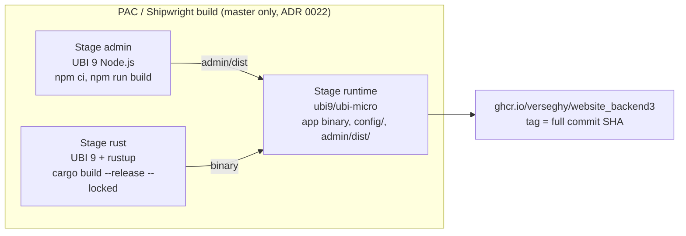

# 0004. Admin UI lives in admin/ and ships in the backend3 image

- Status: Accepted (2026-10-24)
- Decision questions: Q3

## Context

backend3 replaces the Backpack admin of `website_backend` with a React admin built on ra-core and shadcn-admin-kit. Someone has to build that UI, ship it and serve it. Four facts decide where it lives.

**Loco's client-side template cannot host the kit.**

| Package | Router requirement | Source |
|---|---|---|
| Loco 1.2.0 `frontend/` template | `react-router ^8.3.0` | research: SYNTHESIS §6.7 |
| ra-core 5.15.5 (peer dependency) | `react-router` / `react-router-dom ^6.28.1 \|\| ^7.1.1` | research: SYNTHESIS §6.7 |
| shadcn-admin-kit v2.0.0 registry | installs `react-router-dom@^7.1.1` | research: SYNTHESIS §6.15 |

Version 8 is outside ra-core's peer range. The Loco scaffold generator also writes TanStack Query pages into `frontend/src/` when `frontend/src/routes.tsx` exists. Those pages are not react-admin resources (research: SYNTHESIS §6.7; stack-loco-react-admin §1.7).

**Loco's `static` middleware is the wrong tool for an SPA with hashed assets.**

- It answers a missing file with the fallback file and status **200**, so a missing `app-1a2b.js` returns HTML. The browser then fails with a confusing MIME error.
- It sets one `cache_control` value for every file. An SPA needs `no-cache` on `index.html` and a long immutable lifetime on hashed assets.
- It sits outside the `cors`, `etag` and `compression` layers (research: SYNTHESIS §6.6, §6.7; loco-rs@1.2.0:src/controller/middleware/static_assets.rs).

**A separate repository is expensive here.** Each new website repo repeats the onboarding list: a PAC `Repository` CR, an Image Updater entry, an Argo CD Application, Prow branch protection, OWNERS, a ruleset bypass for the Prow app, and a `website_*` name for catalog discovery. A cross-origin admin also needs CORS with credentials and `Access-Control-Expose-Headers` for list counts (research: SYNTHESIS §1.16.2-§1.16.5, §6.20).

**The cost of one image is build time.** PAC builds use a cache-less `vfs` builder. Every admin-only change triggers a cold Rust release build of the whole binary. The projection is 51-77 min at 1 CPU (research: SYNTHESIS §1.8.3; gap-14 §5-§7). [ADR 0022](0022-builds-and-ci-pac-for-production-images-github-actions-for-p.md) deals with that cost through build capacity, not by splitting the repo.

Same-origin serving also matters for authentication. [ADR 0006](0006-admin-authentication-and-account-lifecycle.md) keeps the admin session in an httpOnly, Secure, `SameSite=Strict` cookie. That works without CORS only when the UI and the API share one origin, which [ADR 0014](0014-one-host-backend3-microshift-verseghy-gimnazium-net.md) provides: `backend3.microshift.verseghy-gimnazium.net` serves `/admin`, `/api/admin` and `/api/v1`.

## Decision

### 1. Repository layout

The admin UI is an npm project in `admin/` at the root of website_backend3. It has its own `package.json`, a committed `package-lock.json`, `tsconfig*.json` and `vite.config.ts`. Dependencies install with `npm ci`.

| Item | Choice |
|---|---|
| Scaffold | `shadcn` CLI, Vite template, preset `vega`, plus the kit's `admin` registry block. The bootstrap PR records the exact CLI version it used. |
| Stack (at bootstrap) | shadcn-admin-kit v2.0.0, ra-core 5.15.5 (the kit needs 5.15.2 or later), React 19, **react-router 7**, Vite 8, Tailwind 4, TypeScript |
| Rich text | the kit's `rich-text-input` block, extended as [ADR 0013](0013-rich-text-editor-and-html-sanitiser.md) decides |
| Not used | Loco's `frontend/` client-side template; `cargo loco generate scaffold` for UI pages; `ra-data-json-server` and `ra-data-simple-rest` |
| Data provider | a hand-written provider in `admin/src/` that maps ra-core calls onto backend3's admin API (research: DECISIONS 43a) |
| Generated types | ts-rs writes the DTO bindings into `admin/src/bindings/` ([ADR 0005](0005-rust-dtos-are-the-api-contract-ts-rs-utoipa-openapi.md)). They are committed and never edited by hand. |
| Agent files | `admin/AGENTS.md` as the kit registry writes it, plus `admin/CLAUDE.md` with project overrides ([ADR 0024](0024-ai-maintainability-instruction-files-the-loco-skill-guardrai.md)) |

backend3 itself is generated without Loco's client-side assets. `cargo loco generate` may be used for the Rust half of a feature only.

The kit ships as copied source files from a shadcn registry, not as an npm package (research: SYNTHESIS §6.15). Those MIT files keep their notice, indexed in `THIRD_PARTY.md` ([ADR 0012](0012-delivery-review-commits-and-licensing.md)).

### 2. Build into the backend3 image

The `Containerfile` has three stages. [ADR 0022](0022-builds-and-ci-pac-for-production-images-github-actions-for-p.md) sets the Rust rules.

- The Node stage runs `npm ci` and `npm run build` in `admin/`. It needs no Rust, because the ts-rs bindings are committed.
- The Node.js major version is written once in `admin/.node-version`. The Containerfile's Node ARG must match it, and CI checks that ([ADR 0022](0022-builds-and-ci-pac-for-production-images-github-actions-for-p.md)). Node 20 reached end of life in April 2026. Vite 8 needs Node 20.19+ or 22.12+. The bootstrap PR picks the newest LTS major that has a UBI 9 image.
- The Rust stage does not depend on the Node stage. The binary reads `admin/dist` from disk at run time and does not embed it.
- The runtime stage copies `admin/dist` to `/app/admin/dist`.

### 3. Serving: same origin, under `/admin`

backend3 serves the built UI with a hand-written router built from tower-http `ServeDir` and `ServeFile` plus a response-header layer. Loco already enables the tower-http `fs` and `set-header` features, so no new dependency is needed (research: SYNTHESIS §6.6).

- The router lives in `src/controllers/admin_ui.rs`. It is built from an explicit settings struct (the dist directory), following [ADR 0008](0008-code-layout-a-pure-src-domain-beside-loco-models.md).
- `src/app.rs` mounts it in `Hooks::before_routes`. In loco-rs 1.2.0 the router returned by `before_routes` receives Loco's routes and is then wrapped by Loco's whole middleware stack. So `/admin` responses get the same secure headers, request id, logging and compression as the API. Routers added in `Hooks::after_routes` get none of these layers (loco-rs@1.2.0:src/boot.rs `setup_routes`; research: SYNTHESIS §6.6).
- Loco's `static` middleware is disabled (`server.middlewares.static.enable: false`). Loco's `fallback` middleware, the development welcome screen, is disabled in every environment.
- Vite builds with `base: "/admin/"` and writes hashed files to `dist/assets/`, which is the Vite default naming.
- **The admin uses browser-history routing.** Outside a router, ra-core 5.15.5 creates a hash router (ra-core@5.15.5:src/routing/adapters/reactRouterProvider.tsx, `RouterWrapper`). With hash URLs the server never sees a client route, and the fallback rows below would test nothing. So `admin/src` wraps the ra-core admin root in a react-router 7 browser router. The `/admin` prefix is set once, as `basename="/admin"` on the admin root, and the router gets no basename of its own, so links are not prefixed twice. The bootstrap PR confirms in the ra-core 5.15.5 source and in the kit's admin component that this replaces the default hash router.
- **Client routes never put a dot in their last path segment.** The table below treats such a path as a file request, which answers 404 when no such file exists in `dist/`. The media library ([ADR 0015](0015-media-separate-static-server-media-library-image-optimisatio.md)) therefore passes folder and file paths as a query parameter, for example `/admin/media?path=uploads/posts`, never as path segments.

Request handling under `/admin`:

| Request (GET or HEAD) | Response | `Cache-Control` |
|---|---|---|
| `/admin`, `/admin/` | `dist/index.html`, 200 | `no-cache` |
| `/admin/assets/<file>` that exists | the file, 200 (304 on revalidation) | `public, max-age=31536000, immutable` |
| `/admin/assets/<file>` that does not exist | 404, short plain-text body, never `index.html` | `no-store` |
| `/admin/<name>.<ext>` that exists in `dist/` root (for example `favicon.ico`) | the file, 200 | `no-cache` |
| `/admin/<name>.<ext>` that does not exist | 404 | `no-store` |
| `/admin/<path>` whose last segment has no extension (client-side route, for example `/admin/posts/12/show`) | `dist/index.html`, 200 | `no-cache` |
| any other method | 405 | none |

Rules behind the table:

- The deciding question is whether the last path segment has a file extension. A pure function in `src/domain/` classifies the path. It has unit tests and proptests ([ADR 0008](0008-code-layout-a-pure-src-domain-beside-loco-models.md)).
- The `immutable` header goes only on successful responses (200, 206, 304). A 404 must never carry a one-year lifetime. During a rolling update the browser could otherwise cache the 404 for an asset that a newer pod does serve.
- Paths under `/api/admin` and `/api/v1` never fall back to `index.html`. An unknown API path returns the JSON error body of that API with status 404.
- Path traversal (`..`, encoded or not) never leaves `dist/`. `ServeDir` rejects such paths, and a test proves it.
- Compression comes from Loco's compression middleware. Precompressed `.br`/`.gz` files are not produced in release 1.
- The admin CSP and the rest of the security headers come from [ADR 0023](0023-operations-hardening-rate-limits-monitoring-backups-secrets.md) and apply to every `/admin` response.

### 4. Configuration and boot checks

- The dist directory is a typed setting in `config/<env>.yaml` under `settings`. Production uses `/app/admin/dist`. The test environment points at a small fixture directory in `tests/fixtures/admin-dist/` with a stub `index.html` and one hashed asset, so Rust tests never need a Node build.
- In production, the server refuses to start when the directory or its `index.html` is missing. The error names the configured path and the setting key. The check runs where the router is built, so tasks and CronJobs ([ADR 0016](0016-no-redis-in-memory-cache-postgres-queue-cronjob-tasks.md)) are not affected.
- In development, the Vite dev server serves the UI and proxies `/api` to `http://localhost:5150`. The browser sees one origin, so the `SameSite=Strict` cookie works the same as in production. The Rust server's `/admin` route is not needed in development.

### 5. What the admin does after a deploy

An editor's open tab keeps the old JavaScript after a new image goes live. Old hashed chunks no longer exist in the new image. The admin catches failed dynamic imports (chunk-load errors) and shows a Hungarian prompt to reload. It reuses the public site's wording, "Frissítés elérhető. Kérlek töltsd újra az oldalt!" ([ADR 0021](0021-hungarian-only-admin-ui.md)). Because `index.html` is `no-cache`, the reload fetches the new version.

## Consequences

Positive:

- One PR can change a DTO, its endpoint and its admin screen together. Binding drift fails CI ([ADR 0005](0005-rust-dtos-are-the-api-contract-ts-rs-utoipa-openapi.md), [ADR 0022](0022-builds-and-ci-pac-for-production-images-github-actions-for-p.md)).
- One image, one PAC Repository, one Image Updater entry and one Argo CD Application. The admin UI and the API it calls always deploy together.
- Same origin removes CORS, `Access-Control-Expose-Headers` and cross-site cookie work. `SameSite=Strict` covers CSRF for the admin ([ADR 0006](0006-admin-authentication-and-account-lifecycle.md)).
- The admin router sits inside Loco's middleware stack, so security headers are configured once.

Negative:

- Every admin-only change rebuilds the Rust binary from cold in PAC. [ADR 0022](0022-builds-and-ci-pac-for-production-images-github-actions-for-p.md) raises build capacity for this.
- backend3 now serves static files. The cost is small but real on the edge node.
- Whenever backend3 uses `RollingUpdate` ([ADR 0015](0015-media-separate-static-server-media-library-image-optimisatio.md)), even at one replica, old and new pods serve side by side for a short time. A new `index.html` from one pod can then request an asset that an old pod does not have. The chunk-load reload prompt covers this. Copying the previous release's assets into the image is not planned.
- Kit updates are manual. The registry copies source files, so an upgrade means re-adding the block and reviewing the diff.

What must be true in code and tests:

- Request tests cover every row of the routing table against the fixture directory. That includes `immutable` on a found asset, `no-store` on a missing asset, `no-cache` on `index.html` and on deep links, 405 for `POST /admin`, a JSON 404 for an unknown `/api/admin/...` path, and a traversal attempt.
- A request test checks that `/admin` responses carry the security headers from [ADR 0023](0023-operations-hardening-rate-limits-monitoring-backups-secrets.md). That proves the router is inside Loco's stack.
- A boot test checks the missing-`dist` error message.
- E2E tests (Playwright, [ADR 0022](0022-builds-and-ci-pac-for-production-images-github-actions-for-p.md)) load the built admin through backend3, not through the Vite dev server. They fail on any CSP violation reported in the browser console.
- An E2E test opens a record deep link (for example `/admin/posts/12/show`) and a media-library deep link (for example `/admin/media?path=uploads/posts`) directly, reloads each, and checks that the same screen comes back. This proves browser-history routing and the `index.html` fallback together.

Follow-up work:

- Bootstrap PR: create `admin/` with the shadcn CLI. Run it inside `admin/` and confirm that the registry's `~/AGENTS.md` target writes `admin/AGENTS.md` and leaves the root `AGENTS.md` alone. This behaviour is unverified (research: SYNTHESIS §6.28 U3, §8.9 O57).
- Bootstrap PR: choose the Node.js LTS major and its UBI 9 image, and pin it by digest.

## Alternatives considered

- **B. Loco's built-in `static` middleware, unchanged** (`folder.uri: /admin`, `precompressed: true`). Rejected: a missing asset returns 200 with the fallback file, and it sets one `Cache-Control` value for every file.
- **C. Monorepo, two images.** `admin/` would ship as its own unprivileged `ubi9/nginx-124` image from a second, path-filtered PipelineRun. Rejected: two images to version, promote and keep in step, a second Route or path split on the same host, and a PAC path filter whose support in the installed PAC version is unverified. Saving the Rust rebuild on admin-only changes does not outweigh this once build capacity is raised.
- **D. A separate `website_admin` repository** with its own nginx image and Route, and a CORS-enabled admin API. Rejected: the full onboarding list again, cross-origin cookies and CORS, and ts-rs bindings published as a package or synced by a job.
- **Loco's `frontend/` client-side template.** Rejected: it pins react-router 8, which is outside ra-core 5.15.5's peer range, and its scaffold writes non-react-admin pages.

## References

- research: DECISIONS 3, 14, 16, 43a
- research: QUESTIONS 3
- research: SYNTHESIS §1.8.3, §1.16.2-§1.16.5 (onboarding cost of a repo), §5.15.4 (the public site's update prompt), §6.6 (HTTP layer, `after_routes`), §6.7 (static middleware, client-side template), §6.15 (kit install model), §6.20 (data-provider contracts), §6.28 U3, §8.9 O57
- research: stack-loco-react-admin §1.7, §5 D-5, D-6
- research: gap-14 §5-§7 (build time)
- loco-rs@1.2.0:src/boot.rs (`setup_routes`: `before_routes`, `to_router`, `after_routes`)
- loco-rs@1.2.0:src/controller/app_routes.rs (`to_router` applies middleware to the routes present)
- loco-rs@1.2.0:src/controller/middleware/static_assets.rs
- tower-http@0.6.11:src/services/fs/serve_dir/mod.rs (`fallback`, `not_found_service`)
- ra-core@5.15.5:src/routing/AdminRouter.tsx, src/routing/adapters/reactRouterProvider.tsx (`RouterWrapper` creates a hash router when the app is not inside a router)
- Related: [ADR 0005](0005-rust-dtos-are-the-api-contract-ts-rs-utoipa-openapi.md), [ADR 0006](0006-admin-authentication-and-account-lifecycle.md), [ADR 0008](0008-code-layout-a-pure-src-domain-beside-loco-models.md), [ADR 0012](0012-delivery-review-commits-and-licensing.md), [ADR 0013](0013-rich-text-editor-and-html-sanitiser.md), [ADR 0014](0014-one-host-backend3-microshift-verseghy-gimnazium-net.md), [ADR 0015](0015-media-separate-static-server-media-library-image-optimisatio.md), [ADR 0021](0021-hungarian-only-admin-ui.md), [ADR 0022](0022-builds-and-ci-pac-for-production-images-github-actions-for-p.md), [ADR 0023](0023-operations-hardening-rate-limits-monitoring-backups-secrets.md), [ADR 0024](0024-ai-maintainability-instruction-files-the-loco-skill-guardrai.md)
