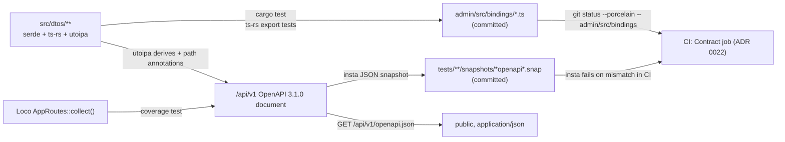

# 0005. Rust DTOs are the API contract (ts-rs + utoipa OpenAPI)

- Status: Accepted (2026-10-24)
- Decision questions: Q4

## Context

backend3 has two HTTP APIs on one host ([ADR 0014](0014-one-host-backend3-microshift-verseghy-gimnazium-net.md)):

| API | Prefix | Consumers | Change coupling |
|---|---|---|---|
| Admin API | `/api/admin` | the admin UI in `admin/` ([ADR 0004](0004-admin-ui-lives-in-admin-and-ships-in-the-backend3-image.md)) | same repo, same PR, same image |
| Public read API | `/api/v1` | the Angular site (website_frontend), later perhaps website_frontend2, and the planned Backstage API entity | other repos, other release cycles |

Each API needs one source of truth for its wire shapes. Without one, the Rust handlers, the TypeScript types and any published description drift apart. None of the ready-made routes fits as it is:

- **Loco 1.2.0 has no OpenAPI integration.** There is no `utoipa` dependency. The only mention is a docstring example in `src/controller/format.rs` (research: SYNTHESIS §6.6).
- **The official `loco-openapi` 0.1.2 targets an older Loco.** It requires `loco-rs ^0.16` and `utoipa ^5` (research: QUESTIONS 4; crates.io: loco-openapi 0.1.2 dependencies, <https://crates.io/crates/loco-openapi/0.1.2/dependencies>).
- **utoipa 6.0.0 and utoipa-axum 0.3.0** were released on 2026-09-22. utoipa-axum needs `axum ^0.8.4`. loco-rs 1.2.0 declares `axum = "0.8.1"`, a caret requirement, so one axum 0.8.x can satisfy both. Nobody has tried utoipa 6 with Loco's `Routes` yet (research: QUESTIONS 4; loco-rs@1.2.0:Cargo.toml).
- **utoipa 6 emits OpenAPI 3.1.0 by default.** 3.2.0 is opt-in (docs.rs: utoipa 6.0.0 `openapi::OpenApiVersion`).
- **ts-rs 12** is what Loco's own template uses for DTO-to-TypeScript bindings. The template derives `ts_rs::TS` on DTOs in `src/dtos/` and overrides `u64` fields to `number` (research: SYNTHESIS §6.1, §6.7; loco-rs 1.2.0 CLI template `src/dtos/common.rs`).
- **The house testing bar** comes from backend2: insta snapshots where "a snapshot change is an API change" (research: SYNTHESIS §7.6.9).
- **Planned consumers of a machine-readable document:** the platform checklist plans a Backstage `backend3-api` entity of `type: openapi`, and the REST draft already exists as an OpenAPI 3.1 document (research: SYNTHESIS §1.16.5, §5.16).

## Decision

### 1. The source of truth

Rust DTO types in `src/dtos/` are the contract. The one-day spike in section 5 proves that utoipa 6 works with Loco `Routes` before the first `/api/v1` slice merges. Every type that crosses the HTTP boundary is a DTO: request bodies, query and path parameters, response bodies and error bodies.

- Sea-ORM entities and models never serialize to a client. Handlers convert them into DTOs. This is also Loco's doctrine ([ADR 0008](0008-code-layout-a-pure-src-domain-beside-loco-models.md)).
- Public API types live in `src/dtos/v1/`. Admin API types live in `src/dtos/admin/`. Shared envelopes and error bodies have one definition per API.
- serde attributes are the only naming mechanism (`rename_all`, `rename`). ts-rs reads them through its `serde-compat` feature, and utoipa reads them as well. Field names are never repeated in a second place.

### 2. What each DTO derives

| DTO kind | Derives | Output |
|---|---|---|
| Admin API type | `serde`, `ts_rs::TS` with `#[ts(export, export_to = "../admin/src/bindings/")]` | `admin/src/bindings/<Type>.ts` |
| Public API response or body | `serde`, `utoipa::ToSchema` | a component schema in the OpenAPI document |
| Public API query or path parameters | `serde`, `utoipa::IntoParams` | parameters of the operation |
| Public API handler | `#[utoipa::path(...)]` on the function registered with Loco `Routes` | an operation in the document |
| Type used by both APIs (for example the event wall-time newtype, or a shared enum) | `serde`, `ts_rs::TS` and `utoipa::ToSchema` | both outputs, which must agree |

ts-rs is pinned at major 12 with `chrono-impl` and `serde-compat`, as in Loco's template. utoipa is pinned at major 6 with the features the DTOs need (for example `chrono`). `Cargo.lock` pins exact versions ([ADR 0024](0024-ai-maintainability-instruction-files-the-loco-skill-guardrai.md)).

### 3. Wire rules the generated types must follow

| Topic | Rule |
|---|---|
| 64-bit integers | ts-rs maps them to `bigint` by default. Every `i64`/`u64` field in a type that derives ts-rs carries `#[ts(type = "number")]`, as Loco's template does. Values must stay below 2^53. |
| Optional fields | `Option<T>` means "present, may be `null`". A field that can be absent needs an explicit serde skip attribute, and the snapshot shows the difference. ts-rs must show `T \| null`, and the schema must mark the field nullable. |
| Instants other than event start and end (admin API) | `DateTime<Utc>`, serialized by chrono's serde support as RFC 3339 in UTC. [ADR 0010](0010-all-instants-stored-as-timestamptz.md) owns the time policy. ts-rs must describe the field as `string`. |
| Instants other than event start and end (public API) | as [ADR 0010](0010-all-instants-stored-as-timestamptz.md) sets them: RFC 3339 in UTC with `Z`. A unit test pins the form. |
| Calendar dates (`posts.date`, canteen day `date`) | `YYYY-MM-DD` on both APIs ([ADR 0010](0010-all-instants-stored-as-timestamptz.md)). A unit test pins the form. |
| Event wall times (public and admin API) | a newtype that serializes as naive Europe/Budapest `YYYY-MM-DD HH:MM:SS` ([ADR 0010](0010-all-instants-stored-as-timestamptz.md)). It carries an explicit schema override (string with a pattern) and `#[ts(type = "string")]`. The same newtype is used in `src/dtos/v1/` and `src/dtos/admin/`, so ts-rs emits `string` and the admin never converts event times itself. The server converts in both directions. A unit test pins its serialized form. |
| Enums | serialized as strings through serde. Each generator that sees an enum must produce the literal union that serde emits. |
| Errors | error bodies are DTOs like any other and are documented on every operation that can return them. The public codes and envelope are set by [public-api.md](../public-api.md) §8. Admin API error bodies use the envelope, codes and status table of [ADR 0021](0021-hungarian-only-admin-ui.md) §4, with `ErrorCode` in `src/dtos/admin/`. |

### 4. Generated artefacts and drift checks

- **TypeScript bindings.** `cargo test` runs the export tests that ts-rs generates and rewrites `admin/src/bindings/`. The CI `Contract` job ([ADR 0022](0022-builds-and-ci-pac-for-production-images-github-actions-for-p.md)) runs them, then fails if `git status --porcelain -- admin/src/bindings` shows any change or untracked file.
- **OpenAPI document.** One function builds the `/api/v1` document from a utoipa `OpenApi` derive that lists the public operations. The version string is `3.1.0`, utoipa 6's default. An insta JSON snapshot of the whole document is committed. A snapshot change is an API change: the PR must say so and use the `api` commit scope ([ADR 0012](0012-delivery-review-commits-and-licensing.md)).
- **Serving.** `GET /api/v1/openapi.json` returns the same document with `Content-Type: application/json` and `Cache-Control: no-cache`. A request test checks that the served bytes match the snapshot.
- **Route coverage, both directions.** A test collects `(method, path)` pairs under `/api/v1` from Loco's route table (`AppRoutes::collect()`, the same data `cargo loco routes` prints). It fails when a route is missing from the document, and when the document lists an operation that has no route. The document route itself is the only exception. axum 0.8 and OpenAPI both write path parameters as `{id}`, so the paths compare directly.
- **Response shapes.** Public API request tests validate each response body against the component schema that the document declares for it. This catches schema overrides that do not match what serde emits.
- **License and source.** The document's `info.license` is `AGPL-3.0-only`, and `info` links to the public repository ([ADR 0012](0012-delivery-review-commits-and-licensing.md), AGPL-3.0 section 13).
- **Versioning.** `info.version` is the contract version and starts at `1.0.0`. Additions bump the minor, by hand, in the same PR as the snapshot. A breaking change to `/api/v1` needs either a coordinated change with website_frontend ([ADR 0003](0003-cut-over-one-rehearsed-flip-then-a-read-only-parallel-run.md)) or a new `/api/v2` prefix.

The admin API has no OpenAPI document in release 1. Its contract is the ts-rs bindings, checked by the same drift job and by admin type-checking. The same utoipa machinery can describe it later if a second consumer appears.

### 5. The one-day spike

The spike runs right after the bootstrap PR and before the first `/api/v1` slice. Its time box is one working day.

Scope: one spike PR on backend3, on loco-rs `=1.2.0` and the pinned toolchain ([ADR 0022](0022-builds-and-ci-pac-for-production-images-github-actions-for-p.md)), with utoipa 6 and two public endpoints registered through Loco `Routes`:

- `GET /api/v1/posts`: query parameters, a cursor, the list envelope and nested DTOs
- `GET /api/v1/posts/{id}`: a path parameter, an optional query token and a 404 error body

Pass criteria. All must hold:

| # | Criterion |
|---|---|
| P1 | It compiles with loco-rs 1.2.0. `cargo tree -d` shows a single `axum` 0.8.x and a single `http` 1.x. |
| P2 | `#[utoipa::path]` handlers register through Loco `Routes` without patching or forking Loco and without changing its middleware stack. |
| P3 | The document is valid OpenAPI 3.1.0 according to an independent validator. Paths include the `/api/v1` prefix. |
| P4 | For each spike DTO, the JSON the handler emits and the utoipa schema agree on names, optionality, nullability and types. This includes a 64-bit id, an `Option` field and the naive wall-time newtype. For the newtype, which admin DTOs share, the ts-rs type is `string` as well. |
| P5 | The route-coverage test works in both directions against `AppRoutes::collect()`. |

Measurements (recorded, not pass/fail): the cold release-build CPU seconds with and without utoipa, measured the gap-14 way (CPU seconds of `cargo build --release` from an empty `target/`), and the crate-count delta. If CPU time grows by more than 10 %, the spike PR says so, and the cost is handled under [ADR 0022](0022-builds-and-ci-pac-for-production-images-github-actions-for-p.md)'s build-capacity rule (section 1, "If the build is too slow"). It does not by itself fail the spike.

utoipa-axum's `OpenApiRouter` is not part of the plan. It builds its own axum router, which Loco's route table would not see. The spike tries it only if `#[utoipa::path]` with Loco `Routes` fails P2. The result is evidence for the Proposed ADR below. The spike cannot adopt `OpenApiRouter` on its own.

**On success:** the spike PR records the measurements in its description and in a short spec note under `docs/`. It merges only the reusable parts: the OpenAPI builder function, the snapshot test, the served-document test, the route-coverage test and the spec note. The two spike endpoints are removed before the merge, and the first `/api/v1` slice adds them again with full tests. The decision does not change, so this ADR is not edited ([ADR 0001](0001-record-architecture-decisions.md) section 6).

**On failure** (a criterion P1-P5 that cannot be fixed within the day): stop. The spike PR records which criteria failed and why, and is closed without merging. An agent writes a Proposed ADR that names the failing criterion, with evidence, and asks the maintainer ([ADR 0001](0001-record-architecture-decisions.md) section 6). No `/api/v1` slice merges until the maintainer answers. The candidates for that ADR are option B (a hand-maintained `docs/openapi.yaml`, embedded at compile time and served at `GET /api/v1/openapi.json`, checked by the response-shape and route-coverage tests) and utoipa-axum's `OpenApiRouter`. Neither is adopted without that answer. If the maintainer accepts one, the new ADR amends sections 2 and 4 of this one, and this ADR's Status line reads "Amended by NNNN".

Admin slices are not blocked by a failed spike: the ts-rs half of this decision does not depend on utoipa.

## Consequences

Positive:

- Each shape has one compile-checked definition. TypeScript types, the published document and the handlers cannot drift without a red CI check.
- The admin gets real types for every request and response, and the `tsc` type-check catches mismatches ([ADR 0022](0022-builds-and-ci-pac-for-production-images-github-actions-for-p.md)).
- The public API gets a machine-readable contract for website_frontend, a later frontend2 port and Backstage.

Negative:

- Every public DTO carries three sets of derives and attributes. Mistakes in schema overrides are possible; response-shape validation exists to catch them.
- utoipa 6 is new, and the version pairing with Loco is untested until the spike.
- Proc-macro derives add build time on the cache-less PAC builder. The spike measures this; [ADR 0022](0022-builds-and-ci-pac-for-production-images-github-actions-for-p.md) handles it.

What must be true in code and tests:

- No handler returns an entity or model type. Review enforces this; Loco's doctrine ranks it as the worst smell ([ADR 0008](0008-code-layout-a-pure-src-domain-beside-loco-models.md)).
- Every `i64`/`u64` field in an admin DTO has the `number` override. A unit test over the generated bindings fails on any `bigint`.
- The snapshot, served-document and route-coverage tests merge with the spike, before the first public endpoint. Each public endpoint merges together with its response-shape test.
- Binding files carry ts-rs's "do not edit" header. The admin's lint and format configs ignore `src/bindings/`.

Follow-up work:

- Run the spike and record its result as described in section 5.
- Keep the OpenAPI document equal to [public-api.md](../public-api.md): a change to either lands in the same PR as the DTOs, the snapshot and the specification tests (public-api.md, "Which source wins").
- website_k8s: add the Backstage API entity `backend3-api` (`type: openapi`) pointing at the served document. Under the merge rules, that PR is left for human review (research: DECISIONS R2).

## Alternatives considered

- **B. A hand-written `docs/openapi.yaml` is the contract**, with responses validated against it and ts-rs for the admin only. Not chosen: the document is a second, hand-kept copy of the shapes. It is the first candidate offered to the maintainer if the spike fails (section 5).
- **C. ts-rs only.** No OpenAPI and no Backstage API entity. Rejected: the public API has consumers outside this repo and needs a published contract.
- **D. OpenAPI is the source**, and `openapi-typescript` generates the admin types instead of ts-rs. Rejected: the Rust code would have to be written to match a document instead of the document coming from the compiled code. It also drops the ts-rs pipeline that Loco's template already uses.
- **`loco-openapi` 0.1.2.** Rejected: it requires `loco-rs ^0.16` and utoipa 5.

## References

- research: DECISIONS 3, 4, 9, 44, R2
- research: QUESTIONS 3, 4
- research: SYNTHESIS §1.16.5 (Backstage API entity), §5.16 (REST draft and DEC register), §6.1 (versions), §6.6 (no OpenAPI in Loco), §6.7 (ts-rs export in the template), §6.10 (DTO envelope), §7.6.9 (house testing bar)
- research: gap-10 §9 (REST implementation notes), gap-14 §6.2 (build-cost method)
- loco-rs@1.2.0:Cargo.toml (`axum = "0.8.1"`)
- loco-rs@1.2.0:src/controller/app_routes.rs (`AppRoutes::collect`)
- loco 1.2.0 CLI template: `base_template/src/dtos/common.rs.t` (`#[ts(type = "number")]` on `u64`)
- docs.rs: utoipa 6.0.0, `utoipa::openapi::OpenApiVersion` (3.1.0 default, 3.2.0 opt-in): <https://docs.rs/utoipa/6.0.0/utoipa/openapi/enum.OpenApiVersion.html>
- docs.rs: utoipa-axum 0.3.0 (`OpenApiRouter`, `routes!`): <https://docs.rs/utoipa-axum/0.3.0/utoipa_axum/>
- crates.io: loco-openapi 0.1.2 dependencies (`loco-rs ^0.16`, `utoipa ^5.0.0`, `utoipa-axum ^0.2.0`): <https://crates.io/crates/loco-openapi/0.1.2/dependencies>
- [public-api.md](../public-api.md): "Which source wins", §8 (errors), §12 (DEC-1 to DEC-18)
- Related: [ADR 0003](0003-cut-over-one-rehearsed-flip-then-a-read-only-parallel-run.md), [ADR 0004](0004-admin-ui-lives-in-admin-and-ships-in-the-backend3-image.md), [ADR 0008](0008-code-layout-a-pure-src-domain-beside-loco-models.md), [ADR 0010](0010-all-instants-stored-as-timestamptz.md), [ADR 0012](0012-delivery-review-commits-and-licensing.md), [ADR 0014](0014-one-host-backend3-microshift-verseghy-gimnazium-net.md), [ADR 0022](0022-builds-and-ci-pac-for-production-images-github-actions-for-p.md), [ADR 0024](0024-ai-maintainability-instruction-files-the-loco-skill-guardrai.md)
