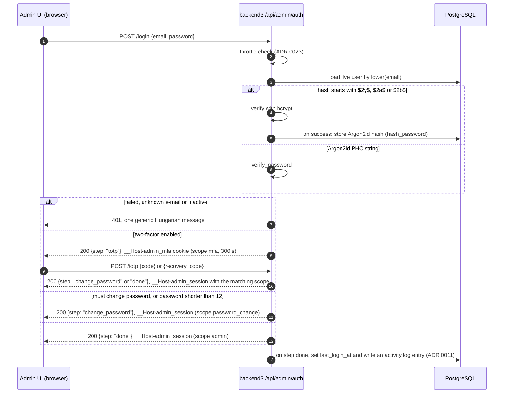
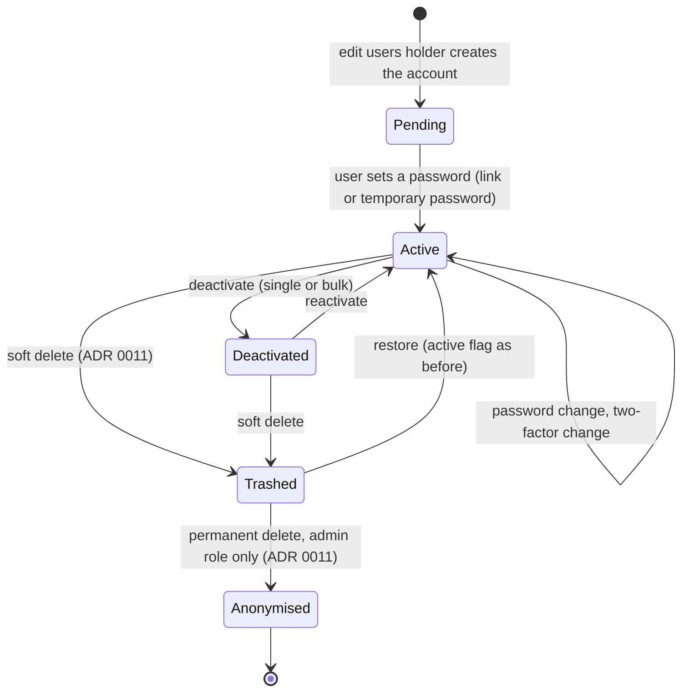

# 0006. Admin authentication and account lifecycle

- Status: Accepted (2026-10-24)
- Decision questions: Q5, Q10a, Q10b, Q10c, Q10d, Q10e (10e was added during the design review; it has no entry in the question list)

## Context

backend3 replaces backend1's admin login. The admin UI, the admin API and the public API share one host ([ADR 0014](0014-one-host-backend3-microshift-verseghy-gimnazium-net.md)), and the admin stays reachable from the internet ([ADR 0023](0023-operations-hardening-rate-limits-monitoring-backups-secrets.md)). These facts shape the design:

| Fact | Number or detail | Source |
|---|---|---|
| Accounts to carry over | 40 accounts. All hold Laravel bcrypt hashes (`$2y$10$`). They were created between 2018 and 2026 (2018: 1, 2019: 7, 2020: 12, 2021: 4, 2022: 2, 2024: 12, 2026: 2) | research: SYNTHESIS §3.2.4, §4.3.8 |
| Who the editors are | Staff publishers and secretaries, plus student writers who change from year to year. 30 of the 44 role assignments are `writer` | research: DECISIONS 10d; research: SYNTHESIS §3.3.2 |
| Loco password hashing | `loco_rs::hash::hash_password` and `verify_password` use Argon2id only. loco-rs has no bcrypt dependency. A probe on 2026-10-24 showed that a Laravel `$2y$10$` hash verifies as `false` | research: SYNTHESIS §6.3.2, §6.4; loco-rs@1.2.0:src/hash.rs |
| Loco JWT | HMAC only (HS512 by default). The secret must be base64. The starter template's expiry is 604,800 s (7 days) | research: SYNTHESIS §6.4; loco-rs@1.2.0:src/auth/jwt.rs |
| Token location | `auth.jwt.location` takes one source (`Bearer`, `Query { name }`, `Cookie { name }`) or a list tried in order, for example Cookie then Bearer | research: SYNTHESIS §6.4; loco-rs@1.2.0:src/config/auth.rs |
| Per-request user lookup | `auth::JWTWithUser<T>` loads the user on every request through `Authenticable::find_by_claims_key`. A miss answers 401 | research: SYNTHESIS §6.4 |
| What Loco 1.2.0 lacks | No CSRF protection, no SameSite handling, no server-side sessions and no token revocation. Signed-cookie sessions exist only on unreleased master (loco-rs#1884) | research: QUESTIONS Q5, SYNTHESIS §6.2 |
| Starter auth routes | `register`, e-mail verification, `forgot`/`reset` by mail and magic links. All of them need outbound mail | research: SYNTHESIS §6.4 |
| Mail | The website platform has no outbound mail service, and the decision is not to add one | research: SYNTHESIS §3.2.3; research: DECISIONS 10b |
| Session length today | backend1 sessions last 120 minutes | website_backend@0dead98:config/session.php |
| Single sign-on | iam signs ES256 tokens, which Loco's HMAC-only extractor cannot validate, and iam has no deployment the website can reach. Whether the school has an identity provider was not researched | research: SYNTHESIS §7.4 |
| Content in the admin | The admin loads rich HTML: legacy bodies with tables and embedded iframes (20 iframes in 19 published posts), and later anything editors paste | research: SYNTHESIS §3.8.3; [ADR 0013](0013-rich-text-editor-and-html-sanitiser.md) |

Two consequences follow. A session token must not be readable by page scripts, because the admin renders rich HTML and an injection is never fully ruled out. And account recovery must work without e-mail, for a user base that turns over every school year.

## Decision

### 1. Session token

backend3 keeps Loco's JWT and its user extractor. It stores the token in a cookie that page scripts cannot read.

| Setting | Value |
|---|---|
| Algorithm and secret | Loco default HS512. The secret is a base64 value of at least 64 random bytes from the shared `backend-secrets` ExternalSecret ([ADR 0023](0023-operations-hardening-rate-limits-monitoring-backups-secrets.md)). It never appears in `config/*.yaml` or in the image |
| Lifetime (`auth.jwt.expiration`) | 7,200 s (2 hours) |
| Token location (`auth.jwt.location`) | A list: `Cookie` (name below) first, then `Bearer` |
| Cookie name | `__Host-admin_session`. The `__Host-` prefix makes the browser refuse the cookie unless it is `Secure`, has `Path=/` and has no `Domain`. Sibling hosts under `*.microshift.verseghy-gimnazium.net` therefore cannot set or overwrite it |
| Cookie attributes | `HttpOnly; Secure; SameSite=Strict; Path=/; Max-Age=7200` |
| Claims | Loco's `pid` (the user's UUID, [ADR 0009](0009-clean-domain-schema-with-preserved-integer-ids.md)) and `exp`, plus custom claims: `tv` (the user's token version), `scope` (`admin`, `password_change` or `mfa`) and `auth_time` (when the password step succeeded) |
| Sliding refresh, passive | When a request with a valid `admin`-scope token arrives and less than 3,600 s of the token's lifetime remain, the response sets a new cookie that expires 2 hours later. The 3,600 s threshold applies only to this path |
| Sliding refresh, explicit | `POST /api/admin/auth/refresh` always sets a new cookie that expires 2 hours later. The admin UI calls it on user activity (typing or clicking) whenever at least 10 minutes have passed since its previous call, so a long editing session without saves stays signed in |
| Absolute limit | Neither refresh path sets an expiry later than `auth_time` plus `admin_auth.session_absolute_max_secs` (default 43,200 s, 12 hours; section 8). After that the user signs in again |
| Idle result | The session ends between 1 h 50 min and 2 h after the last user activity, unless the absolute limit ends it earlier: the last explicit refresh happened less than 10 minutes before that activity, and no refresh sets an expiry more than 2 hours after its request. The next request after expiry answers 401 |

backend3 wraps Loco's `JWTWithUser<users::Model>` in its own admin extractor. After Loco has checked the signature and expiry and loaded the user, the extractor rejects the request with 401 when any of these holds:

- the user is soft-deleted (`deleted_at` is set, [ADR 0011](0011-safety-net-soft-delete-revisions-and-an-activity-log-for-eve.md));
- the user is inactive (`active = false`);
- the token's `tv` differs from `users.token_version`;
- the token's `scope` is not the scope the route accepts.

The extractor takes the database connection and the clock as explicit arguments in its checking function, so the checks are unit-testable ([ADR 0008](0008-code-layout-a-pure-src-domain-beside-loco-models.md)).

### 2. Revocation with `token_version`

`users.token_version` is an integer, starting at 0. backend3 increments it on each of the events below. Every token that carries the old value stops working on its next request.

| Event | Who triggers it | Current session |
|---|---|---|
| Logout (`POST /api/admin/auth/logout`, POST only) | the user | ended; the cookie is cleared with `Max-Age=0` |
| Own password change | the user | gets a new cookie with the new version |
| Password reset by link or temporary password | an `edit users` holder issues it (section 5) | the target's sessions end at issue time |
| Deactivation, soft delete | an `edit users` holder | the target's sessions end |
| Two-factor enabled, disabled or reset | the user, or an `edit users` holder for a reset | when users change their own two-factor, their current session gets a new cookie; every other session of the account ends |

Logout therefore signs the user out on every device. Role and permission changes need no version bump: the extractor loads the user, roles and extra grants on every request ([ADR 0007](0007-authorization-four-roles-enforced-on-every-operation.md)), so a change applies on the next request.

### 3. CSRF and the Bearer path for scripts

- The admin cookie is `SameSite=Strict` and the admin UI is served from the same origin ([ADR 0004](0004-admin-ui-lives-in-admin-and-ships-in-the-backend3-image.md), [ADR 0014](0014-one-host-backend3-microshift-verseghy-gimnazium-net.md)), so browsers do not send the cookie on cross-site requests.
- `SameSite` does not separate hosts under `verseghy-gimnazium.net`, because they all belong to the same site. A request from a sibling host, such as the public site at `https://verseghy-gimnazium.net`, still carries the cookie.
- backend3 therefore rejects any cookie-authenticated `POST`, `PUT`, `PATCH` or `DELETE` whose `Origin` header names a different origin (403). Against cross-site requests this check is a second layer. Against sibling hosts it is the control, so it is mandatory.
- Scripts authenticate with a Bearer token. `POST /api/admin/auth/token` takes the e-mail address, password and, when the account has two-factor enabled, a TOTP code. It returns `{token, expires_at}` in the body. The token has the same 2-hour lifetime, the same `tv` check and the same permission checks. It is not refreshed, so scripts sign in again. `/auth/token` issues only `admin`-scope tokens and never a `password_change` or `mfa` token. When the password and, if enabled, the TOTP code are correct but a browser sign-in would yield a `password_change` session (section 4), it answers 403 `password_change_required`; the account's owner first sets a new password through the browser. Requests with a Bearer token are exempt from the `Origin` check, because browsers never attach Bearer tokens on their own.
- A script uses its own account with the smallest role it needs. That account's password lives in the secret store, never in a repository.
- The browser login endpoint never returns the token in the response body.

### 4. Login

Rules:

- **Order of steps.** Password first, then TOTP when two-factor is on, then the forced password change when one is due. A temporary password or reset link never skips the TOTP step.
- **Legacy hashes.** The importer copies each Laravel hash unchanged into `users.password_hash` ([ADR 0017](0017-legacy-data-import-normalisation-and-defect-resolution.md)). On a successful login with a bcrypt hash, backend3 verifies the password with the `bcrypt` crate (the same crate iam uses), then immediately replaces the hash with `hash_password` output (Argon2id with the argon2 crate's default parameters). Accounts that never sign in keep their bcrypt hash; the users list shows them as "never signed in to backend3" through `last_login_at` (section 7).
- **Same answer for every failure.** A wrong password, an unknown e-mail address, a deactivated account and a soft-deleted account all get the same 401 status, the same Hungarian message and a password verification of comparable cost (a dummy hash is verified when no user matches).
- **Throttling** of login, TOTP and reset-token attempts, per IP address and per account, with lockout and backoff, is specified in [ADR 0023](0023-operations-hardening-rate-limits-monitoring-backups-secrets.md).
- **`last_login_at`** is set only when the full `admin`-scope session is issued, that is after the TOTP step when two-factor is on.
- **Restricted scopes.** A `password_change` token is accepted only by `GET /api/admin/auth/me`, `POST /api/admin/auth/change-password` and `POST /api/admin/auth/logout`. An `mfa` token is accepted only by `POST /api/admin/auth/totp`.
- **The TOTP step reads its own cookie.** The token location of section 1 reads only `__Host-admin_session` and the Bearer header, so Loco never sees `__Host-admin_mfa`. `POST /api/admin/auth/totp` therefore does not use the admin extractor. It reads the `__Host-admin_mfa` cookie itself and validates its signature and `exp` with the same JWT secret. It requires `scope = mfa` and a `tv` equal to `users.token_version`, and checks that the user is live and active. The `Origin` check of section 3 applies to it. On success it clears the mfa cookie (`Max-Age=0`) and sets `__Host-admin_session`. The mfa cookie has the same attributes as the session cookie, with `Max-Age=300`.
- **Starter routes are not mounted.** backend3 does not mount Loco's starter `register`, `verify`, `forgot`, `reset`, `magic-link` or `resend-verification-mail` routes, and does not create the starter's e-mail-verification, magic-link or `api_key` columns. Accounts are created only by `edit users` holders ([ADR 0007](0007-authorization-four-roles-enforced-on-every-operation.md)) and by the account-creation task of parity item AUTH-09 ([parity.md](../parity.md)), which an operator runs on a fresh development or staging database. In production the first accounts come only from the import ([ADR 0003](0003-cut-over-one-rehearsed-flip-then-a-read-only-parallel-run.md)).

The endpoint paths in this ADR show the intended shape. The OpenAPI document generated from the Rust DTOs ([ADR 0005](0005-rust-dtos-are-the-api-contract-ts-rs-utoipa-openapi.md)) is authoritative.

### 5. Recovery without e-mail

An `edit users` holder can issue one of two credentials from a user's page. backend3 generates both; nobody types a password for another person.

| Credential | Hungarian label | How it works |
|---|---|---|
| One-time reset link | "Jelszó-visszaállító link" | 32 random bytes, URL-safe base64. backend3 stores only its SHA-256 hash, the expiry (`admin_auth.reset_link_ttl_secs`, default 24 hours), the issuer and when it was used (`password_reset_tokens`, section 7). The link carries the token in the URL fragment (`/admin/jelszo-visszaallitas#token=<token>`), which browsers never send to the server, so it stays out of server and router access logs; the admin UI posts it to `POST /api/admin/auth/reset-password` with the new password. The token works once. Issuing a new link or a temporary password voids the previous one |
| Temporary password | "Ideiglenes jelszó" | 16 characters from an alphabet without look-alike characters. Stored as an Argon2id hash in `users.password_hash` with `must_change_password = true` and an expiry of `admin_auth.temp_password_ttl_secs` (default 72 hours). The first login with it yields only a `password_change` session |

In both cases the admin sees the credential once and hands it over in person or through a school channel. Issuing either one increments the target's `token_version` and writes an activity log entry ([ADR 0011](0011-safety-net-soft-delete-revisions-and-an-activity-log-for-eve.md)). Using a reset link, or replacing a temporary password, clears `must_change_password` and increments `token_version` again.

A new account starts with no password (`password_hash` is NULL). The create form asks the admin to issue a reset link or a temporary password right away.

**Clear sign-in lock ("Zárolás feloldása").** An `edit users` holder can clear an account's sign-in lock ([ADR 0023](0023-operations-hardening-rate-limits-monitoring-backups-secrets.md)) from the user's page. It writes an `account_unlocked` activity entry ([ADR 0011](0011-safety-net-soft-delete-revisions-and-an-activity-log-for-eve.md)) and changes nothing else on the account.

Extra guard ([ADR 0007](0007-authorization-four-roles-enforced-on-every-operation.md) §6): issuing a credential for, resetting two-factor of, clearing the sign-in lock of, or deactivating an account that holds the `admin` role requires the `admin` role.

### 6. Passwords and two-factor authentication

**Password rule.** One rule applies on every path that sets a password: reset link, temporary-password change, own password change.

| Rule | Value |
|---|---|
| Minimum length | 12 characters, counted as Unicode scalar values after NFC normalisation (so `á` counts once, however it was typed) |
| Maximum length | 128 characters, to bound hashing cost |
| Composition rules, forced periodic change | none |
| Existing short passwords | A legacy password shorter than 12 characters still verifies once, but that login yields only a `password_change` session (`admin_auth.force_change_short_legacy_password`, default on; section 8) |
| Own password change | requires the current password |

The rule is a pure function in `src/domain/` with unit and property tests ([ADR 0008](0008-code-layout-a-pure-src-domain-beside-loco-models.md)). The admin UI shows the same limit, read from the generated types ([ADR 0005](0005-rust-dtos-are-the-api-contract-ts-rs-utoipa-openapi.md)).

**Two-factor (TOTP).** Every account can turn it on from its own account page ("Kétlépcsős azonosítás"). It is optional for every account and mandatory for none.

| Item | Value |
|---|---|
| Algorithm | TOTP (RFC 6238) over HOTP (RFC 4226): HMAC-SHA-1, 6 digits, 30 s step. These are the settings common authenticator apps support |
| Clock skew | the previous, current and next step are accepted |
| Replay | backend3 stores the last accepted step per user and rejects a code for that step or an earlier one |
| Secret | 20 random bytes (160 bits). Shown once during set-up as an `otpauth://` URI (QR code) and as base32 text |
| Secret at rest | AES-256-GCM. Each encryption uses a fresh random 96-bit nonce and the user's `id` (8 bytes, big-endian) as associated data, so a ciphertext copied into another row fails to decrypt. `users.totp_secret_encrypted` (`bytea`) holds the 12-byte nonce, the 20-byte ciphertext and the 16-byte tag, concatenated (48 bytes). A database dump alone does not reveal TOTP secrets |
| Encryption key | The 32-byte cipher key is derived with HKDF-SHA-256 (RFC 5869, no salt, info string `backend3 totp-secret v1`) from the `backend3-totp-key` secret: base64 of at least 64 random bytes, 1Password item `backend3-totp-key/password`, separate from the JWT secret ([ADR 0023](0023-operations-hardening-rate-limits-monitoring-backups-secrets.md) §11). `config/production.yaml` reads it from the environment variable `TOTP_ENCRYPTION_KEY` with `get_env`. The TOTP module receives the derived key as an explicit argument ([ADR 0008](0008-code-layout-a-pure-src-domain-beside-loco-models.md)). Startup fails with a message naming the key when it is missing, is not valid base64 or decodes to fewer than 64 bytes |
| Key rotation | The production key is new at go-live and was never used on staging ([ADR 0023](0023-operations-hardening-rate-limits-monitoring-backups-secrets.md) §11). No account enrols before go-live (research: DECISIONS 42), so no stored secret needs re-encrypting then. A later rotation runs a re-encrypt task that decrypts every stored secret with the old key and encrypts it with the new key in one transaction; the runbook describes the procedure. Rotating this key signs nobody out |
| Enrolment | two-factor turns on only after the user confirms one valid code |
| Recovery codes | 10 single-use codes of 10 characters each, shown once at enrolment ("Helyreállító kódok"). Stored as Argon2id hashes. Each use is marked and logged. The user can generate a new set with the password and a current code; the old set stops working, and a `recovery_codes_regenerated` activity entry records it |
| Turning it off | from the own account page, with the password and a current code or a recovery code |
| Lost device and lost codes | an `edit users` holder resets two-factor for the user (this clears the secret and the codes). The user can enrol again |

TOTP verification is a pure function of secret, code, last accepted step and the current time, which is passed in. Unit tests use the RFC 6238 Appendix B test vectors.

### 7. Account lifecycle

"Pending" is not a stored state. It means `active AND password_hash IS NULL AND deleted_at IS NULL AND anonymised_at IS NULL`. "Anonymised" is marked by `anonymised_at` (see the table below).

| Field or feature | Behaviour |
|---|---|
| `active` (boolean, default true) | An inactive user cannot sign in, and every existing token is rejected. Hungarian labels: "Aktív", "Deaktiválás", "Aktiválás" |
| Bulk deactivate | The users list supports selecting rows and "Deaktiválás". Each user gets `active = false`, a `token_version` increment and an activity log entry; the entries share the request id |
| `last_login_at` (timestamptz, NULL until the first login, [ADR 0010](0010-all-instants-stored-as-timestamptz.md)) | Shown in the users list as "Utolsó belépés", sortable. The list can be filtered by "never signed in" and by "last sign-in before a date". This is how stale accounts, such as last year's student writers, are found and switched off |
| Authorship and history | Deactivated, trashed and anonymised users keep every `created_by` and `updated_by` reference, every revision they authored and every activity entry. Anonymisation deletes only the revisions of their own user record and clears the IP address of their own sign-in and account entries ([ADR 0011](0011-safety-net-soft-delete-revisions-and-an-activity-log-for-eve.md) §6). Deactivated and trashed users still show their name, marked as inactive |
| Own account ("Fiókom") | Every active user can change their name, change their e-mail address (with the current password), change their password, and manage two-factor. No permission is needed |
| Safety guards ([ADR 0007](0007-authorization-four-roles-enforced-on-every-operation.md)) | Nobody can deactivate, delete or change the roles of their own account. The last active holder of the `admin` role cannot be deactivated, deleted or lose that role |
| Anonymised (`anonymised_at` set) | Permanent delete sets it ([ADR 0011](0011-safety-net-soft-delete-revisions-and-an-activity-log-for-eve.md) §6). The row keeps `deleted_at`, has `active = false`, and cannot be restored. It does not appear in the trash. Two CHECK constraints enforce this shape (below) |

**Import ([ADR 0017](0017-legacy-data-import-normalisation-and-defect-resolution.md)).** All 40 accounts are imported with their ids preserved and a new UUID `pid`. Each keeps its bcrypt hash and starts with `active = true`, `last_login_at = NULL`, `token_version = 0` and two-factor off. Roles and the 4 direct permission grants are mapped as described in [ADR 0007](0007-authorization-four-roles-enforced-on-every-operation.md). The importer drops the orphaned role assignment, the `remember_token` column and the `password_resets` table.

**The `users` table and its two side tables.** This ADR defines them. [ADR 0009](0009-clean-domain-schema-with-preserved-integer-ids.md) lists them under its naming and key conventions, and the types follow [ADR 0009](0009-clean-domain-schema-with-preserved-integer-ids.md) and [ADR 0010](0010-all-instants-stored-as-timestamptz.md).

| Column of `users` | Type | Rule |
|---|---|---|
| `id` | `bigint` identity primary key | legacy ids preserved ([ADR 0009](0009-clean-domain-schema-with-preserved-integer-ids.md)) |
| `pid` | `uuid NOT NULL UNIQUE` | the JWT claim key (section 1) |
| `email` | `text NULL` | unique on `lower(email)` across all rows, trashed ones included ([ADR 0009](0009-clean-domain-schema-with-preserved-integer-ids.md)); NULL only on anonymised rows |
| `name` | `text NOT NULL` | |
| `password_hash` | `text NULL` | an Argon2id PHC string, or the legacy bcrypt string until the first login; NULL while pending and after anonymisation |
| `must_change_password` | `boolean NOT NULL DEFAULT false` | set with a temporary password (section 5) |
| `temp_password_expires_at` | `timestamptz NULL` | the temporary password's expiry |
| `token_version` | `integer NOT NULL DEFAULT 0` | section 2 |
| `active` | `boolean NOT NULL DEFAULT true` | |
| `last_login_at` | `timestamptz NULL` | NULL until the first backend3 login |
| `totp_secret_encrypted` | `bytea NULL` | the encrypted TOTP secret (section 6) |
| `totp_enabled_at` | `timestamptz NULL` | NULL while two-factor is off |
| `totp_last_step` | `bigint NULL` | the last accepted TOTP step |
| `anonymised_at` | `timestamptz NULL` | set by permanent delete ([ADR 0011](0011-safety-net-soft-delete-revisions-and-an-activity-log-for-eve.md) §6) |
| `created_at`, `created_by`, `updated_at`, `updated_by`, `deleted_at`, `deleted_by` | per [ADR 0011](0011-safety-net-soft-delete-revisions-and-an-activity-log-for-eve.md) §2 | |

Two CHECK constraints fix the shape of an anonymised row:

- `CHECK (email IS NOT NULL OR anonymised_at IS NOT NULL)`;
- `CHECK (anonymised_at IS NULL OR (email IS NULL AND password_hash IS NULL AND totp_secret_encrypted IS NULL AND NOT active AND deleted_at IS NOT NULL))`.

| Column of `password_reset_tokens` | Type | Rule |
|---|---|---|
| `id` | `bigint` identity primary key | |
| `user_id` | `bigint NOT NULL`, foreign key to `users.id` | the account the link is for |
| `token_sha256` | `bytea NOT NULL UNIQUE` | the SHA-256 of the token; the token itself is never stored |
| `expires_at` | `timestamptz NOT NULL` | issue time plus `admin_auth.reset_link_ttl_secs` |
| `issued_by` | `bigint NULL`, foreign key to `users.id` | the `edit users` holder who issued it |
| `used_at` | `timestamptz NULL` | set when the link is redeemed |
| `created_at` | `timestamptz NOT NULL` | |

| Column of `user_recovery_codes` | Type | Rule |
|---|---|---|
| `id` | `bigint` identity primary key | |
| `user_id` | `bigint NOT NULL`, foreign key to `users.id` | |
| `code_hash` | `text NOT NULL` | an Argon2id PHC string |
| `used_at` | `timestamptz NULL` | set when the code is used |
| `created_at` | `timestamptz NOT NULL` | |

- Issuing a reset link or a temporary password deletes the account's unused `password_reset_tokens` rows. Generating a new recovery-code set deletes the old rows. Anonymisation deletes the account's rows in both tables.
- Neither side table has revisions or soft delete. The activity log records each issue and each use ([ADR 0011](0011-safety-net-soft-delete-revisions-and-an-activity-log-for-eve.md)).
- The importer's legacy hashes, the TOTP secret and the side tables are never part of a revision snapshot ([ADR 0011](0011-safety-net-soft-delete-revisions-and-an-activity-log-for-eve.md)).

### 8. Settings

Four values are set by this ADR, not by the decision record. Each is a typed setting under `settings.admin_auth` in `config/<env>.yaml` ([ADR 0008](0008-code-layout-a-pure-src-domain-beside-loco-models.md)) with the default below. Implement with these defaults; the maintainer may change the values in review without a new ADR.

| Setting | Default | Effect |
|---|---|---|
| `admin_auth.session_absolute_max_secs` | `43200` (12 hours) | No refresh sets an expiry later than `auth_time` plus this value (section 1) |
| `admin_auth.reset_link_ttl_secs` | `86400` (24 hours) | Lifetime of a reset link (section 5) |
| `admin_auth.temp_password_ttl_secs` | `259200` (72 hours) | Lifetime of a temporary password (section 5) |
| `admin_auth.force_change_short_legacy_password` | `true` | A legacy password shorter than 12 characters yields only a `password_change` session (section 6) |

The settings struct validates at boot and names the bad key: each duration must be positive, and `session_absolute_max_secs` must be at least the 7,200 s token lifetime.

## Consequences

Positive:

- The people who sign in today keep their e-mail address and password at cut-over. Only a password shorter than 12 characters must be changed at the first sign-in (section 6). Each hash moves to Argon2id the first time its owner signs in.
- Page scripts cannot read the session token, and logout, password change and deactivation end every session at once.
- backend3 stays on Loco's supported `JWTWithUser` extractor and adds no mail infrastructure.
- Stale accounts can be found from evidence (`last_login_at`) and switched off in bulk, which fits a user base that changes every school year.

Negative:

- Logout ends the user's sessions on every device, not only the current one.
- Each admin request costs a user lookup plus a roles and grants lookup. With about 40 accounts this is negligible.
- Recovery depends on an admin being available to hand over a link or temporary password.
- Accounts that never sign in keep their bcrypt hash until an admin deactivates them or issues a new credential.
- Any JWT secret rotation ([ADR 0023](0023-operations-hardening-rate-limits-monitoring-backups-secrets.md)) signs everyone out.

Follow-up work and what must be true in code and tests:

- The admin UI must not drop an open form on a 401. It shows a sign-in dialog in place, then retries, so a long post survives an expired session. `checkError` signs the user out only on 401, never on 403.
- Tests (stubs and a per-test Postgres database, no live services):
  - a bcrypt `$2y$10$` fixture hash, generated in the test from a known test password, verifies, is replaced by an `$argon2id$` hash, and the next login uses Argon2id;
  - a wrong password, an unknown e-mail address, an inactive account and a trashed account give byte-identical 401 responses;
  - each `token_version` event in section 2 invalidates a second, independently issued token for the same user;
  - a snapshot test pins the `Set-Cookie` attributes;
  - with an injected clock: the passive refresh fires only with less than 3,600 s left; `/refresh` always sets a new 2-hour cookie; with user activity ending at T, the session ends no earlier than T + 1 h 50 min and no later than T + 2 h; no refresh sets an expiry past `auth_time` plus `admin_auth.session_absolute_max_secs`;
  - `password_change` and `mfa` tokens are rejected on every other route; a valid mfa cookie reaches `/totp`, and the same token sent as `__Host-admin_session` or as a Bearer token is rejected everywhere else;
  - `/auth/token` answers 403 `password_change_required` for a temporary password, for `must_change_password` and for a legacy password shorter than 12 characters, and never returns a `password_change` or `mfa` token;
  - the `Origin` check rejects cookie writes from another origin, including a sibling host such as `https://verseghy-gimnazium.net`, and ignores Bearer requests;
  - the password rule rejects 11 characters and accepts 12, including a test where the characters are multi-byte (`á`);
  - TOTP against the RFC 6238 test vectors, step replay is rejected, and a recovery code works once;
  - a reset link works once, expires after `admin_auth.reset_link_ttl_secs`, and is voided by a newer credential;
  - an encrypted TOTP secret decrypts for its own row, the same bytes copied into another user's row fail to decrypt, and startup fails on a missing or short `TOTP_ENCRYPTION_KEY`;
  - the anonymisation CHECK constraints reject an anonymised row that keeps an e-mail address or has no `deleted_at`, and a row without an e-mail address that is not anonymised;
  - the settings struct rejects a zero duration and an absolute limit shorter than 7,200 s.
- The users list, reset-link and temporary-password screens, the two-factor set-up screen and every message are in Hungarian ([ADR 0021](0021-hungarian-only-admin-ui.md)).
- The runbook gains a "start of school year" step: filter writers by last sign-in and bulk-deactivate the ones who left.
- The four values in section 8 ship with their defaults. The maintainer may change them in review without a new ADR.

## Alternatives considered

| Option | Why not |
|---|---|
| Q5 B: server-side opaque sessions in a database table | Gives per-session revocation and idle timeouts, but means hand-written middleware outside Loco's auth extractors. `token_version` gives the revocation the school needs |
| Q5 C: single sign-on through iam or a school identity provider | iam's ES256 tokens need a custom extractor and iam has no reachable deployment. A school identity provider was not researched and would add an external dependency |
| Q5 D: JWT as a Bearer token in `localStorage` | Any script running in the page can read it, and the admin renders rich HTML |
| Q10a B: import only accounts that admins confirm as active | Breaks sign-in for people nobody remembered to list. `last_login_at` and bulk deactivate handle stale accounts with evidence |
| Q10a C: import without passwords and force a reset at cut-over | Every editor would need a credential handed over in the cut-over window, with no mail to send it |
| Q10a D: single sign-on | See Q5 C |
| Q10b B: an SMTP provider for self-service reset | Adds a provider, a secret and mail deliverability work for about 40 accounts. Rejected by the maintainer |
| Q10c A: 12-character minimum and no two-factor | The maintainer wanted two-factor available to everyone |
| Q10c B: mandatory TOTP for the `admin` role, optional for others | Rejected by the maintainer (user override): two-factor is optional for every account and mandatory for none |

## References

- research: DECISIONS 5, 10a, 10b, 10c, 10d, 10e, 33, 35 and 42 (2026-10-24)
- research: QUESTIONS Q5, Q10
- research: SYNTHESIS §3.2 (backend1 authentication), §3.3.2 (role counts), §4.3.8 (auth tables), §6.3.2 (MySQL and hash probe), §6.4 (Loco authentication), §7.4 (iam)
- loco-rs@1.2.0:src/auth/jwt.rs, src/config/auth.rs, src/hash.rs
- website_backend@0dead98:config/session.php
- RFC 4226 (HOTP), RFC 6238 (TOTP), RFC 6265bis (cookie name prefixes, SameSite), RFC 5869 (HKDF), NIST SP 800-38D (GCM)
- [ADR 0004](0004-admin-ui-lives-in-admin-and-ships-in-the-backend3-image.md), [ADR 0005](0005-rust-dtos-are-the-api-contract-ts-rs-utoipa-openapi.md), [ADR 0007](0007-authorization-four-roles-enforced-on-every-operation.md), [ADR 0008](0008-code-layout-a-pure-src-domain-beside-loco-models.md), [ADR 0009](0009-clean-domain-schema-with-preserved-integer-ids.md), [ADR 0010](0010-all-instants-stored-as-timestamptz.md), [ADR 0011](0011-safety-net-soft-delete-revisions-and-an-activity-log-for-eve.md), [ADR 0014](0014-one-host-backend3-microshift-verseghy-gimnazium-net.md), [ADR 0017](0017-legacy-data-import-normalisation-and-defect-resolution.md), [ADR 0021](0021-hungarian-only-admin-ui.md), [ADR 0023](0023-operations-hardening-rate-limits-monitoring-backups-secrets.md)
