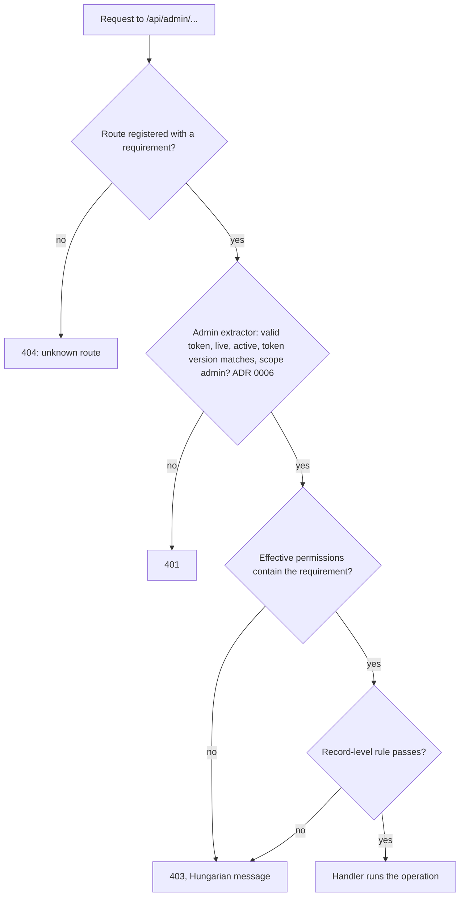

# 0007. Authorization: four roles, enforced on every operation

- Status: Accepted (2026-10-24)
- Decision questions: Q6. Related answers that change the permission list: Q11 and 11b ([ADR 0011](0011-safety-net-soft-delete-revisions-and-an-activity-log-for-eve.md)), Q26 ([ADR 0015](0015-media-separate-static-server-media-library-image-optimisatio.md)), Q28, Q29 and Q30 ([ADR 0019](0019-scope-parity-tracking-retired-features-release-1-additions.md))

## Context

| Fact | Number or detail | Source |
|---|---|---|
| backend1 permissions | 9 named permissions, created by migrations: `edit posts`, `edit events`, `edit canteens`, `edit users`, `edit newsletter`, `edit colleagues`, `publish posts`, `edit labels`, `edit authors` | research: SYNTHESIS §3.3.1; website_backend@0dead98:database/migrations/2019_04_02_202025_add_permissions.php, 2019_04_02_205431_add_colleagues_permissions.php, 2019_09_22_015933_add_posts_publish_permissions.php, 2019_10_10_234945_posts_permissions.php |
| backend1 roles | 4 roles with ids 1-4: `writer`, `secretary`, `supervisor`, `admin`. 20 role-permission links | research: SYNTHESIS §3.3.2, §4.3.8 |
| Role assignments | 44 rows: writer 30, secretary 3, supervisor 1, admin 10. One row points at a user that no longer exists. A few users hold two roles, and one user holds none | research: SYNTHESIS §3.3.2; gap-03 §6.1 |
| Per-user extra grants | 4 rows: `edit events` ×3, `edit canteens` ×1 | research: SYNTHESIS §3.3.2 |
| Who changes roles | Nobody, through the UI: the role and permission screens are list-only, so roles change only through migrations or the command line | research: SYNTHESIS §3.3.5; website_backend@0dead98:config/backpack/permissionmanager.php |
| `publish posts` semantics | Without it, a user cannot tick "Published" and cannot save a post that is already published | research: SYNTHESIS §3.3.1; website_backend@0dead98:app/Http/Controllers/Admin/PostsCrudController.php |
| One permission, two screens | `edit canteens` covers both dishes and canteen days | research: SYNTHESIS §2.3 |
| Areas without a permission name | Pages, menu items, the file manager, logs and backups have no permission name of their own in backend1 | research: SYNTHESIS §3.3.1 |
| Framework support | Loco 1.2.0 has no roles or permissions. ra-core (MIT) offers `authProvider.canAccess({action, resource, record})`, `useCanAccess` and `<CanAccess>`; role-based access control proper is react-admin Enterprise | research: SYNTHESIS §6.4, §6.21 |
| shadcn-admin-kit behaviour | The kit's `List`, `Edit`, `Create` and `Show` pages check access, and `app-sidebar.tsx` hides resources with `useCanAccess`. No kit button calls `canAccess` | research: SYNTHESIS §6.21, §6.27; shadcn-admin-kit@c1503dd:src/components/admin/app-sidebar.tsx |
| Screens that change | Logs and Backups are retired ([ADR 0019](0019-scope-parity-tracking-retired-features-release-1-additions.md)). Newsletter is retired ([ADR 0019](0019-scope-parity-tracking-retired-features-release-1-additions.md)). New: activity log and trash ([ADR 0011](0011-safety-net-soft-delete-revisions-and-an-activity-log-for-eve.md)), media library ([ADR 0015](0015-media-separate-static-server-media-library-image-optimisatio.md)), pages and the menu tree ([ADR 0018](0018-content-model-publishing-pages-menu-tree-canteen-week-editor.md)), and the release-1 additions ([ADR 0019](0019-scope-parity-tracking-retired-features-release-1-additions.md)) | research: DECISIONS 11, 26, 28, 29, 30 |
| Who the editors are | Staff publishers and secretaries, plus student writers who change every year | research: DECISIONS 10d |

backend3 keeps backend1's vocabulary (role and permission names, the split between roles, the extra grants) and applies one rule to every operation. The per-operation analysis of backend1 stays in the private research. [parity.md](../parity.md) and the parity issues describe features and backend3's behaviour only, never backend1's checks.

## Decision

### 1. Permissions

Permission identifiers stay in English, exactly as in backend1, so imported grants map one to one and old notes stay readable. The admin UI shows Hungarian labels ([ADR 0021](0021-hungarian-only-admin-ui.md)); the final wording lives in the message file.

| Permission | Status | What it gates in backend3 | UI label (proposal) |
|---|---|---|---|
| `edit posts` | kept | posts: list, read, create, update, delete, restore; preview-token regeneration | Bejegyzések szerkesztése |
| `publish posts` | kept | together with `edit posts`: publish, unpublish, set or clear "featured", and update, delete or restore a published post | Bejegyzések közzététele |
| `edit labels` | kept | labels | Címkék szerkesztése |
| `edit authors` | kept | authors | Szerzők szerkesztése |
| `edit events` | kept | events | Események szerkesztése |
| `edit canteens` | kept | dishes and canteen days, including the week editor ([ADR 0018](0018-content-model-publishing-pages-menu-tree-canteen-week-editor.md)) | Menza szerkesztése |
| `edit colleagues` | kept | colleagues | Munkatársak szerkesztése |
| `edit users` | kept | users, the read-only roles list and the read-only permissions list; account actions of [ADR 0006](0006-admin-authentication-and-account-lifecycle.md) | Felhasználók kezelése |
| `edit pages` | new | pages, including Clone | Oldalak szerkesztése |
| `edit menu` | new | menu items, including reordering in the tree ([ADR 0018](0018-content-model-publishing-pages-menu-tree-canteen-week-editor.md)) | Információk menü szerkesztése |
| `manage media` | new | the media library: browse, upload (including drag-and-drop; pasted images are not inserted, research: DECISIONS 15d), rename, move, delete, restore, copy URL, insert into the editor ([ADR 0015](0015-media-separate-static-server-media-library-image-optimisatio.md)) | Médiatár kezelése |
| `view logs` | new, repurposed | the global activity log and the global trash overview ([ADR 0011](0011-safety-net-soft-delete-revisions-and-an-activity-log-for-eve.md)) | Tevékenységnapló megtekintése |
| `edit notices` | new, release 1 | home-page notices ([ADR 0019](0019-scope-parity-tracking-retired-features-release-1-additions.md)) | Értesítések szerkesztése |
| `edit banners` | new, release 1 | partner banners ([ADR 0019](0019-scope-parity-tracking-retired-features-release-1-additions.md)) | Partnerbannerek szerkesztése |
| `edit site settings` | new, release 1 | the site settings record ([ADR 0019](0019-scope-parity-tracking-retired-features-release-1-additions.md)) | Oldalbeállítások szerkesztése |
| `edit diaktoll` | new, release 1 | Diáktoll issues ([ADR 0019](0019-scope-parity-tracking-retired-features-release-1-additions.md)) | Diáktoll-számok szerkesztése |
| `edit newsletter` | retired, not created | nothing: the newsletter screen is retired and its table is not migrated ([ADR 0019](0019-scope-parity-tracking-retired-features-release-1-additions.md)) | — |
| `manage backups` | dropped, not created | nothing: the Backups screen is retired (research: DECISIONS 28). Backups run outside backend3, through the runbook ([ADR 0023](0023-operations-hardening-rate-limits-monitoring-backups-secrets.md)) | — |

`view logs` was added in the decision record for backend1's log-file viewer. That screen is retired as a documented parity exception; operators use `oc logs` and the runbook (research: DECISIONS 28). backend3 reuses the name for the global activity log and the global trash of [ADR 0011](0011-safety-net-soft-delete-revisions-and-an-activity-log-for-eve.md) (research: DECISIONS 11). `manage backups` was listed in the same decision, but the later decision to retire the Backups screen leaves it nothing to gate, so backend3 does not create it. Both points reconcile the decision record's permission list with its later decisions to retire screens (research: DECISIONS 6, 28 and 30); the maintainer confirms them in review (see follow-up work).

backend3 therefore has 16 permissions: 8 of backend1's 9 names, 4 new ones for areas backend1 already had, and the 4 that [ADR 0019](0019-scope-parity-tracking-retired-features-release-1-additions.md) names for the release-1 screens. This ADR proposes those four names (see follow-up work).

### 2. Role matrix

Roles and their permission sets are defined in code. ✓ means the role grants the permission. The first eight rows equal backend1's production grants (research: SYNTHESIS §3.3.2, §4.3.8). The last row shows backend1's grants of the retired `edit newsletter` for reference.

| Permission | writer | secretary | supervisor | admin |
|---|---|---|---|---|
| `edit posts` | ✓ | | ✓ | ✓ |
| `publish posts` | | | ✓ | ✓ |
| `edit labels` | ✓ | | ✓ | ✓ |
| `edit authors` | ✓ | | ✓ | ✓ |
| `edit events` | | ✓ | | ✓ |
| `edit canteens` | | ✓ | | ✓ |
| `edit colleagues` | | ✓ | | ✓ |
| `edit users` | | | | ✓ |
| `edit pages` (new) | | | | ✓ |
| `edit menu` (new) | | | | ✓ |
| `manage media` (new) | ✓ | | ✓ | ✓ |
| `view logs` (new) | | | | ✓ |
| `edit notices` (new, release 1) | | | | ✓ |
| `edit banners` (new, release 1) | | | | ✓ |
| `edit site settings` (new, release 1) | | | | ✓ |
| `edit diaktoll` (new, release 1) | | | | ✓ |
| `edit newsletter` (retired) | | backend1 only | | backend1 only |

Reasons for the new rows:

- `edit pages`, `edit menu` and `view logs` go to `admin` only. backend1 showed pages, menu items and logs to the `admin` role, so this keeps who-sees-what unchanged.
- `manage media` goes to the content roles, the roles that write posts: writer, supervisor, admin (research: DECISIONS 26). None of the secretary's screens embeds media-library files; secretaries upload colleague images through the entity form, which `edit colleagues` covers.
- The four release-1 permissions go to `admin` only, as [ADR 0019](0019-scope-parity-tracking-retired-features-release-1-additions.md) sets. Other users get them as extra grants.

The `admin` role also unlocks three things that are not permissions, so an extra grant can never give them:

- permanent delete ("Végleges törlés") from the trash, for every entity type ([ADR 0011](0011-safety-net-soft-delete-revisions-and-an-activity-log-for-eve.md));
- account actions on, and role changes to, accounts that hold the `admin` role (section 6);
- dashboard figures about individual people, such as edits per user ([ADR 0019](0019-scope-parity-tracking-retired-features-release-1-additions.md)).

### 3. Effective permissions and extra grants

A user's effective permissions are the union of the permission sets of all their roles and their per-user extra grants ("Egyéni jogosultságok"). A user with no role and no grant can sign in and use only the own-account screen ([ADR 0006](0006-admin-authentication-and-account-lifecycle.md)).

Storage (tables named in [ADR 0009](0009-clean-domain-schema-with-preserved-integer-ids.md)):

| Table | Content |
|---|---|
| `roles` | four rows seeded by a migration, ids preserved from backend1: 1 `writer`, 2 `secretary`, 3 `supervisor`, 4 `admin` |
| `user_roles` | `(user_id, role_id)`, primary key on both |
| `user_permissions` | `(user_id, permission)`, primary key on both; `permission` is text with a CHECK constraint listing the 16 names |

The role-to-permission mapping is not a table. It is a constant in `src/domain/authz.rs` ([ADR 0008](0008-code-layout-a-pure-src-domain-beside-loco-models.md)), so every change to it is a reviewed code change. Adding a role or a permission needs a migration (seed row or CHECK constraint) and a code change in the same PR. Tests assert that the `roles` rows and the CHECK list equal the Rust enums.

`src/domain/authz.rs` is pure: it holds the `Permission` and `Role` enums, the mapping, the effective-set calculation and the record-level rules. It has unit tests and property tests (for example: `admin` holds every permission; adding a role or a grant never removes a permission; a user with no role and no grant holds none).

### 4. Operations per resource

Every admin API operation requires a permission. "Delete" is the soft delete of [ADR 0011](0011-safety-net-soft-delete-revisions-and-an-activity-log-for-eve.md).

| Resource | list, read | create, update, delete, restore | Extra rules |
|---|---|---|---|
| posts | `edit posts` | `edit posts` | publishing, unpublishing, "featured", and any write to a published post also need `publish posts` |
| labels | `edit labels`, or `edit posts` for the post form's picker | `edit labels` | |
| authors | `edit authors`, or `edit posts` for the picker | `edit authors` | |
| colleagues | `edit colleagues` | `edit colleagues` | |
| dishes | `edit canteens` | `edit canteens` | |
| canteen days | `edit canteens` | `edit canteens` | the week editor writes several days in one request; each day is checked |
| events | `edit events` | `edit events` | |
| pages | `edit pages`, or `edit menu` for the menu form's page picker | `edit pages` | Clone is a create |
| menu items | `edit menu` | `edit menu` | reordering is an update |
| media library | `manage media` | `manage media` | uploads through an entity's own image field (index image, gallery, author or colleague image) need that entity's permission instead |
| users, roles list, permissions list | `edit users` | `edit users` | section 6 |
| notices, partner banners, site settings, Diáktoll issues | `edit notices`, `edit banners`, `edit site settings`, `edit diaktoll` respectively | the same | the settings record cannot be deleted; section 8 |
| one record's history ("Előzmények") | the resource's list permission | reverting to a revision is an update | [ADR 0011](0011-safety-net-soft-delete-revisions-and-an-activity-log-for-eve.md) |
| global activity log ("Tevékenységnapló"), global trash ("Lomtár") | `view logs` | — | |
| permanent delete from the trash | — | `admin` role | [ADR 0011](0011-safety-net-soft-delete-revisions-and-an-activity-log-for-eve.md) |
| own account ("Fiókom") | any active user | any active user | [ADR 0006](0006-admin-authentication-and-account-lifecycle.md) |
| dashboard figures | the list permission of the data they summarise | — | figures about individual people, such as edits per user, need the `admin` role ([ADR 0019](0019-scope-parity-tracking-retired-features-release-1-additions.md)) |

The sitemap and the public API (`/api/v1`) need no permission.

### 5. Server enforcement

- **Deny by default.** Every `/api/admin` route is declared together with its requirement (a permission, the `admin` role, or "any active user") in one route table, and the router is built from that table. A test walks the table and fails if any route lacks a requirement.
- **Status codes.** No valid session: 401. Valid session, missing permission: 403 with a Hungarian message in the admin error envelope ([ADR 0021](0021-hungarian-only-admin-ui.md) §4). A list the user may not see answers 403, never an empty list.
- **Fresh data.** The admin extractor loads roles and extra grants on every request, so a role change applies on the user's next request.
- **Record-level rules** live in `src/domain/authz.rs` and are called by the handlers after the record is loaded:
  - posts: a write that sets or keeps `published = true`, or changes `featured`, needs `publish posts`; deleting or restoring a published post needs `publish posts`;
  - users: the guards in section 6.
- **User editing.** Creating, updating, deleting or restoring a user, and changing roles or extra grants, all require `edit users`. Only `edit users` gates the user editor. A test asserts that a user holding every permission except `edit users` gets 403 on each of these operations.

### 6. Guards against self-escalation and lock-out

| Guard | Rule |
|---|---|
| No self-changes | Nobody can change their own roles or extra grants, deactivate their own account, or delete their own account |
| Grant only what you hold | An actor may assign a role or an extra grant only when every permission it confers is in the actor's effective set |
| The `admin` role | Only a holder of the `admin` role can assign or remove the `admin` role, and only an `admin` holder can issue a reset link or temporary password for, reset two-factor of, clear the sign-in lock of, deactivate, or delete an account that holds the `admin` role |
| Last admin | The last active, live holder of the `admin` role cannot be deactivated, deleted or lose that role |

Each guard has its own error message and its own test.

### 7. Admin UI

The admin UI hides what the server forbids. It never decides access on its own.

- After sign-in, the admin UI calls `GET /api/admin/auth/me`. The response (a Rust DTO exported to TypeScript, [ADR 0005](0005-rust-dtos-are-the-api-contract-ts-rs-utoipa-openapi.md)) carries the user's `pid`, name, roles, effective permissions, an `is_admin` flag, and an `access` map from ra-core resource name to the allowed actions, computed on the server from the table in section 4. Example: `{"posts": ["list", "show", "create", "edit", "delete", "history"]}`. Actions beyond ra-core's built-in `list`, `show`, `create`, `edit` and `delete` are `publish`, `restore`, `purge` and `history`.
- `authProvider.canAccess({action, resource, record})` answers from that response, without a network call. The record-level rules for posts and users are mirrored in one small TypeScript function. Rust and TypeScript tests run the same case table (`tests/fixtures/authz_cases.json`: permissions, resource, action, record, expected result), so the two cannot drift.
- The kit's page components and `app-sidebar.tsx` already call `canAccess`. Because no kit button does, backend3 wraps the create, edit, delete, bulk-delete, restore and permanent-delete buttons in components that call `useCanAccess` and pass the record where a record-level rule applies. On the post form, the "Published" and "Featured" inputs are disabled without `publish posts`.
- A 403 from the server (for example after a role change in another session) shows the Hungarian message, refetches `/me` and keeps the user signed in. Only 401 signs the user out.

### 8. Screens added in release 1

The release-1 screens (notices, partner banners, site settings, Diáktoll issues; [ADR 0019](0019-scope-parity-tracking-retired-features-release-1-additions.md)) use the four permissions in sections 1 and 2. Only `admin` holds them by default. The banner and Diáktoll forms pick their image or PDF from the media library, so a user who edits them through an extra grant also needs `manage media`. Giving one of these permissions to another role is a change to the code mapping and to this ADR.

### 9. Import

The importer ([ADR 0017](0017-legacy-data-import-normalisation-and-defect-resolution.md)) maps backend1's data as follows:

- role assignments to `user_roles` by role name, keeping users with two roles; the orphaned assignment is dropped;
- the 4 direct grants to `user_permissions`;
- backend1's `role_has_permissions` rows are not imported, because the mapping is in code; a dry-run check confirms that the 18 production links of the 8 kept permissions equal the code mapping, and reports the other 2 links, `edit newsletter` on secretary and admin, as skipped;
- grants of `edit newsletter` exist only through roles, so dropping the permission loses no direct grant;
- the user with no role is imported with no role.

## Consequences

Positive:

- Every admin operation is checked on the server against one route table.
- The school keeps its role names and its split of duties, and the 4 extra grants survive.
- Role changes are code changes, so they are reviewed and visible in the history.
- No Enterprise licence is needed: the admin UI uses ra-core's open-source access-control hooks.

Negative:

- Changing what a role may do needs a PR and a deploy. There is no screen for it.
- backend3 must maintain its own button wrappers, because the kit's buttons do not check access.
- A user with no role and no grant can sign in but sees only the own-account screen.

Follow-up work and what must be true in code and tests:

- A matrix integration test calls every admin route as each role, as a user with no role, and as users with single extra grants. It expects 403 exactly where section 4 and the record-level rules say so. The test cases come from the route table and the role matrix, so a new route cannot skip the test.
- The guards in section 6 each have a test, including "last admin" and "grant only what you hold".
- Whether ra-core's page components pass `record` to `canAccess` is not verified (research: SYNTHESIS §6.28 U5). backend3's own wrappers pass it explicitly. The posts slice settles the question by reading the ra-core 5.15.5 source.
- The Hungarian permission labels go into the message file ([ADR 0021](0021-hungarian-only-admin-ui.md)).
- Points 1-3 below are set by this ADR rather than by the decision record. Build them as written; the maintainer confirms them in review, and a change is an edit to this ADR and to the code mapping. Point 4 is decided (research: DECISIONS 6b):
  1. `edit newsletter` is not created, because the newsletter screen is retired (research: DECISIONS 30);
  2. `manage backups` is not created, although research: DECISIONS 6 lists it, because the Backups screen is dropped (research: DECISIONS 28);
  3. `view logs` is reused to gate the global activity log and the global trash;
  4. the release-1 permissions `edit notices`, `edit banners`, `edit site settings` and `edit diaktoll` go to the `admin` role only; other users get them as extra grants.

## Alternatives considered

| Option | Why not |
|---|---|
| Q6 B: the same model plus an admin screen for editing the role matrix and creating roles | Roles in code stay reviewable. A matrix editor adds UI and risk for something backend1 changed through four migrations, all in 2019 |
| Q6 C: reproduce backend1's permission checks exactly | Parity covers features. backend3 derives every check from its own route table (section 5), not from another system's code |
| Q6 D: a simpler fixed set of roles without per-user grants | The role names and the split between them are how the school works, and 4 extra grants are in use |
| react-admin Enterprise role-based access control (`ra-core-ee` / `ra-rbac`) | Commercial licence and private registry; the open-source `canAccess` hooks plus server checks cover the need |

## References

- research: DECISIONS 6, 10d, 11, 15d, 26, 28, 29, 30 (2026-10-24)
- research: QUESTIONS Q6, Q26, Q28, Q29, Q30
- research: SYNTHESIS §2.3 (permission gating per operation), §3.3 (users, roles, permissions), §4.3.8 (auth tables), §6.4 (Loco authentication), §6.21 (ra-core access control), §6.22 (Enterprise boundary), §6.28 (unverified items); gap-03 §6.1
- website_backend@0dead98:database/migrations/2019_04_02_202025_add_permissions.php and the three later permission migrations named in Context
- website_backend@0dead98:config/backpack/permissionmanager.php
- shadcn-admin-kit@c1503dd:src/components/admin/app-sidebar.tsx, docs/src/content/docs/Security.md
- ra-core documentation, "Permissions" and "Access Control" (marmelab.com/react-admin)
- [ADR 0005](0005-rust-dtos-are-the-api-contract-ts-rs-utoipa-openapi.md), [ADR 0006](0006-admin-authentication-and-account-lifecycle.md), [ADR 0008](0008-code-layout-a-pure-src-domain-beside-loco-models.md), [ADR 0009](0009-clean-domain-schema-with-preserved-integer-ids.md), [ADR 0011](0011-safety-net-soft-delete-revisions-and-an-activity-log-for-eve.md), [ADR 0015](0015-media-separate-static-server-media-library-image-optimisatio.md), [ADR 0017](0017-legacy-data-import-normalisation-and-defect-resolution.md), [ADR 0018](0018-content-model-publishing-pages-menu-tree-canteen-week-editor.md), [ADR 0019](0019-scope-parity-tracking-retired-features-release-1-additions.md), [ADR 0021](0021-hungarian-only-admin-ui.md), [ADR 0023](0023-operations-hardening-rate-limits-monitoring-backups-secrets.md)
