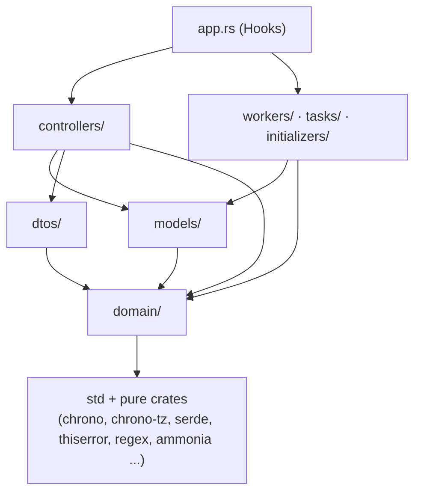

# 0008. Code layout: a pure src/domain/ beside Loco models

- Status: Accepted (2026-10-24)
- Decision questions: Q7

## Context

Loco ships an agent skill with a doctrine file. The repo vendors it into `.claude/skills/loco/` ([ADR 0024](0024-ai-maintainability-instruction-files-the-loco-skill-guardrai.md)), and agents follow it. On layout it says:

> Do not add a `services/` or `repositories/` or `utils/` directory — Rails does not have them and neither does Loco. If you feel the need for one, the code belongs on a model.
>
> (loco-rs@1.2.0:skills/loco/doctrine.md)

The doctrine also asks for fat models and slim controllers, config through `ctx.config` instead of `std::env::var`, and `BackgroundWorker` instead of `tokio::spawn`.

backend3 needs logic that is not persistence and does not belong to one model (research: QUESTIONS 7):

| Logic | Why it is not a model method |
|---|---|
| ISO-week and calendar-grid ranges | used by canteen and events; pure date math |
| Keyset cursor encode and decode | used by every paged public list |
| Hungarian name sort key (the "Dr." prefix stripped) | ordering rule, not storage ([ADR 0020](0020-search-and-hungarian-ordering.md)) |
| Rich-text normalisation and the derived plain-text column | shared by posts and pages, and by the importer ([ADR 0013](0013-rich-text-editor-and-html-sanitiser.md), [ADR 0017](0017-legacy-data-import-normalisation-and-defect-resolution.md), [ADR 0020](0020-search-and-hungarian-ordering.md)) |
| Nested-set to `parent_id` + `position` conversion | import only ([ADR 0017](0017-legacy-data-import-normalisation-and-defect-resolution.md), [ADR 0018](0018-content-model-publishing-pages-menu-tree-canteen-week-editor.md)) |
| The legacy MySQL importer | holds two database connections at once |

House precedent and the maintainer's engineering standard point the same way. backend2's unmerged test and fix branches keep pure helpers such as `src/utils/date_range.rs` beside the handlers, with unit tests and proptests (research: SYNTHESIS §5.18, §7.6.9). backend2 and iam ban `std::env::var` with clippy `disallowed-methods` (research: SYNTHESIS §7.6.9). The standard asks for pure helpers tested directly, and for modules that talk to external systems to take credentials and configuration as explicit arguments.

Left alone, the doctrine would push the pure logic into model files as associated functions. Those functions would be reachable only through types that wrap database rows, and would be tested through a database.

## Decision

backend3 overrides the doctrine in one narrow place. Everywhere else, the doctrine and the Loco skill apply unchanged.

### The rules

These six rules go into the root `CLAUDE.md` verbatim ([ADR 0024](0024-ai-maintainability-instruction-files-the-loco-skill-guardrai.md)). Agents and reviewers check code against them.

1. **`src/domain/` is pure.** No I/O, no `AppContext`, no `async fn`. It does not read files, the network, the database, environment variables, the clock or a random number generator. "Now", "today" and random input are function arguments. Fixed facts, such as the school's time zone, are constants in `src/domain/` ([ADR 0010](0010-all-instants-stored-as-timestamptz.md)). Every public function has unit tests. A function has a non-trivial input space unless every argument is a boolean or a small closed enum. Strings, collections, dates and times, integers, and structs that contain any of them are always non-trivial. Every function with a non-trivial input space also has at least one proptest property. Only functions over booleans and small closed enums may rely on exhaustive unit tests instead.
2. **Code that talks to an external system takes explicit arguments.** External systems include the database, the uploads volume or storage driver, the legacy MySQL database and any HTTP service. Such code receives the connection or handle and a typed config struct as function arguments. It never reads `std::env`, never takes `&AppContext`, and never looks up a global registry.
3. **Only controllers, workers, tasks and initializers touch `AppContext`.** `src/app.rs` also does, for the `Hooks` wiring. They take apart `ctx.db`, `ctx.storage`, `ctx.cache` and the typed settings, and pass the pieces down explicitly.
4. **Models stay fat Active Record.** Finders live on `impl Model`. State transitions live on `impl ActiveModel`, consume `self` and return the saved `Model`. Field rules use `Validatable` and `before_save`. Model methods take the connection or transaction handle explicitly, as Loco's own finders do. They call into `src/domain/` for pure computation. Raw queries in controllers stay forbidden.
5. **No other new top-level directories.** No `services/`, `repositories/`, `utils/`, `helpers/`, `common/`, `shared/` or `lib/` under `src/`. External-system code that no model owns lives in the module of its only caller, for example `src/tasks/import_mysql/`. External-system code that several callers share and no Sea-ORM entity owns lives in `src/models/<name>.rs` as a model module without an entity, for example `src/models/media.rs`.
6. **Wire types live in `src/dtos/`** ([ADR 0005](0005-rust-dtos-are-the-api-contract-ts-rs-utoipa-openapi.md)). Domain types never derive ts-rs or utoipa, and DTOs convert to and from domain types at the controller boundary.

### Layout

```text
src/
  app.rs            Hooks: routes, workers, tasks, initializers, before_routes
  bin/main.rs
  controllers/      HTTP handlers; thin; touch AppContext
    admin/          /api/admin
    v1/             /api/v1
    admin_ui.rs     the /admin static router (ADR 0004)
  dtos/             wire types: serde + ts-rs + utoipa (ADR 0005)
    admin/
    v1/
  models/           fat Active Record (Sea-ORM)
    media.rs        the uploads volume; a model module without an entity (rule 5)
    _entities/      generated by `cargo loco db entities`; never edited by hand
  domain/           pure logic only (rule 1)
  workers/          BackgroundWorker types (ADR 0016); touch AppContext
  tasks/            Task types (ADR 0016); touch AppContext
  initializers/     Initializer types; touch AppContext
  fixtures/         seed data for tests and E2E
migration/          Sea-ORM migrations (ADR 0009)
tests/              integration and request tests
admin/              the admin UI (ADR 0004)
```

backend3 renders no server-side HTML and sends no mail (research: DECISIONS 10b). So Loco's `src/views/` and `src/mailers/` are not used.

### Allowed dependencies



`domain/` depends on no other module of the crate. Nothing in `domain/` names `loco_rs`, `sea_orm`, `sqlx`, `tokio`, `std::fs`, `std::net`, `std::env` or `std::process`. Calls that read the clock or randomness (`Utc::now`, `Local::now`, `SystemTime::now`, `Instant::now`, `rand`) are banned there too.

Pure crates are allowed when they compute a result from their inputs alone. An HTML sanitiser that maps a string to a string is pure. A crate that opens files or sockets is not.

### Where things go (illustrative)

The owning ADRs decide the behaviour. This table only shows the placement the rules produce.

| Logic | Placement | Shape |
|---|---|---|
| Canteen ISO-week arithmetic and the events calendar grid (port of backend2's `date_range.rs` with its proptests) | `src/domain/canteen.rs` ([ADR 0018](0018-content-model-publishing-pages-menu-tree-canteen-week-editor.md)) and a calendar module for events | `(iso_year, iso_week) -> Monday..Friday`, or a typed week error |
| Menu tree validation and the nested-set conversion ([ADR 0018](0018-content-model-publishing-pages-menu-tree-canteen-week-editor.md)) | `src/domain/menu.rs` | pure checks on `parent_id` and `position` |
| Keyset cursor | `src/domain/cursor.rs` | encode and decode; property: `decode(encode(c)) == c` |
| Europe/Budapest wall time to and from UTC ([ADR 0010](0010-all-instants-stored-as-timestamptz.md)) | `src/domain/time.rs` | takes the instant; never reads the clock |
| Effective permissions from roles and per-user grants ([ADR 0007](0007-authorization-four-roles-enforced-on-every-operation.md)) | `src/domain/authz.rs` | `fn can(grants, action, resource) -> bool` |
| Password policy ([ADR 0006](0006-admin-authentication-and-account-lifecycle.md)) | `src/domain/password_policy.rs` | returns typed, user-facing errors |
| Rich-text normalisation and sanitising ([ADR 0013](0013-rich-text-editor-and-html-sanitiser.md), [ADR 0017](0017-legacy-data-import-normalisation-and-defect-resolution.md)) | `src/domain/rich_text/` | property: the output is a fixed point, `f(f(x)) == f(x)` |
| Unique slug for a cloned page ([ADR 0018](0018-content-model-publishing-pages-menu-tree-canteen-week-editor.md)) | `src/domain/slug.rs` | takes the set of existing slugs |
| `/admin` path classification ([ADR 0004](0004-admin-ui-lives-in-admin-and-ships-in-the-backend3-image.md)) | `src/domain/admin_path.rs` | asset, root file or client route |
| Paged public post list | `src/models/posts.rs` | `posts::Model::list_published(db, filter, cursor, limit)` calls `domain::cursor` |
| Legacy import orchestration | `src/tasks/import_mysql/` | the task reads `ctx` and calls `run(&source_db, &target_db, &ImportOptions)` |
| Upload handling and image optimisation ([ADR 0015](0015-media-separate-static-server-media-library-image-optimisatio.md)) | `src/models/media.rs` owns the uploads volume (rule 5): storing an upload (stage in `media.tmp_dir`, optimise, atomic rename into `media.root`), rename, move, and move to `media.trash_dir`. It works with filesystem operations on those configured paths, never with `ctx.storage`, because ADR 0015 relies on an atomic rename within one filesystem. The media controller and the entity image upload handlers call it. The importer does not: it writes its extracted images byte for byte, without the optimiser, from its own module ([data-migration.md](../data-migration.md) §7.1, rule N4). The re-encode, the metadata strip, the keep-or-discard rule, name normalisation and the target-folder choice are pure functions in `src/domain/`, for example `src/domain/image_opt.rs`. | `media::store_upload(&MediaSettings, &DatabaseConnection, ...)`: the typed media settings and the connection are arguments |

### Typed configuration

Application settings live under `settings:` in `config/<env>.yaml`. Secrets are injected with `get_env` as Loco does (research: SYNTHESIS §6.11). They deserialize once into a typed `Settings` struct. That struct validates at boot and names the bad key in every error. External-system code receives only the sub-struct it needs, never the whole `Settings` and never `AppContext`.

### Enforcement

| Mechanism | What it checks |
|---|---|
| `clippy.toml` `disallowed-methods` | `std::env::var`, `std::env::var_os`, `std::env::vars` and `std::env::vars_os` (house rule, doctrine P4); `tokio::spawn` and `tokio::task::spawn` (use a `BackgroundWorker`, [ADR 0016](0016-no-redis-in-memory-cache-postgres-queue-cronjob-tasks.md)). The second listener for `/metrics` ([ADR 0023](0023-operations-hardening-rate-limits-monitoring-backups-secrets.md)) starts from a `Hooks::serve` override that runs both listeners with `tokio::try_join!`. It never uses `tokio::spawn`, so no clippy exception is needed. An initializer's `before_run` is not used for it: Loco awaits `before_run` before the server starts (loco-rs@1.2.0:src/boot.rs `run_app`), so a listener started there would have to be spawned. |
| Architecture test (`tests/architecture.rs`) | walks `src/domain/**/*.rs` with comments stripped. It fails on any banned path listed under "Allowed dependencies", on `async fn`, and on `crate::` imports outside `crate::domain`. It also fails if `src/` holds a directory banned by rule 5. A third check, added with the app clock (Verseghy/website_backend3#207), covers all of `src/`, unit tests included: it fails on a read of the system time or a use of chrono's `Local` anywhere except inside `impl Clock for SystemClock` in `src/app.rs`, and on `set_clock` outside that file, so "now" comes from the app clock ([ADR 0010](0010-all-instants-stored-as-timestamptz.md) point 7). `Instant::now` stays allowed outside `src/domain/`, because it measures a duration and never becomes an instant. |
| Review against `CLAUDE.md` | rules 2-4, which a scan cannot prove |
| CI ([ADR 0022](0022-builds-and-ci-pac-for-production-images-github-actions-for-p.md)) | `cargo clippy -- -D warnings` and the test suite, including the architecture test |

### Testing per layer

| Layer | Tests | Needs Postgres |
|---|---|---|
| `domain/` | in-module unit tests and proptest properties | no |
| `models/` | integration tests on a per-test database through Loco's testing harness | yes |
| External-system code | against fakes or a narrow trait with an in-memory implementation, or a local throwaway container. Never against a shared or production service. The test harness refuses non-local database URLs ([ADR 0024](0024-ai-maintainability-instruction-files-the-loco-skill-guardrai.md)). | depends |
| `controllers/` | request tests through Loco's test server | yes |
| `workers/`, `tasks/` | run inline with `workers.mode: ForegroundBlocking` (the Loco test default) | yes |

## Consequences

Positive:

- Pure logic is tested directly and fast, without a database, and proptests cover the edge cases (week 53, year ends, empty inputs).
- The importer and other external-system code can be tested against fakes. They do not depend on how `AppContext` happens to be built.
- Agents get one clear exception to the doctrine instead of improvising helpers in random places.

Negative:

- Two homes for logic, `models/` and `domain/`, need judgement. The test: "Does it need the database or another external system?" If yes, it belongs on a model or in the caller's module. If no, it goes in `domain/`.
- The architecture test is a text scan, so a determined bypass is possible. If it proves leaky, `src/domain/` can become a separate workspace crate with no Loco, Sea-ORM or tokio dependency, which the compiler then enforces. That move is mechanical and is not planned.

What must be true in code:

- `CLAUDE.md` contains the six rules above verbatim, with a link to this ADR ([ADR 0024](0024-ai-maintainability-instruction-files-the-loco-skill-guardrai.md)).
- The architecture test and the `clippy.toml` entries land in the bootstrap PR, before the first domain module.
- Every `src/domain/` module has a `#[cfg(test)]` block. Every function with a non-trivial input space, as rule 1 defines it, has at least one proptest property.

## Alternatives considered

- **B. Follow Loco's doctrine strictly.** Helpers would live as associated functions or private modules inside the model files. Rejected: cross-entity logic would have to pick one arbitrary model, the importer has no model, and pure code would be tested only through a database.
- **C. A middle way.** Pure helpers as `src/models/<entity>/` submodules, with no new top-level directory. Rejected: logic shared by posts and pages, or by import and runtime, still has no home, and the purity boundary would not be visible in the tree.

## References

- research: DECISIONS 7, 10b, 37, 43a
- research: QUESTIONS 7
- research: SYNTHESIS §5.18 (backend2 pure helpers and proptests), §6.9 (Loco testing harness), §6.11 (configuration), §6.13 (the Loco skill), §7.6.9 (house Rust style and testing bar)
- research: stack-loco-react-admin §5 D-15 (doctrine rules adopted as project rules)
- loco-rs@1.2.0:skills/loco/doctrine.md
- loco-rs@1.2.0:src/boot.rs (`run_app` awaits `before_run` before `Hooks::serve`), src/app.rs (`Hooks::serve`, `Initializer::before_run`)
- loco 1.2.0 CLI template: `base_template/src/` layout, `base_template/AGENTS.md`
- website_backend2@7ba71da:clippy.toml (`disallowed-methods` for `std::env::var`, `std::env::var_os`)
- Related: [ADR 0004](0004-admin-ui-lives-in-admin-and-ships-in-the-backend3-image.md), [ADR 0005](0005-rust-dtos-are-the-api-contract-ts-rs-utoipa-openapi.md), [ADR 0006](0006-admin-authentication-and-account-lifecycle.md), [ADR 0007](0007-authorization-four-roles-enforced-on-every-operation.md), [ADR 0009](0009-clean-domain-schema-with-preserved-integer-ids.md), [ADR 0010](0010-all-instants-stored-as-timestamptz.md), [ADR 0013](0013-rich-text-editor-and-html-sanitiser.md), [ADR 0015](0015-media-separate-static-server-media-library-image-optimisatio.md), [ADR 0016](0016-no-redis-in-memory-cache-postgres-queue-cronjob-tasks.md), [ADR 0017](0017-legacy-data-import-normalisation-and-defect-resolution.md), [ADR 0018](0018-content-model-publishing-pages-menu-tree-canteen-week-editor.md), [ADR 0020](0020-search-and-hungarian-ordering.md), [ADR 0022](0022-builds-and-ci-pac-for-production-images-github-actions-for-p.md), [ADR 0024](0024-ai-maintainability-instruction-files-the-loco-skill-guardrai.md)
