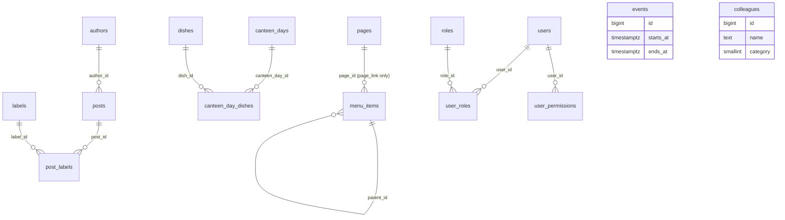

# 0009. Clean domain schema with preserved integer ids

- Status: Accepted (2026-10-24)
- Decision questions: Q8

## Context

backend3 gets a new PostgreSQL database (ADR 0002). The importer (ADR 0017) is the only code that has to know the legacy Laravel shape, so the new schema can be designed freely now. Renaming later would touch every model, DTO, test and the admin.

The legacy schema is a set of Laravel and Backpack artefacts (research: SYNTHESIS §4.2, §4.6.4, §4.10 R1, R12-R14, R19-R20):

| Artefact | Example |
|---|---|
| Odd table names | `posts_data`, `canteen_data` (days), `canteen_menus` (dishes), `colleagues_data`, `events_data` |
| Odd pivot names and column order | `posts_pivot_labels_data(labels_id, posts_id)`, `canteen_pivot_menus_data` with primary key `(menu_id, data_id)` |
| A camelCase column | `posts_data.previewToken` (Postgres folds unquoted identifiers to lower case) |
| `varchar(191)` everywhere | a leftover of an old index-length limit; real values are short (longest post title 95, label 24, dish 58, slug 53 characters) |
| Polymorphic permission tables | spatie `model_has_roles(role_id, model_type, model_id bigint)` with `model_type = 'App\User'`, while `users.id` is `int` |
| Two tree encodings | `menu_items` keeps `parent_id` and a nested set (`lft`, `rgt`, `depth`) |
| Dead columns and tables | `pages.deleted_at` and `menu_items.deleted_at` are never written; `pages.template` is constant; `pages.extras` was never filled; `newsletter` (0 rows ever), `migrations` (20 rows of Laravel bookkeeping) and `password_resets` (6 rows) |
| No integrity in the database | 0 foreign keys; the only unique index besides primary keys is `users_email_unique` |

Integer ids are a public contract. They appear in `/posts/{id}`, in `/search/author/{id}` and `/search/label/{id}`, in the sitemap and in social-media caches of shared links (research: SYNTHESIS §4.10 R1). Hard deletes left gaps (for example pages 1-7), and MySQL never reissues a counter value.

Loco 1.2.0 conventions this schema meets:

- `ColType::PkAuto` creates a 64-bit auto-increment key. With Sea-ORM 2.0 and sea-query 1.0.2 on Postgres it renders as `bigint GENERATED BY DEFAULT AS IDENTITY` (loco-rs@1.2.0:`src/schema.rs`; sea-query@1.0.2:`src/backend/postgres/table.rs`). `BY DEFAULT` accepts explicit ids on insert.
- `create_table` adds `created_at` and `updated_at` as `timestamptz` with a `CURRENT_TIMESTAMP` default (loco-rs@1.2.0:`src/schema.rs`, `timestamps_tz`).
- Loco's starter `users` table has a UUID `pid` used in JWT claims (research: SYNTHESIS §6.4).
- react-admin needs an `id` on every record it edits as a resource.

## Decision

### Tables

backend3 uses a clean domain schema with snake_case plural table names:

| Target table | Legacy source | Notes |
|---|---|---|
| `posts` | `posts_data` | news posts |
| `labels` | `posts_labels` | post labels |
| `post_labels` | `posts_pivot_labels_data` | join table `(post_id, label_id)` |
| `authors` | `posts_authors` | post authors |
| `canteen_days` | `canteen_data` | one row per canteen day |
| `dishes` | `canteen_menus` | dishes, with a course |
| `canteen_day_dishes` | `canteen_pivot_menus_data` | join table `(canteen_day_id, dish_id)` plus `position` (ADR 0018 §4.1) |
| `events` | `events_data` | calendar events |
| `colleagues` | `colleagues_data` | staff directory |
| `pages` | `pages` | static pages (ADR 0018) |
| `menu_items` | `menu_items` | navigation tree, `parent_id` + `position` (ADR 0018) |
| `users` | `users` | admin accounts, Loco shape (ADR 0006) |
| `roles` | `roles` | the 4 roles, seeded by a migration |
| `user_roles` | `model_has_roles` | join table `(user_id, role_id)` |
| `user_permissions` | `model_has_permissions` | per-user extra grants `(user_id, permission)` |

Tables introduced by other ADRs (revisions and the activity log of ADR 0011, the release-1 content of ADR 0019) follow the same conventions. Loco's own `pg_loco_queue` (ADR 0016) and Sea-ORM's `seaql_migrations` are created and owned by the framework and are exempt: Loco creates `pg_loco_queue` at run time with a `VARCHAR` id (loco-rs@1.2.0:`src/bgworker/pg.rs`), and backend3's migrations do not create it. The schema snapshot test excludes both.

Not carried over: `migrations`, `password_resets`, `newsletter`, `permissions` and `role_has_permissions`. Permission names and the role-to-permission map are defined in code (ADR 0007). [data-migration.md](../data-migration.md) §9 lists every dropped table and column with the reason.

### Naming conventions

| Element | Rule | Example |
|---|---|---|
| Table | snake_case, plural | `canteen_days` |
| Join table | `<singular>_<plural>` of the two sides, composite primary key, no surrogate id | `post_labels(post_id, label_id)` |
| Foreign key column | `<singular>_id` | `author_id`, `canteen_day_id` |
| Boolean | adjective or past participle, `NOT NULL` with a default | `published`, `featured`, `active` |
| Instant | `<verb>_at`, `timestamptz` (ADR 0010) | `created_at`, `starts_at`, `last_login_at` |
| Calendar date | `timestamptz` holding the Europe/Budapest midnight of the day (decision 9, ADR 0010 point 2, ADR 0018 §1.3); rendered as `YYYY-MM-DD` | `posts.date`, `canteen_days.date` |
| Identifier quoting | none needed; every identifier is lower-case ASCII | `preview_token` |

### Primary keys and ids

1. Every entity table has `id bigint GENERATED BY DEFAULT AS IDENTITY PRIMARY KEY` (Loco `ColType::PkAuto`). Foreign keys to it are `bigint`.
2. The importer inserts every legacy row with its legacy id. Ids are never renumbered.
3. After the import, each identity sequence is set so that the next id is `greatest(max(id), legacy AUTO_INCREMENT - 1) + 1`. No id that MySQL ever issued is reissued, so an old link to a deleted post can never show a new post.
4. A UUID `pid` (Loco shape) exists only on `users`. No other table has a second identifier.
5. Join tables have no `id`. The admin edits them through their owning record (labels on a post, dishes on a canteen day, roles and grants on a user).

### Column types

| Kind | Type | Rule |
|---|---|---|
| Short and long text | `text` (or unbounded `varchar`) | No `varchar(191)`. Length limits live in domain validation (ADR 0008) with values from the parity checklist (for example post title 255, label name 64, dish name 64, menu item name 100). The importer reports any legacy value over its limit. |
| Rich text | `text` | `posts.content` is nullable (28 published posts have no body); `pages.content` is `NOT NULL`. Neither has a size cap (the largest legacy page is 63,082 bytes, close to MySQL's 65,535-byte `TEXT`). |
| Small integer codes | `smallint` with a `CHECK` on the allowed range, mapped to a Rust enum | `dishes.course` 0 soup, 1 main dish, 2 dessert; `colleagues.category` 0-4 |
| String codes | `text` with a `CHECK (... IN (...))`, mapped to a Rust enum | `menu_items.kind` in `page_link`, `internal_link`, `external_link` |
| Colour | `text` with `CHECK (color ~ '^#[0-9A-Fa-f]{6}$')` | posts, labels, events (100 % of legacy values conform) |
| File references | `text`, the disk-relative path as stored today | `posts.index_image = 'index/<32 hex>.<ext>'`; paths and URLs do not change (ADR 0015) |
| Gallery | `posts.images jsonb NOT NULL DEFAULT '[]'` with `CHECK (jsonb_typeof(images) = 'array')` | an ordered array of file names; element shape validated in code |
| Booleans | `boolean NOT NULL` | `tinyint(1)` 0/1 in the legacy data |

Postgres `ENUM` types are not used: adding a value later needs a migration that is awkward inside a transaction, and the public API already speaks the integer and string codes.

### Constraints

The legacy database enforced nothing. backend3 adds foreign keys, uniqueness and checks once the importer has resolved the rows that violate them (ADR 0017).

| Constraint | Definition |
|---|---|
| Post author | `posts.author_id` FK `authors(id)` `ON DELETE RESTRICT`; `CHECK (NOT published OR author_id IS NOT NULL)` |
| Post date | `CHECK (NOT published OR date IS NOT NULL)`. Domain validation requires a date on every save and pre-fills today in Europe/Budapest (decision 21, ADR 0018 §1.3). The column stays nullable only for imported drafts ([data-migration.md](../data-migration.md) D5, ADR 0017). |
| Calendar midnight | `CHECK ((date AT TIME ZONE 'Europe/Budapest')::time = time '00:00')` on `posts` and on `canteen_days` (ADR 0010 point 2, ADR 0018 §1.3) |
| Post index image | `CHECK (NOT published OR index_image IS NOT NULL)`; also required by domain validation on every save (parity with backend1). Post 70 gets an image before the final dump ([data-migration.md](../data-migration.md) D3, ADR 0017). |
| Preview token | `posts.preview_token text NOT NULL UNIQUE` (format in ADR 0018) |
| Post labels | `post_labels` FKs to `posts` and `labels`, both `ON DELETE CASCADE` |
| Label name | unique on `lower(name)` among rows that are not soft-deleted |
| Canteen day | one live day per Budapest date: `CREATE UNIQUE INDEX canteen_days_live_date ON canteen_days (((date AT TIME ZONE 'Europe/Budapest')::date)) WHERE deleted_at IS NULL` (ADR 0018 §4.1) |
| Canteen links | `canteen_day_dishes.canteen_day_id` `ON DELETE CASCADE`; `dish_id` `ON DELETE RESTRICT`; `position smallint NOT NULL CHECK (position BETWEEN 0 AND 2)`; `UNIQUE (canteen_day_id, position)` (ADR 0018 §4.1) |
| Event range | `CHECK (ends_at >= starts_at)` |
| Page slug | `pages.slug` unique among rows that are not soft-deleted; `CHECK (slug ~ '^[a-z0-9-]+$')` (all 39 legacy slugs match) |
| Menu link shape | `CHECK ((kind = 'page_link') = (page_id IS NOT NULL))` and `CHECK ((kind = 'page_link') = (link IS NULL))`; `page_id` FK `pages(id)` `ON DELETE RESTRICT`; `parent_id` FK `menu_items(id)` `ON DELETE RESTRICT` |
| Menu order | `position` unique per parent among live items (ADR 0018 owns the reorder mechanics and the depth cap) |
| User email | unique on `lower(email)` across all rows, deleted or not |
| User links | `user_roles` and `user_permissions` `ON DELETE CASCADE` from `users`; `user_roles.role_id` `ON DELETE RESTRICT` |

"Not soft-deleted" means a partial unique index `WHERE deleted_at IS NULL` (ADR 0011). Restoring a row from the trash checks the same uniqueness first and fails with a message that names the conflicting row.

Postgres does not index foreign-key columns by itself. Every foreign-key column gets an index, and so does every public filter or sort key: `posts (published, date DESC, id DESC)`, `posts (featured)`, `canteen_days (date)` (range scans for a week; the one-live-day rule uses the expression index above), `events (starts_at, ends_at)`, `menu_items (parent_id, position)`.

### Columns per table

Every entity table also has `created_at` and `updated_at` (Loco's `timestamptz` pair) and ADR 0011's `created_by`, `updated_by`, `deleted_at` and `deleted_by`. Join tables and `roles` have none of these. [data-migration.md](../data-migration.md) §6 maps every column from its legacy source.

| Table | Columns |
|---|---|
| `posts` | `id`; `title`; `color`; `description` (NULL); `content` (NULL); `content_text` (`NOT NULL DEFAULT ''`, the derived search text of ADR 0020); `index_image` (NULL on drafts only); `author_id` (NULL); `images` (`jsonb`); `date` (`timestamptz` at Europe/Budapest midnight, NULL on drafts only); `featured`, `published` (`boolean`, default `false`); `preview_token`; `publish_at` (`timestamptz` NULL, unused in release 1, ADR 0018) |
| `labels` | `id`; `name`; `color` |
| `post_labels` | `post_id`; `label_id` |
| `authors` | `id`; `name`; `description` (NULL); `image` (NULL) |
| `canteen_days` | `id`; `date` (`timestamptz NOT NULL` at Europe/Budapest midnight) |
| `dishes` | `id`; `name`; `course` (`smallint` 0-2) |
| `canteen_day_dishes` | `canteen_day_id`; `dish_id`; `position` (`smallint` 0-2, the slot order, ADR 0018) |
| `events` | `id`; `title`; `description` (NULL); `color`; `starts_at`, `ends_at` (`timestamptz`, ADR 0010) |
| `colleagues` | `id`; `name`; `jobs`, `subjects`, `roles`, `awards` (NULL); `image` (NULL); `category` (`smallint` 0-4) |
| `pages` | `id`; `title`; `slug`; `internal_note` (NULL); `content`; `seo_description` (NULL); `published` (`boolean`, default `false`) (ADR 0018) |
| `menu_items` | `id`; `name`; `kind`; `link` (NULL); `page_id` (NULL); `parent_id` (NULL); `position` (`integer`) (ADR 0018) |
| `users` | `id`; `pid` (`uuid`, unique); `email` (NULL only on anonymised rows, ADR 0011); `name`; `password_hash` (NULL; Argon2id, or the legacy bcrypt string until the first login); `must_change_password`; `temp_password_expires_at`; `token_version` (`integer`, default 0); `active` (`boolean`, default `true`); `last_login_at`; the two-factor columns and `anonymised_at` of ADR 0006. Loco's starter `api_key`, e-mail-verification and magic-link columns are not created (ADR 0006). |
| `roles` | `id`; `name` (unique); seeded by a migration (ADR 0007) |
| `user_roles` | `user_id`; `role_id` |
| `user_permissions` | `user_id`; `permission` (`text` with a `CHECK` listing the permission names, ADR 0007) |

### Shape at a glance

Audit columns (`created_by`, `updated_by`, `deleted_by`), `deleted_at`, revisions and the activity log are added to every admin-editable table by ADR 0011 and are left out of the diagram.

## Consequences

Positive:

- Every public URL that carries an id keeps working, because ids are preserved and never reissued.
- The schema reads like the domain. Models, DTOs and admin resources can use the table names directly.
- The database now enforces what backend1 only hoped for in model hooks: no dangling author, label, page or role references, no duplicate canteen dates, labels or slugs.

Negative:

- The importer must transform names, types and shapes (spatie flattening, nested set to `parent_id` + `position`, JSON objects to arrays). That mapping is specified in [data-migration.md](../data-migration.md) and tested.
- The new constraints reject legacy rows that violate them. The importer must resolve those rows first, through the editor-signed list of ADR 0017.
- Ids are 64-bit. ts-rs maps 64-bit integers to TypeScript `bigint` by default, while JSON carries numbers; the DTO id fields need a `number` type override (ADR 0005; confirm against the pinned ts-rs version in the bootstrap PR).
- Ids of merged duplicate labels and dropped duplicate canteen days disappear. A public link to a merged label id answers 404 unless an alias is added (open item in data-migration.md).

What must be true in code and tests:

- Migrations create exactly the tables, constraints and indexes above, including the calendar-midnight and index-image checks. A schema snapshot test fails on any unplanned change. It excludes the framework-owned `pg_loco_queue` and `seaql_migrations`.
- No migration or model uses a quoted or camelCase identifier.
- The import test asserts that every legacy id survives and that each sequence's next value is above every id MySQL issued.

## Alternatives considered

| Option | Why not |
|---|---|
| B. Mirror the Laravel schema 1:1 in Postgres and rename later | Keeps polymorphic tables, the nested set, `varchar(191)` and `extras` JSON for the whole life of the code. Renaming later costs more than renaming now, when the importer is the only coupling. |
| C. Clean schema with UUIDv7 primary keys and a `legacy_id` column | Two identifiers on every table, while the integer ids are already a public URL contract and react-admin needs only some `id`. |

## References

- research: DECISIONS 8 (and 6, 9, 10a, 11, 20, 21-23 for the entity details)
- research: SYNTHESIS §4.2, §4.3, §4.5, §4.6.1, §4.6.4, §4.10 (R1, R8, R10-R20), §6.4
- research: gap-03 §5, §6, §10; gap-07 §7.2; gap-09 §8
- research: QUESTIONS Q8
- loco-rs@1.2.0: `src/schema.rs`, `src/bgworker/pg.rs`; sea-query@1.0.2: `src/backend/postgres/table.rs`
- [data-migration.md](../data-migration.md)
- ADR 0002, ADR 0005, ADR 0006, ADR 0007, ADR 0008, ADR 0010, ADR 0011, ADR 0015, ADR 0016, ADR 0017, ADR 0018, ADR 0019
