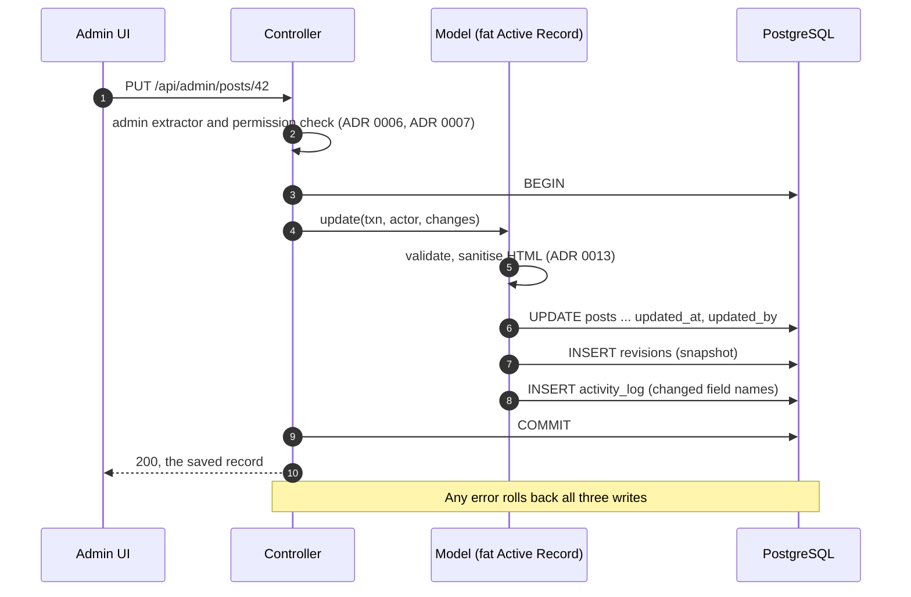
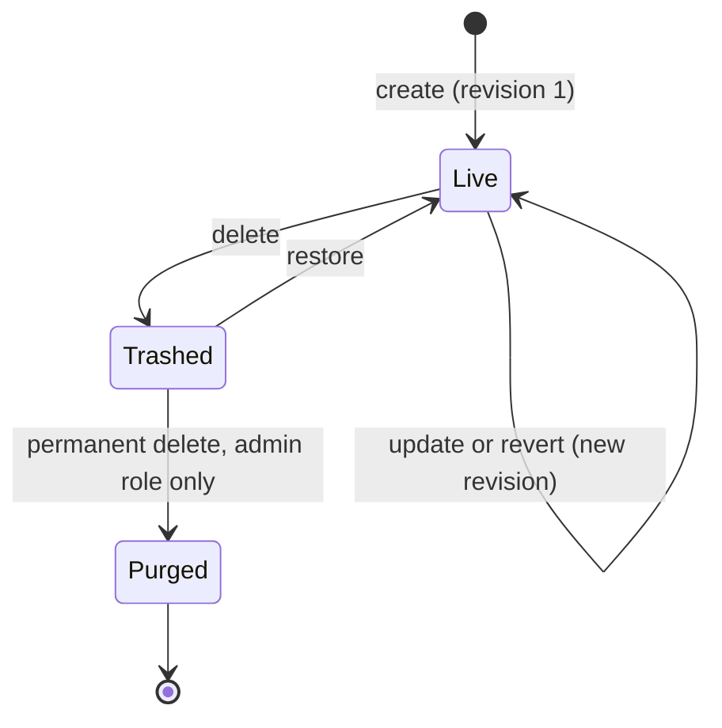

# 0011. Safety net: soft delete, revisions and an activity log for every entity

- Status: Accepted (2026-10-24)
- Decision questions: Q11, 11b (the scope answer). Related: Q30 (the newsletter is retired, so it is out of scope), Q19 (the importer keeps each original body as a revision), Q28 (the Logs screen is retired as a documented parity exception; operators use `oc logs` and the runbook. The activity log exists because of Q11, not as a Logs replacement)

## Context

| Fact | Number or detail | Source |
|---|---|---|
| Deletes in backend1 | Every delete is a hard `DELETE`. Deleting a post also deletes its index image and gallery files from disk and detaches its labels. Deleting an author sets `author_id` to NULL on that author's posts | research: SYNTHESIS §2.13, §3.14 N1; gap-08 §2.5; website_backend@0dead98:app/Models/Posts.php |
| History in backend1 | No `created_by` or `updated_by` column, no revisions. Four tables have no timestamps at all (`posts_labels`, `posts_authors`, `posts_pivot_labels_data`, `colleagues_data`) | research: SYNTHESIS §3.14 N2; gap-08 §3 |
| Dead `deleted_at` columns | `pages.deleted_at` and `menu_items.deleted_at` exist but are NULL on all 39 pages and 23 menu items; nothing writes them | research: SYNTHESIS §5.7; gap-08 §2.3 |
| The first save rewrites a body | The new editor parses stored HTML through the browser DOM, so the first save of a legacy body normalises the whole body; byte-identical preservation is impossible | research: gap-05 §4.3 |
| Round-trip losses measured | With the kit's default TipTap schema, a round-trip flattened tables to paragraphs (post 562: 140,006 B to 21,273 B) and dropped every iframe. With table, alignment and YouTube extensions added, cell styles were still lost. [ADR 0013](0013-rich-text-editor-and-html-sanitiser.md) extends the editor further, but a bad first save stays possible | research: SYNTHESIS §6.17; gap-06 §6.1 |
| Import rewrites bodies on purpose | The import normalisation task decodes entities, converts embeds and extracts base64 images; the original body is kept as a revision | research: DECISIONS 19; [ADR 0017](0017-legacy-data-import-normalisation-and-defect-resolution.md) |
| Enterprise boundary | Soft delete, history and audit-log UIs are react-admin Enterprise modules (`ra-soft-delete`, `ra-history`, `ra-audit-log`). Enterprise starts at 145 € per month billed annually for up to 2 developers, from a private registry, with no free trial | research: SYNTHESIS §6.22 |
| Framework support | loco-rs 1.2.0 and Sea-ORM 2.0.4 have no soft-delete support (0 matches in either source tree) | research: SYNTHESIS §6.6, §6.22 |
| Data size | 6.05 MiB in 6,677 rows. `posts_data` is 5,299 KiB for 576 posts. Recent pace is about 3.5 new posts a week | research: SYNTHESIS §4.1 |
| Cut-over | One flip to a new PostgreSQL database ([ADR 0002](0002-postgresql-as-the-database.md), [ADR 0003](0003-cut-over-one-rehearsed-flip-then-a-read-only-parallel-run.md)). backend2 reads MySQL and never reads backend3's tables, so soft-deleted rows cannot reappear on the live site through backend2 | research: DECISIONS 1, 2 |
| Who edits | Staff plus student writers who change every year | research: DECISIONS 10d |
| Logs screen | Retired; there is no log-file viewer in backend3 | research: DECISIONS 28 |

In backend1 a bad save or a delete cannot be undone, and no record says who changed it. The maintainer chose the full safety net for every admin-editable entity (research: DECISIONS 11 and 11b, a user override of the recommended "audit columns, activity log and revisions for posts and pages").

## Decision

backend3 has one generic safety net, built from four parts: audit columns, soft delete with a trash, revisions as JSON snapshots, and an append-only activity log. The admin UI gets one pattern for each: trash, history and activity log.

### 1. Scope

| Entity | Audit columns | Soft delete and trash | Revisions | Activity log |
|---|---|---|---|---|
| posts, pages, labels, authors, colleagues, dishes, canteen days, events, menu items, users | yes | yes | yes | yes |
| notices, partner banners, Diáktoll issues (release-1 additions, [ADR 0019](0019-scope-parity-tracking-retired-features-release-1-additions.md)) | yes | yes | yes | yes |
| site settings (one record, [ADR 0019](0019-scope-parity-tracking-retired-features-release-1-additions.md)) | yes | no: it cannot be deleted | yes | yes |
| newsletter | out of scope: retired, the table is not migrated ([ADR 0019](0019-scope-parity-tracking-retired-features-release-1-additions.md)) | | | |
| join tables (`post_labels`, `canteen_day_dishes`, `user_roles`, `user_permissions`) | no own history | no | recorded in the parent's revision | recorded on the parent |
| media library files ([ADR 0015](0015-media-separate-static-server-media-library-image-optimisatio.md)) | — | own file trash, defined in [ADR 0015](0015-media-separate-static-server-media-library-image-optimisatio.md): a deleted file moves out of the served tree, a `manage media` holder restores it ([ADR 0007](0007-authorization-four-roles-enforced-on-every-operation.md)), and a task purges it after 30 days. It uses the trash screens of section 8 | — | yes, every upload, rename, move, delete, restore and purge |
| sign-in and account events ([ADR 0006](0006-admin-authentication-and-account-lifecycle.md)) | — | — | — | yes |

"Admin-editable entity" means any database-backed resource with an admin create or update screen. Media-library files follow [ADR 0015](0015-media-separate-static-server-media-library-image-optimisatio.md) and the trash screens of section 8. A new resource joins the safety net in the PR that adds it.

### 2. Audit columns

Every table of an entity in scope gets `created_at`, `created_by`, `updated_at` and `updated_by`. Tables with soft delete also get `deleted_at` and `deleted_by`; site settings does not. Types follow [ADR 0010](0010-all-instants-stored-as-timestamptz.md):

| Column | Type | Rule |
|---|---|---|
| `created_at` | `timestamptz NOT NULL` | set on insert |
| `created_by` | `bigint NULL`, foreign key to `users.id` | the acting user; NULL for the importer and system jobs |
| `updated_at` | `timestamptz NOT NULL` | set on every update, restore and relation change; not on the account-event writes of section 4 |
| `updated_by` | `bigint NULL`, foreign key to `users.id` | as `created_by` |
| `deleted_at` | `timestamptz NULL` | set by soft delete, cleared by restore |
| `deleted_by` | `bigint NULL`, foreign key to `users.id` | as `created_by` |

- Model write methods take the actor as an explicit argument: a user id, or `System` for the importer, CronJob tasks and queue jobs. There is no thread-local or global "current user" ([ADR 0008](0008-code-layout-a-pure-src-domain-beside-loco-models.md)).
- Changing a relation, such as a post's labels or a canteen day's dishes, updates the parent's `updated_at` and `updated_by` and writes a parent revision.
- Imported rows keep their legacy `created_at` and `updated_at` where they exist, converted to instants per [ADR 0010](0010-all-instants-stored-as-timestamptz.md) (the canteen-day audit columns are read as Europe/Budapest wall time, the others as UTC). The three entity tables whose sources had no timestamps (labels, authors, colleagues) get the import instant. The fourth legacy table without timestamps, the label pivot, becomes the `post_labels` join table, which has no audit columns (section 1). `created_by` and `updated_by` are NULL, because no source exists to fill them from.

### 3. Soft delete

**Delete.** Deleting sets `deleted_at` and `deleted_by`. It never cascades to other rows and never removes files. Files owned by the row (index image, gallery, author or colleague image) stay on disk until permanent delete. Until then they stay reachable at their unlisted URL under `/storage`.

**Live rows.** A live row has `deleted_at IS NULL`. Each model offers one live-row query helper, and every public query uses it.

**Every public read filters `deleted_at`, on every table it touches:**

| Public read path | Tables filtered |
|---|---|
| post lists, paging, featured posts | posts, and each post's labels and author |
| single post, draft preview by token | posts (a deleted draft's preview link answers 404) |
| search, archive counts, label and author pages | posts, labels, authors |
| labels list, authors list, colleagues, events | that table |
| canteen days | canteen days and their dishes |
| page by slug | pages |
| menu tree | menu items at every level, and each item's linked page |
| sitemap | posts and pages |
| release-1 public endpoints (notices, partner banners, site settings, Diáktoll issues) | their tables |

**Dependencies.** A row that live rows depend on cannot be moved to the trash. The refusal names the dependent rows. This keeps public output free of references to trashed rows:

| Target | Delete is refused while | Source of the rule |
|---|---|---|
| author | a live post has this author | this ADR; `posts.author_id` is `ON DELETE RESTRICT` ([ADR 0009](0009-clean-domain-schema-with-preserved-integer-ids.md)) |
| page | a live menu item links to it | [ADR 0018](0018-content-model-publishing-pages-menu-tree-canteen-week-editor.md) |
| dish | a live canteen day uses it | [ADR 0018](0018-content-model-publishing-pages-menu-tree-canteen-week-editor.md) |
| menu item | it has live children | [ADR 0018](0018-content-model-publishing-pages-menu-tree-canteen-week-editor.md) |
| user | the account guards apply (no self-delete, last admin) | [ADR 0007](0007-authorization-four-roles-enforced-on-every-operation.md) |

Labels are tags, so a label can be moved to the trash while live posts carry it. Public output then leaves it out of those posts' label lists and out of label lists and label pages. Restoring the label brings the links back, because soft delete never touched `post_labels`. The delete confirmation warns first, for example "Ezt a címkét 12 élő bejegyzés használja."

A menu item that links to a hidden or trashed page is left out of the public menu together with its subtree ([ADR 0018](0018-content-model-publishing-pages-menu-tree-canteen-week-editor.md)).

**Admin reads.** Lists show live rows by default; the trash filter shows deleted rows. Reference pickers offer live rows only.

**Uniqueness.** [ADR 0009](0009-clean-domain-schema-with-preserved-integer-ids.md) and [ADR 0018](0018-content-model-publishing-pages-menu-tree-canteen-week-editor.md) define each uniqueness rule and whether trashed rows count. Rules over live rows only use PostgreSQL partial unique indexes (`... WHERE deleted_at IS NULL`), for example `canteen_days.date` and `lower(labels.name)`. Some rules count trashed rows on purpose, for example `lower(users.email)`, so a trashed account keeps its address until it is anonymised.

**Other effects.** A soft-deleted user cannot sign in ([ADR 0006](0006-admin-authentication-and-account-lifecycle.md)).

**Restore.** Restore clears `deleted_at` and `deleted_by` and sets `updated_at` and `updated_by`. It is refused, with a Hungarian message that names the blocking row, when:

- a row it depends on is in the trash (a post whose author is trashed, a menu item whose parent is trashed, a canteen day with a trashed dish);
- a live row already holds a value that must be unique (answered with 409);
- the row is an anonymised user ([ADR 0006](0006-admin-authentication-and-account-lifecycle.md)).

Restoring a published post needs `publish posts` ([ADR 0007](0007-authorization-four-roles-enforced-on-every-operation.md)).

### 4. Revisions

One generic table holds every revision:

| Column | Type | Content |
|---|---|---|
| `id` | `bigint` identity | |
| `entity_type` | `text NOT NULL` | resource name, for example `posts` |
| `entity_id` | `bigint NOT NULL` | the row's id |
| `revision_no` | `integer NOT NULL` | 1, 2, 3 … per entity; unique on `(entity_type, entity_id, revision_no)` |
| `reason` | `text NOT NULL` | one of `create`, `update`, `revert`, `import`, `import_original` |
| `schema_version` | `integer NOT NULL` | version of the snapshot DTO |
| `snapshot` | `jsonb NOT NULL` | the record after the write |
| `created_at`, `created_by` | as in section 2 | |
| `request_id` | `text NULL` | Loco's request id, to group a multi-row save |

Indexes: `(entity_type, entity_id, revision_no DESC)`.

- **When.** Every create and update writes one revision in the same database transaction. Delete and restore do not change content, so they write only an activity entry.
- **Account events are not content updates.** Writes by the sign-in and account flow of [ADR 0006](0006-admin-authentication-and-account-lifecycle.md) to `last_login_at`, `totp_last_step`, `token_version`, `password_hash` (including the bcrypt-to-Argon2id rehash), `must_change_password`, `temp_password_expires_at` and the other two-factor columns write no revision and do not change `updated_at` or `updated_by`. They write only the account activity entries of section 5. The same holds for the account side tables `password_reset_tokens` and `user_recovery_codes`.
- **What.** The snapshot is the entity's revision DTO, serialised after validation and after the HTML sanitiser ([ADR 0013](0013-rich-text-editor-and-html-sanitiser.md)). It holds every editable field plus relation id lists: a post's `label_ids`, a canteen day's `dish_ids`, a user's role names and extra grants.
- **Display.** `import_original` is the only snapshot kind that has not been through the sanitiser. The history panel never renders snapshot HTML as stored. For display, the server passes the rich-text fields of every revision through the same ammonia allow-list as writes ([ADR 0013](0013-rich-text-editor-and-html-sanitiser.md)). Reverting to an `import_original` revision loads it into the form, and saving sanitises it as usual. There is no raw HTML view (research: DECISIONS 15).
- **Never secrets.** The users revision DTO is an explicit allow-list. It never contains the password hash, the TOTP secret, recovery codes, reset tokens or `token_version`.
- **Schema changes.** When a revision DTO changes shape, its `schema_version` goes up, and a pure upcaster in `src/domain/` converts older snapshots for display and revert ([ADR 0008](0008-code-layout-a-pure-src-domain-beside-loco-models.md)). Each version step has a unit test.
- **Import.** Every imported row gets an `import` revision. When the normalisation task changed a body, revision 1 is `import_original` (the legacy body as stored in MySQL) and revision 2 is `import` (the normalised body). Otherwise revision 1 is `import` (research: DECISIONS 19).
- **Revert.** "Visszaállítás erre a változatra" loads a snapshot into the edit form. Nothing is written until the user saves. Saving goes through the normal update path (validation, sanitiser, permissions) and appends a new revision with reason `revert`. History is never rewritten. Ids in the snapshot that point at rows purged since then are dropped, with a warning in the form.
- **Retention.** All revisions are kept in release 1. At about 9 KiB per average post body and a few saves per post, a year of edits adds roughly 10 MiB.

### 5. Activity log

One append-only table records who did what and when:

| Column | Type | Content |
|---|---|---|
| `id` | `bigint` identity | |
| `occurred_at` | `timestamptz NOT NULL` | |
| `actor_id` | `bigint NULL`, foreign key to `users.id` | NULL for the importer and system jobs |
| `actor_kind` | `text NOT NULL` | `user`, `system` or `import` |
| `action` | `text NOT NULL` | from the list below |
| `entity_type`, `entity_id` | `text NULL`, `bigint NULL` | the record concerned, if any |
| `revision_id` | `bigint NULL` | the revision this action wrote, if any |
| `label` | `text NULL` | a display label for content records (post title, page title, label name, dish name, event title, menu item name), so the log stays readable after a purge. Empty for users, authors and colleagues, which are people: the log keeps only their id |
| `details` | `jsonb NULL` | for updates, the names of the changed fields (not their values); for media operations, the old and new path and the size; for batch actions, counts |
| `request_id` | `text NULL` | groups the entries of one request, such as a week-editor save or a bulk action |
| `ip` | `inet NULL` | filled only for sign-in and account events |

Indexes: `(occurred_at DESC)`, `(actor_id, occurred_at DESC)`, `(entity_type, entity_id, occurred_at DESC)`.

Actions:

| Group | Actions |
|---|---|
| Content | `create` (a page Clone is a `create` with the source page id in `details`), `update`, `revert`, `delete`, `restore`, `purge`, `publish`, `unpublish`, `reorder`, `preview_link_regenerated`, `import` |
| Accounts ([ADR 0006](0006-admin-authentication-and-account-lifecycle.md)) | `login`, `login_failed` (known accounts only), `logout`, `password_changed`, `reset_link_issued`, `temporary_password_issued`, `totp_enabled`, `totp_disabled`, `totp_reset`, `recovery_code_used`, `recovery_codes_regenerated`, `account_unlocked`, `user_activated`, `user_deactivated`, `roles_changed`, `grants_changed` |
| Media ([ADR 0015](0015-media-separate-static-server-media-library-image-optimisatio.md)) | `media_upload`, `media_rename`, `media_move`, `media_delete`, `media_restore`, `media_purge` |

- An entry for a data change is written in the same transaction as the change. A failed sign-in changes no data and is written on its own.
- The importer writes one `import` entry per table per run, with row counts in `details`, not one entry per row.

**Append-only in the database.** Triggers make the history tables tamper-resistant against application bugs:

| Table | UPDATE | DELETE | TRUNCATE |
|---|---|---|---|
| `revisions` | rejected | rejected, except inside a permanent-delete transaction that sets a transaction-local flag (`SET LOCAL`) checked by the trigger | rejected |
| `activity_log` | rejected, except inside a permanent-delete transaction (the same flag), and there only an UPDATE that sets `ip` to NULL and changes no other column; only the anonymisation of a user issues one (section 6) | rejected | rejected |

Removing a trigger takes a migration, which is a reviewed PR.

### 6. Trash and permanent delete

**Who.** Delete and restore need the resource's permission. The per-resource trash needs the same permission. The global trash across all types needs `view logs`. Permanent delete ("Végleges törlés") needs the `admin` role ([ADR 0007](0007-authorization-four-roles-enforced-on-every-operation.md)). Nothing in the entity trash is purged automatically. Media-library files have their own trash with a 30-day purge task ([ADR 0015](0015-media-separate-static-server-media-library-image-optimisatio.md)). Restoring a file needs `manage media`; deleting it permanently before the purge needs the `admin` role (section 8).

**What permanent delete does, per entity:**

| Entity | Permanent delete |
|---|---|
| post | deletes the row, its `post_labels` rows and its revisions; then the owned files (index image, gallery). Editor uploads under `uploads/posts/<id>/` stay, because other documents may link to them; the media library manages them ([ADR 0015](0015-media-separate-static-server-media-library-image-optimisatio.md)) |
| page | refused while a menu item, live or trashed, points at it; otherwise deletes the row and its revisions |
| label | deletes the row, its `post_labels` rows and its revisions |
| author | refused while a post, live or trashed, refers to it; otherwise deletes the row, the image file and its revisions |
| colleague | deletes the row, the image file and its revisions |
| dish | refused while a canteen day, live or trashed, uses it; otherwise deletes the row and its revisions |
| canteen day | deletes the row, its `canteen_day_dishes` rows and its revisions |
| event | deletes the row and its revisions |
| menu item | refused while it has children, live or trashed; otherwise deletes the row and its revisions |
| user | anonymises instead of deleting, so every reference stays valid. The row and id stay, `deleted_at` stays set, `active` becomes false and `anonymised_at` is set ([ADR 0006](0006-admin-authentication-and-account-lifecycle.md)). The name becomes "Törölt felhasználó #<id>". The e-mail address, password hash, TOTP secret, recovery codes, reset tokens, roles and extra grants are removed. The revisions of the account record itself (`entity_type = 'users' AND entity_id = <id>`) are deleted, because they hold the name and e-mail address. The `ip` of the activity entries that record the user's own sign-ins and account actions (`actor_id = <id>`, and `login_failed` entries for the account) is set to NULL, because an address tied to the account is personal data. Otherwise, revisions and activity entries the user authored (`revisions.created_by`, `activity_log.actor_id`) are kept unchanged. CHECK constraints allow a NULL e-mail address only on anonymised rows ([ADR 0006](0006-admin-authentication-and-account-lifecycle.md) section 7). An anonymised row cannot be restored and does not appear in the trash |
| notice, partner banner, Diáktoll issue | deletes the row and its revisions. A banner image or a Diáktoll PDF is a media-library file, not an owned file, so it stays ([ADR 0015](0015-media-separate-static-server-media-library-image-optimisatio.md)) |

A refusal names the rows that block it.

**Files.** Owned files are removed only after the purge transaction commits, by a job on the Postgres queue ([ADR 0016](0016-no-redis-in-memory-cache-postgres-queue-cronjob-tasks.md)). If the job fails, files are orphaned, never referenced by a missing row; the job reports the failure.

**Log.** Each permanent delete writes a `purge` entry with the label (content records) or only the id (people).

### 7. Write path

### 8. Admin UI

backend3 builds three screen patterns itself. They do what react-admin Enterprise's `ra-soft-delete`, `ra-history` and `ra-audit-log` do, described by behaviour only.

| Screen | Hungarian name | Behaviour |
|---|---|---|
| Trash | "Lomtár" | A filter on every resource list, and a global screen across all types. Columns: type, label, deleted at, deleted by. Actions: "Visszaállítás" (single and bulk) and "Végleges törlés" (single and bulk, `admin` role only, with a confirmation that names the record). Deleted media-library files appear in the global screen with type "Fájl" and their former path as label (deleted at and deleted by come from the file's `media_delete` entry), and in a "Lomtár" view of the media library, with the same two actions; restoring a file needs `manage media`. Anonymised users never appear. Only files are purged automatically, after 30 days ([ADR 0015](0015-media-separate-static-server-media-library-image-optimisatio.md)) |
| History | "Előzmények" | A panel on every edit page. Lists revisions (number, time, actor, reason). Any two revisions can be compared: plain fields in a before/after table; rich text rendered side by side, plus a word-level diff of its text. The rich text shown is always the server's sanitised display copy, never the stored snapshot HTML (section 4). Offers "Visszaállítás erre a változatra" (section 4). Also shows that record's activity entries |
| Activity log | "Tevékenységnapló" | A global timeline, `view logs` only. Filters: actor, entity type, action, date range. Each entry links to the record, its trash entry or its purge note, and to the revision diff |

- Delete moves the record to the trash. The confirmation says "Az elem a lomtárba kerül, onnan visszaállítható." The success notice offers "Visszavonás", which calls restore.
- Restore, permanent delete, the revision list and the activity log are custom methods on backend3's own data provider ([ADR 0005](0005-rust-dtos-are-the-api-contract-ts-rs-utoipa-openapi.md); never `ra-data-json-server`, research: DECISIONS 43a). Indicative routes: `POST /api/admin/<resource>/<id>/restore`, `POST /api/admin/<resource>/<id>/purge`, `GET /api/admin/<resource>/<id>/revisions`, `GET /api/admin/trash`, `GET /api/admin/activity`. The OpenAPI document is authoritative ([ADR 0005](0005-rust-dtos-are-the-api-contract-ts-rs-utoipa-openapi.md)).
- All strings are in Hungarian ([ADR 0021](0021-hungarian-only-admin-ui.md)).

**Clean-room rule.** The implementation is written from this ADR and from public documentation only. Contributors, human or AI, never install an `@react-admin/` package, never read or copy Enterprise source, types or styles, and never paste Enterprise examples. A CI check fails if `admin/package.json` or the lockfile names any `@react-admin/` package.

## Consequences

Positive:

- A bad save, including a destructive first save of a legacy body in the new editor, can be undone from the history panel.
- An accidental delete can be undone from the trash by the person who made it.
- Every change can be traced to a person and a time.
- One convention for all entities keeps the code and the UI uniform: one test helper, one set of screens.
- No Enterprise licence and no private registry are needed.

Negative:

- Every public query must filter `deleted_at` on every table it touches. A missed filter leaks a deleted record onto the live site. This is the main risk of this ADR, and the tests below exist to catch it.
- Files of a trashed record stay reachable at their unlisted URL until an admin purges the record.
- Restore can fail on a unique value that a newer live row now holds.
- Each write costs one extra insert into `revisions` and one into `activity_log`, inside the same transaction.
- Some deletes and permanent deletes are refused while other rows depend on the target, so an editor may first have to change those rows.

What must be true in code and tests:

- A generic resource test, run for every entity in scope, checks: create writes revision 1 and a `create` entry; update writes the next revision and an `update` entry listing the changed fields; delete writes no revision, writes a `delete` entry and hides the row from every public endpoint; restore brings it back; permanent delete is refused without the `admin` role and, with it, removes the rows and enqueues the file job.
- The public-API fixtures include a soft-deleted twin of every row type: post, draft with a preview token, label, author, page, menu item (parent and child), dish, canteen day, event, colleague and each release-1 type. Every public endpoint test asserts that the twins are absent.
- A CI check fails if a public-API module calls an entity finder directly instead of the live-row helper.
- SQL tests: DELETE and TRUNCATE on `activity_log` fail; UPDATE on `activity_log` fails outside a permanent-delete transaction, and inside one fails unless it only sets `ip` to NULL; UPDATE and TRUNCATE on `revisions` fail; DELETE on `revisions` fails outside a permanent-delete transaction.
- Anonymising a user sets `anonymised_at`, keeps `deleted_at`, deletes only the revisions with `entity_type = 'users' AND entity_id = <id>`, and sets `ip` to NULL on that user's sign-in and account entries. It leaves unchanged the number of revisions with `created_by = <id>` on other records and the number of activity entries with `actor_id = <id>`. Restoring an anonymised row is refused, and the row does not appear in the trash.
- A sign-in, a TOTP check and a bcrypt-to-Argon2id rehash write no users revision and leave `updated_at` and `updated_by` unchanged.
- The revisions endpoint returns a revision whose body holds a `<script>` element and an iframe from a host outside the allow-list without either, and the history panel renders it without either.
- A deleted media file appears in the global trash and in the media library's trash view; restoring it without `manage media` answers 403.
- A failure while inserting the activity entry rolls back the record change.
- The users revision snapshot contains exactly the allow-listed keys.
- Each snapshot upcaster step has a unit test.
- A restore that hits a partial unique index answers 409 with the Hungarian message.
- The CI check against `@react-admin/` packages runs on every PR ([ADR 0022](0022-builds-and-ci-pac-for-production-images-github-actions-for-p.md)).

## Alternatives considered

| Option | Why not |
|---|---|
| Q11 A: exact parity, hard delete and no history | Leaves bad saves and accidental deletes unrecoverable, at the moment a new editor starts rewriting legacy bodies |
| Q11 B: audit columns and an activity log only | Says who changed what, but cannot bring content back |
| Q11 C: B plus revisions for posts and pages (the recommended default) | Rejected by the maintainer (user override). The full set applies to every admin-editable entity |
| Q11 D: C plus soft delete for posts and pages, switched on after backend2 stops reading the tables | Its precondition holds from day one, because backend2 never reads backend3's database ([ADR 0003](0003-cut-over-one-rehearsed-flip-then-a-read-only-parallel-run.md)). The maintainer widened the scope to every entity (11b) |
| Buy react-admin Enterprise (`ra-soft-delete`, `ra-history`, `ra-audit-log`) | A commercial licence and a private registry do not fit a public AGPL-3.0-only repository that anyone must be able to build without a subscription; 145 € per month or more, with no trial |
| Per-entity history tables and per-entity trash screens | One generic pattern was chosen (11b): one revisions table, one activity log, one set of screens |

## References

- research: DECISIONS 1, 2, 10d, 11, 11b, 15, 19, 25b, 28, 29, 30, 43a (2026-10-24)
- research: QUESTIONS Q11, Q19, Q28, Q30
- research: SYNTHESIS §2.13 (delete cascades), §3.14 (features that do not exist), §4.1 (database at a glance), §5.7 (visibility rules), §6.6 and §6.22 (no soft delete in Loco or Sea-ORM; Enterprise boundary), §6.17 (rich-text round trip)
- research: gap-05 §4.3, gap-06 §6.1, gap-08 §2-§3, §6
- website_backend@0dead98:app/Models/Posts.php
- [ADR 0002](0002-postgresql-as-the-database.md), [ADR 0003](0003-cut-over-one-rehearsed-flip-then-a-read-only-parallel-run.md), [ADR 0005](0005-rust-dtos-are-the-api-contract-ts-rs-utoipa-openapi.md), [ADR 0006](0006-admin-authentication-and-account-lifecycle.md), [ADR 0007](0007-authorization-four-roles-enforced-on-every-operation.md), [ADR 0008](0008-code-layout-a-pure-src-domain-beside-loco-models.md), [ADR 0009](0009-clean-domain-schema-with-preserved-integer-ids.md), [ADR 0010](0010-all-instants-stored-as-timestamptz.md), [ADR 0013](0013-rich-text-editor-and-html-sanitiser.md), [ADR 0015](0015-media-separate-static-server-media-library-image-optimisatio.md), [ADR 0016](0016-no-redis-in-memory-cache-postgres-queue-cronjob-tasks.md), [ADR 0017](0017-legacy-data-import-normalisation-and-defect-resolution.md), [ADR 0018](0018-content-model-publishing-pages-menu-tree-canteen-week-editor.md), [ADR 0019](0019-scope-parity-tracking-retired-features-release-1-additions.md), [ADR 0021](0021-hungarian-only-admin-ui.md), [ADR 0022](0022-builds-and-ci-pac-for-production-images-github-actions-for-p.md)
