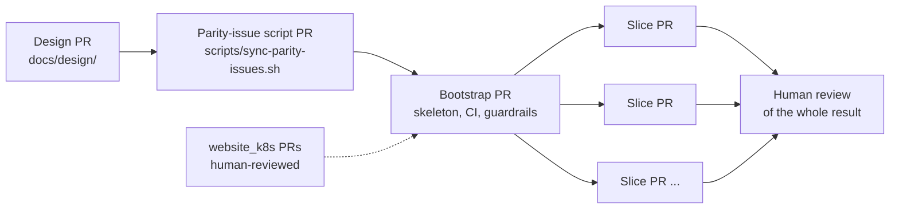

# 0012. Delivery, review, commits and licensing

- Status: Accepted (2026-10-24)
- Decision questions: Q12, Q13, Q14, Q44, and the maintainer's follow-up decisions R1 (SPDX identifier), R2 (merge autonomy in other repositories) and R3 (self-merge mechanism)

## Context

One maintainer and AI agents build backend3. This ADR sets four things: the order in which work lands, how pull requests merge, what commit history looks like, and the licence the code is published under.

| Fact | Value | Source |
|---|---|---|
| Who does the work | Since 2025-10 all website work has been one maintainer plus AI agents. Every `OWNERS` file lists exactly two approvers. | research: SYNTHESIS §7.6.1, §7.6.4; QUESTIONS Q13 |
| How Tide merges | Tide squash-merges. The PR title becomes the commit subject on `master`, with a `(#N)` suffix. The org-wide query needs the labels `lgtm` and `approved`, and none of `needs-rebase`, `do-not-merge/hold`, `do-not-merge/work-in-progress`, `do-not-merge/invalid-owners-file`. Prow's lgtm plugin does not let an author `/lgtm` their own PR. | website_k8s@34b8b55:verseghy-website/prow/configmaps.yaml; research: SYNTHESIS §7.6.2 |
| Branch protection | branchprotector protects `master` in every managed org repo (website_backend3 included): `enforce_admins`, no force pushes, no deletions, linear history, conversation resolution, required context `tide`. It runs weekly, on Sunday at 03:00. Tide reads the required contexts from branch protection and skips contexts that are not listed. | website_k8s@34b8b55:verseghy-website/prow/branchprotector.yaml, configmaps.yaml; research: SYNTHESIS §7.6.2 |
| Rulesets | A repository ruleset that requires a native GitHub review blocks Tide, unless the `verseghy-prow` app (id 2748019) is a bypass actor. website_backend3 has no ruleset (GitHub API, 2026-10-24). | research: SYNTHESIS §7.6.3 |
| What a review bottleneck costs | backend2's test suite and 12 semantic fixes arrived on 2026-09-14 as 14 stacked PRs (#246-#259). The base PR still waits for a second reviewer, so nothing in the stack can merge. | research: SYNTHESIS §7.9.4, §7.10 |
| Commit conventions differ by repo | website_frontend: Angular conventional commits with scopes, 100-character lines. website_backend2: conventional commits, mostly without a scope. website_k8s: `<component>: <subject>`. website_backend: plain sentences since 2023. | research: SYNTHESIS §7.6.7 |
| AI attribution | `Co-authored-by: Claude` trailers are on `master` in four repos. The maintainer's rule forbids claude.ai session links in public repositories. | research: SYNTHESIS §7.6.8 |
| Licences in the org | website_backend, website_backend2, website_frontend, website_k8s and iam are MPL-2.0. website_frontend2 is AGPL-3.0. website_backend3 was created with the AGPL-3.0 text in `LICENSE`; the chosen SPDX identifier is `AGPL-3.0-only`. | research: SYNTHESIS §7.6.6; research: DECISIONS R1 |
| Third-party source that backend3 copies in | The Loco agent skill: 17 Markdown files (350,563 bytes) from the `loco-rs` crate, licence Apache-2.0. The 1.2.0 crate ships a `LICENSE` file and no `NOTICE` file. The admin kit: shadcn-admin-kit, MIT, "Copyright (c) 2025 marmelab". The shadcn/ui primitives it installs: MIT, "Copyright (c) 2023 shadcn". Apache-2.0 §4 requires every redistributed copy to carry the licence and keep the upstream notices. | research: SYNTHESIS §6.13, §6.14; loco-rs 1.2.0 (crates.io): `Cargo.toml` (`license = "Apache-2.0"`), `LICENSE`; github.com/marmelab/shadcn-admin-kit `LICENSE`; github.com/shadcn-ui/ui `LICENSE.md` |
| Dependency licence policy in the house | backend2's `deny.toml` allows MIT, Apache-2.0, ISC, MPL-2.0, BSD-2-Clause, BSD-3-Clause, Zlib, Unicode-3.0 and BSL-1.0, with a CDLA-Permissive-2.0 exception for `webpki-roots`. It bans `openssl` and `openssl-sys` and denies unknown registries and git sources. No house licence check exists for npm. | website_backend2@7ba71da:deny.toml; research: SYNTHESIS §7.6.6 |

## Decision

### 1. Delivery order

1. **Design first.** One PR adds `docs/design/`: the architecture overview, ADRs 0001-0024, the parity checklist ([parity.md](../parity.md)), the public API contract ([public-api.md](../public-api.md)) and the other specs. It merges before any code. When a later change alters a decision, it adds a new ADR that supersedes or amends the old one, in the same PR as the code that needs it. That PR merges only after a maintainer accepts the new ADR ([ADR 0001](0001-record-architecture-decisions.md) section 6).
2. **Parity-issue script PR.** A small PR adds `scripts/sync-parity-issues.sh` and its tests (ADR 0019 section 1, PLT-39 in [parity.md](../parity.md)). It merges after the design PR and before the bootstrap PR opens. Then the project board is created and the script creates one issue per parity ID, so the bootstrap PR and every later PR can carry `Closes #N`. Its tests run locally until the bootstrap PR adds the CI jobs that run them.
3. **Bootstrap PR.** One PR adds what every later PR builds on:
   - the Loco app with `loco-rs = "=1.2.0"` and a committed `Cargo.lock` (ADR 0024), and the `admin/` skeleton (ADR 0004);
   - the PR-check workflows (ADR 0022), including the two checks in section 3 of this ADR;
   - the `Containerfile` and `.tekton/push.yaml` (ADR 0004, ADR 0022);
   - `AGENTS.md`, `CLAUDE.md`, the vendored Loco skill, `.claude/settings.json`, the hook and the database guard (ADR 0024);
   - `THIRD_PARTY.md`, the licence files of vendored code, `deny.toml` and `clippy.toml` (section 4).

   The matching website_k8s changes are separate PRs in website_k8s, and a human reviews them (section 2). The PAC `Repository` CR must merge before the bootstrap PR merges to `master`. That merge is the first push that carries `.tekton/push.yaml`, so PAC builds the first production image (ADR 0022).
4. **Vertical slices.** After that, one PR per entity or feature group. A slice carries one feature end to end:
   - the migration and the model (ADR 0009);
   - DTOs and handlers for the admin API, plus the public endpoint if the feature has one (ADR 0005, [public-api.md](../public-api.md));
   - the admin screen (ADR 0004, ADR 0021);
   - the importer step for its tables (ADR 0017), so the nightly rehearsals (ADR 0003) grow with each slice;
   - tests at each layer: unit tests for pure helpers, request tests for endpoints, admin unit tests, and an E2E test for the main flow;
   - the doc updates, and a `Closes #N` line for each parity issue the slice finishes (ADR 0019).
5. **Size.** A slice aims for about 500 hand-written lines or fewer (added plus changed). These do not count: generated files (ts-rs bindings, the OpenAPI snapshot, insta snapshots, generator output committed without edits), lock files and vendored files. A feature that needs more is split into smaller vertical slices by feature (for example list and edit first, trash and history next). It is never split by layer (all migrations, then all endpoints, then all screens).
6. **Branching.** Every PR branches from `master`. A PR may build on at most one other open PR. When that base merges, the PR is rebased onto `master`. Deeper stacks are not allowed.
7. **Drafts.** A PR opens as a draft. It is marked ready for review only when the work is complete and every check is green. Section 2 explains why this matters here.

The planned slice order follows the dependencies, and the project board (ADR 0019) can change it: authentication, users and roles first (every admin endpoint needs them); then labels and authors, which settle the shared patterns (list and search, trash, revisions, activity log); then posts, pages, menu and the media library; then colleagues, canteen and events; then the release-1 additions and the dashboard. Each entity's public endpoint ships in the same slice as the entity.

### 2. Merge policy

- **Self-merge in this repository.** In website_backend3, agents push branches, open PRs and merge their own PRs once the required checks pass. No second person reviews each PR. The same autonomy applies in the private Verseghy/runbooks repository.
- **One human review of the whole.** A human reviews everything once all the work is done, outside the per-PR loop. It is tracked as one item in the parity checklist (PLT-36 in [parity.md](../parity.md)).
- **Other repositories.** In website_k8s, website_backend2, website_frontend and every other repository, agents open PRs and leave them for human review. They never merge there. A PR there that finishes a parity item carries `Closes Verseghy/website_backend3#N` in its body (ADR 0019 section 1).
- **Mechanism.** website_k8s PR #50 (merged 2026-10-24) adds a Tide query for this repository.

| Element | Setting |
|---|---|
| Tide query for `Verseghy/website_backend3` | `labels: [approved]`, with the same `missingLabels` as the org query |
| Who applies `approved` | Prow's approve plugin, from `OWNERS`. The author is an approver, and self-approval applies through the plugin's default `require_self_approval: false`. The first PR confirms this. |
| Merge method | squash (the org default) |
| Branch protection | unchanged: protected `master`, `enforce_admins`, linear history, no force pushes, no deletions, conversation resolution, required context `tide`. The PR-check job names are added as required contexts in a follow-up website_k8s PR once the jobs exist (ADR 0022). |
| Repository ruleset | none. If one is ever added, it must not require a native review, or it must list the `verseghy-prow` app (2748019) as a bypass actor with `bypass_mode: always`. Otherwise Tide can never merge. |

- **Everything merges through Tide.** Nobody pushes to `master`, uses the merge button or uses an admin override. Once branchprotector has protected the branch, `enforce_admins` makes this binding.
- **What the approved-only query implies.** A PR opened by an approver can merge as soon as Tide sees its required contexts pass. Two rules follow:
  - work in progress stays a draft (Prow's wip plugin then adds `do-not-merge/work-in-progress`) or carries `/hold`;
  - until the PR-check jobs are required contexts, Tide does not wait for them, because only `tide` is required and unlisted contexts are skipped. Until the follow-up website_k8s PR merges, a PR is marked ready only after all of its checks have passed.

### 3. Commits and PR titles

Tide squash-merges, so the PR title becomes the commit subject on `master`. The convention is therefore checked on PR titles.

**Format.** `<type>(<scope>[,<scope>...])[!]: <subject>`

- `type` is one of `build`, `chore`, `ci`, `docs`, `feat`, `fix`, `perf`, `refactor`, `revert`, `style`, `test`.
- `scope` is required. It is one or more of the six fixed scopes below, separated by commas.
- `!` marks a breaking change to the public API ([public-api.md](../public-api.md)) or the admin API. It should be rare.
- `subject` is in the imperative and has no trailing period. The whole title is at most 90 characters, so the squash subject with Tide's ` (#NNNN)` suffix stays within 100.
- The check regex is `^(build|chore|ci|docs|feat|fix|perf|refactor|revert|style|test)\((api|admin|db|import|deploy|docs)(,(api|admin|db|import|deploy|docs))*\)!?: \S.*$`.

| Scope | What it covers |
|---|---|
| `api` | Rust application code: controllers, models, `src/domain/`, DTOs, workers and tasks other than the importer, the admin API and the public API, Rust dependencies |
| `admin` | everything under `admin/`: screens, the data provider, the Hungarian message file, npm dependencies |
| `db` | migrations and schema changes |
| `import` | the legacy MySQL importer and its normalisation and resolution rules (ADR 0017) |
| `deploy` | `Containerfile`, `.tekton/`, `.github/workflows/`, build and release scripts, `.claude/settings.json` and hooks |
| `docs` | `docs/`, `README.md`, `THIRD_PARTY.md`, `AGENTS.md`, `CLAUDE.md` and the project skill |

Examples: `feat(db,api,admin): add labels with trash and history`, `fix(api): keep backdated posts in keyset paging`, `build(api): bump loco-rs to 1.3.0`.

- **Bots.** Dependabot's `commit-message.prefix` sets both the commit message and the PR title, and Dependabot adds `: ` after a prefix that ends in `)` (GitHub docs, Dependabot options reference). The prefixes are `build(api)` for cargo, `build(admin)` for npm and `ci(deploy)` for GitHub Actions. GitHub's "Revert" button produces `Revert "..."`; the author renames the PR to `revert(<scope>): ...`.
- **Enforcement.** A job named `PR title` runs on `pull_request` events (`opened`, `edited`, `reopened`, `synchronize`). It is a small script in the repository, not a third-party action. It is a required context (ADR 0022). Commit messages on branches are not checked for format, because they are squashed away.
- **AI attribution.** `Co-Authored-By: Claude ... <noreply@anthropic.com>` trailers in commits and a "Generated with Claude Code" line in PR bodies are allowed. They are not required.
- **Session links are banned.** No claude.ai session link may appear anywhere in this public repository: in commit messages, PR titles or bodies, issues, comments, code or docs. A session link is an `http` or `https` URL with the host `claude.ai` whose path starts with `/code/session_`. Prose that names the rule without a URL, as this ADR does, is not a link.
- **Session-link check.** A job named `No session links` scans the PR title and body (from the event payload), every commit message in the PR's range, and the added lines of the diff. It matches only real links (scheme, host and the `/code/session_` path prefix), fails, and names the place where it found one. It also runs on `edited`, so a body edit is checked while the PR is open. The script assembles its pattern from parts, so it never matches itself. CI cannot check issue bodies, comments or edits made after the merge; `CLAUDE.md` states the rule for those (ADR 0024).

### 4. Licence

- **Repository licence.** The repository is licensed `AGPL-3.0-only`. `LICENSE` holds the AGPL-3.0 text. `Cargo.toml` sets `license = "AGPL-3.0-only"` and `publish = false`. `admin/package.json` sets `"license": "AGPL-3.0-only"` and `"private": true`. Source files carry no per-file licence headers.
- **Vendored code keeps its own licence file** next to it:

| Path | Upstream | Licence | Licence file | May it be modified? |
|---|---|---|---|---|
| `.claude/skills/loco/` | `skills/loco/` of the `loco-rs` crate at the locked version (1.2.0) | Apache-2.0 | `.claude/skills/loco/LICENSE`, a byte copy of the crate's `LICENSE` | Never: it is vendored verbatim (ADR 0024), so the Apache-2.0 §4(b) notice for modified files never applies |
| `admin/src/components/admin/`, plus kit files installed elsewhere (such as the kit's `src/lib` helpers), each listed by path in `THIRD_PARTY.md` | shadcn-admin-kit registry, v2.0.0 | MIT, Copyright (c) 2025 marmelab | `admin/src/components/admin/LICENSE` | Yes. Copy-and-own is the kit's model, and some files change, for example to make hard-coded English strings translatable (ADR 0021). |
| `admin/src/components/ui/` | shadcn/ui primitives installed by the kit | MIT, Copyright (c) 2023 shadcn | `admin/src/components/ui/LICENSE` | Yes |

- **`THIRD_PARTY.md`** at the repository root indexes every vendored path. Each row gives the upstream URL, the version or commit, the SPDX identifier, the licence file, and whether the copy is modified. A PR that adds or re-syncs vendored code updates `THIRD_PARTY.md` in the same PR.
- **Dependencies are checked, not listed.** Code fetched by cargo or npm is not vendored, so it is checked in CI instead of being indexed in `THIRD_PARTY.md`:
  - `cargo-deny` uses backend2's licence allow-list, the `webpki-roots` exception, the `openssl` ban and the source rules. The workspace's own crates are `AGPL-3.0-only` and unpublished, and `[licenses] private = { ignore = true }` skips them (cargo-deny docs).
  - The admin CI job fails when a production npm dependency has a licence outside the npm allow-list, which follows the same compatibility rule (ADR 0022 section 4). The bootstrap PR picks the tool.
  - Both allow-lists contain only permissive licences and MPL-2.0. All of them can be combined into an AGPL-3.0 work.
  - ADR 0022 section 4 holds the exact `deny.toml` settings and the `Admin licenses` job.
- **Source offer for network users (AGPL-3.0 §13).** Editors and site visitors use backend3 over a network. The admin UI footer links to the public repository at the commit that is running. The OpenAPI document's `info` block names the licence and links to the source. Production images are built only from public `master` commits (ADR 0022), so the link always points at the running source.
- **Contributions** are accepted under the repository licence (inbound equals outbound). There is no CLA.

## Consequences

**Positive**

- Each PR can be reviewed, tested and reverted on its own. `master` stays deployable after every merge.
- Work no longer stops while it waits for a second person, which is what stalled backend2 #246-#259.
- The history can be grepped by scope, and the session-link rule is enforced by CI instead of by memory.
- Anyone who runs a modified backend3 as a network service must offer its source.

**Negative and risks**

- No second person reviews each PR before it merges. A defect can reach `master` and stay there until the final review. The mitigations are the required checks (ADR 0022), the testing standard, small slices and the ADRs. The maintainer can stop any PR with `/hold`.
- The final human review covers the whole codebase. To keep it workable, every PR body names the parity IDs and the ADRs it implements.
- Until the required-contexts follow-up merges, CI does not gate Tide; the draft rule covers that gap.
- Every change in website_k8s, website_frontend and website_backend2 waits for a human. Cross-repository steps must start early: the PAC CR (ADR 0022) and the Angular REST build. website_backend2 #251 and #258 already exist, and decision 2 says to merge them now; the maintainer merges them (R2).
- Code cannot move from backend3 into the MPL-2.0 house repositories unless its authors relicense it. The other direction works: MPL-2.0 code can be combined into this AGPL-3.0 work (MPL-2.0 §3.3).

**Follow-up work**

- The maintainer merges website_backend2 #251 and #258 now (decision 2); [cutover.md](../cutover.md) P5 checks that they are deployed.
- The parity-issue script PR merges after this design PR and before the bootstrap PR opens (section 1; ADR 0019 section 1).
- A follow-up website_k8s PR adds website_backend3's required contexts to Prow branch protection (ADR 0022).
- The bootstrap PR adds: the `PR title` and `No session links` jobs, `THIRD_PARTY.md` and the licence files, `deny.toml`, the npm licence check, the Dependabot prefixes and the admin footer source link.
- The first PR confirms that self-approval sets `approved`.

**What must be true in code and tests**

- The title check and the session-link check each have their own tests, which run in CI: accepted and rejected sample titles, and a sample body, commit message and diff line that contain a link.
- The `cargo-deny check bans licenses sources` and `Admin licenses` jobs are required contexts (ADR 0022).
- Every vendored directory has a `LICENSE` file and a `THIRD_PARTY.md` row. The Loco skill check (ADR 0024) also compares `LICENSE` with the crate's.
- The admin footer renders the source link. A request test asserts that the OpenAPI `info.license` names `AGPL-3.0-only`.

## Alternatives considered

- **Q12 B: spike the code first and write the design afterwards.** Rejected: agents need the "why" before the code, and the decisions had to be made first.
- **Q12 C: layered PRs** (all schema, then all endpoints, then all screens). Rejected: no layer PR can be tested end to end.
- **Q12 D: one long-lived feature branch merged at parity.** Rejected: one huge, untestable merge at the end.
- **Q13 A: keep two-person review on every PR.** Rejected: it recreates the backend2 stall.
- **Q13 B: self-approval with a `needs-human-review` label** for schema, auth, storage and cut-over PRs (the recommended default). Rejected by the maintainer in favour of one review of the whole result.
- **Q13 C: add a third OWNERS reviewer.** Rejected: there is no third reviewer.
- **Q13 D: merge freely into a `develop` branch** and batch-review `develop` into `master`. Rejected: a second long-lived branch, and Prow, PAC and RHDH are all set up for `master`.
- **Q14 A: MPL-2.0 with per-directory notices** (the recommended default, matching the house licence). Rejected by the maintainer in favour of AGPL-3.0. The per-directory notices and `THIRD_PARTY.md` from this option are kept.
- **Q14 B: MPL-2.0 without notices.** Rejected: it breaks Apache-2.0 §4 and the MIT notice condition.
- **Q14 D: MIT/Apache-2.0 dual licence.** Rejected: no network copyleft.
- **`AGPL-3.0-or-later`.** Rejected: the maintainer confirmed `AGPL-3.0-only` on 2026-10-24 (R1).
- **Q44 B: conventional commits with no AI attribution.** Rejected: attribution is allowed; only session links are banned.
- **Q44 C: no enforced format.** Rejected: history that cannot be grepped, and a session-link rule that nothing enforces.

## References

- research: QUESTIONS Q12, Q13, Q14, Q44; research: DECISIONS rows 12, 13, 14, 44, R1, R2, R3
- research: SYNTHESIS §6.13 (Loco skill), §6.14 (kit licensing), §7.6.1-§7.6.8 (people, Prow, rulesets, OWNERS, licences, commit style, AI attribution), §7.10 (backend2 stacked PRs)
- website_k8s PR #50, "prow: let Tide merge website_backend3 PRs with the author's approval" (merged 2026-10-24)
- website_backend2 PRs #251 and #258
- website_k8s@34b8b55: `verseghy-website/prow/configmaps.yaml`, `verseghy-website/prow/branchprotector.yaml`
- website_backend2@7ba71da: `deny.toml`
- loco-rs 1.2.0 (crates.io): `Cargo.toml`, `LICENSE`, `skills/loco/`
- shadcn-admin-kit `LICENSE` (MIT, marmelab); shadcn/ui `LICENSE.md` (MIT, shadcn)
- GitHub docs, Dependabot options reference: `commit-message.prefix`
- cargo-deny docs, licenses configuration: `private.ignore`
- GNU AGPL-3.0 §13; Apache License 2.0 §4; Mozilla Public License 2.0 §3.3
- Related ADRs: [0003](0003-cut-over-one-rehearsed-flip-then-a-read-only-parallel-run.md), [0004](0004-admin-ui-lives-in-admin-and-ships-in-the-backend3-image.md), [0005](0005-rust-dtos-are-the-api-contract-ts-rs-utoipa-openapi.md), [0009](0009-clean-domain-schema-with-preserved-integer-ids.md), [0017](0017-legacy-data-import-normalisation-and-defect-resolution.md), [0019](0019-scope-parity-tracking-retired-features-release-1-additions.md), [0021](0021-hungarian-only-admin-ui.md), [0022](0022-builds-and-ci-pac-for-production-images-github-actions-for-p.md), [0024](0024-ai-maintainability-instruction-files-the-loco-skill-guardrai.md)
