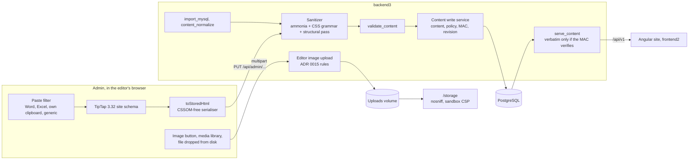

# 0013. Rich-text editor and HTML sanitiser

- Status: Accepted (2026-10-24)
- Decision questions: Q15 and the follow-up answers 15a-15g

## Context

Posts and pages carry HTML bodies. Editors write them in the admin, and both public sites render them. The maintainer answered Q15 on 2026-10-24 (research: DECISIONS 15). Seven follow-up questions about the detailed design were answered the same day (research: DECISIONS 15a-15g). This ADR records all eight answers and the design that implements them. [editor.md](../editor.md) is the implementable specification.

### What editors store

Counts marked **[500]** come from the 500-post and 24-page harvest of the public API, as in [data-migration.md](../data-migration.md). The import re-takes every count on the real dump.

| Fact | Value | Source |
|---|---|---|
| Bodies to import | 615 rows: 576 posts (541 published, 35 drafts) and 39 pages. 28 published posts have no body. | [data-migration.md](../data-migration.md) §6 |
| Inline style declarations | 62,935 **[500]**. 11 properties make up 99.6 % of them, and all 11 sit on `td` and `table`. | research: editor design §3.4 |
| Pasted spreadsheets are the live authoring pattern | In 2026, 1,101 of 1,109 `<td>` carry a style, in 9 tables across 7 posts. 34 of the 44 tables made in 2024-26 are Excel pastes **[500]**. | research: editor design §3.4 |
| Tables that stretch to the 1000 px content box on the live site | 114: 102 in posts, 12 in pages **[500]** | [ADR 0017](0017-legacy-data-import-normalisation-and-defect-resolution.md) |
| Images | 110 **[500]**. 103 are sized by an inline width, and 53 of those are wider than 700 px. 9 have no `alt` and 14 an empty one. | research: editor design §5.3, §9 |
| Embeds | 8 oEmbed wrappers in 7 published posts; bare YouTube iframes in 13 posts **[500]**; 20 YouTube and padlet iframes in 19 posts | [ADR 0017](0017-legacy-data-import-normalisation-and-defect-resolution.md), [ADR 0019](0019-scope-parity-tracking-retired-features-release-1-additions.md) |
| Character styling | 0 `color`, `font-size` or `font-family` declarations. The legacy editor build loaded no font or colour plugin. Word and Excel do send colour, size and highlight, so new pastes will carry them. | research: editor design §3.4 |
| `/storage` sources in content | 74 distinct image sources (jpg 69, JPG 1, png 3, gif 1); 9 contain parentheses. Links into `/storage`: pdf 183, jpg 15, docx 8, doc 5, none to `.svg`, `.html` or `.xml`. | research: editor design §2.8, §11 |

### Two public renderers, neither of which changes here

| | Angular site (`website_frontend`, live build v1.6.3) | website_frontend2 (SolidStart beta, out of scope, research: DECISIONS 31) |
|---|---|---|
| How content enters the page | Inserted as trusted HTML ([public-api.md](../public-api.md) §2.4). In the browser, `processCustomTags` moves every `` in front of its parent element, copies its inline `width` into `max-width`, sets `width: 100%`, rewrites the image host and sets `target` on links. Server-side rendering returns the HTML unchanged. | DOMPurify 3.4.14 with `ADD_TAGS: ['iframe']`, after an image-host rewrite. DOMPurify removes `allow`, `allowfullscreen` and `referrerpolicy` from iframes. A hook sets `target="_blank"` and `rel="noopener"` on links. |
| Tables | The inline table `width` is ignored and the table stretches to the 1000 px box. `tbody` gets `display: table`, so `colgroup` widths and `thead` misalign. | Inline widths are honoured, inside a scroll box. A `
` inside a cell wraps (`text-wrap: pretty`), which defeats Excel's `nowrap`. |
| Cell box sizing | content-box: a cell with `width: 64px` is 75 px wide | `* { box-sizing: border-box }`: 64 px |
| Typography | Headings 36/27/21.06/18 px, Roboto, Roboto Light Italic | Headings 26/22/20/19 px, `-apple-system, BlinkMacSystemFont, Roboto`, synthesised italic, a 700 px quote box |

Sources: website_frontend@f74c765:apps/frontend/src/app/modules/shared/components/page-renderer/page-renderer.component.ts; website_frontend2@8108c88:src/utils/sanitize.ts, src/components/PageRenderer.module.scss; research: editor design §4.2.

A table measured on both sites in Chrome 156 had identical geometry when it had no table width, `border-collapse: collapse; max-width: fit-content`, `tbody` with `display: table-row-group`, widths on the cells, and no `
` inside the cells (research: editor design §4.3). A table width, a `
` in a cell, or a cell width without a fixed box model each broke the match. Heading sizes, the font stack and italics cannot be made equal from the content side. Neither renderer changes in this project. The website_frontend REST build promoted at the cut-over ([ADR 0003](0003-cut-over-one-rehearsed-flip-then-a-read-only-parallel-run.md)) changes its API calls, not its page renderer or its content CSS, which stay as at website_frontend@f74c765. **Layout parity must therefore come from the shape of the stored HTML.**

### Why the stock editor and stock TipTap do not work

- **The kit's input.** shadcn-admin-kit's `rich-text-input` flattens tables in one round trip (post 562: 140,006 to 21,273 bytes) and drops every iframe. With Table, TextAlign and YouTube added, cell borders, widths, heights and vertical alignment are still lost, and bare iframes are still dropped (research: QUESTIONS 15). The kit writes its own `class` attributes (`text-node`, `heading-node`, …) into the stored HTML. Its value-sync effect reloads with `preserveWhitespace: "full"` whenever `getHTML()` differs from the value, which turns legacy source indentation into empty paragraphs (post 532: 12 to 24 `
`) (shadcn-admin-kit@c1503dd:src/components/rich-text-input/minimal-tiptap/hooks/use-minimal-tiptap.ts).
- **`editor.getHTML()` is not stable storage.** It returns the browser's CSSOM re-serialisation (`rgb()` colours, grouped `border-width`), which differs between engines (research: editor design §0 #5).
- **Stock extensions emit or parse the wrong shape.** The table node writes a `colgroup` plus `width` or `min-width`, and installs its table view even when resizing is off. The YouTube extension writes about 12 option attributes and parses only its own wrapper. StarterKit's trailing node appends `

` after a final table. Heading parses only its configured levels. Subscript and Superscript do not exclude each other, so a run can be stored as ``. The Bold, Italic and Underline parse rules read `font-weight` and friends on any element, so typography on a `td` is never a fixed point. The 3.32.0 FileHandler consumes a drop that also carries HTML before its callback runs (research: editor design §2.3, §11).
- **Office clipboard HTML needs its own handling.** Word lists are plain paragraphs with `mso-list` styles. Excel's styling lives in `<style>` class rules, and Excel desktop places `<!--StartFragment-->` inside `<table>`. Hidden rows stay in the HTML. Excel also puts a picture of the range on the clipboard. Word cells use `%` widths, which the two renderers resolve differently. prosemirror-view 1.42 added its own `<style>` inliner. It applies class rules over inline styles and erases `mso-list`, so Excel merged-cell borders and Word list levels are lost (research: editor design §2.4, §4.3).
- **The paid option is excluded.** Tiptap's paste handler for Word, Excel and Google is a Team-plan feature (research: editor design §7.2). Research: DECISIONS 15 requires open-source extensions only.

### The maintainer's answers

| # | Answer (research: DECISIONS) |
|---|---|
| 15 | Extended TipTap. Copy-paste from Microsoft Excel and Word must keep styling. Tables with custom cell styles, TextAlign, YouTube (bare iframes parsed), a padlet node, image sizes, real uploads, mandatory alt text. A server ammonia allow-list on every write, with iframes only from YouTube and padlet. No raw HTML view. Editor styling matches the public renderers. |
| 15a | The editor surface matches website_frontend2's PageRenderer styling, not the live Angular site. Tables, images and embeds render identically on both sites through the content-v1 HTML shape. (The same answer, as recorded in research: editor design, Maintainer answers A1, adds that a preview toggle may show the Angular rendering.) |
| 15b | Normalise at import: one content-v1 shape for old and new content (114 tables stop stretching to 1000 px, 7 floated images are centred, old YouTube players become a responsive player of at most 640 px, images wider than 700 px are untouched). No legacy editor node variants. |
| 15c | Keep text colour, highlight and font size (stored relative to the body size); drop font family. Cell layout (borders, fills, widths, alignment) is always kept. |
| 15d | Images are never pasted. Pictures are stripped from pasted Word and Excel content, a pasted image file is not inserted, and the editor tells the user to use the image upload or the media library. No placeholder, no RTF extraction. |
| 15e | v1 fully supports Windows desktop Word and Excel pasted into Chrome, Edge or Firefox. Microsoft 365 web, macOS Office, LibreOffice and Google Docs are not targeted in v1. |
| 15f | Images copied or cut inside the editor itself, already under `/storage`, paste normally. Only images from outside sources (Word, Excel, web pages, clipboard files) are refused. A file dropped from disk is uploaded through the image-button path. |
| 15g | No separate admin host. Everything stays on `backend3.microshift.verseghy-gimnazium.net` (research: DECISIONS 16). The `/storage` response headers (`nosniff`, a sandbox CSP) stop uploaded files from running script on that origin. |

### What the server has to guarantee

- **The server decides what readers' browsers run.** The Angular site inserts the API's HTML as trusted markup ([public-api.md](../public-api.md) §2.4). backend3's sanitiser is the barrier.
- **Not every row arrives through the write path.** A manual SQL fix, a restore from a backup, a migration bug or a future tool can put bytes into `posts.content` or `pages.content` that the sanitiser never saw.
- **`/storage` is served on the admin's origin.** The backend3 host serves `/storage` so that the admin can show the root-relative URLs it stores ([ADR 0014](0014-one-host-backend3-microshift-verseghy-gimnazium-net.md), [ADR 0015](0015-media-separate-static-server-media-library-image-optimisatio.md) §2). Any file under `/storage` that a browser rendered as HTML or SVG would run script in that origin.
- **History keeps unsanitised bytes.** The `import_original` revision holds each legacy body exactly as MySQL stored it ([ADR 0011](0011-safety-net-soft-delete-revisions-and-an-activity-log-for-eve.md) §4).

## Decision

### 1. content-v1 is the one stored HTML format

- Every body that backend3 stores is **content-v1**. The editor serialiser, the paste filter, the server sanitiser and the import all produce or enforce it. Old and new content share one shape. There are no legacy node variants (15b).
- content-v1 is defined as data in `src/domain/rich_text/`. `POLICY_VERSION` is `"content-v1"`. The Loco task `rich_text_manifest` writes it as `policy.json`, and the admin imports the committed copy, `admin/src/rich-text/policy.json`. CI fails when the two differ. The client's style canonicaliser and the server's grammar are tested against one generated vector file.
- **Elements:** `p`, `h1`-`h4`, `strong`, `em`, `u`, `s`, `sub`, `sup`, `br`, `hr`, `blockquote`, `ul`, `ol`, `li`, `a`, `span`, `img`, `table`, `tbody`, `tr`, `td`, `th`, `iframe`. **No** `class`, `id`, `name`, `lang`, `dir`, `aria-*`, `on*` or generic `data-*` attribute is stored. The only data attributes are the two embed markers `p[data-youtube-video]` and `p[data-padlet-embed]`, whose value is always empty.
- **Styles** are allowed per element, each property with its own value grammar. The output is canonical: shorthands expanded, declarations sorted alphabetically, colours as lower-case `#rrggbb`, lengths in px, and only the characters `a-z 0-9 # . % : ; / -` and space. Some declarations are **locked** to one value. They exist only to make the layout identical on both renderers.
- **Canonical shapes**:

| Content | Stored shape |
|---|---|
| Table | `<table style="border-collapse: collapse; max-width: fit-content"><tbody style="display: table-row-group">`. No table width, `colgroup`, `thead` or `caption`. Widths live on the cells. |
| Cell | Borders per side, fill, alignment, `white-space`, `width` and `height` in px. A sized cell also carries `box-sizing: content-box`, which is what Angular computes today. A lone paragraph inside a cell, list item or quote is stored without its `
`. Bold, italic, underline, colour and size inside a cell are marks on the text, never cell CSS. |
| Image | Its own paragraph: `

`. Only at the top level, never floated. |
| YouTube | `
<iframe src="https://www.youtube-nocookie.com/embed/<id>" …>` with a responsive style (`aspect-ratio: 16 / 9; height: auto; max-width: 640px; width: 100%`), one fixed `allow` value, `allowfullscreen` and `referrerpolicy="strict-origin-when-cross-origin"`. Only `start` and `list` survive in the query. |
| Padlet | `
<iframe src="https://padlet.com/embed/<key>" …>` with `height: <N>px; width: 100%` and the same fixed attributes |
| Link | `<a href="…" target="_blank" rel="noopener noreferrer">`, with `rel` always last |

[editor.md](../editor.md) §3 holds the complete element, attribute, CSS and URL tables.

### 2. The editor: TipTap 3 with MIT packages only

- Every `@tiptap/*` package is pinned exactly at **3.32.0** (MIT). They sit on prosemirror-view 1.42.7, prosemirror-model 1.25.12 and prosemirror-tables 1.8.5. An upgrade must pass the corpus fixed-point job.
- The kit's `rich-text-input` block is forked into `admin/src/components/site-rich-text/`, which is the kit's intended copy-and-own model. The fork keeps its MIT notice and is listed in `THIRD_PARTY.md` ([ADR 0012](0012-delivery-review-commits-and-licensing.md) §4). The fork replaces the kit's editor hook, emits `toStoredHtml` output on update (throttled to about 150 ms), adds the validators and the Hungarian toolbar, and writes no `class` anywhere.
- Nodes and marks:

| Extension | Source | What it does in this schema |
|---|---|---|
| StarterKit | `@tiptap/starter-kit` | Paragraph, headings 1-4 (the toolbar offers H2-H4; `h1` is parsed for legacy bodies), bold, italic, underline, strike, hard break, rule, blockquote, lists, undo. No code, code block or trailing node. |
| Document | own `Document.extend` | Content `(block \| media)+`. Images and embeds are in a `media` group, so they are legal only at the top level, never in a cell, list item, quote, heading or link. |
| OrderedList, BulletList | StarterKit, extended | `ol` keeps `start` and `type` (`a`, `A`, `i`, `I`). `ul` keeps `list-style-type` `circle` or `square`. |
| Link | StarterKit | http, https, mailto, tel, relative and `#` targets. Autolink while typing only. |
| TextAlign | `@tiptap/extension-text-align` | Paragraphs and headings. In a table cell the toolbar aligns the cell. |
| Subscript, Superscript | `@tiptap/extension-subscript`, `-superscript` | Each excludes the other. |
| TextStyleKit | `@tiptap/extension-text-style` | Colour and background colour as hex, and font size as `em` in [0.5, 3] (15c). No font family, no line height. |
| Table, TableRow, TableCell, TableHeader | `@tiptap/extension-table`, extended | No resizing and no table view. Cells hold the canonical cell declarations as attributes, rendered as one sorted style string. |
| SiteImage | own node | `src`, `alt`, display width (size presets 175, 350, 525 and 700 px), aspect ratio, upload state. A missing alt shows a red badge. |
| YoutubeEmbed, PadletEmbed | own nodes | Parse the canonical wrappers, other TipTap wrappers, legacy `
<iframe>` and bare iframes from allowed hosts. Insert dialogs accept a URL. |
| OfficePaste | own extension | The paste filter of section 3 and the picture rules of section 4. |
| ImageUploads | own plugin | Uploads from the image button and from files dropped from disk. Never from a paste. |

- **Not used:** Code, CodeBlockLowlight, Typography, Highlight, FontFamily, LineHeight, the stock Image, YouTube and FileHandler extensions, the kit's image and file handling, and every `@tiptap-pro/*` package. **No paid package is used.**
- **No raw HTML view.** The sanitiser is the only way HTML gets in (research: DECISIONS 15).
- **Stored HTML comes from `toStoredHtml(doc)`, never from `editor.getHTML()`.** It is a verbatim DOM serialiser (no CSSOM), followed by a post-pass (canonical style strings, bare spans unwrapped, lone paragraphs tightened, fixed attribute order, whitespace rule), followed by a string writer in html5ever's dialect. **Fixed point:** for every canonical `z`, `toStoredHtml(load(z)) == z`. Loading and saving a body without changes never changes a byte.
- **Alt text is mandatory.** A `SiteImage` needs a non-empty `alt` after trimming. The editor blocks the save with a Hungarian message, and the server refuses the write with `422`. An imported image without alt, or with an empty one, loads without any change and must get alt text before the next save.

### 3. Office paste: Windows desktop Word and Excel

- The paste filter is our own `transformPastedHTML`, not prosemirror-view's built-in inliner. It is pure, synchronous and never throws.
- It detects three sources: **Word desktop**, **Excel desktop** and **the editor's own clipboard**. Fidelity is promised only for Windows desktop Word and Excel pasted into Chrome, Edge or Firefox (15e). Every other source (Microsoft 365 web, Safari, LibreOffice, Google Docs and Sheets, web pages) takes the **generic path**. macOS Office writes the same clipboard dialect, so its HTML may be detected as Word or Excel desktop; that is best effort, with no fidelity promise (15e). The generic path runs the same steps without the Word and Excel rules. Its output is sanitised content-v1, and it promises nothing about fidelity.
- In order, the filter:
  1. parses the whole string;
  2. builds real lists from Word's raw `mso-list` paragraphs;
  3. inlines every `<style>` rule (type, then class, then inline precedence) and then removes every `<style>`;
  4. drops hidden rows and columns;
  5. maps declarations onto the content-v1 vocabulary: units to px, Excel's thin, medium and thick borders to 1, 2 and 3 px, Word `%` cell widths to px against the source table width, and `white-space: normal` on Word cells;
  6. resolves bold, italic, underline, strike, sub and superscript, colour, highlight and size **per text run** into marks, with the font size relative to the source base size (inside a heading, the reference is the heading's own source size, so the site's heading scale is not applied twice; this is how the design reads 15c, research: editor design, Maintainer answers A3);
  7. removes Office structure and every attribute outside content-v1;
  8. applies the picture rules of section 4;
  9. moves embeds out of cells, lists, quotes, headings and links to the top level.
- **Kept** (15c): cell borders per side, fills, horizontal and vertical alignment, wrapping, column widths, row heights, merged cells, bold, italic, underline, strike, sub and superscript, text colour, highlight, font size as `em`, lists with nesting, start and type, headings (Word's Heading 1-3 shift down one level, because the post title is the page `h1`), paragraph alignment and links. **Not kept:** font family, paragraph margins, indents and line height, cell padding, hidden rows and columns, shapes, charts and comments.
- **Last line of defence.** If the filter throws anyway, the paste falls back to the text alone, as plain paragraphs. A Hungarian notice says that the formatting was dropped. No clipboard content can break the editor.

### 4. Images are never pasted from outside sources

- **Every picture from an outside source is removed** (15d, 15f): pictures in Word, Excel and web-page HTML (`file:`, `blob:`, `data:`, `cid:`, remote and relative sources, VML fallbacks, `picture`, inline `svg`, `object`), and every file in `clipboardData.files`. Nothing from a paste is uploaded, fetched or decoded, and no RTF is read. An inline element or a paragraph that held only the picture goes with it. Once per paste, the editor shows a short Hungarian notice that names the image button and the media library, for example „A más programból vagy weboldalról beillesztett képek kimaradtak. Képet a Kép gombbal tölthet fel, vagy választhat a médiatárból.” (the final wording is in the message file, [ADR 0021](0021-hungarian-only-admin-ui.md)). Excel's picture of a copied range, which arrives next to its HTML, is ignored without a notice.
- **The editor's own clipboard is the exception** (15f). When the pasted HTML comes from the editor itself, an image is kept if its `src` passes the content-v1 image rule: a root-relative path under `/storage/uploads/` with an allowed image extension. Its alt text and size come with it. Copy, cut and paste therefore move or reuse images inside a document and between documents. An image nested inside a pasted table, list, quote, heading or link moves into its own top-level paragraph before that block; an image pasted into a cell, list item, quote or heading lands after the enclosing top-level block ([editor.md](../editor.md) §5.2 step 11a, §5.3). An image in the editor's clipboard whose `src` fails the rule is removed like an outside picture.
- **How pictures enter a document:** the image button (upload or media-library picker), a file dropped from disk (uploaded through the image button's path, 15f), and copy, cut or drag inside the editor.
- These rules refine what [ADR 0015](0015-media-separate-static-server-media-library-image-optimisatio.md) and [ADR 0023](0023-operations-hardening-rate-limits-monitoring-backups-secrets.md) call "pasted images": those statements mean pictures from outside sources. ADR 0015 §5 left file drops to this ADR. A file dropped from disk is an upload.

### 5. The server sanitiser runs on every write

- `Sanitizer` lives in `src/domain/rich_text/` and is pure ([ADR 0008](0008-code-layout-a-pure-src-domain-beside-loco-models.md)). It is built once from an explicit `SanitizePolicy` and shared through Loco's shared store.
  - It uses **ammonia 4.2.4** with every `Builder` field set explicitly, because `Builder::empty()` clears only the tag list.
  - CSS goes through **our own per-element value grammar** inside `attribute_filter`. ammonia's `filter_style_properties` is never enabled. It re-serialises tokens without checking any grammar, it uses one property set for all elements, and it keeps `https:` `url()` values.
  - A **structural pass** runs on a fresh parse of ammonia's output. It strips the child nodes of every `iframe`, removes an `img` that has no `src`, drops `font-size` from a span inside a sized span, unwraps a `sub` or `sup` nested in another, and writes every element's attributes in the canonical order. It also asserts the invariants of the live sink chain: no `table` inside a `p`, only content-v1 tags, and no raw-text element except a childless `iframe`.
  - The sanitiser repeats until the output is a fixed point, at most three passes. An input that does not converge is refused.
  - The content write service accepts only the `SanitizedHtml` type. `Sanitizer::sanitize` is the only way to construct it, so no write path can skip the sanitiser without a compile error.
- **Properties:** `S(S(x)) == S(x)`. `S(e) == e` for every body the editor emits. Two `Sanitizer` instances produce identical bytes: forced attributes are admitted with their one canonical value, and the structural pass fixes the attribute order, so ammonia's hash-map order never shows.
- **Every write path uses it:** admin creates and updates, reverts, `import_mysql`, and `content_normalize`.
- **`validate_content(original, &clean, &report, &policy)`** checks admin writes and answers `422` with `{code, index, detail}` and a Hungarian message. It takes the sanitiser's removal report, because the sanitised output alone cannot show every case. `image_src_rejected` and `iframe_content` come from the report's per-rule counts, `content_too_large` from the input length and `content_not_normalisable` from the fixed-point loop. `image_alt_missing` and `embed_rejected` are checked on the sanitised output. The importer and `content_normalize` report these cases instead of failing on them, and the importer's save-time exemptions apply ([data-migration.md](../data-migration.md) §4.3).
- **Drift canary.** If `S(x) != x` for an admin write, the response says so and lists what was removed. The admin replaces its form value with the stored bytes and shows a toast. backend3 counts the event per rule in a metric. When the editor and the server agree, this never fires.
- **Supply chain.** `cargo-deny check advisories` runs in CI and weekly on `master` ([ADR 0022](0022-builds-and-ci-pac-for-production-images-github-actions-for-p.md)). It is not a required check, so a new ammonia advisory is acted on from its failure notification. ammonia had three fixes to its style handling in October 2026 (research: editor design §6.4).

### 6. Stored bytes are served verbatim only when backend3 wrote them

- `posts` and `pages` gain two columns, `content_policy text NULL` and `content_mac text NULL`.
- `content_mac` is `"k<key id>:"` followed by the hex HMAC-SHA256, under a server-held key, of the policy, the entity name, the row id and the content bytes, separated by zero bytes. Binding the policy, entity and id means a valid tag cannot be copied onto another row or policy.
- **Only the content write service sets the two columns**, in the same `UPDATE` as `content`: admin writes, reverts, the import and `content_normalize`.
- **One function, `serve_content`, prepares every body that leaves backend3:** `/api/v1` posts (the token-gated draft preview included) and pages, any later response that embeds `content`, and the admin API's edit reads. It returns the stored bytes **only if the tag verifies with a key in the ring and `content_policy` is `content-v1`**. Otherwise it returns `S(content)`, caches that result by `(sha256(content), POLICY_VERSION)` in Loco's in-memory cache ([ADR 0016](0016-no-redis-in-memory-cache-postgres-queue-cronjob-tasks.md)), increments `rich_text_read_resanitized_total{entity}` and logs the row id once. Raw bytes that backend3 did not write never reach a renderer or the editor. A NULL body stays NULL, and the API serves `""` as before.
- **Keys.** `src/domain/rich_text/integrity.rs` receives the key ring as an argument. It never reads the environment. The current key is a new key of the shared `backend-secrets` ExternalSecret, proposed as `backend3-content-mac-key`: at least 32 random bytes, base64-encoded. It is listed with backend3's other keys in [ADR 0023](0023-operations-hardening-rate-limits-monitoring-backups-secrets.md) §11 and follows its conventions. During a rotation, the ring also holds the previous key. Verification is constant-time.
- **`content_normalize`** ([data-migration.md](../data-migration.md) §7.3) also selects every row whose tag does not verify or whose policy is older. It computes `S(normalise(content))`. When that equals the stored bytes, it rewrites only the policy and the tag, with no revision. Otherwise it writes the new body, the tag and a revision. Its dry run shows every diff first. Rotating the key is therefore: add the new key as current, keep the old one as previous, run `content_normalize`, then remove the old key.

### 7. Editor image uploads and `/storage` headers

**Upload contract.** The editor's image upload is a media upload under [ADR 0015](0015-media-separate-static-server-media-library-image-optimisatio.md) §6 and §7, with these editor rules:

| Rule | Value |
|---|---|
| Endpoint and permission | One multipart file per request to an admin endpoint scoped to the post or page being edited. It needs `manage media` and the permission to update that post or page ([ADR 0007](0007-authorization-four-roles-enforced-on-every-operation.md)), plus the admin session and the `Origin` check of every admin write ([ADR 0006](0006-admin-authentication-and-account-lifecycle.md)). |
| Types | JPEG, PNG, GIF and WebP only. The type is sniffed from the bytes, and the extension must agree with it. The extension must be `.jpg`, `.jpeg`, `.png`, `.gif` or `.webp` (any case), because the content-v1 image rule accepts only those. SVG, HTML, XML, PDF and everything else are refused with a Hungarian message that names the accepted types. |
| Size | ADR 0015's global limit and pixel budget (default 50 megapixels, checked from the header before decoding, research: DECISIONS 27b). |
| Processing | ADR 0015 §7, per format: metadata strip, and for JPEG and lossy WebP a visually lossless re-encode. Format, extension, dimensions and URL are kept, and the image is never resized (research: DECISIONS 27). The stored bytes are always written by the parser-based strip or by the encoder, so nothing after the image's end marker and no unknown chunk survives. |
| Folder and name | `uploads/posts/<post id>/` or `uploads/pages/<page id>/` (ADR 0015 §5). The upload is unavailable until the first save. The human file name is kept, normalised as ADR 0015 §6 says. From the editor, a name conflict always keeps both files (the ` (1)` suffix). Replacing a file is a media-library action. |
| Response | `{src, width, height}`, with `src` the root-relative, percent-encoded `/storage/uploads/…` path. |

The client-side type check gives faster feedback only. The server's check is the control.

**`/storage` response headers.** This ADR adds two rows to the media contract of ADR 0015 §1. Both the nginx server and the fallback router must meet them on all three hosts, and the media contract suite tests them:

| Requirement | Behaviour |
|---|---|
| Sandbox | Every response except `application/pdf` carries `Content-Security-Policy: default-src 'none'; img-src 'self'; style-src 'unsafe-inline'; sandbox`. PDF is exempt until the contract suite shows that each engine still shows a PDF under `sandbox`. The 183 PDF links in content and the Diáktoll viewer must keep working. |
| Download | Every `200` or `206` response whose type is outside JPEG, PNG, GIF, WebP and PDF gets `Content-Disposition: attachment`. `/storage/sitemap.xml`, which backend3 writes itself, is exempt. |

`X-Content-Type-Options: nosniff` is already in the contract. Together, the three headers mean that no file under `/storage` runs script in the public origin or in the admin's origin, however it reached the volume. This settles Q6 of the editor design as 15g answers it: no separate admin host (research: DECISIONS 16).

### 8. Revisions and previews are never rendered raw

- **History** ([ADR 0011](0011-safety-net-soft-delete-revisions-and-an-activity-log-for-eve.md) §4, §8):
  - Rich text is always the server's sanitised display copy. It is shown inside `<iframe sandbox srcdoc>` with an **empty** sandbox token list: an opaque origin, with no scripts and no popups. The renderer pipeline of the preview runs in the parent first, on an inert `DOMParser` document.
  - The raw bytes of an `import_original` revision are offered only as a download: `text/plain; charset=utf-8`, `Content-Disposition: attachment`, `nosniff`. That revision is labelled „nem ellenőrzött”.
  - The text diff is rendered as React text nodes, never assigned through `innerHTML`.
- **Revert** loads the server's display copy of each rich-text field into the form. For `import_original` that copy is `S(normalise(raw))`. The editor's loss guard and the removal report show what changes before the user saves. Saving is an ordinary write.
- **Preview** iframes use `sandbox="allow-same-origin"`, because the preview measures geometry. They never get `allow-scripts`: together with `allow-same-origin`, a framed document could remove its own sandbox. The parent writes the processed document in. Its `<head>` carries `<meta http-equiv="Content-Security-Policy" content="script-src 'none'; object-src 'none'">`. The admin CSP of [ADR 0023](0023-operations-hardening-rate-limits-monitoring-backups-secrets.md) §6 applies unchanged, and `srcdoc` documents inherit it.

### 9. The editor looks like frontend2, with an Angular preview

- `vfg-content.css` is scoped to `.vfg-content`, which is put on the ProseMirror root and on the preview surface. It ports website_frontend2's `PageRenderer.module.scss`, plus the parts of its `global.scss` and modern-normalize 3.0.1 that reach into content (15a). That covers heading sizes, the font stack, synthesised italics, the quote box, the table block, lists, links, rules and images.
  - A reset with zero specificity runs first. It removes Tailwind's preflight and the kit's typography, and it exempts node-view chrome marked `data-vfg-ui`.
  - Paragraphs that the serialiser stores without a `
` are shown tight.
  - `ol` types are shown through a view-only decoration.
- The editing surface is **960 px** wide, frontend2's post box, inside its own horizontal scroll container. A „Teljes szélesség” toggle collapses the sidebar. The surface stays white with `color-scheme: light` under the admin's dark theme. Roboto 400 and 700 are self-hosted, with no italic face.
- An **„Előnézet”** tab renders the stored HTML through one site's exact pipeline: frontend2 (DOMPurify 3.4.14 and its compiled SCSS) by default, or „Élő oldal (Angular)” (`processCustomTags` copied verbatim and the Angular content CSS). Each has an „asztali” (1280 px) and a „telefon” (500 px) width. The revision view uses the same toggle.
- **Layout is identical** on both sites through content-v1. **Typography is not**: heading sizes, the italic face, the quote width and the spacing of multi-paragraph cells, items and quotes differ. Staff see frontend2's typography while editing, and the Angular preview shows the live site's.

### 10. The import normalises every body to content-v1

- The importer's normaliser ([data-migration.md](../data-migration.md) §7, [ADR 0017](0017-legacy-data-import-normalisation-and-defect-resolution.md)) emits content-v1. Rule N5b applies the content-v1 shapes that [editor.md](../editor.md) §9 lists: canonical tables, image paragraphs, embeds and tightened paragraphs. The sanitiser then re-spells every style canonically.
- Every imported body is a fixed point three ways: `normalise(out) == out`, `S(out) == out`, and the editor round trip returns `out` byte for byte. The round trip uses the admin's own modules, run headless under Node and jsdom. CI repeats it in Chromium.
- The importer writes `content_policy` and `content_mac` for every body, with the production key, which phase 1 of the cut-over window sets together with backend3's other production keys, before the import ([ADR 0003](0003-cut-over-one-rehearsed-flip-then-a-read-only-parallel-run.md), [ADR 0023](0023-operations-hardening-rate-limits-monitoring-backups-secrets.md) §11).
- The visible one-time changes on the live site are accepted (15b): 114 tables stop stretching, 7 floated images are centred, and legacy players become responsive at no more than 640 px.

## Consequences

### Positive

- Pasted Excel and Word tables keep their borders, fills, widths, alignment, merged cells and per-run character styling, and they look the same on both public sites.
- One dialect, specified once as data, keeps the editor, the paste filter, the sanitiser and the import from drifting. A drift shows up as a test failure or a counted canary.
- Loading and saving a body without changes never changes a byte. Revisions get no spurious diffs, and the form is not dirty after load.
- The live site's safety does not depend on any client-side layer, on how a row reached the database, or on how a file reached the volume.
- No paid package is used. The admin builds from public registries alone, as a public AGPL-3.0-only repository requires.

### Negative

- Pictures never come along with a Word, Excel or web paste (15d). Staff have to upload them with the image button. The notice and the staff guide must say so.
- Other Office setups and Google Docs paste with less fidelity until a later version targets them (15e).
- Staff see frontend2's heading sizes and italics while readers of the live Angular site see Angular's (15a). The Angular preview is one click away.
- The verbatim serialiser relies on a prosemirror-model internal (the `style` branch of its DOM output), and the canonical attribute order relies on ammonia internals. Both are pinned and guarded by tests, so every upgrade of `@tiptap/*`, `prosemirror-*` or ammonia goes through the corpus job.
- Each read of a body costs one HMAC verification. A row that fails it costs one sanitiser pass until it is cached or re-normalised.
- The MAC key is one more secret. If it is lost, every body takes the slower fallback until `content_normalize` re-tags the rows under a new key. If it leaks, rotate it. The tag stops writers that do not hold the key, nothing else.
- Text in a colour close to its background can still hide content. Only `transparent` and colours with alpha below 1 are rejected, because a contrast rule would block legitimate white text on a dark fill.
- 23 legacy images without usable alt text **[500]** block the next save of their post until an editor adds it. The import report lists them.
- Font metrics differ (Calibri 11 pt in Excel, Roboto 16 px on the sites), so `nowrap` cells end up wider than in Excel. That is expected and shown honestly in the editor.

### Follow-up work

1. **Clipboard captures.** Staff run the dev-only clipboard recorder on the school's Windows machines with desktop Word and Excel, in Chrome, Edge and Firefox, before the paste filter is frozen. The captures decide the Excel border weights and the General-alignment rule ([editor.md](../editor.md) §13.2).
2. Capture the current Padlet embed snippet as a fixture. Its markup has not been verified.
3. The editor PR adds the policy module, the manifest task, the fork of the kit input, the paste filter, the serialiser, the editor CSS, the preview and the editor image upload. It also adds the two columns and `serve_content`, and indexes the copied material in `THIRD_PARTY.md` ([editor.md](../editor.md) §13.1).
4. A website_k8s PR adds the two `/storage` headers to the media server's ConfigMap, for human review. The fallback router gets them in code.
5. A website_k8s PR adds the `backend3-content-mac-key` key to `backend-secrets`. ADR 0023 §11 and [cutover.md](../cutover.md) §11 list it, and the private rotation inventory includes it (consumer: backend3 `ContentIntegrity`).
6. The hub-monitoring ADR ([ADR 0023](0023-operations-hardening-rate-limits-monitoring-backups-secrets.md) §9) alerts on any non-zero `rich_text_read_resanitized_total`, and the operator then runs `content_normalize`.
7. Renderer fixes are recommended, never required, and belong to other repositories ([editor.md](../editor.md) §15).

### What must be true in code and tests

[editor.md](../editor.md) §13 is the test plan. In short:

- **Paste (L1, L3).** The filter's output contains only content-v1 and no `<style>`, and no outside picture survives. Fixtures from Word and Excel desktop give identical snapshots in Chromium and Firefox. A degrade-safely suite for every other source asserts only invariants, never fidelity.
- **Editor fixed point (L2).** `J(J(x)) == J(x)` over every fixture and, in a private job, over all 615 bodies. A guard fails if stored HTML ever contains `rgb(` or `border-width:`.
- **Sanitiser (P0-P5).** Idempotence by proptest, an independent oracle over the output, cross-language golden files (`S(e) == e`, and the server removes nothing the editor emits), and determinism across instances.
- **Live sink chain (P6).** The real `processCustomTags`, `innerHTML` and the server-side DOM, in three engines, under `script-src 'none'`.
- **Read path (P7).** Every public route that returns `content` serves a row with a stale, copied or unknown tag as `S(content)`.
- **Uploads and `/storage` (P8, P9).** Hostile files are refused or neutralised, and the headers are present on all three hosts for both media server variants.
- **Manifest.** CI fails when `policy.json` drifts, and when the tag list ever contains `noscript`, `template`, `style`, `script`, `xmp`, `noembed`, `noframes`, `plaintext`, `textarea`, `title`, `listing`, `select` or `option`.
- **Import.** The admin round trip over the importer's fixture outputs, including an image without alt ([data-migration.md](../data-migration.md) §12), and V13 in rehearsals.

## Alternatives considered

| Option | Source | Why not |
|---|---|---|
| Extended TipTap that preserves the corpus, with ammonia on every write | QUESTIONS 15 A | Chosen (research: DECISIONS 15). |
| A plus an admin-only HTML source view | QUESTIONS 15 B | Not chosen: the sanitiser is the only way HTML gets in, and a source view would invite markup the editor cannot round-trip. |
| Normalise tables to a smaller model with per-cell styles stripped | QUESTIONS 15 C | Not chosen: it changes how about 85 documents and every new spreadsheet paste look, against "keep the styling". |
| Embed a CKEditor-family editor | QUESTIONS 15 D | Not chosen: CKEditor 5's paste-from-Office plugin is GPL-or-commercial and marked premium in version 49, and the upkeep of the CKEditor 4 successors was not researched. |
| Store bodies verbatim without a server sanitiser, with a raw HTML field for legacy posts | QUESTIONS 15 E | Not chosen: the public sites would have no barrier against hostile markup. |
| Make the editor look like the live Angular site | editor design Q1 default | Not chosen (15a). The Angular look stays one click away in the preview. |
| Keep the legacy layout through legacy node variants | editor design Q2 | Not chosen (15b). |
| Drop all pasted character styling, or keep font family too | editor design Q3 | Not chosen (15c). Font family renders only where Office fonts are installed. |
| Show a "click to upload" placeholder for pasted pictures, extract them from RTF later, or upload pasted `data:` images | editor design Q4 default | Not chosen (15d). No placeholder, no RTF parsing, no upload from a paste. |
| Also target Microsoft 365 web, macOS Office and Safari, LibreOffice and Google Docs in v1 | editor design Q5 | Not chosen (15e). They take the generic path (macOS Office HTML may run the Word and Excel rules, best effort) and are later work. |
| Remove images copied inside the editor as well | editor design's reading of 15d | Not chosen (15f). Images already under `/storage` paste normally. |
| Serve the admin from its own host, so it shares no origin with `/storage` | editor design Q6 | Not chosen (15g, research: DECISIONS 16). The `/storage` headers are the control. |
| Store `editor.getHTML()` | research: editor design §0 #5 | Engine-dependent CSSOM output. Never a fixed point across browsers. |
| Rely on prosemirror-view's built-in `<style>` inliner | research: editor design §0 #4 | Class rules beat inline styles, and `mso-list` is erased. |
| The paid Tiptap paste handler | research: editor design §7.2 | Paid, from a private registry, and against research: DECISIONS 15. |
| ammonia's `filter_style_properties` | research: editor design §3.5 | No grammar, no per-element sets, and it keeps `https:` `url()`. |
| A plain SHA-256 of the content instead of a keyed MAC | research: editor design §11 | Anyone who can write the column can compute a plain hash. |
| Sanitise every body on every read | research: editor design §2.7 | It costs a full pass per read for rows that are already safe. The tag check gives the same guarantee for backend3's own rows. |
| Accept `%` cell widths, or `border-box` cells | research: editor design §11 | The two renderers resolve `%` differently. `border-box` would narrow every legacy Excel column on the live site by about 10 px. |
| A `colgroup` table or a table width | research: editor design §4.3 | Measured to break the layout match between the sites. |
| A `div` wrapper for embeds | research: editor design §8 | It puts the iframe at the container edge on both sites. |
| Downscale editor uploads to at most 2,560 px | research: editor design §2.8 | Overridden by research: DECISIONS 27: uploads are optimised, never resized. |

## References

- research: DECISIONS 15, 15a, 15b, 15c, 15d, 15e, 15f, 15g, 16, 26, 27, 27b, 31, 33.
- research: QUESTIONS 15.
- research: editor design §0-§11 and its "Maintainer answers" section, with its research files on the renderers, the clipboard, TipTap and the sanitiser, and the two reviews (security and fidelity).
- research: SYNTHESIS §3.8 (the legacy editor), §4.7 (stored rich text), §5.14 (Angular page renderer), §6.16-§6.18 (editor stack).
- website_frontend@f74c765:apps/frontend/src/app/modules/shared/components/page-renderer/page-renderer.component.ts, page-renderer.component.scss.
- website_frontend2@8108c88:src/components/PageRenderer.tsx, src/components/PageRenderer.module.scss, src/utils/sanitize.ts.
- shadcn-admin-kit@c1503dd:src/components/rich-text-input/minimal-tiptap/hooks/use-minimal-tiptap.ts.
- ammonia@4.2.4:src/lib.rs (attribute allow-list `retain`, `set_tag_attribute_values`, `link_rel`, `attribute_filter`, relative-URL handling); html5ever@0.40.1:src/serialize/mod.rs; prosemirror-model@1.25.12:src/to_dom.ts; @tiptap/extension-table@3.32.0:src/table/table.ts; @tiptap/extension-file-handler@3.32.0:src/FileHandlePlugin.ts.
- MDN, `<iframe>` `sandbox` attribute (on `allow-scripts` with `allow-same-origin`), read 2026-10-24.
- [editor.md](../editor.md); [data-migration.md](../data-migration.md) §7, §10, §12; [public-api.md](../public-api.md) §2.4; [parity.md](../parity.md) POS-C01-POS-C10, EDIT-01, EDIT-02, FILE-02.
- Related: [ADR 0003](0003-cut-over-one-rehearsed-flip-then-a-read-only-parallel-run.md), [ADR 0004](0004-admin-ui-lives-in-admin-and-ships-in-the-backend3-image.md), [ADR 0005](0005-rust-dtos-are-the-api-contract-ts-rs-utoipa-openapi.md), [ADR 0006](0006-admin-authentication-and-account-lifecycle.md), [ADR 0007](0007-authorization-four-roles-enforced-on-every-operation.md), [ADR 0008](0008-code-layout-a-pure-src-domain-beside-loco-models.md), [ADR 0011](0011-safety-net-soft-delete-revisions-and-an-activity-log-for-eve.md), [ADR 0012](0012-delivery-review-commits-and-licensing.md), [ADR 0014](0014-one-host-backend3-microshift-verseghy-gimnazium-net.md), [ADR 0015](0015-media-separate-static-server-media-library-image-optimisatio.md), [ADR 0016](0016-no-redis-in-memory-cache-postgres-queue-cronjob-tasks.md), [ADR 0017](0017-legacy-data-import-normalisation-and-defect-resolution.md), [ADR 0020](0020-search-and-hungarian-ordering.md), [ADR 0021](0021-hungarian-only-admin-ui.md), [ADR 0022](0022-builds-and-ci-pac-for-production-images-github-actions-for-p.md), [ADR 0023](0023-operations-hardening-rate-limits-monitoring-backups-secrets.md).
