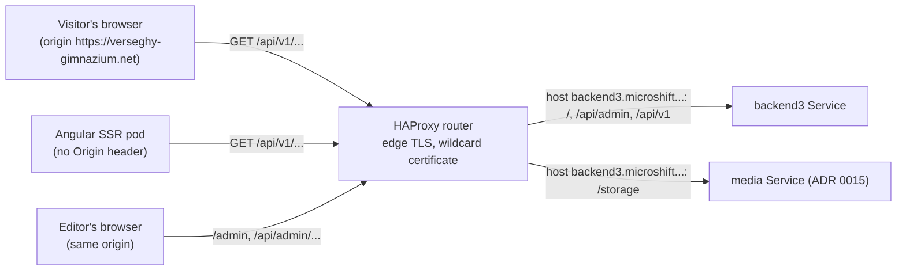

# 0014. One host: backend3.microshift.verseghy-gimnazium.net

- Status: Accepted (2026-10-24)
- Decision questions: Q16

## Context

backend3 has three audiences on the web:

- editors, who use the admin UI ([ADR 0004](0004-admin-ui-lives-in-admin-and-ships-in-the-backend3-image.md));
- the admin UI, which calls the admin JSON API with a session cookie ([ADR 0006](0006-admin-authentication-and-account-lifecycle.md));
- the live Angular site, which reads the public REST API from the visitor's browser and from its server-side rendering (SSR) pod ([ADR 0005](0005-rust-dtos-are-the-api-contract-ts-rs-utoipa-openapi.md), [public-api.md](../public-api.md)).

Uploaded media under `/storage/**` keep their current URLs. They are covered by [ADR 0015](0015-media-separate-static-server-media-library-image-optimisatio.md).

These facts bound the choice of hostnames:

| Fact | Value | Source |
|---|---|---|
| Wildcard DNS | Every `*.microshift.verseghy-gimnazium.net` name already resolves to the production node. | research: SYNTHESIS §1.10 |
| Wildcard certificate | One cert-manager `Certificate`, `router-certs-custom`, covers `*.microshift.verseghy-gimnazium.net` and `verseghy-gimnazium.net`. It is the router's default certificate, so a Route on any wildcard name needs no certificate of its own. | website_k8s@34b8b55:microshift-infra/router-certs/certificate.yaml; website_k8s@34b8b55:config.yaml (`ingress.certificateSecret`) |
| The backend3 name today | `https://backend3.microshift.verseghy-gimnazium.net/` answers 503 from the router. DNS and TLS work. Only a Route is missing. | research: SYNTHESIS §1.5.2 |
| Names outside the wildcard | A name such as `admin.verseghy-gimnazium.net` needs a Cloudflare record and a new `dnsNames` entry, which means a new certificate order. | research: SYNTHESIS §1.10 |
| `api.microshift.verseghy-gimnazium.net` | Already the MicroShift API server. | research: QUESTIONS 16 |
| The apex host | `verseghy-gimnazium.net` already carries Routes from three Argo CD Applications: `verseghy-website-frontend` (the Angular site, `/`), `verseghy-website-backend` (backend1's `backend-storage` Route, `/storage`) and `verseghy-website-static` (legacy static files, `/docs`, `/images`). The media Application of [ADR 0015](0015-media-separate-static-server-media-library-image-optimisatio.md) takes over `/storage` later. | research: SYNTHESIS §1.8.5, §1.10, §5.15.1 |
| The legacy host | `backend.microshift.verseghy-gimnazium.net` is a whole-host Route to backend1 (`/admin`, `/storage/**`). Its `/storage` URLs are a contract ([ADR 0015](0015-media-separate-static-server-media-library-image-optimisatio.md)). backend1 stays up on it, read-only, as a reference view until the maintainer decides to decommission it ([ADR 0003](0003-cut-over-one-rehearsed-flip-then-a-read-only-parallel-run.md)). | research: SYNTHESIS §1.10; research: DECISIONS 41 |
| Angular service worker | Installed production service workers have four `dataGroups` for `https://backend.microshift.verseghy-gimnazium.net/api/{posts,canteen,events,colleagues}/**`. `Posts` is `freshness` with a 3-day fallback. `Canteen`, `Events` and `Colleagues` are `performance` (cache first) for 2, 7 and 30 days. No current request matches them. | website_frontend@f74c765:apps/frontend/ngsw-config.json; research: frontend-contract §7 |
| How the Angular site calls its API today | Browser and SSR pod both call `https://backend2.microshift.verseghy-gimnazium.net/graphql`. The browser call is cross-origin, and backend2 answers with `Access-Control-Allow-Origin: *`. The SSR pod goes out through the public router and sends no `Origin` header. | research: SYNTHESIS §1.4 (F2, F3) |
| Router behaviour | Path Routes on one host coexist. The longest matching path wins. Path claims across namespaces are allowed. Every Route uses edge TLS with a redirect from HTTP. | research: SYNTHESIS §1.10; website_k8s@34b8b55:config.yaml (`routeAdmissionPolicy.namespaceOwnership: InterNamespaceAllowed`) |
| Loco configuration | The Loco 1.2.0 production template refuses to boot without `HOST`, the public URL of the app. | research: SYNTHESIS §1.14 |
| CORS in the REST draft | DEC-18 recorded `Access-Control-Allow-Origin: *` on the public API, with no credentials. The REST decisions that the maintainer did not override keep their recorded defaults. | research: SYNTHESIS §5.16.2; research: QUESTIONS, Appendix C |
| Site boundary | Browsers treat `verseghy-gimnazium.net` and every `*.verseghy-gimnazium.net` name as one site, because they share one registrable domain. | browser same-site rules |

The research recommended splitting by audience: the public API on the apex, the admin on its own wildcard name. The maintainer chose one host (research: DECISIONS 16).

## Decision

### One host for everything backend3 serves

`https://backend3.microshift.verseghy-gimnazium.net` is the only public name of backend3. DNS and certificates do not change.

| Path | What it serves | Authentication | CORS | Defined in |
|---|---|---|---|---|
| `/admin`, `/admin/**` | The admin single-page app, served same-origin. | None for the static files | None | [ADR 0004](0004-admin-ui-lives-in-admin-and-ships-in-the-backend3-image.md) |
| `/api/admin/**` | The admin JSON API. | Session cookie, or a Bearer token for scripts | None | [ADR 0006](0006-admin-authentication-and-account-lifecycle.md), [ADR 0007](0007-authorization-four-roles-enforced-on-every-operation.md) |
| `/api/v1/**` | The public read API and its OpenAPI document at `/api/v1/openapi.json`. | None | `*`, no credentials | [ADR 0005](0005-rust-dtos-are-the-api-contract-ts-rs-utoipa-openapi.md), [public-api.md](../public-api.md) |
| `/storage/**` | The media files, read-only, so the admin can show the root-relative media URLs stored in content. | None | `*` | [ADR 0015](0015-media-separate-static-server-media-library-image-optimisatio.md) |
| `/_ping`, `/_health`, `/_readiness` | Loco's built-in health routes, for probes and smoke tests. | None | None | [ADR 0023](0023-operations-hardening-rate-limits-monitoring-backups-secrets.md) |
| `/` | A redirect to `/admin/`. | None | None | this ADR |
| `/robots.txt` | `User-agent: *` and `Disallow: /`. The admin and the API on this host are not for search engines. | None | None | this ADR |

`/metrics` is not served on this host. It listens on a separate port that no Route targets ([ADR 0023](0023-operations-hardening-rate-limits-monitoring-backups-secrets.md)).

### Routes

The three `backend3*` Routes live in website_k8s under `verseghy-website/backend3/`. The media Route belongs to the media Application ([ADR 0015](0015-media-separate-static-server-media-library-image-optimisatio.md)). Every Route sets `tls.termination: edge`, `insecureEdgeTerminationPolicy: Redirect` and `wildcardPolicy: None`, and carries no certificate of its own.

| Route | Host | Path | Target | Why it is a separate Route |
|---|---|---|---|---|
| `backend3` | `backend3.microshift.verseghy-gimnazium.net` | none (whole host) | Service `backend3`, port `http` | Admin SPA, health routes, the redirect, `robots.txt`. |
| `backend3-api-admin` | same | `/api/admin` | Service `backend3`, port `http` | Own router limits for login traffic, and a longer timeout for uploads ([ADR 0023](0023-operations-hardening-rate-limits-monitoring-backups-secrets.md)). |
| `backend3-api-v1` | same | `/api/v1` | Service `backend3`, port `http` | Own router limits for public read traffic ([ADR 0023](0023-operations-hardening-rate-limits-monitoring-backups-secrets.md)). |
| `media-storage-admin` | same | `/storage` | Service `media` | Media for admin previews ([ADR 0015](0015-media-separate-static-server-media-library-image-optimisatio.md)). |

HAProxy keeps its rate-limit counters per Route. That is why the public API and the admin API each get their own path Route on the same host.

### CORS on `/api/v1` only

- Every `/api/v1/**` response carries `Access-Control-Allow-Origin: *`, errors included. Credentials are never allowed. This serves the Angular site on `https://verseghy-gimnazium.net`, and the staging and development frontends, without a list to maintain. It is the REST draft's recorded default, DEC-18 ([public-api.md](../public-api.md) §2.1).
- The Angular site's GET requests carry no custom headers. They are CORS simple requests, so the browser sends no preflight.
- Loco's global `cors` middleware stays disabled. A tower-http `CorsLayer` is attached to the `/api/v1` routes only, for example with Loco's `Routes::layer`. The bootstrap PR picks the exact mechanism ([public-api.md](../public-api.md) O-3). As a result, `/admin` and `/api/admin` never send CORS headers.
- Requests without an `Origin` header are served normally. That covers the SSR pod and `curl`. CORS controls what browsers may read. It is not access control.

### Configuration and the Angular switch

- Production sets `HOST=https://backend3.microshift.verseghy-gimnazium.net`. Staging on the hub uses its own LAN host. That host is chosen when staging is built ([cutover.md](../cutover.md) §5.1), and staging's `HOST` is set to it. How the Angular REST build reaches the staging API is [cutover.md](../cutover.md) open item 3: a staging build configuration or a runtime setting, settled in the website_frontend REST PR. No hostname is hard-coded in Rust or TypeScript. Code that needs a hostname receives it as an explicit argument ([ADR 0008](0008-code-layout-a-pure-src-domain-beside-loco-models.md)).
- The Angular REST build is staged ahead and promoted in the cut-over window ([ADR 0003](0003-cut-over-one-rehearsed-flip-then-a-read-only-parallel-run.md)). It replaces `gqlURL` with `apiURL: 'https://backend3.microshift.verseghy-gimnazium.net/api/v1'`. `environment.origin`, the media host, does not change ([public-api.md](../public-api.md)).
- Removing the four dead `dataGroups` is optional. The website_frontend REST PR decides, and its human review settles it (research: DECISIONS R2). The REST build adds no `dataGroup` for `/api/v1`. If one is ever added, it uses the `freshness` strategy, because `performance` would serve stale content for days after an admin edit ([public-api.md](../public-api.md) §18).

### The legacy host

`backend.microshift.verseghy-gimnazium.net` stays with backend1 for the read-only parallel run ([ADR 0003](0003-cut-over-one-rehearsed-flip-then-a-read-only-parallel-run.md)), except for its `/storage` path ([ADR 0015](0015-media-separate-static-server-media-library-image-optimisatio.md)). Once the maintainer decommissions backend1, a later change may redirect `backend.microshift.verseghy-gimnazium.net/admin` to the new admin. Nothing in this ADR depends on that.

## Consequences

### Positive

- No DNS record, certificate or Cloudflare change. Only Routes are added.
- backend3 can be deployed and smoke-tested end to end before the flip (`/_ping`, `/_readiness`, admin login, `/api/v1` reads) without touching the apex host or the legacy host.
- The admin SPA and the admin API share one origin. The admin needs no CORS. It uses one host-only session cookie ([ADR 0006](0006-admin-authentication-and-account-lifecycle.md)) and one CSP ([ADR 0023](0023-operations-hardening-rate-limits-monitoring-backups-secrets.md)).
- No path on this host can match the service worker's `dataGroups`, because those match only `backend.microshift.verseghy-gimnazium.net`. Returning visitors with an old service worker therefore never get stale API answers from it.
- The REST switch changes the Angular API URL, not the pattern. The site already calls its API cross-origin on a `*.microshift` host, with `Access-Control-Allow-Origin: *`.

### Negative

- The names `microshift` and `backend3` are compiled into the Angular bundle. If the platform or the backend is renamed later, the old name must keep being routed, or the Angular site must be rebuilt. The hostname is a long-lived contract, like `backend.microshift.verseghy-gimnazium.net/storage`.
- `SameSite=Strict` does not stop requests that start on the same site. Any page on the apex or on another `*.verseghy-gimnazium.net` host is same-site with the admin. [ADR 0006](0006-admin-authentication-and-account-lifecycle.md) therefore keeps the cookie host-only (`__Host-` prefix). It also rejects with `403` any cookie-authenticated `POST`, `PUT`, `PATCH` or `DELETE` whose `Origin` header names an origin other than `https://backend3.microshift.verseghy-gimnazium.net`. [ADR 0006](0006-admin-authentication-and-account-lifecycle.md) §3 is the authoritative definition of this check, including how a request without an `Origin` header is handled.
- The public API and the admin run in the same pods. A burst of public traffic can slow the admin. The per-Route router limits of [ADR 0023](0023-operations-hardening-rate-limits-monitoring-backups-secrets.md) bound this.
- Nobody has yet tested whether the SSR pod can reach a new public host through the router (research: SYNTHESIS §8.2 O18). The production pre-flip check in the follow-up work settles it.

### Follow-up work

- A website_k8s PR adds the Service and the Routes listed above. It is left for human review (research: DECISIONS R2).
- The website_frontend REST build changes its API URL. [ADR 0003](0003-cut-over-one-rehearsed-flip-then-a-read-only-parallel-run.md) stages that build.
- Before the flip, once the `backend3*` Routes are live in production, run `oc exec -n verseghy deploy/frontend -- curl -sI https://backend3.microshift.verseghy-gimnazium.net/_ping` from the production SSR pod. Record the result and the client address that backend3 logs for the request. That address feeds the `/api/v1` limits of [ADR 0023](0023-operations-hardening-rate-limits-monitoring-backups-secrets.md) §7. This is a production pre-flip check, not part of the hub-staging rehearsals: staging has its own router and no production SSR pod (research: DECISIONS 42).

### What must be true in code and tests

- `/api/v1` responses, including errors, carry `Access-Control-Allow-Origin: *`. A test checks that they never carry `Access-Control-Allow-Credentials`, and that `/admin` and `/api/admin` responses never carry `Access-Control-Allow-Origin`.
- A cookie-authenticated `/api/admin` write with a foreign `Origin` gets `403`. [ADR 0006](0006-admin-authentication-and-account-lifecycle.md) owns the `Origin` rule and its test cases, so the missing-header case is specified and tested there.
- Tests check that `/` redirects to `/admin/` and check the `robots.txt` body.
- The OpenAPI `servers` URL is built from the configured host, never hard-coded ([ADR 0005](0005-rust-dtos-are-the-api-contract-ts-rs-utoipa-openapi.md)).

## Alternatives considered

| Option | Source | Why not |
|---|---|---|
| Public API at `https://verseghy-gimnazium.net/api/v1` as an apex path Route, admin on `admin.microshift.verseghy-gimnazium.net` (the recommended default) | QUESTIONS 16 A | Not chosen (maintainer override). It needs two hosts and two origins. It also adds a backend3 Route to the public site's host, which already carries Routes from three Applications. |
| Everything on one new wildcard host | QUESTIONS 16 B | Chosen. |
| Take over the legacy host: `backend.microshift.verseghy-gimnazium.net/admin` and `/api/v1` | QUESTIONS 16 C | Not chosen. That host stays with backend1 for the read-only parallel run ([ADR 0003](0003-cut-over-one-rehearsed-flip-then-a-read-only-parallel-run.md)). Installed service workers keep `dataGroups` for API paths on it for up to 30 days. |
| New names outside the wildcard (`admin.verseghy-gimnazium.net`, `api.verseghy-gimnazium.net`) | QUESTIONS 16 D | Not chosen. They need Cloudflare records and a new certificate order, for no functional gain. |
| An origin allow-list instead of `*` on `/api/v1` | SYNTHESIS §5.16.2 DEC-18 (alternative) | Not chosen. The API is public and uncredentialed. `*` keeps the recorded default and needs no per-environment list. |

## References

- research: DECISIONS 16 (hostnames), 3 (admin UI same-origin at `/admin`), 5 (session cookie), 41 (read-only parallel run), 42 (staging on the hub), R2 (PR review in other repositories).
- research: QUESTIONS 16; Appendix C (REST draft defaults).
- research: SYNTHESIS §1.4 (data flows F2, F3), §1.5.2 (live probes), §1.8.5 (Argo CD Applications), §1.10 (hostnames, DNS, TLS, router), §1.14 (Loco production configuration), §5.9 (caching layers), §5.15.1 (hosts and Routes), §5.16.2 (DEC-18), §8.2 (O18).
- research: frontend-contract §7 (service worker groups).
- website_frontend@f74c765:apps/frontend/ngsw-config.json.
- website_k8s@34b8b55:config.yaml; website_k8s@34b8b55:microshift-infra/router-certs/certificate.yaml.
- loco-rs@1.2.0:src/controller/routes.rs (`Routes::layer`).
- [public-api.md](../public-api.md) §2.1 (transport and CORS), §18 (notes for the Angular switch); [cutover.md](../cutover.md) §5.1 (staging), §13 open item 3 (the staging API URL).
- Related: [ADR 0003](0003-cut-over-one-rehearsed-flip-then-a-read-only-parallel-run.md), [ADR 0004](0004-admin-ui-lives-in-admin-and-ships-in-the-backend3-image.md), [ADR 0005](0005-rust-dtos-are-the-api-contract-ts-rs-utoipa-openapi.md), [ADR 0006](0006-admin-authentication-and-account-lifecycle.md), [ADR 0007](0007-authorization-four-roles-enforced-on-every-operation.md), [ADR 0008](0008-code-layout-a-pure-src-domain-beside-loco-models.md), [ADR 0015](0015-media-separate-static-server-media-library-image-optimisatio.md), [ADR 0023](0023-operations-hardening-rate-limits-monitoring-backups-secrets.md).
