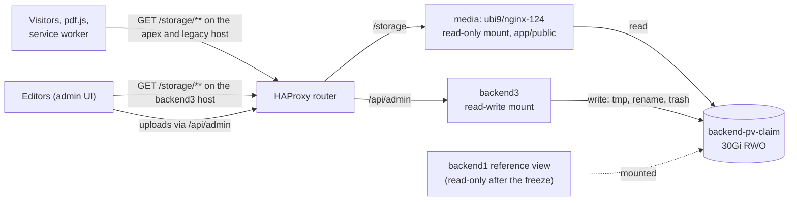

# 0015. Media: separate static server, media library, image optimisation

- Status: Accepted (2026-10-24)
- Decision questions: Q17; Q26; Q27 (the image half; the dashboard half is in [ADR 0019](0019-scope-parity-tracking-retired-features-release-1-additions.md)); Q28 (only the archiving and deletion of the 2020-21 backup archives)

## Context

### What is on the volume

All uploaded media live on one PersistentVolumeClaim, `backend-pv-claim`: 30Gi, `ReadWriteOnce`, on the LVMS/TopoLVM default storage class (xfs) of the single production node. backend1 mounts it as Laravel's `storage/` directory. These figures were measured on the 2026-10-23 snapshot (research: gap-04 §1; research: SYNTHESIS §4.9.1):

| Path on the volume | Size | Files | Content |
|---|---:|---:|---|
| whole volume | 2,990.6 MiB | 6,789 | |
| `app/public/` | **1,751.7 MiB** | **6,213** | All public media, served as `/storage/**`. |
| `app/public/posts_images/` | 1,250.3 MiB | 5,631 | Post galleries, plus `index/` with 576 index images. |
| `app/public/uploads/` | 499.3 MiB | 515 in 83 folders | The editors' file tree: `Pictures/`, `diaktoll/`, `docs/`, `pages/`, `posts/`. |
| `app/public/colleagues_images/`, `authors_images/` | 2.0 MiB | 64 | Staff and author photos. |
| `app/backups/Laravel/` | 1,237.1 MiB | 6 | Obsolete backup archives from 2020-21, from the previous hosting era. Not media. |
| `framework/`, `logs/` | 1.8 MiB | 569 | Laravel runtime state. |

What the payload looks like:

- **`uploads/` file types.** jpg 259, pdf 218, docx 21, png 11, doc 3, jpeg 2, gif 1.
- **`uploads/` file names.** Human names in UTF-8, with spaces, accents, `(1)` and `[PR]`. HTML links percent-encode them.
- **`posts_images/` file types.** 5,572 of 5,631 files are JPEG (`.jpg` 5,529, `.jpeg` 41, `.jfif` 2). The rest are 53 PNG, 1 WebP and 5 non-images (3 PDF, 1 MP3, 1 Word autosave).
- **Case.** Some extensions are upper case (`.JPG` ×20). URLs are case-sensitive on xfs.
- **Sizes.**
  - 106 files exceed 2,000,000 bytes, which is Loco's default body limit.
  - Three files exceed 40 MiB. The largest is an 85.7 MiB admissions PDF.
  - No file exceeds 100,000,000 bytes.
- **Integrity.** Every image that the posts, authors and colleagues tables reference exists on the volume (5,628, 6 and 57 files). Links from post and page HTML into `uploads/` were not checked (research: gap-04 §1).

### The URL contract

| URL shape (on both hosts) | Minted by | Consumers |
|---|---|---|
| `/storage/posts_images/index/<32 hex>.<ext>` | the public API, as an absolute URL on the legacy host | cards, post page, `og:image`, service-worker `images` group |
| `/storage/posts_images/<32 hex>.<ext>` | the public API | galleries |
| `/storage/authors_images/…`, `/storage/colleagues_images/…` | the public API | author block, staff page |
| `/storage/uploads/<free path>` | root-relative links stored in content | 76 published and 7 draft posts, and 21 of 39 pages |
| `https://backend.microshift.verseghy-gimnazium.net/storage/uploads/diaktoll/ujsag_final_2021osz.pdf` | hard-coded in the Angular Diáktoll viewer | pdf.js, with a cross-origin request from the apex |

Two consequences follow:

- **Both hosts must keep working.** `https://verseghy-gimnazium.net/storage/**` and `https://backend.microshift.verseghy-gimnazium.net/storage/**` must keep serving identical paths. The legacy host is baked into several places: backend2's `STORAGE_BASE_URL` (carried over as backend3's `media.public_base_url` setting, [public-api.md](../public-api.md) §2.3), the Angular `environment.origin` image-host rewrite, the service worker's `images` asset group, the Diáktoll URL, and cached `og:image` URLs (research: SYNTHESIS §5.15.1-§5.15.2).
- **`Access-Control-Allow-Origin: *` is required.** The Diáktoll viewer (`ng2-pdf-viewer`, pdf.js) fetches the PDF cross-origin and breaks without the header. The service worker caches non-opaque responses only (research: gap-04 §4).

### The platform

- **Router.** The OpenShift router's HAProxy uses 30-second inactivity timeouts. A Route can raise its server timeout with `haproxy.router.openshift.io/timeout`. There is no request-body limit, and the longest matching path wins (research: SYNTHESIS §1.10).
- **Pod security.** Under `restricted-v2`, a pod cannot choose `runAsUser: 1000`, and admission injects an `fsGroup`.
- **Volume ownership.** The LVMS `CSIDriver` sets no `fsGroupPolicy`. When a pod mounts the volume, kubelet therefore regroups every entry on it: files get `g+rw`, directories get `g+rwx` and setgid. This was derived from the lvm-operator release-4.20 source, not observed (research: gap-04 §3.1-§3.3).
- **Co-mounting.** Nobody has tested whether two pods on the node can mount the same TopoLVM `ReadWriteOnce` volume at the same time (research: SYNTHESIS §8.2 O15).
- **Object storage.** The cluster has no S3 endpoint (research: SYNTHESIS §6.5).
- **Capacity.** The edge node has very little spare capacity (research: DECISIONS 36).

### Loco 1.2.0

These facts come from research: gap-04 §5 and SYNTHESIS §6.6-§6.7:

- The `static` middleware serves one folder. For a missing file it returns the fallback file with status **200**. It sits outside the `cors` layer and can set only `Cache-Control`.
- `limit_payload` defaults to 2,000,000 bytes. `body_limit` accepts values such as `128mib`.
- Routers nested in `Hooks::after_routes` run outside Loco's middleware stack.
- tower-http `ServeDir`, `SetResponseHeaderLayer` and `CorsLayer` are already compiled in. `ServeDir` gives real 404s, `Last-Modified` and byte ranges. With `append_index_html_on_directories(false)` it never lists a directory. It has no dot-file filter.

### Why media serving gets its own process

During the PHP2Shell incident in October 2026, the admin application was scaled to zero. That application also served `/storage`, so every image and PDF on the public site was offline for about 14.5 hours (Verseghy/website_k8s#43, Verseghy/website_k8s#49; research: SYNTHESIS §1.6).

### Editors and images

- **Who uploads.** The editors are staff (publishers and secretaries) plus rotating student writers (research: DECISIONS 10d).
- **No processing today.** The previous admin did no server-side image processing. Its dashboard card asked editors to shrink images by hand with squoosh.app (MozJPEG, at most 1000 px wide) (research: SYNTHESIS §3.4.2).
- **Pasted photos.** The old editor had no upload endpoint, so 16 inline `data:` images sit in 6 posts, plus 1 in a page (research: SYNTHESIS §4.7.3). [ADR 0017](0017-legacy-data-import-normalisation-and-defect-resolution.md) extracts them.
- **Pasting in the new editor.** Images are never pasted. Pictures in pasted Word or Excel content are stripped, and a pasted image file is not inserted (research: DECISIONS 15d). That later decision replaces the "paste from editor" part of DECISIONS 26.

### nginx lifecycle

The RHEL 9 nginx 1.24 Application Stream was released in May 2024 and retires in **May 2027**. nginx 1.26 retires in May 2028 (Red Hat Enterprise Linux Application Streams Life Cycle, read 2026-10-24).

## Decision

### 1. A separate media server serves `/storage/**`

| Item | Value |
|---|---|
| Workload | Deployment `media` in namespace `verseghy`, in its own Argo CD Application (`verseghy.net/component: media`). |
| Image | `registry.access.redhat.com/ubi9/nginx-124`, pinned by digest. The image is public, so no pull secret is needed. |
| Identity | Default ServiceAccount under `restricted-v2`: no `anyuid`, no `runAsUser`, `allowPrivilegeEscalation: false`, all capabilities dropped, `automountServiceAccountToken: false`. |
| Port | 8080. Service `media`, port name `http`. |
| Volume | `backend-pv-claim`, `subPath: app/public`, mounted **read-only** at `/srv/media/storage`. The media server reads only the public media. It never sees `app/backups/`, `framework/` or `logs/`. |
| Replicas | 1, `RollingUpdate`. This is allowed only because the co-mount test (section 3) proves that two pods can hold the volume. |
| Probes | `GET /healthz` on port 8080, answered by nginx itself. No Route reaches it. |
| Resources | Small fixed requests and limits, sized in the deploy PR. |

The nginx server configuration is a ConfigMap. The required behaviour is the **media contract**. Both nginx and the fallback in section 4 must meet it.

| Requirement | Behaviour |
|---|---|
| Path mapping | `/storage/<path>` maps to `app/public/<path>`. Names are byte-identical and case-sensitive. |
| Missing files and directories | `404`. A directory is never listed (`autoindex off`, `try_files $uri =404`). |
| Dot-files | Any path segment that starts with `.` gets `404`. This covers `.htaccess` and `.gitignore`, which stay on the volume but are never served. |
| Methods | `GET` and `HEAD`. `OPTIONS` answers the CORS preflight. Any other method gets `405`. |
| CORS | `Access-Control-Allow-Origin: *` on every response, 404s included. `Access-Control-Expose-Headers: Accept-Ranges, Content-Range, Content-Length`, so pdf.js can use range requests cross-origin. The preflight allows the `Range` header. No credentials. |
| Ranges | A single byte range gets `206`, or `416` when it cannot be satisfied. nginx sets `max_ranges 1`, so it answers a multi-range request with `200` and the full body. The fallback (tower-http `ServeDir`) answers a multi-range request with `416`. The contract suite accepts either answer for a multi-range request. |
| Large files | Sent with `sendfile`. The application never buffers a response. |
| Caching | Every file gets `Last-Modified` and honours `If-Modified-Since`. nginx also sends `ETag`. The fallback does not, so the contract suite asserts `ETag` only for nginx. Files under `posts_images/`, `authors_images/` and `colleagues_images/` get `Cache-Control: public, max-age=31536000, immutable`, because those names are unique per upload. Everything else gets `public, max-age=3600`, because `uploads/` names can be replaced. |
| Headers | Content type from the extension, `X-Content-Type-Options: nosniff`, `server_tokens off`; plus the sandbox `Content-Security-Policy` and `Content-Disposition` rows of [ADR 0013](0013-rich-text-editor-and-html-sanitiser.md) §7. |
| Logs | Access and error logs go to stdout. The fallback router brings its own tower-http `TraceLayer`, because routers nested in `Hooks::after_routes` get no Loco logger and no request id (research: gap-04 §5). |

Below is a sketch of the server block. The deploy PR's contract tests are the authority, not the sketch.

```nginx
server {
    listen 8080;
    server_tokens off;
    root /srv/media;                       # the PVC subPath app/public is mounted at /srv/media/storage
    autoindex off;

    location = /healthz { return 200 "ok\n"; }

    location /storage/ {
        if ($request_method !~ ^(GET|HEAD|OPTIONS)$) { return 405; }
        add_header Access-Control-Allow-Origin "*" always;
        add_header Access-Control-Expose-Headers "Accept-Ranges, Content-Range, Content-Length" always;
        add_header X-Content-Type-Options "nosniff" always;
        # OPTIONS: answer the preflight (allow GET, HEAD and the Range header) with 204
        max_ranges 1;
        try_files $uri =404;               # directories and missing files are 404, never a listing
        # Cache-Control per folder, as in the contract table

        location ~ /\. { return 404; }     # dot-files; nested, so this 404 inherits the add_header lines above
    }

    location / { return 404; }             # everything else, dot-files outside /storage/ included
}
```

The dot-file rule is nested inside `location /storage/` on purpose. A nested location that sets no `add_header` of its own inherits its parent's. A regex location at server level would still win for `/storage/.htaccess`, but it would not inherit those lines, so its 404 would lack `Access-Control-Allow-Origin`.

### 2. Routes and when they switch

Three path Routes send `/storage` to Service `media`. Each Route uses edge TLS with a redirect from HTTP, `wildcardPolicy: None`, and `haproxy.router.openshift.io/timeout: 120s` for slow clients on 86 MB PDFs. Their router limits are set in [ADR 0023](0023-operations-hardening-rate-limits-monitoring-backups-secrets.md) §7. In release 1 they carry no per-address connection caps, because a classroom behind one school address would hit them.

| Route | Host | Path | Note |
|---|---|---|---|
| `media-storage-public` | `verseghy-gimnazium.net` | `/storage` | Replaces backend1's `backend-storage`. Two Routes cannot claim the same host and path, so the old one is removed in the same change. Argo CD does not prune, so that removal is an explicit runbook step. |
| `media-storage-legacyhost` | `backend.microshift.verseghy-gimnazium.net` | `/storage` | Its path is longer than backend1's whole-host Route, so it wins. backend1's `/admin` stays available as the reference view ([ADR 0003](0003-cut-over-one-rehearsed-flip-then-a-read-only-parallel-run.md)). |
| `media-storage-admin` | `backend3.microshift.verseghy-gimnazium.net` | `/storage` | Lets the admin display the root-relative `/storage/uploads/…` URLs that the editor stores ([ADR 0013](0013-rich-text-editor-and-html-sanitiser.md)) and the root-relative media URLs of the admin API (section 3). This keeps the admin CSP at `img-src 'self'` ([ADR 0023](0023-operations-hardening-rate-limits-monitoring-backups-secrets.md) §6). |

The media server and `media-storage-admin` go live first, so the media contract can be smoke-tested on the backend3 host. The two public Routes then move to the media server **before** the cut-over window, as a change of their own ([ADR 0003](0003-cut-over-one-rehearsed-flip-then-a-read-only-parallel-run.md), [cutover.md](../cutover.md)). The media server only reads files, so backend1 keeps uploading until the freeze. At the freeze, a held PR removes backend1's write access and leaves its mount read-only. Rollback of the serving change means pointing the two public Routes back at backend1. No file changes.



### 3. backend3 co-mounts the volume, after a co-mount test

backend3 mounts the whole `backend-pv-claim` read-write at `/data`, under `restricted-v2`. It gets the same namespace UID and injected `fsGroup` as the media server, so nginx can read everything backend3 writes. Paths and limits are explicit configuration values ([ADR 0008](0008-code-layout-a-pure-src-domain-beside-loco-models.md)):

| Setting | Value | Use |
|---|---|---|
| `media.root` | `/data/app/public` | The served tree. Every write lands here through an atomic rename. |
| `media.tmp_dir` | `/data/backend3/tmp` | Upload staging. It is on the same filesystem, so the rename is atomic, and outside the served tree. |
| `media.trash_dir` | `/data/backend3/trash` | Deleted files, outside the served tree. |
| `media.min_free_bytes` | 2 GiB | Uploads are refused below this free space. |
| `media.public_base_url` | `https://backend.microshift.verseghy-gimnazium.net/storage` | Base of the absolute media URLs in the public API. Required, absolute, with no trailing slash. Startup fails otherwise ([public-api.md](../public-api.md) §2.3). Only `/api/v1` uses it. |

**Media URLs in the admin API.** Admin API (`/api/admin`) DTOs carry every media URL that the admin UI loads root-relative, as `/storage/<folder>/<path>`, with the same percent-encoding as the public API. That covers index and gallery images, author and colleague photos, and media-library thumbnails and file links. These URLs are never built from `media.public_base_url`. Only `/api/v1` mints absolute legacy-host URLs. The admin therefore loads every image through `media-storage-admin`, within `img-src 'self'` ([ADR 0023](0023-operations-hardening-rate-limits-monitoring-backups-secrets.md) §6). The media library's "Copy URL" value (section 5) is the one absolute media URL the admin shows. It is text for the editor to use elsewhere, and the admin never loads it.

In this setup backend3 may use `RollingUpdate`. The replica count is a capacity decision and starts at 1. Only backend3's server and worker processes mount the volume.

CronJob pods never mount it. A CronJob that needs file work only enqueues a job, and the backend3 worker does the work. This applies to the trash purge in section 5 and to the sitemap written to `app/public/sitemap.xml` ([ADR 0016](0016-no-redis-in-memory-cache-postgres-queue-cronjob-tasks.md), [ADR 0019](0019-scope-parity-tracking-retired-features-release-1-additions.md)).

**Precondition: a co-mount test on a throwaway PVC.** The test never runs on the production claim.

| Step | Pass criterion |
|---|---|
| 1. Create a small throwaway PVC on the default storage class. Seed it from the backup with a few real media folders, including names with accents and upper-case extensions. | The PVC is bound. |
| 2. Start the media server under `restricted-v2`: nginx-124, the real ConfigMap, a read-only mount. | It is admitted with no SCC change and serves the seeded files under the contract. |
| 3. On the same claim, start a backend3 stand-in with backend3's pod security settings and a read-write mount. Also start a pod with the backend1 reference view's security settings. | All pods are `Running` at the same time. No `Multi-Attach` or mount errors. |
| 4. The writer creates, renames and deletes files. | nginx serves each new file on the next request and answers 404 for removed ones. Neither side sees a permission error. |
| 5. Restart each pod in turn while the others hold the mount. Do a rolling update of the backend3 stand-in and of the media server. | Every pod comes back within its normal start time, and the others keep serving. |
| 6. Record owner, group and mode of sample entries before and after the first mount. | kubelet's `fsGroup` behaviour is documented, and the reference view can still read what it needs. |

Steps 2 to 5 with the media server and the backend3 stand-in decide the variant (research: DECISIONS 17). The backend1 reference-view pod is a separate check. If only that pod fails, the separate media server is still used, and the backend1 reference view runs without the volume, as described for the reference view in section 4 ([cutover.md](../cutover.md) open item 1).

A human deletes the throwaway PVC afterwards, because the agent guardrails deny `oc delete pvc` ([ADR 0024](0024-ai-maintainability-instruction-files-the-loco-skill-guardrai.md)). The result goes into the private runbook, and the deploy PR links it.

### 4. Fallback if the co-mount test fails

If the media server and the backend3 stand-in cannot co-mount the volume, backend3 serves `/storage` itself, and it is the only pod that mounts the volume:

- **The router.** A dedicated router is nested in `Hooks::after_routes`, outside Loco's middleware, so no body limit, request timeout or `etag` layer applies to it.
  - It uses tower-http `ServeDir` rooted at `media.root`, with `append_index_html_on_directories(false)`.
  - `SetResponseHeaderLayer::overriding` adds `Access-Control-Allow-Origin: *` and `nosniff`.
  - A guard answers 404 for any dot-segment.
  - It allows only `GET` and `HEAD`, plus `OPTIONS` for the preflight.
  - It sets `Cache-Control` per folder as in the contract.
  - A tower-http `TraceLayer` logs each request, because Loco's logger does not wrap this router.
- **Not the `static` middleware.** Loco's `static` middleware is never used for `/storage`.
- **Routes.** The three `/storage` Routes point at Service `backend3`.
- **Replicas.** backend3 runs **1 replica with `strategy: Recreate`**. Every backend3 deploy then briefly interrupts `/storage` as well as the APIs.
- **The cut-over.** The handover happens inside the window, right after the freeze. backend1 releases the volume, then backend3 mounts it and takes the Routes. This causes a `/storage` gap of about 1-2 minutes ([cutover.md](../cutover.md)).
- **The reference view.** The backend1 reference view runs without the volume, with its runtime state on an `emptyDir`. Its pages still show media, because the media come through the `/storage` Routes.

One contract test suite runs against both the nginx configuration and this router. It allows only the differences that the contract table names: no `ETag` from this router, and `416` instead of nginx's full `200` for a multi-range request.

### 5. The media library (admin)

**Scope.** The library manages `uploads/` only. Entity images (`posts_images/`, `posts_images/index/`, `authors_images/` and `colleagues_images/`) are written only through their entity forms.

| Operation | Behaviour |
|---|---|
| Browse folders | Tree and list of `uploads/`, with size, type and modification time. |
| Create folder | Needed so that "move" has a target. |
| Upload | Button and drag-and-drop in the media library, and the image-upload button or the media-library picker in the rich-text editor ([ADR 0013](0013-rich-text-editor-and-html-sanitiser.md)). Pasted images are never inserted: pictures in pasted Word or Excel content are stripped, a pasted image file is not inserted, and the editor tells the user to use the image upload or the media library instead (research: DECISIONS 15d, which replaces the "paste from editor" part of DECISIONS 26). A file dropped onto the editor surface is not inserted either, unless the detailed editor design of [ADR 0013](0013-rich-text-editor-and-html-sanitiser.md) makes it an upload. From the editor, the default target is `uploads/posts/<post-id>/` for posts and `uploads/pages/<page-id>/` for pages. A post or page that has not been saved has no id yet. Until the first save, the editor's upload button is disabled and shows the hint "Képfeltöltés az első mentés után lehetséges." Existing topic folders stay where they are. |
| Rename, move | Within `uploads/` only. |
| Delete | Moves the file to `media.trash_dir`. A `manage media` holder restores it from the media library's "Lomtár" view. Only the `admin` role can delete it permanently ("Végleges törlés") before the purge ([ADR 0011](0011-safety-net-soft-delete-revisions-and-an-activity-log-for-eve.md) §6, §8; [ADR 0007](0007-authorization-four-roles-enforced-on-every-operation.md)). A daily CronJob enqueues the purge of trash older than 30 days, and the worker carries it out ([ADR 0016](0016-no-redis-in-memory-cache-postgres-queue-cronjob-tasks.md)). |
| Copy URL | Copies the public URL `https://verseghy-gimnazium.net/storage/uploads/<percent-encoded path>`. |
| Insert into editor | Inserts the root-relative `/storage/uploads/…` URL: an image node for an image, a link for a document ([ADR 0013](0013-rich-text-editor-and-html-sanitiser.md)). |
| Not offered | Archive, extract, chmod, netmount, duplicate, resize or crop, and content editing. |

- **Permission.** All operations require `manage media`, which [ADR 0007](0007-authorization-four-roles-enforced-on-every-operation.md) grants to the content roles. Permanent delete from the trash also requires the `admin` role. The UI is Hungarian ([ADR 0021](0021-hungarian-only-admin-ui.md)).
- **References.** Before a rename, move or delete, backend3 lists the posts and pages whose content contains the file's path, in raw or percent-encoded form. The editor must confirm, for example "Ez a fájl 3 helyen szerepel." Release 1 does not rewrite links automatically.
- **Audit.** Every operation writes an activity-log entry ([ADR 0011](0011-safety-net-soft-delete-revisions-and-an-activity-log-for-eve.md)): actor, operation, old and new path, size.
- **Existing paths.** Existing paths never change. The rollout migrates and renames nothing.

### 6. Upload rules

| Rule | Value |
|---|---|
| Media library allow-list | Images: JPEG (`.jpg`, `.jpeg`, `.jfif`), PNG, GIF, WebP. Documents: PDF. Office: `.doc`, `.docx`, `.xls`, `.xlsx`, `.ppt`, `.pptx`. |
| Entity image fields | Images only (JPEG, PNG, GIF, WebP), including post galleries (research: DECISIONS 26b). Existing non-image gallery items are imported as they are. No width, height or file-size rule beyond the global limit and the pixel budget (research: DECISIONS 27, 27b). |
| Type check | The extension must be on the list, and the sniffed content type (magic bytes) must agree with it. A mismatch is rejected with a Hungarian message, for example "A fájltípus nem engedélyezett." SVG, HTML, scripts, archives and executables are never accepted. |
| Size limit | `server.middlewares.limit_payload.body_limit: 128mib`, which is 134,217,728 bytes. The largest existing file is 85.7 MiB. JSON routes get a tighter per-route limit ([ADR 0023](0023-operations-hardening-rate-limits-monitoring-backups-secrets.md)). The admin UI checks the size before sending. The server answers `413` with a JSON error. |
| Streaming | The multipart field streams into `media.tmp_dir`, is flushed with `fsync`, then is renamed into place. A file is never buffered whole in memory, and nginx never sees a partial file. |
| Names in `uploads/` | Human names are kept, normalised to Unicode NFC. Rejected: `/`, `\`, NUL and control characters, a leading `.`, `..`, and segments longer than 255 bytes. Every path resolves under `media.root`. Symbolic links are never followed. |
| Name conflicts | backend3 never overwrites silently. The editor picks "replace", which keeps the URL (useful for an updated PDF), or "keep both", which adds a ` (1)` suffix. |
| Entity image names | 32 lower-case hex characters plus the lower-cased extension, in the same folders as today. One URL rule then serves old and new files. |
| Free space | An upload that would leave less than `media.min_free_bytes` free is refused with a clear message. |

### 7. Automatic image optimisation, never a resize

Every new image upload is optimised before its URL exists. That covers entity fields, the media library and the editor's image-upload button. Existing files are not rewritten. Images that the importer extracts from legacy bodies are written byte-for-byte and do not pass through this pipeline ([data-migration.md](../data-migration.md), rule N4; [ADR 0017](0017-legacy-data-import-normalisation-and-defect-resolution.md)).

| Format | Treatment |
|---|---|
| JPEG | First the metadata is stripped losslessly. Then the image is re-encoded at quality 85, the visually lossless target. The re-encoded bytes are kept only if they are at least 5 % smaller than the stripped original. Otherwise the stripped original is kept. |
| PNG | Lossless recompression only. Ancillary chunks are dropped, except the colour chunks (`iCCP`, `sRGB`, `gAMA`, `cHRM`) and an `eXIf` chunk reduced to its Orientation tag. |
| WebP | Metadata is removed. Lossy WebP is re-encoded at the same quality target and kept only under the same at-least-5 % rule as JPEG. Lossless WebP keeps its pixels and animation. |
| GIF | Metadata is removed. Pixels and animation are not touched. |

- **What is removed.** Every EXIF field except Orientation (GPS position and camera serial numbers included), XMP, IPTC, comments and embedded thumbnails. Dropping GPS data matters on a school site with photos of students.
- **What is kept.** The ICC colour profile and the EXIF Orientation tag, the only EXIF field kept. A re-encode keeps the pixels in their stored orientation and writes the tag back. The stored pixels, width and height therefore do not change, and the image displays exactly as before.
- **What never changes.** The format, the extension, the URL and the stored dimensions. The image is never resized, rotated or cropped.
- **Guards.** An image that does not decode as its sniffed type is rejected as corrupt. An image above a pixel budget (configurable, default 50 megapixels) is rejected before it is decoded, with a Hungarian message that asks for a smaller file. This protects the node's memory (research: DECISIONS 27b).
- **Where it runs.** Inside the upload request, on a blocking thread. A semaphore allows one optimisation at a time per backend3 process. The response returns only when the final bytes are in place.
- **Encoder.** The media slice picks the library by measurement: output size, perceptual similarity, CPU time on the node, and build cost on the hub ([ADR 0022](0022-builds-and-ci-pac-for-production-images-github-actions-for-p.md)). MozJPEG-class encoders are candidates.

### 8. The 2020-21 backup archives

An operator runbook step before the cut-over handles the six obsolete archives in `app/backups/Laravel/` (1,237.1 MiB) and the empty `app/backup-temp/`:

1. Copy them to offline storage, kept with the private backups.
2. Verify the checksums.
3. Delete them from the volume.

They sit outside `app/public/`, so neither the media server nor the fallback router could ever serve them. backend3 never lists them ([ADR 0019](0019-scope-parity-tracking-retired-features-release-1-additions.md)).

## Consequences

### Positive

- When the co-mount test passes, an admin or API deploy, crash or scale-down no longer takes public media offline.
- nginx gives correct 404, range, conditional-request and caching behaviour with no application code.
- No data is copied and no extra disk is used. No pod needs `anyuid`. Rolling back the serving change is a Route change.
- Editors in every content role can upload. Images enter content only as uploaded files, never as pasted `data:` URIs (research: DECISIONS 15d).
- Photos lose their location metadata before publication. Media traffic shrinks without any URL changing.

### Negative

- One more Deployment to patch. nginx 1.24 retires in May 2027, so a dedicated PR must move to `ubi9/nginx-126` (retires May 2028) before then. The media contract tests keep that bump low-risk.
- Two or three pods share one `ReadWriteOnce` volume: the media server, backend3 and, if its separate check passes, the backend1 reference view. This works only because the cluster has one node, and only the co-mount test shows that it works here.
- A rename or move breaks links in content until editors update them. The reference list warns editors but does not rewrite anything.
- Optimisation costs CPU and memory on a small node and adds seconds to large photo uploads. The JPEG and lossy WebP re-encodes are not lossless, and originals are not kept.
- Uploads above the pixel budget are refused (DECISIONS 27b). Editors must shrink very large photos before uploading them. The budget is read from the image header, so the check costs no decode.
- Until a new post or page is saved once, its editor cannot upload images.
- The fallback (1 replica, `Recreate`) ties media availability to backend3 deploys again.
- `manage media` lets rotating student writers delete files. Trash and the activity log make every delete recoverable.

### Follow-up work

1. The operator archives the 2020-21 archives offline and then deletes them (section 8).
2. Run the co-mount test (section 3) and record the result.
3. A website_k8s PR, for human review, adds the `media` Application, Deployment, Service, ConfigMap and the `media-storage-admin` Route, plus backend3's volume mount.
4. A separate website_k8s PR moves the two public `/storage` Routes, with the runbook step that removes `backend-storage`. A held PR removes backend1's write access at the freeze ([cutover.md](../cutover.md)).
5. Before May 2027, a PR moves to nginx 1.26.
6. When the maintainer decommissions backend1 ([ADR 0003](0003-cut-over-one-rehearsed-flip-then-a-read-only-parallel-run.md)), `backend-pv-claim` moves out of backend1's Argo CD Application. Its PV is already `Retain`, and the move must not cascade a delete.

### What must be true in code and tests

- **The media contract suite.** One suite runs in CI against the nginx image with the real ConfigMap, and against the fallback router. It covers:
  - paths, accented names and upper-case extensions;
  - 404 for missing files, directories and dot-files;
  - CORS headers, including on a 404, and the preflight;
  - ranges, including the multi-range answer that each server is allowed to give;
  - `Cache-Control` per folder;
  - `nosniff`;
  - the [ADR 0013](0013-rich-text-editor-and-html-sanitiser.md) §7 sandbox CSP and attachment headers on all three hosts;
  - allowed and refused methods.
- **Upload tests.**
  - The allow-list, and a sniffed type that disagrees with the extension.
  - The 128 MiB limit (`413`).
  - Streaming without buffering the whole file.
  - The atomic rename: no partial file is ever visible.
  - Name normalisation, and path-escape attempts: `..`, encoded slashes, symbolic links.
  - Conflict handling and the free-space refusal.
- **Image tests.** They use a committed corpus of sample images that are licensed for the repository and show no people. They assert:
  - the format, the extension and the stored dimensions are unchanged, and the Orientation tag is preserved;
  - every other EXIF field, GPS included, is gone, and the ICC profile is kept;
  - the output is never larger than the input;
  - every re-encoded JPEG and lossy WebP in the corpus reaches SSIM ≥ 0.98 on the luma channel at full resolution, compared with the stripped original;
  - an upload above the pixel budget is rejected from its header dimensions, before any decode, with the Hungarian error message, and nothing is written to the volume.
- **Admin media URLs.** A test asserts that every media URL field in admin DTOs that the admin UI loads starts with `/storage/`, and that none starts with `media.public_base_url`.
- **Pure rules.** The keep-or-discard rule, the metadata policy, the name normalisation and the choice of target folder live in `src/domain/`, with unit tests and proptests ([ADR 0008](0008-code-layout-a-pure-src-domain-beside-loco-models.md)).
- **Media library tests.** The reference listing, trash and restore (`manage media`), permanent delete (`admin` role only), the purge job, and one activity-log entry for every operation. An admin E2E test checks that a pasted image file is not inserted and that the editor's upload button is disabled before the first save.

## Alternatives considered

| Option | Source | Why not |
|---|---|---|
| backend3 serves `/storage` with a dedicated `ServeDir` router, at 1 replica with `Recreate` | QUESTIONS 17 A | Kept as the fallback (section 4). It is not the first choice, because every backend3 deploy would touch media serving again. |
| A separate unprivileged static server, with backend3 co-mounting the PVC | QUESTIONS 17 B | Chosen, gated on the co-mount test. |
| A new, smaller PVC seeded by an in-cluster copy Job | QUESTIONS 17 C | Not chosen. It needs extra disk on a node whose headroom is unknown, and it opens a window in which uploads land on the old volume. |
| Object storage behind a `/storage` proxy | QUESTIONS 17 D | Not chosen. The cluster has no S3 endpoint. It adds cost, credentials, egress and a second backup path, and the URL contract forces a proxy anyway. |
| Loco's `static` middleware | research: gap-04 §5 | Not usable. It serves one folder, answers missing files with 200, cannot set CORS headers and sits outside the `cors` layer. |
| Rebuild the full elFinder command set | QUESTIONS 26 B | Not chosen. Archive, extract, chmod, netmount and the other extras are not what editors do with the volume. |
| Per-document attachments only | QUESTIONS 26 C | Not chosen. Editors also keep shared folders (`docs/`, `Pictures/`, `diaktoll/`) that belong to no single document. |
| Embed a third-party JavaScript file manager | QUESTIONS 26 D | Not chosen. It brings a foreign UI, foreign strings and a connector protocol to secure, for a small feature set. |
| Port the "Képek" guidance card as it is | QUESTIONS 27 A | Not chosen. Editors would keep shrinking images by hand. |
| Resize uploads to at most 1000 px and add a worklist (the recommended default) | QUESTIONS 27 B | Not chosen (maintainer override). There is no resizing and no index-image size or width validation. Images are optimised without changing their dimensions. |
| B plus usage statistics | QUESTIONS 27 C | The statistics part is adopted in [ADR 0019](0019-scope-parity-tracking-retired-features-release-1-additions.md), without resizing. |

## References

- research: DECISIONS 17 (media serving), 26 (media library), 15d (pasted images are never inserted; replaces the paste part of 26), 27 (images), 28 (2020-21 archives), 36 (edge capacity), 10d (who the editors are).
- research: QUESTIONS 17, 26, 27, 28.
- research: gap-04 §1 (volume contents), §3 (SCC, LVMS, `fsGroup`, router), §4 (the CORS header's source and consumers), §5 (Loco facts), §7 (takeover options), §8 (Routes and the `ServeDir` design).
- research: SYNTHESIS §1.6 (PHP2Shell timeline), §1.10 (router), §3.4.2 (dashboard card), §3.7.3 (the `uploads/` tree), §3.8.4 (entity uploads), §4.7.3 (inline `data:` images), §4.9 (uploads inventory and URL shapes), §5.15 (non-GraphQL dependencies), §6.5-§6.7 (Loco storage, HTTP layer, static assets), §8.2 (O13, O15).
- website_frontend@f74c765:apps/frontend/ngsw-config.json; website_frontend@f74c765:apps/frontend/src/app/modules/misc/modules/diaktoll-viewer/components/viewer/viewer.component.html.
- website_backend2@7ba71da:src/graphql/resolvers/posts.rs (how image URLs are built).
- website_k8s@34b8b55:verseghy-website/backend/route-storage.yaml; website_k8s@34b8b55:config.yaml.
- loco-rs@1.2.0:src/controller/middleware/static_assets.rs; loco-rs@1.2.0:src/controller/middleware/limit_payload.rs; loco-rs@1.2.0:src/controller/middleware/logger.rs (`TraceLayer`).
- tower-http@0.6.11:src/services/fs/serve_dir/future.rs (`Last-Modified` but no `ETag`; `416` for a multi-range request).
- nginx documentation: `max_ranges` (ngx_http_core_module) and `add_header` inheritance (ngx_http_headers_module).
- Red Hat Enterprise Linux Application Streams Life Cycle, <https://access.redhat.com/support/policy/updates/rhel-app-streams-life-cycle> (RHEL 9 rows for nginx 1.24 and 1.26, read 2026-10-24).
- sclorg nginx-container 1.24 README, <https://github.com/sclorg/nginx-container/blob/master/1.24/README.md> (port 8080, runs without root, custom configuration).
- [public-api.md](../public-api.md) §2.3 (media URLs); [cutover.md](../cutover.md) (media variants and the freeze; §13 open item 1); [data-migration.md](../data-migration.md) rule N4 (extracted inline images).
- Related: [ADR 0003](0003-cut-over-one-rehearsed-flip-then-a-read-only-parallel-run.md), [ADR 0007](0007-authorization-four-roles-enforced-on-every-operation.md), [ADR 0008](0008-code-layout-a-pure-src-domain-beside-loco-models.md), [ADR 0011](0011-safety-net-soft-delete-revisions-and-an-activity-log-for-eve.md), [ADR 0013](0013-rich-text-editor-and-html-sanitiser.md), [ADR 0014](0014-one-host-backend3-microshift-verseghy-gimnazium-net.md), [ADR 0016](0016-no-redis-in-memory-cache-postgres-queue-cronjob-tasks.md), [ADR 0017](0017-legacy-data-import-normalisation-and-defect-resolution.md), [ADR 0019](0019-scope-parity-tracking-retired-features-release-1-additions.md), [ADR 0021](0021-hungarian-only-admin-ui.md), [ADR 0022](0022-builds-and-ci-pac-for-production-images-github-actions-for-p.md), [ADR 0023](0023-operations-hardening-rate-limits-monitoring-backups-secrets.md), [ADR 0024](0024-ai-maintainability-instruction-files-the-loco-skill-guardrai.md).
