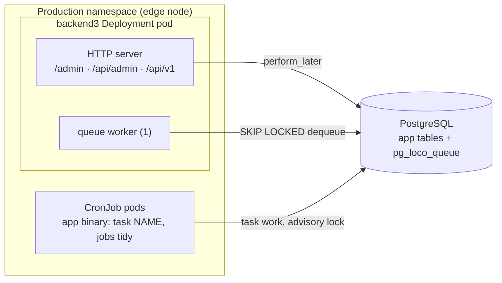

# 0016. No Redis: in-memory cache, Postgres queue, CronJob tasks

- Status: Accepted (2026-10-24)
- Decision questions: Q18

## Context

Loco 1.2.0 ships a job queue, worker modes, an in-process scheduler and a cache. Each has several backends. The question is which ones backend3 runs, and whether it needs Redis at all.

**What Loco 1.2.0 provides.**

| Piece | Backends in 1.2.0 | Facts that matter | Source |
|---|---|---|---|
| Queue (`queue.kind`) | `Postgres` (table `pg_loco_queue`, `FOR UPDATE SKIP LOCKED`), `Sqlite`, `Redis`; no MySQL | **No automatic retry or backoff.** Failed jobs stay `failed` until `jobs retry` moves them back. An opt-in `reaper` requeues jobs stuck in `processing`. The Postgres queue opens its own connection pool (default `max_connections` 20, `num_workers` 2, `poll_interval_sec` 1). Loco creates the queue table itself at startup. | research: SYNTHESIS §6.8; loco-rs@1.2.0:src/config/queue.rs, src/bgworker/pg.rs, src/cli.rs |
| Worker mode (`workers.mode`) | `BackgroundQueue` (default), `ForegroundBlocking`, `BackgroundAsync` | `BackgroundAsync` runs jobs with `tokio::spawn`, so they are lost if the process dies. `ForegroundBlocking` runs them inline, as the test template does. | research: SYNTHESIS §6.8, §6.9; stack-loco-react-admin §1.4 |
| Start modes | server only; `--server-and-worker`; `--worker`; `--all`; `--scheduler` | A server-only process does not run queued jobs. `--all` and `--scheduler` run Loco's cron scheduler inside the process. | loco-rs@1.2.0:src/cli.rs, src/boot.rs `StartMode` |
| Cache (`cache.kind`) | `Null` (default), `InMem` (moka), `Redis` | `InMem.max_capacity` defaults to 33,554,432. The cache has no weigher, so this counts **entries**, not bytes. | research: SYNTHESIS §6.8; loco-rs@1.2.0:src/config/cache.rs, src/cache/drivers/inmem.rs |
| Readiness | `/_readiness` | Pings the database, the queue provider and the cache, and returns 503 on the first failure. `/_ping` and `/_health` always return `{"ok": true}`. | research: SYNTHESIS §6.6, §6.27 |

So any Redis that backend3 depends on becomes part of its readiness. A Redis outage would mark every backend3 pod unready and take the public API down with it.

**What the workload needs.**

- backend3 uses PostgreSQL ([ADR 0002](0002-postgresql-as-the-database.md)), so a durable queue is available without another component.
- backend1 runs no background work at all. It schedules `sitemap:generate` daily, but nothing ever ran Laravel's scheduler in Kubernetes. The live sitemap file dates from 2020-11-17 (website_backend@0dead98:app/Console/Kernel.php; research: SYNTHESIS §3.11, §3.12).
- The only Redis in the namespace serves backend2's persisted-query store. It retires with backend2 ([ADR 0003](0003-cut-over-one-rehearsed-flip-then-a-read-only-parallel-run.md); research: SYNTHESIS §1.5.1, §5.9).
- Release 1 needs some out-of-request work. A background job regenerates `/storage/sitemap.xml` after every change that alters the set of public URLs ([ADR 0019](0019-scope-parity-tracking-retired-features-release-1-additions.md)). Image optimisation, by contrast, runs inside the upload request, one at a time per process ([ADR 0015](0015-media-separate-static-server-media-library-image-optimisatio.md)).
- Release 1 also brings recurring work: queue housekeeping, a daily sitemap backstop ([ADR 0019](0019-scope-parity-tracking-retired-features-release-1-additions.md)), the media trash purge ([ADR 0015](0015-media-separate-static-server-media-library-image-optimisatio.md)) and the purge of expired login-throttle rows ([ADR 0023](0023-operations-hardening-rate-limits-monitoring-backups-secrets.md)).

**Platform limits.**

- The edge node has very little capacity. Node RAM is unknown, and 2 GiB is already committed by limits (research: DECISIONS 36; SYNTHESIS §1.5.1, §8.2 O13).
- backend3 may run more than one replica if the uploads co-mount test passes. Otherwise it runs one replica with `Recreate` ([ADR 0015](0015-media-separate-static-server-media-library-image-optimisatio.md)). Any in-process scheduler would then run once per replica.

## Decision

### 1. No Redis

backend3 enables neither `cache_redis` nor `worker_redis`. No Redis appears in `compose.yaml`, in CI or in the Deployment, and there is no `REDIS_URL`. `/_readiness` depends on Postgres only.

### 2. Cache: in-memory, small, never required for correctness

```yaml
cache:
  kind: InMem
  max_capacity: 1000   # entries, not bytes (loco-rs 1.2.0 InMem has no weigher)
```

Rules for any use of `ctx.cache`:

| Rule | Reason |
|---|---|
| The cache is an optimisation only. Every code path must behave correctly with the `Null` cache, and a test proves it. | per-pod caches and restarts drop entries at any time |
| Every insert has an expiry. Public content expires within 60 seconds. | caches are per pod, so a write on one pod cannot invalidate another pod's entry; the TTL bounds staleness and keeps admin edits visible quickly |
| Values stay well below 64 KiB serialized. Whole list responses are not cached. | 1,000 entries × 64 KiB caps the worst case near 64 MiB on a small node |
| A cache error is logged and treated as a miss. It never reaches the client. | the cache must not create a new failure mode |
| The user lookup behind authentication is never cached. | revocation through `token_version` depends on a fresh read on every request ([ADR 0006](0006-admin-authentication-and-account-lifecycle.md)) |
| State that must be shared across replicas or survive a restart never lives in the cache. Examples are per-account lockout ([ADR 0023](0023-operations-hardening-rate-limits-monitoring-backups-secrets.md)) and traffic counters ([ADR 0019](0019-scope-parity-tracking-retired-features-release-1-additions.md)). | such state lives in Postgres tables |

Release 1 starts with nothing cached. The first use of the cache must come with a measurement that shows the need, such as p95 latency or database load.

### 3. Queue: Postgres, run inside the web process

The first user is the sitemap job of [ADR 0019](0019-scope-parity-tracking-retired-features-release-1-additions.md). Every later feature that needs out-of-request work uses the same queue under the rules below.

```yaml
workers:
  mode: BackgroundQueue
queue:
  kind: Postgres
  uri: <same DATABASE_URL as the application>   # injected with get_env, as for database.uri
  max_connections: 2
  min_connections: 1
  num_workers: 1
  poll_interval_sec: 5
  reaper:
    age_minutes: 30
    interval_seconds: 300
```

- The image's default command is `<bin> start --server-and-worker`, and website_k8s does not override it. Each pod serves HTTP and processes jobs in one process. There is no separate worker Deployment, to save memory on the edge node. With more than one replica, `SKIP LOCKED` hands each job to exactly one worker.
- The Deployment never starts with `--all` or `--scheduler`.
- `num_workers: 1`, a 2-connection pool and a 5-second poll keep the idle cost to one light query every 5 seconds per pod. CPU-heavy jobs run one at a time per pod. Jobs are not latency-critical.
- `BackgroundAsync` and `tokio::spawn` are not used outside tests. clippy bans `tokio::spawn` ([ADR 0008](0008-code-layout-a-pure-src-domain-beside-loco-models.md)). The `/metrics` listener ([ADR 0023](0023-operations-hardening-rate-limits-monitoring-backups-secrets.md)) is joined with the HTTP server in a `Hooks::serve` override, not spawned (ADR 0008, Enforcement).
- Tests run with `workers.mode: ForegroundBlocking`, so jobs execute inline and deterministically.
- The `pg_loco_queue` table lives in the application database. Loco creates and owns it; Sea-ORM migrations do not touch it. Database backups include it because it is in the same database ([ADR 0023](0023-operations-hardening-rate-limits-monitoring-backups-secrets.md)).

Rules for every `BackgroundWorker`:

| Rule | Reason |
|---|---|
| Idempotent: running a job twice gives the same result as running it once. | the reaper requeues jobs whose worker died mid-run |
| Arguments are ids and small values, never file contents or large payloads. | queue rows stay small; the job reads the current state when it runs |
| The job records its outcome on the row it works on, for example in a status column. | editors and the admin UI see the state without reading the queue |
| A job finishes well inside 30 minutes. Longer work is split into several jobs. | it must not reach the reaper age while still running |
| A failing job returns an error and leaves the row marked as not done. It never loops with `sleep`. | 1.2.0 has no automatic retry; hand-rolled retry loops are a doctrine smell |
| Recovery is a reconciliation task that re-enqueues rows still marked as not done, or an operator running `jobs retry`. | explicit, observable and idempotent |

### 4. Scheduled work: Kubernetes CronJobs that run tasks

Recurring work is a Loco `Task`, and a Kubernetes `CronJob` in website_k8s runs it on a schedule. Loco's in-process scheduler and `config/scheduler.yaml` are not used in production.



| CronJob setting | Value | Why |
|---|---|---|
| Image | the same image and tag as the Deployment | one `images:` entry in the kustomization, so Image Updater bumps both together |
| Command | `<bin> task <name> [key:value ...]` or a built-in `<bin> jobs ...` subcommand | the production image has the Loco CLI binary, not `cargo` |
| Environment | the same `LOCO_ENV`, config and Secret references as the Deployment | one configuration |
| `concurrencyPolicy` | `Forbid` | one run at a time per schedule |
| `startingDeadlineSeconds` | 600 | a missed window does not pile up |
| `backoffLimit` | 2 | tasks are idempotent, so a retry is safe |
| `activeDeadlineSeconds` | set per task, about twice the measured runtime | a hung task cannot hold resources |
| History limits | 1 successful, 3 failed | enough to diagnose without clutter |
| Resources | small explicit requests and memory limit | the edge node has little capacity |
| Schedule time zone | `Europe/Budapest` through `spec.timeZone` (stable in Kubernetes since 1.27) | school-day schedules. Confirm support in the MicroShift docs for the live version first; otherwise write schedules in UTC. |

In production, CronJob pods never mount the uploads volume. A task that needs file work only enqueues a job, and the backend3 worker, which has the volume, does the work ([ADR 0015](0015-media-separate-static-server-media-library-image-optimisatio.md) §3).

On staging, the image, environment and Secret references come from the staging Deployment. Production keys are never used there ([ADR 0003](0003-cut-over-one-rehearsed-flip-then-a-read-only-parallel-run.md)). The nightly rehearsal below is the only CronJob that mounts an uploads volume: staging's copy of the uploads, into which the import writes its extracted images ([cutover.md](../cutover.md) §5.1, [data-migration.md](../data-migration.md) `storage_root`).

Every task also takes a Postgres advisory lock keyed by its name. If the lock is already held, the task logs that and exits 0. This keeps a manual run and a scheduled run from overlapping.

CronJobs in release 1:

| CronJob | Command | Schedule | Owner |
|---|---|---|---|
| `backend3-jobs-tidy` | `jobs tidy` (deletes completed and cancelled jobs) | daily, night | this ADR |
| `backend3-jobs-purge` | `jobs purge --max-age 30 --status failed,cancelled` (deletes failed and cancelled jobs older than 30 days) | weekly | this ADR |
| media trash purge | a task that only enqueues the trash-purge job; the worker, which has the uploads volume, deletes trash older than 30 days | daily | [ADR 0015](0015-media-separate-static-server-media-library-image-optimisatio.md) |
| reconciliation tasks | re-enqueue rows whose job never finished | as each feature that uses the queue needs | that feature's ADR |
| sitemap backstop | a task that only enqueues the sitemap job; the worker, which has the uploads volume, writes the file | daily | [ADR 0019](0019-scope-parity-tracking-retired-features-release-1-additions.md) |
| login-throttle purge | a task that deletes expired throttle rows | daily | [ADR 0023](0023-operations-hardening-rate-limits-monitoring-backups-secrets.md) |
| nightly import rehearsal (staging namespace on the hub only, never on the edge node) | the steps of [cutover.md](../cutover.md) §5.2: load the newest `--lock-all-tables` dump into staging's throwaway MySQL, recreate and migrate staging's database, run the import task and the release-1 seed, save the import report, then run the read-only smoke suite | nightly | [ADR 0003](0003-cut-over-one-rehearsed-flip-then-a-read-only-parallel-run.md), [cutover.md](../cutover.md) §5.2 |

`--status` is mandatory on `jobs purge`. Without it, loco-rs 1.2.0 deletes queued and completed jobs older than `--max-age` as well, despite the command's help text (loco-rs@1.2.0:src/cli.rs, `JobsCommands::Purge`). A queued job that old would be a bug worth seeing, not something to delete silently.

Import rehearsals ([ADR 0003](0003-cut-over-one-rehearsed-flip-then-a-read-only-parallel-run.md), [ADR 0017](0017-legacy-data-import-normalisation-and-defect-resolution.md)) are tasks too, scheduled by the staging CronJob above. They run on staging, never against production.

## Consequences

Positive:

- One stateful component, Postgres, backs data, jobs and shared state. Readiness depends on Postgres only.
- Durable jobs without new infrastructure. Jobs are visible with `jobs dump`, and their outcomes are visible on domain rows.
- Recurring work runs exactly once per schedule, however many replicas run. It shows up as Kubernetes Jobs with logs and history.

Negative:

- No automatic retry in Loco 1.2.0. Each feature that uses the queue must provide its own reconciliation task. If a later Loco release adds retries, adopting them needs its own PR and a re-read of the vendored skill ([ADR 0024](0024-ai-maintainability-instruction-files-the-loco-skill-guardrai.md)).
- Per-pod caches are not shared. Cached data can differ between pods for up to the TTL.
- The queue polls Postgres even when idle. At one query every 5 seconds per pod the cost is negligible, but it is not zero.
- CronJob manifests live in website_k8s. A new recurring task needs a PR there, which is left for human review (research: DECISIONS R2).

What must be true in code and tests:

- `Cargo.toml` enables `cache_inmem` and `worker` and does not enable `cache_redis` or `worker_redis`. `cargo tree` shows no `redis` crate.
- `config/production.yaml` sets `cache.max_capacity` explicitly. It never relies on the 1.2.0 default.
- Each worker has a test that runs it twice on the same input and checks the result is the same. For the media trash-purge job, the second run deletes nothing more and does not fail on the files the first run removed.
- Each task has a test for the "lock already held" path.
- A process started without `--server-and-worker` would silently stop all jobs. backend3 therefore exposes the number of queued jobs and the age of the oldest one on `/metrics` ([ADR 0023](0023-operations-hardening-rate-limits-monitoring-backups-secrets.md)). A stopped worker becomes alertable once the hub's OpenShift monitoring scrapes that endpoint, which is planned but not yet designed (research: DECISIONS 36). Until then, the operator runbook's post-deploy check runs `<bin> jobs dump --status queued --folder /tmp` in a backend3 pod (`/tmp` is the pod's writable `emptyDir`, ADR 0023 §8) and checks the age of the oldest queued job.

Follow-up work:

- website_k8s: the two queue housekeeping CronJobs, created with the backend3 Deployment.
- The nightly import rehearsal CronJob in the staging manifests on the hub ([cutover.md](../cutover.md) §5.2). If those manifests live in website_k8s, the PR is left for human review (research: DECISIONS R2).
- Read the MicroShift docs for the live version to confirm CronJob `spec.timeZone` support (unknown until the node version is read; research: SYNTHESIS §8.2 O13).
- Revisit `num_workers`, the pool size and `max_capacity` once the node's real capacity is known (O13).

## Alternatives considered

- **B. A dedicated Redis for backend3** (PVC, password from ESO, `maxmemory`) for the queue and a shared cache. Rejected: another stateful component on a small node, and a new readiness dependency, with no workload that needs it.
- **C. Reuse `redis-backend2`** during coexistence and replace it later. Rejected: it retires with backend2, so backend3 would have to migrate again.
- **`BackgroundAsync` for best-effort work** (the other half of the offered option A). Rejected: jobs die with the process and are not retried. Postgres makes a durable queue free.
- **Loco's in-process scheduler** (`--scheduler` or `--all`). Rejected: it runs once per replica, and its runs are not visible as Kubernetes Jobs.

## References

- research: DECISIONS 1, 18, 27, 28, 36, R2
- research: QUESTIONS 18
- research: SYNTHESIS §1.5.1 (manifest state, committed memory), §3.11-§3.12 (sitemap, commands), §5.9 (backend2 caching), §6.6 (health routes), §6.8 (queue and cache), §6.9 (testing harness), §6.27 (readiness correction), §8.2 O13
- research: stack-loco-react-admin §1.4, §5 D-2
- loco-rs@1.2.0:skills/loco/doctrine.md ("Task vs. Worker vs. Scheduler")
- loco-rs@1.2.0:src/config/queue.rs (`PostgresQueueConfig`, `ReaperConfig`, defaults)
- loco-rs@1.2.0:src/config/cache.rs, src/cache/drivers/inmem.rs (`max_capacity` default, no weigher)
- loco-rs@1.2.0:src/cli.rs (`start` flags, `jobs` subcommands), src/boot.rs (`StartMode`)
- website_backend@0dead98:app/Console/Kernel.php
- [cutover.md](../cutover.md) §5.1 (staging), §5.2 (nightly rehearsal); [data-migration.md](../data-migration.md) §4.1 (`storage_root`)
- Related: [ADR 0002](0002-postgresql-as-the-database.md), [ADR 0003](0003-cut-over-one-rehearsed-flip-then-a-read-only-parallel-run.md), [ADR 0006](0006-admin-authentication-and-account-lifecycle.md), [ADR 0008](0008-code-layout-a-pure-src-domain-beside-loco-models.md), [ADR 0015](0015-media-separate-static-server-media-library-image-optimisatio.md), [ADR 0017](0017-legacy-data-import-normalisation-and-defect-resolution.md), [ADR 0019](0019-scope-parity-tracking-retired-features-release-1-additions.md), [ADR 0023](0023-operations-hardening-rate-limits-monitoring-backups-secrets.md), [ADR 0024](0024-ai-maintainability-instruction-files-the-loco-skill-guardrai.md)
