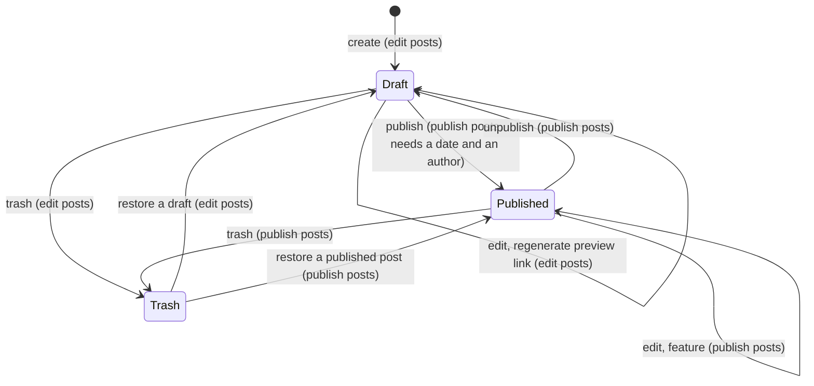
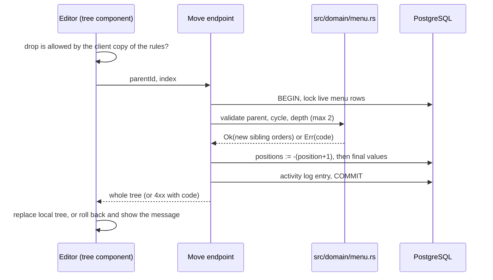

# 0018. Content model: publishing, pages, menu tree, canteen week editor

- Status: Accepted (2026-10-24)
- Decision questions: Q21 (post publishing), Q22 (pages), Q23 (menu editor and storage) with its follow-up 23b (menu depth and import order), Q39 (canteen entry)

## Context

backend1 (Laravel 7 + Backpack 4.1) holds four editorial workflows whose shape the editors depend on every week: publishing a post, maintaining the information pages, ordering the "Információk" menu, and entering the canteen menu. backend3 ports all four (ADR 0019). The research profiled each one against the production dump of 2026-10-23 and the source of backend1, backend2 and the live Angular site. The facts below are the ones that force the decisions.

### Posts and publishing

| Fact | Value | Source |
|---|---|---|
| Rows | 576 posts: 541 published, 35 drafts | research: SYNTHESIS §2.4.1 |
| Publishing | A plain published flag. Only holders of the `publish posts` permission (the admin and supervisor roles; 11 role assignments) can set it. Once a post is published, a writer can no longer save changes to it. | research: SYNTHESIS §2.4.4, §2.4.5 (POS-H01), §3.3.2; QUESTIONS Q21; website_backend@0dead98:app/Http/Controllers/Admin/PostsCrudController.php |
| Public visibility | `published = true` on every public read; order `date DESC, id DESC`; the archive groups by year and month of `date` | research: SYNTHESIS §2.4.5 (POS-H02, POS-H03) |
| Date | Optional in backend1. NULL on 5 drafts and the `1970-01-01` placeholder on 11 drafts. The date decides the public order and the archive month. | research: SYNTHESIS §2.4.8 (POS-H14) |
| Featured | 5 posts, all published. The Angular home page asks for up to 20. | research: SYNTHESIS §2.4.5 (POS-H04) |
| Preview link | `https://verseghy-gimnazium.net/posts/preview/{id}?token={token}`. Every legacy token is 80 characters from `[A-Za-z0-9]`; 3 drafts have none. backend3 creates the token with the draft and lets editors regenerate it (§1.5). | research: SYNTHESIS §2.4.5 (POS-H05 to POS-H08), gap-12 §4 |
| Token alphabet constraint | The Angular router and axum's `Query` extractor both decode `+` to a space before the token is compared, so any token must be URL-safe without encoding. | research: gap-12 §3 (hops 5 and 10) |
| Demand for more | No backlog item asks for scheduled publishing or a review step. | research: QUESTIONS Q21, SYNTHESIS §7.9 |

### Pages

| Fact | Value | Source |
|---|---|---|
| Rows | 39 pages, ids 8 to 50 | research: SYNTHESIS §4.3.6 |
| Templates | One template, `page`, on all 39 rows. The `extras` meta fields (title, description, keywords) are null on all 39 rows; nobody has ever filled them. | research: SYNTHESIS §3.5.2, gap-09 §5; website_backend@0dead98:app/PageTemplates.php |
| Internal name | backend1 labels `name` "Page name (only seen by admins)". It differs from the title on 14 of the 37 rows checked and works as an internal note. | research: SYNTHESIS §3.5.1, gap-09 §3 |
| Reachability | 18 pages are linked from the menu and 6 from hard-coded Angular links. 15 are reachable only by typing the URL: yearly archive copies, scratch copies taken before big edits, and placeholders. | research: SYNTHESIS §4.3.6, gap-09 §6 |
| Visibility | Pages have no draft or hidden state. Every row is served by slug on `/information/<slug>` and `/pages/<slug>`. | research: SYNTHESIS §3.5.2 |
| Clone | Backpack's Clone copies the slug verbatim, so both rows then fail validation until one slug is changed. | research: SYNTHESIS §3.5.1, gap-09 §6.2 |
| Size | The largest body is 63,082 bytes, 2,453 bytes under the 65,535-byte MySQL `TEXT` limit. | research: SYNTHESIS §3.5.2 |
| What Angular reads | `title`, `content`, and `slug` (for JSON-LD). It fetches `id`, `template`, `name` and `extras` but does not use them. | research: SYNTHESIS §5.14; gap-10 §3.8 |

### Menu

| Fact | Value | Source |
|---|---|---|
| Rows | 23 items: two top-level sections, `Rólunk` with 8 links and `További információk` with 13 | research: SYNTHESIS §4.3.7 |
| Stored structure | `parent_id` plus a nested set (`lft`, `rgt`, `depth`; depth starts at 1, `lft` at 2). Only Backpack's Reorder screen writes the nested set; it was last used on 2021-08-29. | research: gap-07 §2.3, §3.3 |
| Unpositioned items | 5 items created between 2023-10-10 and 2024-11-04 (ids 25, 26, 29, 30, 31) have NULL `lft/rgt/depth`. `ORDER BY lft` puts them first in their section, in MyISAM physical order. The public site has shown them first for up to three years. | research: gap-07 §3.2, §4 (experiment E) |
| Depth | Backpack allows 3 levels; production never used a third. Both frontends request and render exactly 2 levels. | research: gap-07 §5.3 |
| Kinds | `page_link` 20, `internal_link` 3, `external_link` 0. The 3 internal links carry a stray `page_id = 1` (no such page), an artefact of the edit form. | research: gap-07 §2.1, §3.3 |
| Frontend contract | A top-level item with children renders as a non-clickable section title. `/information` redirects to the first top-level `page_link`. | website_frontend@f74c765:apps/frontend/src/app/modules/information/components/sidebar/sidebar.component.html; website_frontend@f74c765:apps/frontend/src/app/modules/information/guards/empty-information-path.guard.ts |
| Tree UI | shadcn-admin-kit ships no tree component. react-admin's `ra-tree` is Enterprise Edition (Team plan from 145 EUR per month) and built on Material UI, so it does not fit the shadcn kit either. | research: SYNTHESIS §6.16, §6.19, §6.22 |

### Canteen

| Fact | Value | Source |
|---|---|---|
| Volume | 1,187 days from 2019-04-01 to 2026-10-22, weekdays only. The secretaries enter them 1 to 9 days ahead, most often 4 to 7. | research: SYNTHESIS §2.9, §4.3.3 |
| Entry screen | One form per day. Each day takes 2 or 3 dishes picked from all 624 dishes, listed by name only. | research: SYNTHESIS §2.9 |
| Dishes | 624 rows: soup 144, main dish 420, dessert 60. 55 names occur more than once, never across courses. 57 dishes are unused; one dish is reused on up to 72 days. | research: SYNTHESIS §2.8, §4.3.3 |
| Integrity | 8 dates exist twice and the public site shows both rows. 16 days break the 2-to-3-dish rule. ADR 0017 resolves both at import. | research: SYNTHESIS §2.9 |
| Courses per day | At least 87 three-dish days repeat a course (for example two main dishes). | research: QUESTIONS Q39 |
| List screen | Shows dish names comma-joined, without their course. | research: SYNTHESIS §2.9 |
| Intent | Closed backend1 issue #236 judged type-ahead linking of dishes "actually a very fast way". | research: SYNTHESIS §7.9.6 |
| Permission | One permission, `edit canteens`, covers dishes and days. | research: SYNTHESIS §2.3 |
| Year end | ISO 2026 has 53 weeks; 2026-W53 runs from Monday 2026-12-28 to Sunday 2027-01-03. | research: SYNTHESIS §5.11.2 |

## Decision

All four parts follow ADR 0008: validation rules and tree, slug and week arithmetic live as pure functions in `src/domain/`, with unit and property tests; controllers and models call them. Every write is permission-checked on the server (ADR 0007), soft-deletable, revisioned and logged (ADR 0011). Hungarian wording below is the intended text; the strings live in the admin message file (ADR 0021).

### 1. Posts: publishing parity plus fixes

**1.1 States.** A post is a draft or published, stored as `posts.published boolean NOT NULL DEFAULT false`. There is no scheduled state and no review state.

**1.2 Who may do what.**

| Action | `edit posts` only (writer) | `edit posts` + `publish posts` |
|---|---|---|
| Create a draft; edit any draft; move a draft to the trash; regenerate a draft's preview link | yes | yes |
| Publish or unpublish | no | yes |
| Any change to a published post: edit, move to the trash, restore a revision | no | yes |
| Change `featured` (on any post) | no | yes |

The writer lock covers every write path, including trash, restore from trash and restore of a revision (ADR 0011). The admin sends the whole record on update, so the server compares the submitted `published` and `featured` values with the stored ones: an unchanged value needs no extra permission, a changed one does. A refused write returns HTTP 403 with a stable error code in the admin error envelope (ADR 0021 §4), for example:

- `post.published_locked`: „Közzétett bejegyzést csak a »Bejegyzések közzététele« jogosultsággal lehet módosítani.”
- `post.featured_requires_publish`: „Bejegyzés kiemeléséhez a »Bejegyzések közzététele« jogosultság szükséges.”

The admin disables the publish and featured switches and opens published posts read-only for writers. That is convenience only; the server rule is authoritative. Whether ra-core's `*Base` page components pass the record to `canAccess` is unverified (research: SYNTHESIS §8 O58). backend3 therefore does not rely on it: its own buttons and the post form call `useCanAccess` with the record explicitly, and `canAccess` answers from the `/me` permissions and the record's `published` flag (ADR 0007 §7).

**Removing published posts.** Decision 21 lists three fixes: the required date, `featured` behind `publish posts`, and the preview token. A follow-up decision adds a fourth rule (research: DECISIONS 21b): moving a published post to the trash, restoring one from the trash and restoring one of its revisions also need `publish posts`. Writers can trash only their drafts.

**1.3 Date and author.**

The date is required on every save. The create form, and the edit form of a draft whose date is NULL, pre-fill today's Europe/Budapest date from the injected clock (ADR 0010). UTC would still give the previous day for the first one or two hours after local midnight. The server still refuses a save without a date with HTTP 422 `post.date_required` („A dátum megadása kötelező.”). The column stays nullable because ADR 0017 turns the eleven `1970-01-01` placeholders on drafts into NULL and five drafts already have none. A check constraint keeps the public order total: `CHECK (NOT published OR date IS NOT NULL)`.

Storage follows decision 9 (everything `timestamptz`). `posts.date` (NULL on drafts only) and `canteen_days.date` (`NOT NULL`, §4.1) are `timestamptz` columns that hold the Europe/Budapest midnight of the calendar day. A check enforces it on both tables: `CHECK ((date AT TIME ZONE 'Europe/Budapest')::time = time '00:00')`. Since 1984 Budapest's clocks change at 02:00 and 03:00 local time, so every calendar day from 1984 on has exactly one local midnight; the few earlier days with none or two follow ADR 0010 point 2. The today default, the week editor's Monday-to-Friday dates (§4.7) and the archive's year-and-month grouping all go through ADR 0010's Budapest conversion module (ADR 0010 point 5), and SQL that derives a day, month or year names the zone (ADR 0010 point 10). Both APIs still render the value as `YYYY-MM-DD` (ADR 0010, wire formats).

Publishing requires an author. The server refuses `published = true` without a live `author_id` with HTTP 422 `post.author_required` („Közzétételhez szerző megadása szükséges.”). `CHECK (NOT published OR author_id IS NOT NULL)` (ADR 0009) is the backstop, so the database never has to answer the editor with a 500.

**1.4 Featured.** Only the permission changes. There is no cap on the number of featured posts (parity); the time-window idea of backend1 issue #353 is out of scope.

**1.5 Preview token.**

| Rule | Value |
|---|---|
| Column | `posts.preview_token text NOT NULL`, unique index |
| New posts | Generated on insert in the model's `ActiveModelBehavior::before_save` hook with `loco_rs::hash::random_string(32)` (alphanumeric, about 190 bits). Never generated inside a GET handler. |
| Imported posts | Legacy 80-character tokens are kept byte for byte, so preview links editors already shared keep working. NULL tokens are back-filled with the same generator. |
| Admin actions | „Előnézeti link másolása” and „Előnézeti link újragenerálása”. Regenerating replaces the token, so the old link stops working; the activity log records who did it. |
| Link | `{public_site_url}/posts/preview/{id}?token={token}`. The base URL comes from configuration and is passed to the URL builder as an argument. The token is percent-encoded anyway. |
| Public lookup | Unchanged from backend2: with a token, only an unpublished post with exactly that token is returned; a published post is never returned through a token; any mismatch is `404`. `preview_token` and `published` never appear in public responses. |

**1.6 `publish_at`.** The `posts` table gets `publish_at timestamptz NULL` now, so scheduled publishing (Q21 option C) can come later without a schema change. In release 1 nothing reads or writes it: no admin field, no public filter, the importer leaves it NULL. The migration documents this with `COMMENT ON COLUMN posts.publish_at IS 'Reserved for scheduled publishing (ADR 0018); unused in release 1'`. Turning it on is a decision of its own.

**1.7 Everything else.** The other post fields and their rules are ported as listed in the parity checklist (ADR 0019).

### 2. Pages: one page type with a visibility flag

**2.1 Table `pages`.**

| Column | Type | Rule |
|---|---|---|
| `id` | `bigint` identity | value preserved from MySQL (ADR 0009) |
| `title` | `text NOT NULL` | 2 to 255 characters after trimming (backend1's rule) |
| `slug` | `text NOT NULL`, unique among live rows (partial unique index, ADR 0009) | `CHECK (slug ~ '^[a-z0-9-]+$')` as in ADR 0009, 1 to 191 characters; generated slugs never start or end with `-` and never contain `--` |
| `internal_note` | `text NULL` | up to 255 characters; shown only in the admin |
| `content` | `text NOT NULL` | sanitised editor HTML (ADR 0013); an empty string is allowed; no 64 KiB cap |
| `seo_description` | `text NULL` | plain text, up to 300 characters (search engines show roughly the first 150 to 160) |
| `published` | `boolean NOT NULL DEFAULT false` | `false` means hidden |
| audit and soft-delete columns | | per ADR 0011 |

There is no `template` column and no `extras` column. Slugs that the server generates (on create and on Clone) also skip the slugs of trashed pages, so restoring a trashed page never collides with a generated slug. An editor may deliberately give a new page the slug of a trashed one; restoring the trashed page is then refused with a 409 that names the live page (ADR 0011).

**2.2 Visibility.** A hidden page is not served: `GET /api/v1/pages/{slug}` returns `404` for hidden and trashed pages, the sitemap leaves them out (ADR 0019), and `GET /api/v1/menu` omits menu items that link to them (§3.5). Editors can open and edit hidden pages in the admin, where the editor surface matches website_frontend2's PageRenderer styling (decision 15a, ADR 0013); tables, images and embeds lay out the same on both public sites through the content-v1 HTML shape. New pages start hidden; the editor publishes them with the „Közzétéve” switch.

**2.3 Slug.** If the slug is left empty on create, the server derives it from the title in this order:

1. Lowercase the title.
2. Transliterate the Hungarian letters (á→a, é→e, í→i, ó/ö/ő→o, ú/ü/ű→u).
3. Apply Unicode NFKD and drop the combining marks, so other accented Latin letters such as ä or ç also lose their accents.
4. Turn every run of characters outside `[a-z0-9]` into one `-`. Letters with no ASCII decomposition, such as ß, end up in such a run.
5. Trim leading and trailing `-`.
6. If the result is empty (for a title such as „??”), use `oldal`.
7. Truncate to 191 characters and trim a trailing `-` again.
8. If the result is taken by a live or a trashed page, append the first free `-n` suffix (`n ≥ 1`). Where the suffix would push the slug past 191 characters, the base is shortened first, again without a trailing `-`, and the free `n` is looked up for that shortened base.

The result is never empty, never longer than 191 characters, never starts or ends with `-`, never contains `--`, and always matches the slug pattern of §2.1. The property test in Follow-up work uses these properties as its oracle. Changing the title never changes the slug (parity). Editing the slug of a published page shows a warning that existing links stop working. Imported slugs are kept verbatim.

**2.4 Clone.** `POST /api/admin/pages/{id}/clone` creates a copy with the same title, internal note, content and SEO description. Its slug is `<source-slug>-<n>` with the smallest `n ≥ 1` that no page uses, live or trashed, shortened to fit 191 characters. The copy starts hidden, because copies are archives or scratch work, and the admin opens its edit form at once. The activity log records the source page. Slug selection is a pure function over the set of taken slugs; the unique constraint is the backstop, and the endpoint retries once on a conflict. Revisions (ADR 0011) make most archive copies unnecessary, but Clone stays for parity.

**2.5 Admin screens.** The list shows title, slug („URL-név”), state („Közzétéve” or „Rejtett”), whether a live menu item links the page („Menüpont”), and the last change. Filters: state, and „Nincs menüpontja”. The „Megnyitás a honlapon” button opens `{public_site_url}/information/{slug}` and is disabled for hidden pages. Moving a page to the trash is refused while a live menu item links to it; the message names the items. Hiding a linked page is allowed, with a warning that names the menu items that will disappear from the site. Every page operation requires `edit pages` (ADR 0007).

**2.6 Public response.** The page DTO keeps backend2's field set (ADR 0005), so the Angular page model works unchanged:

| Field | Value |
|---|---|
| `id`, `title`, `slug`, `content` | from the row |
| `template` | constant `"page"` |
| `extras` | constant `{}` |
| `name` | the page title; the internal note never leaves the admin API |
| `seoDescription` | `seo_description` or `null`; an additive field the Angular site does not read yet |

**2.7 Import.** All 39 rows are imported. `name` becomes `internal_note` when it differs from the title and NULL otherwise, which loses nothing. The importer asserts that every row has `template = 'page'` and that every `extras` value is null, and stops with a report if not. Every imported page is published, because every page is public today; the editor-signed resolution list (ADR 0017) may name pages to import as hidden instead.

### 3. Menu: a generic clean-room tree editor, capped at two levels for the menu

**3.1 Table `menu_items`.**

| Column | Type | Rule |
|---|---|---|
| `id` | `bigint` identity | value preserved (ADR 0009) |
| `name` | `text NOT NULL` | 1 to 100 characters after trimming |
| `kind` | `text NOT NULL`, `CHECK (kind IN ('page_link','internal_link','external_link'))` | the public API keeps the field name `type` |
| `page_id` | `bigint NULL`, FK `pages(id) ON DELETE RESTRICT` | `CHECK ((kind = 'page_link') = (page_id IS NOT NULL))` |
| `link` | `text NULL`, up to 255 characters | `CHECK ((kind <> 'page_link') = (link IS NOT NULL))` |
| `parent_id` | `bigint NULL`, FK `menu_items(id) ON DELETE RESTRICT` | NULL for a top-level item |
| `position` | `integer NOT NULL` | dense `0..n-1` among the live children of one parent |
| audit and soft-delete columns | | per ADR 0011 |

A partial unique index keeps sibling positions unique among live rows, top level included: `CREATE UNIQUE INDEX menu_items_live_sibling_position ON menu_items (parent_id, position) NULLS NOT DISTINCT WHERE deleted_at IS NULL`. `NULLS NOT DISTINCT` needs PostgreSQL 15 or later; a probe on PostgreSQL 16.14 confirmed that it rejects a second top-level item at the same position. `lft`, `rgt` and `depth` are not carried over.

**3.2 Validation** (pure functions in `src/domain/menu.rs`):

| Rule | Detail |
|---|---|
| `page_link` | `page_id` must reference a page that is not trashed; a hidden page is allowed and flagged in the tree |
| `internal_link` | `link` starts with `/`, does not start with `//`, contains no whitespace |
| `external_link` | `link` is an absolute `http` or `https` URL with a host |
| Parent | exists, is not trashed, is not the item itself and not one of its descendants |
| Depth | `depth(new parent) + height(moved subtree) ≤ MENU_MAX_DEPTH`, with `MENU_MAX_DEPTH = 2` as one constant. A top-level item has depth 1 and "no parent" counts as 0; a single item has height 1. Moving a section that has children under another section (1 + 2 = 3) is therefore refused. |

The generic tree functions (depth, height, descendants, cycle check, sibling renumbering) take `max_depth: Option<u8>` and know nothing about menus. Example messages: `menu.max_depth` „Az Információk menü legfeljebb két szintű lehet.”; `menu.cycle` „Egy menüpont nem kerülhet a saját maga vagy egy alárendelt menüpontja alá.”; `menu.has_children` „A menücsoport nem törölhető, amíg menüpontok vannak benne.”

**3.3 Writes.**

| Operation | Behaviour |
|---|---|
| Create | appends the item last among its siblings |
| Update | changes fields only; never moves the item |
| Move | `POST /api/admin/menu-items/{id}/move` with `{ "parentId": number or null, "index": number }`. One transaction: lock the live menu rows (`SELECT … FOR UPDATE`; the table holds 23 rows), validate, remove the item from its old sibling list, insert it at `index` (clamped to the list), renumber both lists, write the activity log, return the whole tree. |
| Trash | refused while the item has live children; compacts the positions of the remaining siblings |
| Restore | refused while the parent is trashed; appends the item last under its parent |

Renumbering runs in two steps inside the transaction: first every affected position becomes `-(position + 1)`, then the final values are written. A single `UPDATE` that swaps two positions fails against a non-deferrable unique index; the probe on PostgreSQL 16.14 reproduced that failure and confirmed the two-step form. Every menu operation requires `edit menu` (ADR 0007).

**3.4 The tree component.** The admin gets a self-built, open-source tree in `admin/src/components/tree/`, styled with shadcn/ui and equivalent in behaviour to react-admin Enterprise's `ra-tree` (a tree with a details pane, and a tree input for picking a parent). It is generic: any depth, any record with `id`, `parent_id` and `position`; a `maxDepth` prop is optional. The menu screen passes `maxDepth = 2`.

| Behaviour | Detail |
|---|---|
| Tree with details | the tree on one side; selecting a node opens its edit form beside it; buttons for a new top-level item and a new child |
| Drag and drop | reorder among siblings and move to another parent, with drop indicators (before, after, inside); a drop that breaks the depth cap or targets the node's own subtree is shown as not allowed |
| Keyboard and buttons | „Fel”, „Le”, „Beljebb”, „Kijjebb” (up, down, indent, outdent) on the selected node, so every drag-and-drop move can also be made without a mouse |
| Expand and collapse | per node; small trees start fully expanded |
| Parent picker | a form input that shows the tree and disables nodes where the cap would be exceeded |
| Server is authoritative | the client applies the move optimistically, then replaces its tree with the server's answer; on an error it rolls back and shows the Hungarian message |
| Badges | the menu screen marks hidden linked pages and top-level items without children (the live Angular site renders a childless top-level `page_link` as a broken link) |

Clean-room rules: the component is built from this behaviour description and from public feature documentation only. Nobody working on it reads or copies Enterprise source. No `@react-admin/*` package (the private Enterprise registry scope) is installed; a CI check fails if `admin/package.json` or the lockfile names one. The drag-and-drop library is chosen in the menu PR after checking its current release and accessibility support. Its licence must pass the npm licence check of ADR 0012 (compatible with AGPL-3.0-only, for example MIT, ISC or Apache-2.0). The choice and the reason are recorded in the menu PR description. It is listed in `THIRD_PARTY.md` only if its source is vendored. The pure tree operations exist in Rust (authoritative) and TypeScript (for instant feedback); one shared JSON file of move cases runs in both test suites so the two cannot drift.

**3.5 Public API.** `GET /api/v1/menu` returns the whole tree in one response. Each item is `{ id, name, type, link, slug, children }`, children in `position` order. `slug` is the linked page's slug for `page_link` and `null` otherwise. Trashed items are omitted. A `page_link` item whose page is hidden or trashed is omitted together with its subtree, so the frontends never build `/information/null`, and the editor sees the effect beforehand through the warning in §2.5.

**3.6 Import.** The importer reproduces the order the site serves today (decision 23b):

1. `parent_id` and ids are copied.
2. Within each parent, the rows with NULL `lft` come first, in the order they appear in the `menu_items` INSERT of the MySQL dump (MyISAM physical order, which is what `ORDER BY lft` returns today). The numbered rows follow in `lft` order. Positions are `0..n-1`. Editors can still create or delete menu items until the write freeze, and MyISAM may reuse a freed row slot, so the importer derives the order from each dump rather than from a fixed list. The import report lists every row with NULL `lft` and its resulting position. The pinned table below is re-checked against the final cut-over dump (it matched the dumps of 2026-08-28, 2026-10-01 and 2026-10-23; research: gap-07 §1).
3. `page_id` becomes NULL on the three `internal_link` rows.
4. `lft`, `rgt`, `depth` and `deleted_at` are dropped.
5. Pre-checks stop the import with a report on any dangling `parent_id`, any depth above 2, any `page_link` without an existing page, or a `link` on a `page_link`.

The importer test and the REST-spec fixtures (ADR 0019) pin this expected result, which is public navigation:

| Parent (position) | Children in position order (id, name) |
|---|---|
| 7 `Rólunk` (0) | 25 Az iskola nyitvatartása · 8 Iskolatörténet · 14 Archívum · 13 Tablók · 12 Alapítvány · 11 Iskolapszichológus · 10 Fejlesztők · 9 Munkatársak |
| 15 `További információk` (1) | 26 Versenyeredmények · 30 Szegő-verseny 1994-2023 · 29 Egyetemi tanárok lettek · 31 Adatvédelem · 17 Tagozatok · 23 Búvárkodj a biológiában verseny · 22 Tarján Imre Emlékverseny · 21 Szegő Gábor Matematikaverseny · 20 Közösségi szolgálat · 19 OKTV eredmények · 24 Statisztikák · 18 Dokumentumok · 16 Beiskolázás |

`Rólunk` stays the first top-level `page_link`, so the `/information` redirect still lands on the same page.

### 4. Canteen: a week editor, and the single-day form kept

**4.1 Data rules.**

| Rule | Implementation |
|---|---|
| One live day per date | `canteen_days.date` is `timestamptz NOT NULL` holding the Europe/Budapest midnight of the day, with the midnight check of §1.3 (decision 9). The key is the Budapest calendar date: `CREATE UNIQUE INDEX canteen_days_live_date ON canteen_days (((date AT TIME ZONE 'Europe/Budapest')::date)) WHERE deleted_at IS NULL`. A trashed day does not hold its date: re-entering a deleted day is normal. Restoring a day whose date is taken is refused with a 409 (ADR 0011). A probe on PostgreSQL 16.14 confirmed that the check refuses a non-midnight instant, that the index refuses a second live day for the same Budapest date, and that a trashed day frees its date. |
| 2 or 3 dishes per live day | a pure domain check, run inside the write transaction on every write path (week editor, single-day form, restore); the join table's primary key `(canteen_day_id, dish_id)` stops the same dish appearing twice on a day |
| Courses | `dishes.course` is 0 soup („Leves”), 1 main dish („Főétel”), 2 dessert („Desszert”); two dishes of the same course on one day are allowed |
| Dish rows | `name` 1 to 64 characters (backend1's rule); moving a dish to the trash is refused while a live day uses it, and the message gives the number of days, so a deletion can no longer leave a day with fewer than 2 dishes |
| Order on the public API | the `canteen_day_dishes` join table of ADR 0009 carries `position smallint NOT NULL CHECK (position BETWEEN 0 AND 2)` with `UNIQUE (canteen_day_id, position)`. It stores the slot order from the editor as `0..n-1`, empty slots skipped. A save deletes and re-inserts the day's join rows inside its transaction, so the non-deferrable unique constraint never sees two dishes swapping places (the failure §3.3 describes for the menu). `GET /api/v1/canteen/{isoYear}/{isoWeek}` orders dishes by course, then position (`type ASC`, then position, as [public-api.md](../public-api.md) §6.6 states). backend2 had no tie-break between dishes of one course; the importer assigns positions by course, then dish id. A canteen-day revision stores `dish_ids` in position order (ADR 0011), so restoring a revision restores the order. |

Example messages: `canteen.dish_count` „Egy naphoz legalább két és legfeljebb három étel tartozhat.”; `canteen.date_taken` „Erre a napra már van étlap.”

**4.2 The week editor** („Heti étlap”) is a custom admin page.

| Element | Behaviour |
|---|---|
| Week picker | ISO week with previous and next buttons, shown as for example „2026. 44. hét (okt. 26. – okt. 30.)”; opens on the next ISO week (from the injected clock, ADR 0010), because menus are entered about a week ahead |
| Rows | Monday to Friday, each with its date. A Saturday or Sunday day that exists in the week (entered through the single-day form) is shown read-only with a link to that form. |
| Slots | three dish pickers per row; their course filters default to Leves, Főétel and Desszert, and each slot's course can be switched, so a day with two main dishes takes two clicks |
| Empty row | means no menu that day (holidays); nothing is saved for it |
| Keyboard | Tab moves through the slots row by row; Enter picks the highlighted dish |

**4.3 The dish picker.** Type-ahead over the dishes, matching case- and accent-insensitively with the ADR 0020 helper. Results are grouped by course, the slot's course first, then by how often the dish is used, then by name in Hungarian order. Every result shows its usage count („12 napon”). Where a name occurs more than once in a course, each entry also shows the last date it was used, so the duplicates can be told apart. If nothing matches, the picker offers „Új étel: <név>” and creates the dish inline with the slot's course. Creating a dish whose name and course already exist (compared after case and accent folding) is refused, and the existing dish is offered instead. The 55 legacy duplicate groups stay as they are.

**4.4 Saving a week.** `GET /api/admin/canteen-weeks/{isoYear}/{isoWeek}` returns the five weekdays with their days, dishes and each day's `updated_at`, plus any weekend day of that week for read-only display. `PUT` on the same path saves the whole week in one transaction:

- every date must lie inside that ISO week, Monday to Friday, at most once;
- every non-empty row must hold 2 or 3 live dishes;
- every row that existed when the page loaded must still carry the `updated_at` it was loaded with; otherwise the whole save is refused, so two people editing one week cannot overwrite each other silently;
- a row that had a day and is now empty moves that day to the trash, after the editor confirms a dialog that lists the affected dates;
- each created or changed day gets a revision, and every created, changed or trashed day gets an activity-log entry (ADR 0011; a trash writes no revision).

**4.5 The single-day form stays.** The canteen-day resource keeps its create and edit forms with a date input, the same picker and the same rules. It covers days the week editor does not, such as a Saturday school day.

**4.6 The list screen** shows the date, the weekday and the dishes labelled by course.

**4.7 Week arithmetic** is a pure function in `src/domain/canteen.rs`: `(iso_year, iso_week) → Monday..Friday`, returning an error for a week that does not exist (for example 2027-W53). It works on calendar dates; the model layer turns each date into its Budapest-midnight instant with ADR 0010's module before it reaches the database (§1.3). Its tests include 2026-W53 (2026-12-28 to 2027-01-01) and 2027-W01 (from 2027-01-04), and a property test checks that every valid week maps to five consecutive weekdays carrying the same ISO week.

**4.8 Permission.** `edit canteens` covers dishes, days and the week editor, including list and read (ADR 0007).

## Consequences

**Positive**

- Writers keep the workflow they know; publishers keep control over what goes public, including the featured block.
- Every published post has a date and an author, so the public order and the archive are total; drafts can no longer be saved without a date, and a missing author is a clear refusal, not a database error.
- Preview links are random, URL-safe, created with the draft and replaceable. Links already shared keep working.
- Scratch and archive copies of pages can be hidden, and Clone no longer locks both pages.
- The menu order is explicit and owned by the editors. New items no longer float to the top of a section. The site looks the same on day one.
- The tree component is reusable for any future hierarchy without an Enterprise licence.
- The week editor matches how the menu is entered, keeps the type-ahead speed, and makes duplicate dates and broken days impossible.

**Negative**

- backend3 owns a tree component and its drag-and-drop accessibility; that is real UI work and test surface.
- Two copies of the tree rules (Rust and TypeScript) must stay in step; the shared fixture file is the guard.
- Removing a published post is a publisher action; a writer who wants one gone must ask a publisher. The maintainer decided this (research: DECISIONS 21b).
- Calendar dates stored as instants need the Budapest conversion on every read and write, and a bare `::date` cast would be wrong. The midnight check and ADR 0010's lint rule are the guards.
- Public `name` on pages changes from the internal note to the title. Nothing reads it today, but it is a visible change in the payload.
- The week editor's custom endpoints sit outside the standard CRUD data-provider calls and need their own tests.

**Follow-up work**

- Posts slice: the permission table of §1.2 as server tests, one per row and role; a server test that publishing without an author answers 422 `post.author_required`, and one that a save without a date answers 422 `post.date_required`; an admin test that an imported draft with a NULL date opens with today's Budapest date filled in; database tests that a non-midnight `posts.date` is refused by the check; the preview-token tests listed in research gap-12 §6 (R10), including the two backend2 tests `unpublished_post_is_only_found_with_its_preview_token` and `preview_token_only_finds_unpublished_posts` (website_backend2@ced400b:tests/posts.rs) rewritten against the REST spec; a test that nothing reads or writes `publish_at`; settle O58 by reading the ra-core 5.15.5 source.
- Pages slice: slug and clone functions with unit and property tests (generated slugs have the properties listed in §2.3 for any title, including „??” and titles with ä, ç or ß; clone never returns a taken slug); 404 tests for hidden and trashed pages; the import assertions on `template` and `extras`.
- Menu slice: the domain functions with property tests (no move ever produces a cycle, a depth above `max_depth`, or a gap or duplicate in sibling positions); the move endpoint tests (cycle, depth, trashed parent, concurrent moves); the CI check against `@react-admin/*` packages; the import fixture of §3.6; the public tree test with a hidden and a trashed linked page.
- Canteen slice: week arithmetic tests around 2026-W53; save tests for the 2-to-3 rule, duplicate dates, stale `updated_at`, and trash of an emptied row; database tests that a non-midnight `canteen_days.date` is refused and that a second live day for one Budapest date is refused whichever UTC offset the value is written with; a test that two dishes of one course keep their slot order through a save and a revision restore; the dish trash refusal; the inline-create duplicate refusal.
- ADR 0007 holds the same writer-lock rule (any write to a published post, including delete and restore, needs `publish posts`) and the role matrix: `edit pages` and `edit menu` go to the admin role, and its `edit menu` label follows the terminology of ADR 0021 §6.
- ADR 0010 point 2, ADR 0009's naming table and the date rules of [data-migration.md](../data-migration.md) §5.2 state decision 9 as §1.3 does, and ADR 0009's `canteen_day_dishes` row carries the `position` column of §4.1.

## Alternatives considered

**Q21, publishing**

- A. Exact parity with backend1's publishing rules: rejected; the optional date has already produced broken drafts, and backend1 creates the preview token lazily, when a form is opened.
- C. Scheduled publishing through `publish_at` that the public API respects: not now; nobody has asked for it. The nullable column keeps the door open.
- D. C plus a "ready for review" state and a publisher queue: no demand, and it adds a workflow the school does not use.

**Q22, pages**

- B. Keep the template mechanism (template picker plus `extras` JSON) for possible future templates: rejected; one template and empty meta fields for six years.
- C. Port as is, including the duplicate-slug Clone and no visibility flag: rejected; it keeps the two problems that hurt editors.

**Q23 and 23b, menu**

- A. A purpose-built two-level section editor (sections with ordered links, reordered by drag or up/down buttons): the recommended default, overridden by the maintainer in favour of a generic clean-room tree component. Its validation rules and two-level shape survive inside this decision as the menu's cap.
- B as offered, a drag-and-drop tree with a depth cap of 3 as in Backpack: the tree was chosen, the cap was set to 2, because both frontends render two levels and production never used a third.
- C. Port the nested set and Backpack's Reorder numbering: rejected; the nested set was only ever a sort key, and its write path is the fragile part.
- Buy react-admin Enterprise for `ra-tree`: rejected; it is built on Material UI, not the shadcn kit, and it is a recurring cost.
- Import order (ii), unpositioned items appended last by id (the REST draft's default): rejected; it would visibly move five live menu items on cut-over day.

**Q39, canteen**

- B. The day form as today, plus unique dates and dish pickers filtered by course: rejected; it keeps one form per day although the menu is entered a week at a time.
- C. Port as is: rejected; it keeps the duplicate dates and broken days the public site already shows.

## References

- research: QUESTIONS Q9, Q21, Q22, Q23, Q39; DECISIONS rows 2 (write freeze), 6 (permissions on every operation), 9 (everything `timestamptz`), 13 (end-of-work review), 14 (third-party code), 15a (editor surface), 20 (authors and constraints), 21, 22, 23, 23b, 32b, 39
- research: SYNTHESIS §2.3 (permission gating), §2.4.1-§2.4.8 (posts), §2.8-§2.9 (dishes, canteen days), §3.3.2 (role assignments), §3.5 (pages), §3.6 (menu items), §4.3.3, §4.3.6, §4.3.7 (table profiles), §5.4, §5.7, §5.11.2 (public semantics, visibility, ISO weeks), §5.14 (fields the Angular site reads), §6.16, §6.19, §6.22 (kit components, trees, Enterprise boundary), §7.9.6 (closed issues), §8 O58
- research: gap-07 (menu write semantics, production rows, served order, write model; §0 and §1 for MyISAM slot reuse and the dump comparison), gap-09 (pages: templates, extras, unlinked copies, Clone), gap-10 §3.7-§3.8, §4.11-§4.12 (REST draft for menu and pages), gap-12 (preview tokens)
- website_backend@0dead98:app/Http/Controllers/Admin/PostsCrudController.php, app/Models/Posts.php, app/PageTemplates.php, app/Http/Requests/CanteensRequest.php, app/Http/Controllers/Admin/MenusCrudController.php
- website_backend2@7ba71da:src/graphql/resolvers/menu.rs, src/graphql/resolvers/pages.rs, src/graphql/resolvers/canteen.rs, src/graphql/resolvers/posts.rs
- website_backend2@ced400b (branch `test/integration`): tests/posts.rs, tests/content.rs
- website_frontend@f74c765:apps/frontend/src/app/modules/information/components/sidebar/sidebar.component.html, apps/frontend/src/app/modules/information/guards/empty-information-path.guard.ts, apps/frontend/src/app/modules/posts/posts.module.ts
- Loco 1.2.0 documentation: `ActiveModelBehavior::before_save` (loco-doctrine), `hash::random_string` (recipes/auth), transactions with `db.begin()` (recipes/model-and-migration)
- Probe on PostgreSQL 16.14, 2026-10-24: partial unique index with `NULLS NOT DISTINCT`, single-statement swap failure, two-step renumbering; the Budapest-midnight check and the unique index on the Budapest date of `canteen_days.date`
- [public-api.md](../public-api.md) §6.6 (canteen dish order), [data-migration.md](../data-migration.md) §5.2 (time values)
- Related ADRs: [0003](0003-cut-over-one-rehearsed-flip-then-a-read-only-parallel-run.md), [0005](0005-rust-dtos-are-the-api-contract-ts-rs-utoipa-openapi.md), [0007](0007-authorization-four-roles-enforced-on-every-operation.md), [0008](0008-code-layout-a-pure-src-domain-beside-loco-models.md), [0009](0009-clean-domain-schema-with-preserved-integer-ids.md), [0010](0010-all-instants-stored-as-timestamptz.md), [0011](0011-safety-net-soft-delete-revisions-and-an-activity-log-for-eve.md), [0012](0012-delivery-review-commits-and-licensing.md), [0013](0013-rich-text-editor-and-html-sanitiser.md), [0017](0017-legacy-data-import-normalisation-and-defect-resolution.md), [0019](0019-scope-parity-tracking-retired-features-release-1-additions.md), [0020](0020-search-and-hungarian-ordering.md), [0021](0021-hungarian-only-admin-ui.md)
