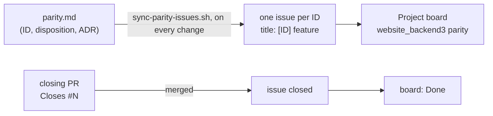

# 0019. Scope: parity tracking, retired features, release-1 additions

- Status: Amended by [0026](0026-backend2-unchanged-and-running-until-decommissioning.md) and [0032](0032-backend1-s-public-rest-api-retired.md) (2026-10-25)
- Decision questions: Q25a, Q25b, Q28, Q29, Q30, Q31, and the dashboard-statistics part of Q27 (the image part of Q27 is in ADR 0015)

## Context

backend3 replaces two systems. It must port every backend1 admin feature unless a decision retires it, and it must serve the public site well enough that backend2 can be switched off. This ADR sets how parity is tracked, what proves backend2 can go, which features are retired, what release 1 adds, and what stays out of scope.

| Fact | Value | Source |
|---|---|---|
| Parity is wide and already has IDs | §2 of the research gives SHR-01…18, POS-H01…18, POS-C01…11 and per-entity tables for labels, authors, colleagues, dishes, canteen days, events and the newsletter. §3.1 gives AUTH-01…09, RBAC-01…05, NAV-01/02, PAGE-01/02, MENU-01…03, FILE-01/02, EDIT-01/02, MEDIA-01…03, LOG-01, BKP-01, SITE-01, CLI-01 and I18N-01. §3.14 lists 32 features that do not exist (N1-N32); they are not parity items. | research: SYNTHESIS §2, §3.1, §3.14 |
| Some features do nothing useful today | The log viewer lists daily framework log files on the volume; they hold only start-up errors. The sitemap command is scheduled in code, but nothing runs the scheduler, so the file has not changed since 2020-11-17 and no consumer of it was found. The newsletter table had 0 rows in every snapshot from 2020-10-04 to 2026-10-23, the screen has no sidebar entry, and nothing ever sends mail. | research: SYNTHESIS §2.11, §3.9, §3.11, §3.12 |
| Backups are an operations task | Database and volume backups run outside the application, under the private runbook. | research: SYNTHESIS §3.10, §1.12 |
| backend2's test data does not look like production | Its seed stores literal accents, not entity-encoded bodies. It has one object-shaped gallery and one published post without an author, but no post without an index image, no published post with NULL content and no duplicate canteen dates. Its menu positions start at 1 and are never NULL. Its 9 operation files come from website_frontend2, not from the Angular site. | research: SYNTHESIS §5.18; QUESTIONS Q25 |
| Content that only a code deploy can change | Home-page notices are an array in Angular's `alert.service.ts` (model `AlertMessage {message, link?, priority, visibleUntil?}`, priorities `low`, `medium`, `high`). One was hand-coded during the 2026-10-21 outage (#1169). Partner banners took 3 code deploys in 2023-2026. The two frontends show different footer e-mail addresses. The Diáktoll viewer shows one 2021 PDF, hard-coded since 2022. | research: SYNTHESIS §7.9.7, §7.9.8; website_frontend@f74c765:apps/frontend/src/app/modules/home/models/alert-message.ts |
| The dashboard | One static Hungarian card ("Képek") with manual image-size advice. No counters, worklists or statistics. | research: SYNTHESIS §3.4.2 |
| website_frontend2 | An unfinished SolidStart site that speaks only GraphQL to backend2. It deploys to a LAN-only hub namespace and has no tests. Nothing in writing makes it the Angular site's successor. The REST draft keeps backend2's camelCase field names. | research: SYNTHESIS §7.2, §5.16 |
| How the site reads content | Angular renders on the server and then repeats most loads in the browser, so one page view usually means two API reads. | research: SYNTHESIS §5.9, §5.17.2 |

## Decision

### 1. Parity tracking: one GitHub issue per parity ID

- **[parity.md](../parity.md) holds the list of IDs.** It lists every ID with its feature, its planned disposition (`port`, `port-with-fix`, `replaced`, `retired`, or `new` for additions), the ADR that decides it, and notes. It does not record status; the board does. That keeps a single place for each fact.
- **One issue per ID.** `scripts/sync-parity-issues.sh` reads the tables in [parity.md](../parity.md) and creates one issue per ID, with the title `[<ID>] <feature>`. The body holds the disposition, the ADR link, the notes and a "Done when" line. Each issue carries the label `parity`. The label is a plain GitHub label, outside Prow's label configuration.
- **The script.** It is added in its own small PR (PLT-39), which merges after this design PR and before the bootstrap PR opens (ADR 0012 section 1).
  - It takes the repository and the project as arguments (`--repo Verseghy/website_backend3 --project <number>`) and talks to GitHub only through `gh`.
  - It can run again at any time. It creates an issue for each ID that has none. For an ID that has one, it updates the issue body and the board's Disposition, ADR and Area fields from [parity.md](../parity.md), so a changed disposition reaches the board. It never reopens or closes an issue, except in the created-closed case below.
  - `--closed <ID>=<PR URL>` creates that ID's issue closed, with a comment that links the merged PR.
  - `--dry-run` prints every change it would make and changes nothing.
  - `scripts/tests/test-sync-parity-issues.sh` runs it against a stub `gh` on `PATH`. It covers a first run, a second run with no change, a changed disposition, an added ID, `--closed` and `--dry-run`.
- **Board.** All parity issues sit on one org-level GitHub Project, "website_backend3 parity", with these fields: Status (Todo, In progress, Done), Disposition, ADR and Area (the section of [parity.md](../parity.md)). The project's built-in "item closed" workflow sets Status to Done.
- **Definition of done.** An ID is done when the PR that closes its issue is merged (decision 25a). In this repository the PR body carries `Closes #N`, and GitHub closes the issue when Tide merges the PR into `master`. The closing rules below cover the other kinds of ID. What the closing PR contains depends on the disposition:

| Disposition | The closing PR contains |
|---|---|
| `port` | the feature and a test that pins today's behaviour |
| `port-with-fix` | the feature and a test that pins the fixed behaviour named in the notes |
| `replaced` | the replacement and its tests |
| `retired` | the change that implements the retirement (for example the importer step that skips a table, or the runbook pointer), plus the documented exception in this ADR |
| `new` | the feature and its tests |

- **Closing rules by kind of ID.**
  1. **Work in this repository.** The PR carries `Closes #N`, as above.
  2. **Work in another Verseghy repository**, for example PLT-03, PLT-10 and PLT-15 in website_k8s, PLT-29 in website_backend2, PLT-30 in website_frontend and PLT-25 in the private runbooks repository. The agent writes `Closes Verseghy/website_backend3#N` in the PR body when it opens the PR. GitHub closes the issue when that PR merges after its review (ADR 0012).
  3. **An operation with no code change**: PLT-01 (repository settings), PLT-32 (credential rotation), PLT-34 (the clean-up of the retired backup tool's files) and PLT-36 (the human review). A `docs(docs)` PR in this repository records the completion date in the doc that owns the item and carries `Closes #N`. The record holds the date only: no secrets, no names and no list of credentials.
  4. **PLT-31** closes by rule 2 or rule 3 once the read-only parallel run is in place. It does not wait for decommissioning, which stays the maintainer's decision (ADR 0003).
  5. **A `retired` ID** closes with the PR that the table above names, never by hand.
  6. **Work that merged before its issue existed**: PLT-11 (this design PR), PLT-02 (website_k8s #50, merged 2026-10-24) and PLT-39 (the script PR itself), plus PLT-29 if website_backend2 #251 and #258 merge before the script first runs. The script creates these issues closed (`--closed`), with a comment that links the merged PR. They are the only issues that no PR merge closes, and each still links the merged PR that did the work.
- **No other way to close.** An issue closed any other way is reopened. Changing an ID's disposition is a PR to [parity.md](../parity.md), and to the deciding ADR if the decision itself changes. The next script run carries the change to the issue and the board.
- **IDs are stable.** IDs are never renumbered or reused. New IDs are appended to their section. A dropped feature keeps its ID, with the disposition `retired`.

### 2. What proves backend2 can retire: new tests from the REST contract

- **New tests are the oracle.** backend3's public read API is proven by new tests written from [public-api.md](../public-api.md). No backend2 snapshots are ported, and no harness compares backend2's output with backend3's against a dump.
- **How the tests run.** They are request tests against a per-test PostgreSQL database (Loco's Postgres test isolation; ADR 0002), loaded with named fixtures. The importer has its own tests, which use fixtures in the legacy MySQL shape (ADR 0017).
- **The known risk.** New tests only cover the data that someone thought to write down. So every production-only data shape below must have a named fixture, either in importer form (legacy input), in API form (what the API reads after import), or both. The working fixture list is [public-api.md](../public-api.md) §17 (seed fixtures in §17.1, import-path fixtures in §17.2); it must cover at least the rows of this table.

| # | Shape seen in production | Evidence | Fixture form | Required behaviour |
|---|---|---|---|---|
| 1 | Rich-text bodies with HTML named entities in text nodes | 485 of 513 non-NULL published bodies, 27 of 29 draft bodies, 38 of 39 pages | importer and API | the importer decodes them (ADR 0017); search finds accented words (ADR 0020) |
| 2 | Published post with NULL content | 28 posts | API | content rendered as [public-api.md](../public-api.md) specifies; never an error |
| 3 | Post without an author | published posts 55, 61, 66 (given authors by the resolution list); drafts without an author | importer and API | a published post always has a live author on the wire, because an author cannot be moved to the trash while a live post has it (ADR 0011); only a draft preview can show `author: null` ([public-api.md](../public-api.md) §3, DEC-5e) |
| 4 | Published post without an index image | post 70 | importer | editors set an index image in the current admin before the final dump, and the importer refuses a published post without one (ADR 0017, [data-migration.md](../data-migration.md) D3, the `CHECK` of ADR 0009); only a draft preview can show `indexImage: null` |
| 5 | Gallery stored as a JSON object, not an array | 36 posts | importer | converted to an array in numeric key order, the order backend2 serves |
| 6 | Gallery entries that are not images | PDFs and other files in post galleries | API | returned as file URLs, unchanged |
| 7 | Draft with a NULL date or the `1970-01-01` sentinel | 5 and 11 drafts | importer and API | the sentinel becomes NULL (ADR 0017); drafts never appear publicly; preview still works |
| 8 | Posts dated one day early | the 181 posts in the signed resolution list | importer | +1 day |
| 9 | Posts whose date order differs from their id order | backdated posts | API | paging returns every published post exactly once (backend2 fix #251) |
| 10 | Menu items without a position | 5 items (ids 25, 26, 29, 30, 31) | importer and API | served first in their section, in today's order (ADR 0018) |
| 11 | Internal-link menu items that reference a missing page | 3 items | importer | the page reference is dropped (foreign key, ADR 0009) |
| 12 | Two canteen days on one date | 8 dates | importer | resolved by the list; the import refuses unresolved duplicates |
| 13 | Canteen day with fewer than 2 dishes | 16 days, one of them with none | API | served as stored; the 2-3 rule applies on write only |
| 14 | Label names that differ only by case or accents | 2 groups | importer | merged by the list |
| 15 | Pages with one template and an all-null `extras` | 39 of 39 pages | API | `template` is `page`, `extras` is empty (ADR 0018) |
| 16 | Pages linked from no menu item | 21 pages | API | a visible page answers 200; a hidden page answers 404 |
| 17 | Event times in Budapest wall time, including odd seconds, all-day 00:00-23:59 spans and a DST change | 293 events, 136 with odd seconds | importer and API | stored as UTC, rendered back as naive Budapest time (ADR 0010) |
| 18 | Canteen weeks at a year boundary in a 53-week year | ISO 2026-W53 and 2027-W01 | API | correct days; a nonexistent week answers 400 (backend2 fix #258) |
| 19 | Colleague names that start with "Dr. " | 3 colleagues | API | sorted ignoring the prefix, with Hungarian collation (ADR 0020) |
| 20 | Post with several labels | 135 posts | API | labels ordered by label id, descending |
| 21 | Base64 images inside bodies | 16 images in 6 posts; bodies up to 892,419 characters | importer | extracted to `/storage/uploads/posts/<id>/` (ADR 0017) |
| 22 | Links to the retired backend host | 15 attributes in 5 posts and 1 page | importer | rewritten to relative `/storage/...` paths |
| 23 | Legacy embeds | 8 `div[data-oembed-url]` wrappers in 7 posts; 20 YouTube and padlet iframes in 19 posts | importer | converted to the editor's nodes (ADR 0013, ADR 0017) |
| 24 | Tables stretched to a fixed 1000 px | 114 tables (decision 15b) | importer and API | normalised to the content-v1 shape: they no longer stretch (ADR 0013, ADR 0017) |
| 25 | Floated images | 7 images (decision 15b) | importer | centred |
| 26 | YouTube iframes with fixed legacy sizes | the YouTube iframes of row 23 | importer | a responsive player of at most 640 px |
| 27 | Images wider than 700 px | not counted yet; the first full dry run reports them | importer | left untouched |

- **Retirement criteria.** backend2 and its Redis are scaled to zero replicas inside the cut-over window, in phase 8 of [cutover.md](../cutover.md) (ADR 0003). The window may be scheduled only when:
  1. every parity issue is done as section 1 defines ([cutover.md](../cutover.md) P1). This includes PUB-01 to PUB-13 and NEW-01 to NEW-04, because the promoted Angular build calls the NEW-01 to NEW-04 endpoints (decision 29). The only issues that may stay open are the platform items that happen in or after the window: PLT-31 (the parallel run), PLT-32 (credential rotation, the window's first phase) and PLT-33 (this retirement);
  2. every shape in the table has a named fixture, and its tests pass;
  3. the release-1 seed of section 5 runs in the nightly rehearsal ([cutover.md](../cutover.md) P14).

  Inside the window, the scale-down happens only after the promoted Angular REST build is serving the site and the go decision has been taken.

  Removing backend2's manifests is a later website_k8s PR that a human reviews (ADR 0012).

### 3. Retired features (documented exceptions to the parity rule)

| Feature | Parity IDs | Decision | What replaces it |
|---|---|---|---|
| Newsletter subscribers | NWS-01, NWS-02 | Retired. The table is not migrated (ADR 0017). Neither the admin screen nor backend1's unused subscribe and unsubscribe endpoints are ported. The newsletter is dropped from the safety-net list (ADR 0011). | nothing |
| Logs screen | LOG-01 | Retired. | Operators read logs with `oc logs` and follow the private runbook. Editors and admins see who changed what in the activity log (ADR 0011). |
| Backups screen | BKP-01 | Retired. | Backups stay an operations task outside the application (ADR 0023, private runbook). backend3 has no backup screen and serves no backup files. |
| "Remember me" | AUTH-02 | Retired. `remember_token` is not migrated (decision 10a). | The sliding session of about 2 h, refreshed on activity (decision 5, ADR 0006) |
| Self-registration | AUTH-06 | Retired. It is already closed, and Loco's starter `register` route is not mounted (ADR 0006). | Accounts are created only by `edit users` holders and by the account task (AUTH-09, ADR 0006) |

### 4. Sitemap: kept, generated by backend3

- **What it lists.** It contains exactly:
  - one URL per published post that is not in the trash: `https://verseghy-gimnazium.net/posts/<id>`;
  - one URL per visible page that is not in the trash: `https://verseghy-gimnazium.net/information/<slug>`. Hidden pages are left out.
  - the fixed URLs `/`, `/events`, `/archive` and `/canteen`, as today.

  The public site's base URL comes from configuration, not from code.
- **Tags.** `<lastmod>` is the item's `updated_at`, not the generation time. No `changefreq` or `priority` is emitted.
- **Where it lives.** The file stays at `/storage/sitemap.xml`, the URL it has today. It is written atomically (a temporary file, then a rename) to the uploads volume, which the media server serves (ADR 0015).
- **When it is written.** A background job regenerates it after every change that alters the set: a publish, an unpublish, a trash, a restore, a slug change or a visibility change. A daily CronJob task (ADR 0016) enqueues the same job as a backstop. The CronJob only enqueues the job; the backend3 worker, which has the uploads volume mounted, writes the file. So the CronJob pod needs no volume.
- **Tests.** The URL selection is a pure function (ADR 0008) with unit tests (published, draft, trashed, hidden, visible). A test checks the XML against the sitemap protocol's required elements.

### 5. Release-1 additions

Release 1 adds four features. Each has an admin screen, an admin API and a public read endpoint. The Angular site switches to them together with its REST migration (ADR 0003). Paths and wire shapes are in [public-api.md](../public-api.md) (§6.11-§6.14, §7.14-§7.17). All four follow the shared safety net (ADR 0011): audit columns, revisions and the activity log. The single settings record cannot be deleted, so it has no trash.

| ID | Feature | Stored fields | Public read |
|---|---|---|---|
| NEW-01 | Notices (home-page alerts) | `message` (required plain text), `link` (optional site-relative path or absolute URL), `priority` (`low`, `medium`, `high`, the values of Angular's `AlertMessagePriority`), `visible_until` (optional instant, `timestamptz`, ADR 0010) | notices not in the trash whose `visible_until` is empty or in the future, by priority (`high`, `medium`, `low`), then newest first |
| NEW-02 | Partner banners | `image` (an image file from the media library), `alt` (required), `link` (required), `height` (optional, CSS pixels), `position` (editor-defined order), `visible` (a flag; a hidden banner is not served) | visible banners not in the trash, by position, then id |
| NEW-03 | Site settings | one record: postal address, phone numbers in display order (each with an optional label), the contact e-mail shown in the footer's contact block, the website-feedback e-mail shown on the footer's bottom line, the OM identifier (a string, because it has a leading zero) | the single record |
| NEW-04 | Diáktoll issues | `title`, `date` (the issue's calendar day), `pdf` (a PDF from the media library, under `/storage/uploads/diaktoll/`), `cover_image` (optional, an image file from the media library), `published` (a flag; an unpublished issue is not served) | published issues not in the trash, newest first, at most the 100 newest |

- **Permissions.** ADR 0007 defines four new permissions: `edit notices`, `edit banners`, `edit site settings`, `edit diaktoll`. By default only the `admin` role holds them; anyone else gets them as per-user extra grants. Editing banners or Diáktoll issues also needs `manage media`, because their files come from the media library.
- **Seed data at cut-over.** The site must look unchanged on the day Angular switches. So the cut-over seeds:
  - the three current partner banners, with their images copied from the Angular assets to the uploads volume;
  - the site settings, from the values the Angular footer shows today;
  - one Diáktoll issue for the existing PDF.

  There is no notice to seed, because the last hard-coded notice expired on 2026-10-22.

### 6. Dashboard: usage statistics

The static "Képek" card is not ported. Uploaded images are optimised automatically instead (ADR 0015). The dashboard shows usage statistics. A widget appears only when the viewer holds its permission (ADR 0007). All labels come from the Hungarian message file (ADR 0021).

| Widget | Source | Shown to |
|---|---|---|
| Posts per month (by post date), per author, per label | `posts`, `post_labels` | `edit posts` |
| Drafts waiting for a publisher: a count and the oldest first, each linking to its edit page | `posts` | `publish posts` |
| Edits per user over the last 30 and 90 days | the activity log (ADR 0011) | `admin` role only (per-person data) |
| Canteen coverage: weekdays in the next 14 days that have no canteen day yet | `canteen_days` | `edit canteens` |
| Media storage: total size and file count per top-level folder | a daily background scan in the process that mounts the uploads volume; the result is stored | `manage media` |
| Most-read posts and pages over the last 7 and 30 days | the read counter below | `edit posts` and `edit pages` respectively |

- **How it is served.** The statistics come from aggregate SQL over existing tables, and the in-memory cache (ADR 0016) holds them for a few minutes. One admin endpoint returns the dashboard, with each section filtered by the viewer's permissions.

**The self-hosted read counter**

- **What counts as a read.** backend3 counts a read for each successful public `GET` of one post (no preview token) or one page. Both 200 and 304 responses count, because a conditional `GET` is still a view. These are not counted: previews, admin reads, `HEAD` requests, errors, and list or search endpoints.
- **What is stored.** Only `(day, resource, resource_id, reads)` in a table `public_read_counts`. `day` is the Europe/Budapest calendar day, `resource` is `post` or `page`, and the primary key is `(day, resource, resource_id)`. No cookies are set, and no IP address, user agent or referrer is stored. The feature processes no personal data.
- **How it is written.** Counts build up in process memory and are flushed every 60 seconds, and at graceful shutdown, with an additive upsert (`ON CONFLICT ... DO UPDATE SET reads = reads + excluded.reads`). The upsert is correct with any number of replicas. A crash loses at most one interval of counts, which is acceptable for this purpose.
- **What the number means.** Server-side rendering plus the browser's repeat load, and crawlers that the renderer serves, all add reads. The dashboard therefore labels the numbers as API reads ("API-olvasások"), a relative popularity signal, not a visitor count.

### 7. Out of scope: website_frontend2

- website_frontend2 is not ported in this project. Its hub beta is scaled down when backend2 retires.
- The public REST shape stays compatible with backend2: the same camelCase field names and the same meaning ([public-api.md](../public-api.md)). A later port of website_frontend2 is then mostly a change of transport.

## Consequences

**Positive**

- Every ID has a visible owner and status, and nothing is dropped silently. A dead feature gets an explicit `retired` row instead of a clone of its bugs.
- The REST tests pin the fixed semantics, not backend2's defects, and the fixture table names the real data shapes.
- Content that took code deploys (notices, banners, footer data, Diáktoll) becomes editable in the admin.
- The dashboard gives publishers a worklist (drafts waiting) and gives the school usage numbers without any third-party tracker.

**Negative and risks**

- There is no comparison against real backend2 output. If production holds a data shape that nobody wrote down, it will first show up in a rehearsal or after the flip. The mitigation: the importer's dry-run report (ADR 0017) counts rows per known shape class. It also lists every row that matches none of the per-column rules of [data-migration.md](../data-migration.md) §6 (NULLs, value formats, lengths) or that takes a fallback branch of a transform. Each listed class gets a fixture and a row in this table before the window is scheduled.
- 183 issues is a lot of tracking. The script and the board fields keep it mechanical.
- Read counts are inflated by server-side rendering and crawlers, and they cannot be compared with visitor numbers.
- Retiring the newsletter, the Logs and Backups screens, "Remember me" and self-registration breaks the "port everything" rule. This ADR is the written exception (section 3).

**Follow-up work**

- Before the bootstrap PR opens: merge the script PR (PLT-39), create the board and run the script (ADR 0012 section 1).
- website_frontend (a human-reviewed PR): switch notices, banners, footer data and the Diáktoll viewer to the new endpoints as part of the REST migration.
- ADR 0017: the importer's dry-run report counts rows per known shape class of the fixture table, and lists every row that matches none of the per-column rules of data-migration.md §6 or takes a fallback branch of a transform, so a rehearsal flags a shape that has no fixture.

**What must be true in code and tests**

- Every row of the fixture table maps to a named fixture, and at least one test refers to each fixture by name.
- `scripts/tests/test-sync-parity-issues.sh` passes. CI runs it once the bootstrap PR adds the job.
- Request tests cover each `PUB-*` and `NEW-*` endpoint, including its error cases.
- The read counter has unit tests (what counts and what does not) and a request test (a preview read does not count; a 304 does).
- The sitemap selection has unit tests; the sitemap job has an integration test that writes to a temporary directory.

## Alternatives considered

- **Q25a A: a machine-readable `docs/parity.yaml`** with a status enum and a CI check of test names (the recommended default). Rejected by the maintainer in favour of issues on a board. Its status vocabulary survives as the disposition column.
- **Q25a C: a Markdown checklist with checkboxes and strict bug-for-bug parity.** Rejected: it would clone today's defects.
- **Q25b A: port backend2's seed and snapshots, plus a backend2-versus-backend3 dump-diff harness** (the recommended default). Rejected by the maintainer.
- **Q25b B: port the seed and snapshots only.** Rejected: the seed does not look like production.
- **Q25b C: the dump-diff harness only.** Rejected by the maintainer.
- **Q28 A: purpose-based screens** (an activity-log view, a backup status page, a generated sitemap). Not chosen: logs and backups stay operations tools.
- **Q28 B: in-cluster file parity** (file logs on a volume, backup creation in the app). Not chosen.
- **Q28 C: thin parity** (pod logs through the Kubernetes API, a backup status page). Not chosen.
- **Q28 D: a database-backed log table.** Not chosen.
- **Q28 E: a literal port.** Not chosen.
- **Q29 A: no new features in release 1.** Rejected: notices and banners have proven demand.
- **Q29 B: notices only** (the recommended default). Not chosen; the maintainer added banners, settings and Diáktoll.
- **Q29 D: C plus an on-hold domain feature** (classes, substitutions, a featured window). Not chosen.
- **Q30 A: a minimal newsletter port** (the recommended default). Rejected by the maintainer: the table has never had a row.
- **Q30 B: finish the newsletter feature** (double opt-in, mailing). Rejected: it needs SMTP and brings GDPR obligations.
- **Q27 A: port the "Képek" card as it is.** Rejected: the dashboard shows statistics instead.
- **Q27 B: resize images on upload to at most 1000 px, galleries accept images only, and a worklist dashboard** (the recommended default). Rejected by the maintainer: no resizing and no size or width validation; optimisation only (ADR 0015). Its drafts-waiting and canteen-coverage items survive as widgets.
- **Q27 C: B plus usage statistics and charts.** Its statistics part is what the maintainer chose. Its resize-on-upload part was rejected (ADR 0015).
- **Q31 B: port website_frontend2 before backend2 retires.** Rejected: it would delay backend2's retirement for a site with no decided future.
- **Q31 C: make website_frontend2 the successor and design the API around it.** Rejected for the same reason.

## References

- research: QUESTIONS Q25, Q27, Q28, Q29, Q30, Q31; research: DECISIONS rows 5, 10a, 15b, 25a, 25b, 27, 28, 29, 30, 31
- research: SYNTHESIS §2 and §3.1 (parity IDs), §3.4.2 (dashboard), §3.9-§3.12 (logs, backups, sitemap, commands), §3.14 (features that do not exist), §5.4.2 (production data shapes), §5.9 and §5.17.2 (server-side rendering and repeat loads), §5.16 (REST draft), §5.18 (backend2 test assets), §7.2 (website_frontend2), §7.9.7-§7.9.8 (hard-coded content, backlog)
- website_backend@0dead98: `app/Console/Commands/GenerateSitemap.php`, `resources/views/dashboard.blade.php`
- website_frontend@f74c765: `apps/frontend/src/app/modules/home/models/alert-message.ts`, `apps/frontend/src/app/modules/home/services/alert.service.ts`
- Sitemap protocol: sitemaps.org
- Related ADRs: [0003](0003-cut-over-one-rehearsed-flip-then-a-read-only-parallel-run.md), [0005](0005-rust-dtos-are-the-api-contract-ts-rs-utoipa-openapi.md), [0007](0007-authorization-four-roles-enforced-on-every-operation.md), [0008](0008-code-layout-a-pure-src-domain-beside-loco-models.md), [0010](0010-all-instants-stored-as-timestamptz.md), [0011](0011-safety-net-soft-delete-revisions-and-an-activity-log-for-eve.md), [0013](0013-rich-text-editor-and-html-sanitiser.md), [0015](0015-media-separate-static-server-media-library-image-optimisatio.md), [0016](0016-no-redis-in-memory-cache-postgres-queue-cronjob-tasks.md), [0017](0017-legacy-data-import-normalisation-and-defect-resolution.md), [0018](0018-content-model-publishing-pages-menu-tree-canteen-week-editor.md), [0020](0020-search-and-hungarian-ordering.md), [0021](0021-hungarian-only-admin-ui.md), [0023](0023-operations-hardening-rate-limits-monitoring-backups-secrets.md); [parity.md](../parity.md), [public-api.md](../public-api.md), [data-migration.md](../data-migration.md), [cutover.md](../cutover.md)
