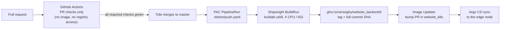

# 0022. Builds and CI: PAC for production images, GitHub Actions for PR checks

- Status: Amended by [0027](0027-per-package-licence-exceptions-and-the-loco-advisory-ignores.md) (2026-10-25)
- Decision questions: Q34a, Q34b

## Context

Two systems are involved. They have different jobs and different limits.

**Production images come from the hub's delivery chain.** A push to `master` reaches Pipelines-as-Code (PAC). PAC starts a Tekton PipelineRun from `.tekton/push.yaml`. That run creates a Shipwright BuildRun with the namespaced `buildah-ubi9` BuildStrategy, and the BuildRun pushes `ghcr.io/verseghy/<repo>:<full commit SHA>`. Argo CD Image Updater accepts only `^[0-9a-f]{40}$` tags. It opens a bump PR in website_k8s, and Argo CD syncs after the merge (research: SYNTHESIS §1.8.1, §1.8.4). PAC builds only for a repository whose `Repository` CR already exists. website_backend's first image was built outside PAC, because its CR was merged after the push (research: gap-14 §5.3).

**That chain is slow for Rust by default.**

| Fact | Value | Source |
|---|---|---|
| `build-and-push` step limits in `buildah-ubi9` | 1 CPU / 2Gi (the operator default, copied unchanged) | research: SYNTHESIS §1.8.2; gap-14 §2 |
| backend2 (310 compiled crates) at 1 CPU | 33.3-47.6 min per push, 8 runs | research: gap-14 §5.1 |
| Angular frontend at 1 CPU | killed at exactly 60.0 min three times (Tekton's default TaskRun timeout) | research: gap-14 §5.2; Verseghy/website_frontend#1167 |
| Angular frontend at 4 CPU / 6Gi | about 17 min | research: gap-14 §5.2 |
| A Loco app | about 437-445 compiled crates; cold release build 1.55-1.64x backend2's CPU time | research: gap-14 §6.1-§6.2 |
| Projection for backend3 at 1 CPU | 51-77 min before application code and the final link | research: SYNTHESIS §1.8.3 |
| Peak RSS of one `rustc` in a Loco build | 1.59 GB, close to the 2Gi limit | research: gap-14 §6.2 |
| Builder | `vfs` storage, fresh pod, no layer cache between pushes | research: SYNTHESIS §1.8.1 |
| cargo-chef in backend2's Containerfile | compiled from source on every push, 106 CPU-seconds, with no cache to reuse | research: gap-14 §6.3 |
| Hub CPUs | lack x86-64-v3: no UBI 10 / RHEL 10 userland in builds, no `-C target-cpu=native` | research: SYNTHESIS §1.8.2 |
| Rust toolchain in builds | `ubi9/rust-toolset` cannot be pulled by the builder, so rustup in a UBI 9 stage is the way | research: gap-14 §6.4 |

**There are two ways to raise the limit, and they differ in durability.**

- A per-repo `stepResources` override works only while the live Shipwright CRDs carry that field. The Builds operator's `builds-1.9` and `main` branches bundle CRDs without it. If the field disappears, the apiserver prunes it silently and the build runs at 1 CPU until it times out (Verseghy/website_k8s#29; research: gap-14 §3-§4).
- Step `resources` in the namespaced `buildah-ubi9` strategy are schema-stable in every Shipwright version. Since Verseghy/website_k8s#42 they are managed through GitOps (research: gap-14 §4.1, §8).

**PR checks run elsewhere.** Prow runs no CI jobs. Checks run in GitHub Actions in each repo. The job names are a contract: branch protection lists them as required contexts in website_k8s `prow/configmaps.yaml` and in GitHub rulesets. backend2's are `Build, Clippy, Test, Format` (research: SYNTHESIS §1.8.6, §7.6.9).

**Toolchain.** loco-rs 1.2.0 and Sea-ORM 2.0 declare `rust-version = "1.94"`. backend2's Containerfile pins 1.93 and iam's pins 1.91, so copying either fails at `cargo build`. backend2's CI uses the moving `stable` channel (research: SYNTHESIS §6.12; gap-14 §1).

**Licensing.** website_backend3 is AGPL-3.0-only ([ADR 0012](0012-delivery-review-commits-and-licensing.md)). Every Rust and npm dependency must carry a license that may be combined with it.

## Decision

### 1. Production images: PAC only, master only



- **Only PAC builds production images.** GitHub Actions never builds or pushes a production image (maintainer rule, research: DECISIONS 34a). Release 1 also has no GitHub-runner container build check, because decision 34b's list of PR checks does not include one. No workflow has `packages: write`, logs in to a registry, or uses `pull_request_target`. Every workflow starts with `permissions: contents: read`. The `Workflow policy` check fails the PR if any workflow breaks one of these rules (section 3).
- **Master only.** `.tekton/push.yaml` triggers on `push` to `master`. There is no `.tekton/pull-request.yaml`. The PAC `Repository` CR keeps `concurrency_limit: 1`, so backend3 builds run one at a time.
- **`.tekton/push.yaml`** is a copy of backend2's with the names changed: PipelineRun `build-backend3`, BuildRun `generateName: backend3-pac-`, output `ghcr.io/verseghy/website_backend3:{{ revision }}`, `dockerfile=Containerfile`, strategy `buildah-ubi9` of kind `BuildStrategy`. The header comments on the SHA-tag rule and the timeout nesting stay (research: gap-14 §9).

**Capacity.** website_k8s raises `spec.steps[name=build-and-push].resources` in `buildah-ubi9`:

| | CPU | Memory |
|---|---|---|
| requests | 1 | 2Gi |
| limits | 4 | 6Gi |

This applies to every website build. The frontend already runs at these values through its own override. The file header records the change as a deliberate deviation from the operator strategy, so the re-sync rule after an operator upgrade keeps it (research: gap-14 §8). backend3 adds no `stepResources` of its own.

**Timeouts.** Each layer is explicit and larger than the one inside it. backend3 never relies on Tekton's 60-minute default.

| Layer (innermost first) | Setting | Value |
|---|---|---|
| Shipwright BuildRun | `spec.build.spec.timeout` | `1h30m0s` |
| `oc wait` in the task script | `--timeout` | `100m` |
| Tekton task | `timeout` | `1h45m0s` |
| PipelineRun | `timeouts.pipeline` | `2h0m0s` |

The Shipwright setting is the inline build spec's `spec.build.spec.timeout`, because on 2026-10-24 the Builds for Red Hat OpenShift 1.8.2 controller failed the first backend3 BuildRun, which set `spec.timeout` beside `spec.build.spec`, with reason `BuildRunBuildFieldOverrideForbidden` and the message "cannot use 'timeout' override and 'buildSpec' simultaneously" (redhat-openshift-builds/shipwright-io-build@99ba109:pkg/validate/validate.go).

After three successful PAC builds, a `deploy`-scoped PR to `.tekton/push.yaml` ([ADR 0012](0012-delivery-review-commits-and-licensing.md)) shrinks all four, keeping the order (research: gap-14 §9). The offsets are the same as in the starting values above:

| Layer | New value |
|---|---|
| Shipwright BuildRun `spec.build.spec.timeout` | 2 × the median BuildRun duration, rounded up to the next 5 minutes |
| `oc wait --timeout` | the BuildRun timeout + 10 min |
| Tekton task `timeout` | the `oc wait` timeout + 5 min |
| PipelineRun `timeouts.pipeline` | the task timeout + 15 min |

The PR lists the three measured BuildRun durations.

**If the build is too slow.** If a build at 4 CPU / 6Gi takes more than about 45 minutes, first read the build log and find where the time goes (Verseghy/website_frontend#1167's rule). Then trim dependencies or features, or raise the strategy limits. Moving production builds to GitHub Actions is not an option.

### 2. Containerfile rules (Rust part)

The admin stage is in [ADR 0004](0004-admin-ui-lives-in-admin-and-ships-in-the-backend3-image.md).

| Rule | Value |
|---|---|
| Build stage | UBI 9 with `rustup-init --profile minimal --default-toolchain "$RUST_VERSION"`, where `ARG RUST_VERSION` equals the `channel` in `rust-toolchain.toml` |
| Build command | `cargo build --release --locked`, with no cargo-chef |
| Target | the default `x86_64-unknown-linux-gnu`; never `-C target-cpu=native` |
| Base images | UBI 9 only, never UBI 10 or RHEL 10 userland; pinned by digest |
| Runtime | `registry.access.redhat.com/ubi9/ubi-micro`; the binary, `config/` and `admin/dist`; runs as an arbitrary non-root UID under `restricted-v2`; default command `start --server-and-worker` ([ADR 0016](0016-no-redis-in-memory-cache-postgres-queue-cronjob-tasks.md)) |
| `.containerignore` | `target/`, `.git/`, `admin/node_modules/`, `admin/dist/` |

`Cargo.toml` disables Loco's default features and adds back what backend3 uses: `auth`, `cli`, `with-db`, `cache_inmem`, `worker` ([ADR 0016](0016-no-redis-in-memory-cache-postgres-queue-cronjob-tasks.md)). Sea-ORM gets `sqlx-postgres`. The importer's MySQL driver, `sqlx` with its `mysql` feature, sits behind the Cargo feature `import-mysql` for as long as the legacy import task exists ([ADR 0017](0017-legacy-data-import-normalisation-and-defect-resolution.md), [data-migration.md](../data-migration.md) §3.3). No SQLite driver is compiled. This drops `libsqlite3-sys` and its C build, so the build stage needs no `clang` (research: gap-14 §6.1). The exact `loco-rs` pin is set by [ADR 0024](0024-ai-maintainability-instruction-files-the-loco-skill-guardrai.md).

### 3. PR checks: GitHub Actions

Workflows run on `pull_request` and on `push` to `master`. They use a concurrency group that cancels superseded runs, and third-party actions are pinned to a full commit SHA with a version comment. They need no secrets. The test database is a throwaway Postgres started by `compose.yaml`.

The job names below are the branch-protection contexts. Renaming one blocks merging until website_k8s is updated.

| Job (context) | What it runs | Required |
|---|---|---|
| `Format` | `cargo fmt --all --check` | yes |
| `Clippy` | `cargo clippy --locked --workspace --all-targets -- -D warnings` | yes |
| `Test` | Postgres (same major version as production, [ADR 0002](0002-postgresql-as-the-database.md)) via `compose.yaml`, with a role allowed to create per-test databases; `cargo nextest run --locked --workspace --all-targets`; `cargo test --locked --workspace --doc`. insta fails on any snapshot mismatch in CI. | yes |
| `Contract` | runs the ts-rs export tests and the OpenAPI snapshot tests, then fails if `admin/src/bindings/` or any snapshot changed ([ADR 0005](0005-rust-dtos-are-the-api-contract-ts-rs-utoipa-openapi.md)) | yes |
| `Toolchain` | `rust-toolchain.toml` names an exact release at or above 1.94; the Containerfile's `RUST_VERSION` equals it; the Containerfile's Node ARG equals `admin/.node-version` ([ADR 0004](0004-admin-ui-lives-in-admin-and-ships-in-the-backend3-image.md)) | yes |
| `cargo-deny check bans licenses sources` | the policy in section 4 | yes |
| `cargo-deny check advisories` | RustSec advisories. Not required, because a new advisory can fail it with no change in the repo. It also runs weekly on `master` from a schedule. GitHub sends the failure notification only to the user who last changed the workflow's cron line. In a public repository, GitHub disables the schedule after 60 days without repository activity, so the runbook checks that the workflow is still enabled. The fix for a new advisory is a dedicated PR. | no |
| `Admin lint` | ESLint in `admin/` | yes |
| `Admin typecheck` | `tsc --noEmit` in `admin/`, which also checks the committed bindings | yes |
| `Admin test` | Vitest unit tests | yes |
| `Admin licenses` | the npm license check in section 4 | yes |
| `E2E` | builds the admin and a debug backend3, seeds Postgres with the E2E fixtures, and runs Playwright (Chromium) against `http://localhost:5150/admin` | yes |
| `Loco skill` | the vendored skill equals the locked crate's copy ([ADR 0024](0024-ai-maintainability-instruction-files-the-loco-skill-guardrai.md)) | yes |
| `PR title` | the conventional-commit check of the PR title, as [ADR 0012](0012-delivery-review-commits-and-licensing.md) section 3 defines it | yes |
| `No session links` | the session-link scan of [ADR 0012](0012-delivery-review-commits-and-licensing.md) section 3 | yes |
| `Workflow policy` | fails if any workflow grants `packages: write` or `id-token: write`, logs in to a container registry, or uses `pull_request_target` (section 1) | yes |

Branch protection also keeps Prow's `tide` context.

**Toolchain pin.** `rust-toolchain.toml` at the repo root is the single source:

```toml
[toolchain]
channel = "1.99.1"          # exact stable release, >= 1.94 (loco-rs 1.2.0 and Sea-ORM 2.0 MSRV)
components = ["rustfmt", "clippy"]
profile = "minimal"
```

The value shown is the current stable release according to the research. The bootstrap PR confirms it when it writes the file. CI installs exactly this toolchain, never the moving `stable`. A toolchain bump is its own PR and changes `rust-toolchain.toml` and the Containerfile ARG together. `Cargo.toml` declares `rust-version = "1.94"`.

### 4. License policy (AGPL-3.0-only compatible)

**Rust: `deny.toml`.** It starts from backend2's policy (research: SYNTHESIS §7.6.6).

| Section | Setting |
|---|---|
| `[licenses]` | `version = 2`; `confidence-threshold = 1.0`; `allow = ["MIT", "Apache-2.0", "ISC", "BSD-2-Clause", "BSD-3-Clause", "Zlib", "BSL-1.0", "MPL-2.0", "Unicode-3.0"]` |
| `[licenses]` exceptions | `CDLA-Permissive-2.0` for `webpki-roots` only |
| `[licenses.private]` | `ignore = true`, so backend3's own unpublished crates (AGPL-3.0-only) are not checked against the list |
| `[bans]` | `openssl` and `openssl-sys` denied (use rustls); `multiple-versions = "warn"` |
| `[sources]` | `unknown-registry = "deny"`, `unknown-git = "deny"` |
| `[advisories]` | `version = 2`; every `ignore` entry needs a comment and a linked issue |

Rules:

- Any license not on the list is denied, including GPL-2.0-only, which cannot be combined with AGPL-3.0, and every non-free or source-available license.
- Each `allow` entry has a comment saying why it may be combined with AGPL-3.0-only, normally the FSF list of GPL-3.0-compatible licenses. MPL-2.0 qualifies through its secondary-license clause (section 3.3). Its "Incompatible With Secondary Licenses" variant has its own SPDX id, `MPL-2.0-no-copyleft-exception`, which is not on the list and is therefore denied. Unicode-3.0 and CDLA-Permissive-2.0 are short permissive notice licenses that the FSF list does not name; their comments give the reasoning instead.
- Adding a license, for example GPL-3.0 or LGPL-3.0 for a specific crate, needs a PR that states that reason.

**npm: `Admin licenses`.** The job checks the license of every production dependency in the installed `admin/` tree, that is everything that can end up in `admin/dist`, against an allow-list in `admin/` ([ADR 0012](0012-delivery-review-commits-and-licensing.md) section 4). It fails on any license outside the list and on any package without one. Development-only tools do not ship in the image and are not gated. The list follows the same rule as `deny.toml`. Its initial content is set in the bootstrap PR from the real dependency tree, because npm build tools bring some licenses the Rust tree does not have. The tool must read the installed tree, not the registry. `license-checker-rseidelsohn` with `--onlyAllow` and `--excludePrivatePackages` is the candidate. The bootstrap PR confirms the tool is maintained before adopting it.

## Consequences

Positive:

- One production delivery path, with PAC check runs and the RHDH Tekton cards, as for every other website repo.
- The capacity lift sits in the one place that survives operator upgrades and applies to all website builds.
- Explicit, nested timeouts turn a slow build into a clear failure at a known layer instead of a silent 60-minute kill.
- PR checks are fast, cached and secret-free on GitHub runners. They cover the Rust code, the contract, the admin and the full stack through E2E.

Negative:

- A Containerfile or image-only error first shows up in the PAC build on `master`, after the merge. A PR that changes the `Containerfile`, `rust-toolchain.toml`, `admin/.node-version` or the base images is built locally with `podman build` by its author, and the PR body says so.
- Each push to `master` costs one cold build (no layer cache). Admin-only changes pay it too ([ADR 0004](0004-admin-ui-lives-in-admin-and-ships-in-the-backend3-image.md)).
- Raising the shared strategy affects every website build. Three concurrent builds use at most 12 CPU / 18Gi against the hub's quoted 31.5 CPU / 62Gi per node. That capacity figure is quoted, not measured (research: SYNTHESIS §8.2 O12).
- The `stepResources` field on the frontend's builds can still vanish with an operator upgrade. backend3 does not depend on it.
- The MySQL driver stays in the build while the import task exists ([ADR 0002](0002-postgresql-as-the-database.md)). If it pulls in a crate with an open advisory that has no fixed release, the `[advisories]` ignore entry names the import task, and the entry is removed together with the driver.

**Precondition for the bootstrap PR.** The bootstrap PR is the first commit with the `Containerfile` and `.tekton/push.yaml`. It merges to `master` only when all three of these hold (research: SYNTHESIS §1.16.2 G3, §1.16.7 steps 4-5; gap-14 §10):

1. The Pipelines-as-Code GitHub App is installed on website_backend3.
2. The `buildah-ubi9` strategy `resources` change, with its header note, is merged in website_k8s and live. It is validated with a server-side dry run, and the next frontend or backend2 build pod shows the new `step-build-and-push` limits.
3. `pac-repository-backend3.yaml` is merged in website_k8s, and the `Repository` CR exists.

The bootstrap PR waits for all three. A `master` commit that lands before PAC sees the repository gets no image by any other route: no manual, local or GitHub Actions build is pushed. The next push to `master` produces the first PAC image.

Further follow-up work in website_k8s (opened and left for human review, research: DECISIONS R2), besides the two PRs above:

1. Branch-protection contexts for website_backend3 in `prow/configmaps.yaml`, matching the job names above.
2. The backend3 kustomization with the first image SHA hard-coded, and the Image Updater entry. Confirm that an automatic bump PR appears for the new app before relying on automatic promotion (research: SYNTHESIS §8.3 O20).

Measurements after the first build: the BuildRun duration and the step pod's peak CPU and memory. Then confirm that the new ghcr package can be pulled anonymously (research: SYNTHESIS §8.3 O21, O23).

## Alternatives considered

- **34a B. Only a per-repo `stepResources` override**, as the frontend has. Rejected: it depends on a CRD field that the next operator minor can drop silently (Verseghy/website_k8s#29).
- **34a C. GitHub Actions builds and pushes `ghcr.io/verseghy/website_backend3:<sha>`** with a Rust cache (the iam precedent). Rejected by maintainer rule: production images are never built by GitHub Actions.
- **34a D. A plus PR image builds** from `.tekton/pull-request.yaml`. Rejected: each PR build costs a full cold build on the shared hub, and `concurrency_limit: 1` would queue them with master builds.
- **34b B. GitHub Actions checks plus PAC PR image builds on the hub.** Rejected for the same reason as 34a D.
- **34b A's non-required `Container build` job on GitHub runners.** Not adopted: decision 34b's list of PR checks leaves it out, and release 1 builds no image of backend3 in GitHub Actions. A PR that changes the `Containerfile`, `rust-toolchain.toml`, `admin/.node-version` or the base images is built locally with `podman build` instead (see Consequences).
- **34b C. Minimal: backend2's four jobs on the moving stable toolchain, no admin E2E.** Rejected: no contract drift check, no admin coverage, and the toolchain could drift below the MSRV or away from the Containerfile.

## References

- research: DECISIONS 3, 14, 34a, 34b, 43b, 44, R1, R2, R3
- research: QUESTIONS 34
- research: SYNTHESIS §1.8.1-§1.8.6 (build chain, strategy, capacity, promotion, Prow), §1.16.2 G3 (GitHub App install), §1.16.3 (files in the repo), §1.16.7 (first-deploy order), §6.12 (toolchain and build cost), §7.6.6 (license policy), §7.6.9 (CI conventions), §8.2 O12, §8.3 O20, O21, O23
- research: gap-14 §2-§10
- Verseghy/website_frontend#1167 (60-minute TaskRun default; 4 CPU / 6Gi override)
- GitHub Docs, "Events that trigger workflows", `schedule` (notifications go to the user who last modified the cron syntax; scheduled workflows in a public repository are disabled after 60 days without activity): <https://docs.github.com/en/actions/reference/workflows-and-actions/events-that-trigger-workflows#schedule>
- Verseghy/website_k8s#29 (`stepResources` CRD field), Verseghy/website_k8s#42 (namespaced `buildah-ubi9`)
- website_backend2@7ba71da:deny.toml (house license policy)
- loco-rs@1.2.0:Cargo.toml (`rust-version = "1.94"`, feature list)
- Related: [ADR 0002](0002-postgresql-as-the-database.md), [ADR 0004](0004-admin-ui-lives-in-admin-and-ships-in-the-backend3-image.md), [ADR 0005](0005-rust-dtos-are-the-api-contract-ts-rs-utoipa-openapi.md), [ADR 0012](0012-delivery-review-commits-and-licensing.md), [ADR 0016](0016-no-redis-in-memory-cache-postgres-queue-cronjob-tasks.md), [ADR 0023](0023-operations-hardening-rate-limits-monitoring-backups-secrets.md), [ADR 0024](0024-ai-maintainability-instruction-files-the-loco-skill-guardrai.md)
