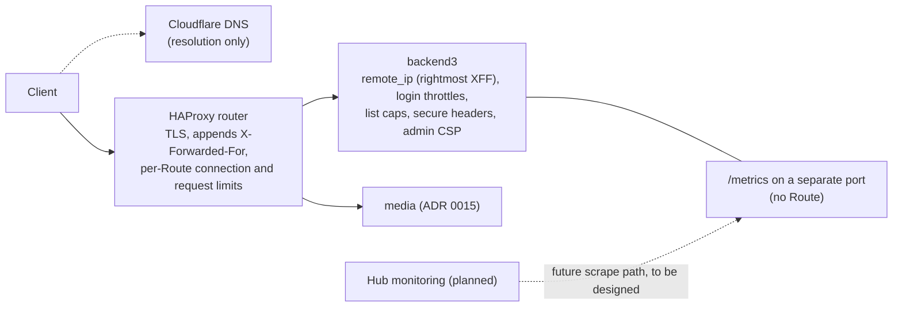

# 0023. Operations: hardening, rate limits, monitoring, backups, secrets

- Status: Accepted (2026-10-24)
- Decision questions: Q35, Q36, Q32a, Q32b (the backup dump option), Q33

## Context

### Platform

- **The edge node.** Production runs on one MicroShift node with very little spare capacity (research: DECISIONS 36). The runbook records MicroShift 4.20 on RHEL 9.6, but the research did not read that live. The node's CPU, RAM and disk are still unknown (research: SYNTHESIS §1.2, §8.2 O13).
- **The hub.** A separate hub cluster builds and promotes images. It is reachable only on the LAN, and it runs the platform's cluster monitoring. The research describes it as OKD 4. Its product and version must be confirmed from its release image (`oc get clusterversion version -o jsonpath='{.status.desired.image}'`) before any monitoring design relies on them (research: SYNTHESIS §1.2, §8.2 O12).
- **Capacity on the edge.** Monitoring workloads stay off the edge node, which has very little spare capacity (research: DECISIONS 36).

### Exposure and the request path

- **Admin exposure.** The admin stays reachable from the internet (research: DECISIONS 35). Nobody has recorded whether editors work from inside or outside the school network (research: QUESTIONS 35).
- **Shared addresses.** Many readers, and some editors, may share one public address. A school network behind NAT is the typical case.
- **DNS.** Cloudflare provides DNS only. Requests go straight to the node's HAProxy router, which terminates TLS (research: SYNTHESIS §1.10).
- **Forwarded headers.** The router's `forwardedHeaderPolicy` is the default, `Append` (website_k8s@34b8b55:config.yaml). In the release-4.20 router template, a Route can override it with `haproxy.router.openshift.io/set-forwarded-headers`, which takes `append`, `replace`, `if-none` or `never`. The default emits `option forwardfor`, which appends the address the router saw.
- **Per-Route limits.** The same template supports limits per Route, keyed by source address. `haproxy.router.openshift.io/rate-limit-connections: "true"` creates a stick table that stores `conn_cur`, `conn_rate(3s)` and `http_req_rate(10s)`. The `.concurrent-tcp`, `.rate-tcp` and `.rate-http` annotations reject a client above their thresholds. `haproxy.router.openshift.io/timeout` raises the server timeout (openshift/router@release-4.20:images/router/haproxy/conf/haproxy-config.template).
- **The SSR pod.** The Angular SSR pod reaches the public API through the public router. Which source address the router sees for those requests is unknown (research: SYNTHESIS §1.4 F2; [public-api.md](../public-api.md) open item O-5).

### Loco 1.2.0 (read in the crate source)

| Feature | Fact | Source |
|---|---|---|
| Rate limiting | No rate-limiting middleware. | research: QUESTIONS 35 |
| `remote_ip` | Off by default. The default source is `RightmostXForwardedFor`, which takes the last value of the last `X-Forwarded-For` header verbatim. It does not walk a proxy chain, keeps no trusted-proxy list, and falls back to the socket address when the header is missing. It is a thin wrapper around `axum-client-ip`. | loco-rs@1.2.0:src/controller/middleware/remote_ip.rs |
| `secure_headers` | Off by default. Presets are `empty`, `github` (the default) and `owasp`, plus per-header `overrides`. It never overwrites a header the inner service already set. | loco-rs@1.2.0:src/controller/middleware/secure_headers.rs, secure_headers.json |
| Health routes | `/_ping` and `/_health` always return `{"ok":true}`. `/_readiness` pings the database, the queue and the cache, and returns `503` on failure. | research: SYNTHESIS §1.14, §6.6 |
| Metrics | No metrics endpoint. | loco-rs@1.2.0 (no metrics code) |
| Production config | Requires `DATABASE_URL`, `JWT_SECRET` (base64) and `HOST`, read with `get_env` in `config/production.yaml`. | research: SYNTHESIS §1.14 |
| `timeout_request` | Off by default. When enabled, the default is 5 seconds, which would cut uploads. | research: gap-04 §5 |

### Backups and secrets

- **Backups.** Production backups are taken by an existing process. Its design and procedure live in the private runbook (research: DECISIONS 32a).
- **Secrets.** Secrets come from the External Secrets Operator (Helm chart 0.20.4), backed by 1Password. One ExternalSecret, `backend-secrets` in namespace `verseghy`, feeds backend1, MySQL and backend2. It uses `creationPolicy: Owner` and `refreshInterval: 24h`. The interval was lowered because of 1Password rate limits (website_k8s@34b8b55:verseghy-website/eso/externalsecret.yaml; Verseghy/website_k8s#14; research: SYNTHESIS §1.9).

### History

In October 2026 the admin application was taken offline for about 14.5 hours during the PHP2Shell response, and public media went down with it (Verseghy/website_k8s#43, Verseghy/website_k8s#49; research: SYNTHESIS §1.6). [ADR 0015](0015-media-separate-static-server-media-library-image-optimisatio.md) removes that coupling. This ADR covers the remaining operational concerns.

## Decision



### 1. Exposure

The admin stays reachable from the internet. There is no IP allow-list and no CDN or WAF proxy in front of it. Protection comes from backend3's code (sections 2 to 6) and from router limits (section 7). Both are in place from day one.

### 2. The client address: `remote_ip` trusts only the router hop

```yaml
# config/production.yaml (staging uses the same)
server:
  middlewares:
    remote_ip:
      enable: true
      source: RightmostXForwardedFor
```

- The router appends the address it saw, so the rightmost value is always the router's own observation. A client cannot choose it.
- backend3's Routes leave `haproxy.router.openshift.io/set-forwarded-headers` at the default or set it to `replace`. `if-none` and `never` are forbidden, because with them the client would choose its own address. The tracked website_k8s `CLAUDE.md` lists this as a platform invariant ([ADR 0024](0024-ai-maintainability-instruction-files-the-loco-skill-guardrai.md)).
- Requests that do not pass through the router, such as in-cluster callers, carry no header. They are identified by their socket address.
- If a CDN proxy is ever added, the same PR must change the source, for example to `CfConnectingIp`.

### 3. Login throttling, per account and per address

Throttling covers every step that checks a secret ([ADR 0006](0006-admin-authentication-and-account-lifecycle.md)):

- password login, including `POST /api/admin/auth/token` for scripts;
- the TOTP step and recovery codes;
- redeeming an admin-issued reset link;
- the current-password check when a user changes their password.

| Rule | Value (configurable in `config/<env>.yaml`) |
|---|---|
| Per account | After 5 consecutive failures, the account is locked for 1 minute. Each failure after a lock expires doubles the next lock: 2, 4, 8, then a cap of 15 minutes. A success resets the counter. The counter decays 24 hours after the last failure. |
| Per client address | 20 failures within a sliding 15-minute window. After that, attempts from the address get `429` until the window has room again. |
| Unknown accounts | Counted and locked exactly like known ones. Neither responses nor timing reveal whether an account exists. |
| Order of checks | Both throttles are checked **before** the password hash is verified, so a flood cannot burn the node's CPU on Argon2id or bcrypt. |
| Responses | `401 invalid_credentials` for a wrong secret. `429 too_many_attempts` with `Retry-After` when throttled or locked. The Hungarian UI says, for example, "Túl sok sikertelen próbálkozás. Próbáld újra később." |
| Unlock | An `edit users` holder can clear a lock from the user's page ([ADR 0007](0007-authorization-four-roles-enforced-on-every-operation.md)). |
| Storage | A Postgres table, so the limits survive restarts and hold across replicas. The in-memory cache is per process and never holds this state ([ADR 0016](0016-no-redis-in-memory-cache-postgres-queue-cronjob-tasks.md)). A daily CronJob task purges expired rows ([ADR 0016](0016-no-redis-in-memory-cache-postgres-queue-cronjob-tasks.md)). |
| Audit | Every failure, lock and unlock writes an activity-log entry with the account identifier and the client address ([ADR 0011](0011-safety-net-soft-delete-revisions-and-an-activity-log-for-eve.md)). |

The backoff schedule and the window arithmetic are pure functions in `src/domain/`, with unit tests and proptests ([ADR 0008](0008-code-layout-a-pure-src-domain-beside-loco-models.md)).

### 4. Capped public list sizes

[public-api.md](../public-api.md) defines these limits. This ADR makes them a hardening requirement.

| Parameter | Rule |
|---|---|
| `limit` on every paged `/api/v1` list | Default 20, allowed 1 to 100. Anything else gets `400 invalid_limit`. |
| Search term `q` | 1 to 200 characters after trimming, otherwise `400 invalid_query` ([ADR 0020](0020-search-and-hungarian-ordering.md)). |
| Lists without paging | Only where the data bounds the list: one ISO week of canteen days, the two ISO weeks of `/canteen/current`, one month of events, the posts of one archive month, the menu tree (capped at two levels), the colleague list, the archive index, the unexpired notices, the editor-curated partner banners, and the Diáktoll issues, capped at the 100 newest ([public-api.md](../public-api.md) §10). The author and label post lists are paged ([public-api.md](../public-api.md) §5.1, [ADR 0005](0005-rust-dtos-are-the-api-contract-ts-rs-utoipa-openapi.md)). |

### 5. Body limits and timeouts

| Item | Value |
|---|---|
| Global body limit | `server.middlewares.limit_payload.body_limit: 128mib`, needed for media uploads ([ADR 0015](0015-media-separate-static-server-media-library-image-optimisatio.md)). |
| JSON write routes | A tighter per-route limit of 4 MiB, set with `Routes::layer`. The largest stored body is 892,455 bytes (research: SYNTHESIS §4.3.1). |
| `timeout_request` | Stays off. It would cut long uploads. |
| Router timeout | `haproxy.router.openshift.io/timeout: 120s` on the `/api/admin` Route and the media Routes. All other Routes keep the 30-second default. |

### 6. Security headers and the admin CSP

Loco's `secure_headers` is on for everything that Loco's stack serves:

```yaml
server:
  middlewares:
    secure_headers:
      enable: true
      preset: github        # HSTS, nosniff, X-Frame-Options, X-Download-Options, X-Permitted-Cross-Domain-Policies
      overrides:
        Content-Security-Policy: "default-src 'none'; frame-ancestors 'none'; base-uri 'none'; form-action 'none'"
        Referrer-Policy: "strict-origin-when-cross-origin"
```

- API responses are JSON and are never rendered, so their CSP allows nothing.
- The `/admin` router runs inside Loco's stack ([ADR 0004](0004-admin-ui-lives-in-admin-and-ships-in-the-backend3-image.md)). It sets the admin headers itself with `SetResponseHeaderLayer::overriding`. Because `secure_headers` never overwrites a header that is already present, these values win.

| Header on `/admin` responses | Value |
|---|---|
| `Content-Security-Policy` | `default-src 'self'; script-src 'self'; style-src 'self' 'unsafe-inline'; img-src 'self' data: blob:; font-src 'self'; connect-src 'self'; frame-src https://www.youtube-nocookie.com https://www.youtube.com https://padlet.com; media-src 'self'; object-src 'none'; base-uri 'none'; form-action 'self'; frame-ancestors 'none'` |
| `X-Frame-Options` | `DENY` |
| `Referrer-Policy` | `strict-origin-when-cross-origin` |
| `Permissions-Policy` | `camera=(), microphone=(), geolocation=(), payment=()` |
| `Cross-Origin-Opener-Policy` | `same-origin` |
| `X-Robots-Tag` | `noindex, nofollow` |

What the CSP values allow, and why:

- **Scripts.** Never inline.
- **`style-src 'unsafe-inline'`.** A deliberate exception. The rich-text editor and the UI kit set `style` attributes for table widths, text alignment and popover positions.
- **`img-src 'self'`.** Works because `/storage` is routed on the admin host, and because the admin API returns every media URL that the admin loads root-relative, as `/storage/...`, never as an absolute legacy-host URL ([ADR 0015](0015-media-separate-static-server-media-library-image-optimisatio.md) §2, §3).
- **`frame-src`.** Matches the editor's embed allow-list ([ADR 0013](0013-rich-text-editor-and-html-sanitiser.md)).
- **`blob:` images.** Cover previews of files chosen for upload until the upload finishes. Pasted images are never inserted (research: DECISIONS 15d), so they need no CSP allowance. `data:` stays only if the admin UI kit itself uses `data:` images. The bootstrap PR checks this with the CSP-violation E2E and removes `data:` from `img-src` if nothing needs it.

`/api/admin` responses also carry `Cache-Control: no-store`.

### 7. Router-level limits from day one

**Precondition.** These steps come before the deploy PR sets any annotation:

1. Read the MicroShift version on the node with `microshift version`.
2. Pin the Red Hat MicroShift documentation to that version with the docs version selector.
3. Confirm each annotation's name and meaning there.
4. Cite the version in the PR.

If no MicroShift docs exist for that exact version, the PR says so, uses the nearest published version, and lists what may not carry over. The names below come from the release-4.20 router source and are not yet confirmed against those docs.

Initial values, per source address and per Route:

| Route ([ADR 0014](0014-one-host-backend3-microshift-verseghy-gimnazium-net.md), [ADR 0015](0015-media-separate-static-server-media-library-image-optimisatio.md)) | `rate-limit-connections.concurrent-tcp` | `.rate-tcp` (new connections per 3 s) | `.rate-http` (requests per 10 s) | `timeout` |
|---|---:|---:|---:|---|
| `backend3` (admin SPA, health, `/`) | 40 | 40 | 300 | default |
| `backend3-api-admin` (`/api/admin`) | 40 | 40 | 300 | `120s` |
| `backend3-api-v1` (`/api/v1`) | 100 | 100 | 1000 | default |
| `media-storage-*` (`/storage`, three Routes) | not set in release 1 | not set in release 1 | not set | `120s` |

```yaml
metadata:
  annotations:
    haproxy.router.openshift.io/rate-limit-connections: "true"
    haproxy.router.openshift.io/rate-limit-connections.concurrent-tcp: "100"
    haproxy.router.openshift.io/rate-limit-connections.rate-tcp: "100"
    haproxy.router.openshift.io/rate-limit-connections.rate-http: "1000"
```

- **Purpose.** These limits cap floods from one address before they reach the small node. They do not shape normal use. Login throttling (section 3) is the precise control.
- **No router limits on `/storage` in release 1.** The router counts connections per source address. A classroom behind one school address can open the same gallery of more than 100 images at once. Over HTTP/1.1 each browser opens up to 6 connections to a host, so 30 browsers can hold about 180 connections and open them within 3 seconds. Caps of 100 would refuse them and break images. The media Routes therefore start without `rate-limit-connections`. If caps are added later, they are sized from production logs, at no less than 6 connections × the expected number of browsers behind one address × 2. Before setting them, the PR confirms whether the router negotiates HTTP/2 for these Routes on the live MicroShift version, because HTTP/2 needs far fewer connections per browser.
- **The SSR pod must never be throttled.** Its client address and its peak rate are both measured in production before the flip. Once the backend3 Routes are live, a request from the production SSR pod ([ADR 0014](0014-one-host-backend3-microshift-verseghy-gimnazium-net.md), follow-up work) shows which client address backend3's `remote_ip` records for SSR traffic. The SSR peak rate is bounded by the production site's current request volume to backend2 over a normal school week. It is read at short intervals from backend2's `query_req_count` counter on its in-cluster `/metrics`, and converted to REST requests with the per-page call counts of the REST build. That counter counts browser and SSR queries together, so it gives an upper bound (research: SYNTHESIS §1.13). Hub staging cannot measure either fact, because it has its own router and no production traffic (research: DECISIONS 42). If all SSR traffic shares one address, the `/api/v1` limits stay at least 3 times above the measured SSR peak. The single SSR pod's render throughput also bounds its API rate. Calling backend3's Service in-cluster from SSR would avoid the question, but it needs an Angular change and is not part of release 1.
- **Tuning.** Values are set from these production measurements and, after go-live, tuned from production logs of `429` responses and rejected connections. Before go-live, the `/api/v1` values are also checked against the per-address arithmetic above for browsers behind one school address. Every change is a website_k8s PR.

### 8. Container hardening

| Setting | backend3 | media | Postgres ([ADR 0002](0002-postgresql-as-the-database.md)) |
|---|---|---|---|
| SCC | `restricted-v2`, default ServiceAccount, no `anyuid` | same | same where the image allows |
| `allowPrivilegeEscalation` | `false` | `false` | `false` |
| Capabilities | drop `ALL` | drop `ALL` | drop `ALL` |
| `readOnlyRootFilesystem` | `true`. It writes only to the uploads volume and an `emptyDir` at `/tmp` | `true`, with an `emptyDir` for nginx's temp and run directories | per image |
| `automountServiceAccountToken` | `false` | `false` | `false` |
| Requests and limits | set, sized for the node in the deploy PR | set | set |
| Probes | liveness `/_ping`, readiness `/_readiness`; never a file on a volume | `/healthz` | the image's own check |

### 9. Monitoring: `/metrics` on the edge, the monitoring stack on the hub

**backend3 metrics.** backend3 exposes Prometheus text format at `/metrics` on a second port, named `metrics`. No Route targets that port, so it is never public. The listener starts from a `Hooks::serve` override that runs it and the HTTP server together with `tokio::try_join!`, never from an initializer's `before_run` and never with `tokio::spawn` ([ADR 0008](0008-code-layout-a-pure-src-domain-beside-loco-models.md), Enforcement). The bootstrap PR picks the metrics library after checking current crate releases.

The minimum metric set:

- HTTP requests by route template, method and status, with a latency histogram;
- the database pool, in use and idle;
- login failures, locks and `429` responses;
- Postgres-queue jobs by state, and the age of the oldest queued job ([ADR 0016](0016-no-redis-in-memory-cache-postgres-queue-cronjob-tasks.md));
- uploads: count, bytes, optimisation time and outcome ([ADR 0015](0015-media-separate-static-server-media-library-image-optimisatio.md));
- process CPU and resident memory.

**Nothing that scrapes, stores or ships runs on the edge** (research: DECISIONS 36): no Prometheus, Grafana, Loki, OpenTelemetry collector or log agent. Every app on the node exposes a non-public `/metrics` for the hub to scrape. backend3 does so natively (above). backend2 keeps its existing endpoint. For the media server and Postgres, the deploy PR either adds a minimal exporter on a port that no Route targets, or records, with the maintainer's agreement, that the app has none and why. The media server's access log on stdout stays a signal either way.

**Logs.** Loco logs JSON to stdout (`logger.format: json`). Operators read logs with `oc logs`. The Logs screen is retired (research: DECISIONS 28). Request bodies, cookies, tokens and connection strings are never logged.

**Hub monitoring is planned, not designed here.** The plan uses the hub's OpenShift monitoring stack to do two things: scrape the edge `/metrics`, and probe public URLs (`/`, one `/storage` file, the admin login page, `/_readiness`) with alerting.

How the LAN-only hub reaches the edge is open. One candidate is a scrape through the MicroShift API server's service proxy with a read-only ServiceAccount, because the hub already reaches that API for Argo CD.

The design gets its own ADR. That ADR is written after the hub's product and version are confirmed, with its monitoring docs pinned to that version. It must keep two properties:

- `/metrics` is never public;
- no scraping or monitoring stack runs on the edge.

### 10. Backups: the existing process, extended

- **What stays.** Apart from the dump option and the new components below, the existing backup process stays as it is. Its procedure lives in the private runbook.
- **The MySQL dump.** The runbook's MySQL backup dump uses `mysqldump --lock-all-tables`, the same option as every rehearsal and cut-over dump (research: DECISIONS 32b; [ADR 0003](0003-cut-over-one-rehearsed-flip-then-a-read-only-parallel-run.md) §3). The legacy tables are not transactional, so only a global read lock gives a consistent dump. Production MySQL itself is not altered.
- **The Postgres database.** The runbook's backup gains the new Postgres database ([ADR 0002](0002-postgresql-as-the-database.md)) as a validated logical dump of the whole instance. A dump is kept only after it passes a validation check. A file copy of a running data directory is never used, because it is not a consistent backup.
- **New PVCs.** Each new PVC is added to the runbook in the same change that creates it. The uploads volume stays `backend-pv-claim` ([ADR 0015](0015-media-separate-static-server-media-library-image-optimisatio.md)), so the backup procedure needs no change for it.
- **Reclaim policy.** Every PV that holds production data has `persistentVolumeReclaimPolicy: Retain` ([ADR 0003](0003-cut-over-one-rehearsed-flip-then-a-read-only-parallel-run.md)). The Postgres PV gets it when it is created.
- **Gates.** Before the cut-over, a Postgres dump and restore are rehearsed on staging ([cutover.md](../cutover.md), P8). In the window, a validated Postgres backup is taken right after the import, before editors write ([cutover.md](../cutover.md), G7).
- **What backend3 does not do.** backend3 holds no backup credentials, runs no backup job and has no Backups screen (research: DECISIONS 28; [ADR 0019](0019-scope-parity-tracking-retired-features-release-1-additions.md)).

### 11. Secrets: the shared `backend-secrets`, every credential rotated at the cut-over

backend3's keys go into the existing `backend-secrets` ExternalSecret (website_k8s `verseghy-website/eso/externalsecret.yaml`). Each key comes from its own 1Password item in the existing vault. The website_k8s PR may rename the items and keys proposed here.

| Secret key | 1Password item / field | Consumer |
|---|---|---|
| `postgres-admin-password` | `postgres-admin/password` | The Postgres Deployment (initialisation) and operator maintenance tasks (private runbook). |
| `postgres-website_backend3-password` | `postgres-website_backend3/password` | backend3 and its CronJob tasks. It goes into `DATABASE_URL` for the `website_backend3` role, never the superuser. |
| `backend3-jwt-secret` | `backend3-jwt/password` | backend3 `JWT_SECRET`, HS512 ([ADR 0006](0006-admin-authentication-and-account-lifecycle.md)). |
| `backend3-totp-key` | `backend3-totp-key/password` | backend3: encrypts TOTP secrets at rest. It is separate from the JWT secret ([ADR 0006](0006-admin-authentication-and-account-lifecycle.md)). |
| `backend3-content-mac-key` | `backend3-content-mac-key/password` | backend3 `ContentIntegrity`: signs and verifies `content_mac` on stored rich text ([ADR 0013](0013-rich-text-editor-and-html-sanitiser.md) §6). |

Rules:

- **Key references.** Each Deployment references single keys with `secretKeyRef`. None uses `envFrom` on the whole Secret.
- **Value formats.** The Deployment builds `DATABASE_URL` from `$(DB_PASSWORD)`. Database passwords are at least 32 random alphanumeric characters, so they need no URL escaping. The JWT secret and the TOTP key are each at least 64 random bytes, base64-encoded; Loco requires base64 for the JWT secret. The content MAC key is at least 32 random bytes, base64-encoded.
- **Reading the environment.** Only `config/production.yaml` reads the environment, through `get_env`. Modules receive values as explicit arguments ([ADR 0008](0008-code-layout-a-pure-src-domain-beside-loco-models.md)).
- **Where values never appear.** No secret value appears in Git, in the image, in CI or in logs. GitHub Actions uses throwaway credentials for its own Postgres service ([ADR 0022](0022-builds-and-ci-pac-for-production-images-github-actions-for-p.md)).

**Rotation at the cut-over.** Rotation is the first phase of the cut-over window, before the freeze ([ADR 0003](0003-cut-over-one-rehearsed-flip-then-a-read-only-parallel-run.md), [cutover.md](../cutover.md) section 11). It covers every credential the website's workloads use (research: DECISIONS 33): database account passwords and application keys, the Postgres superuser password (`postgres-admin-password`), and backend3's own keys (database password, JWT secret, TOTP key, content MAC key). The full inventory is in the private runbook, and the maintainer confirms it there ([cutover.md](../cutover.md) §13, open item 9). backend3's production values are new and were never used on staging or in a rehearsal. For each credential:

1. Put the new value in its 1Password item.
2. Force an ESO refresh. Annotate the ExternalSecret with ESO's `force-sync` annotation using `oc annotate`, after confirming the annotation against the docs of the installed ESO version. The 24-hour `refreshInterval` is too slow to wait for.
3. Change the credential at its source. For database accounts that means `ALTER USER` or `ALTER ROLE` inside the database pod.
4. Restart the consumers with `oc rollout restart`. Pods read the Secret only at start.
5. Check behaviour, never values: `/_readiness`, an admin login, a public API read, the backend1 reference view.

A cut-over rollback does not undo the rotation. A legacy consumer's keys leave `backend-secrets` when that consumer retires: backend2's when backend2 retires, and backend1's and MySQL's when the maintainer decommissions them ([ADR 0003](0003-cut-over-one-rehearsed-flip-then-a-read-only-parallel-run.md)).

## Consequences

### Positive

- Brute force against the admin is slowed per account and per address. The code that does this runs, and is tested, on any platform.
- Router limits stop single-address floods before they reach the small node.
- The client address in logs, throttles and the activity log cannot be chosen by the client.
- Browsers get a strict CSP for the admin and a deny-all CSP for API responses.
- Nothing on the edge scrapes, stores or ships monitoring data. The metrics already exist when the hub is ready to read them.
- Backups keep a process the team already runs, and Postgres joins it before backend3 holds production data.
- One rotation step covers every credential. One ExternalSecret keeps the platform's existing conventions.

### Negative

- Per-address throttles can affect everyone behind one school address. A brute-force attempt from that network makes the whole network wait. The thresholds are configuration, and an `edit users` holder can clear an account lock.
- Router limits are coarse: per Route and per address. Wrong values cause false `429` responses or rejected connections. Setting and tuning them needs production traffic data, because hub staging has none.
- `style-src 'unsafe-inline'` weakens the admin CSP for styles. Scripts stay strict.
- Alerting is specified by the hub-monitoring ADR (follow-up 5).
- The media Routes start without connection caps, so a flood from one address on `/storage` reaches the media server, or backend3 in the fallback variant. Caps low enough to stop it would also refuse a classroom behind one address.
- `oc logs` keeps only the current and previous container's logs, so the edge keeps no longer log history.
- One shared Secret is one RBAC object for every consumer's keys. Any change to it is a change for all of them.

### Follow-up work

1. Read the node's version and capacity (O13), and confirm the router annotations against the matching MicroShift docs.
2. A website_k8s PR, for human review: Route annotations, securityContexts, resources, the new `backend-secrets` keys, and the `Retain` patch for the Postgres PV.
3. Private runbook changes: the Postgres dump and its validation, and the rotation inventory and steps.
4. Before the flip, measure the SSR client address and rate in production (section 7) and set the `/api/v1` limits from them.
5. A later ADR designs hub monitoring: the scrape path, the probes and alerting.

### What must be true in code and tests

- Integration tests cover:
  - the per-account lock after 5 failures, its doubling and its cap;
  - the per-address window;
  - `429` with `Retry-After`;
  - identical responses for known and unknown accounts;
  - throttles checked before hashing, asserted with a counting hash stub;
  - TOTP, recovery-code, reset-link and Bearer-token attempts being counted.
- A test sends a forged `X-Forwarded-For` with a router-appended value after it, and asserts that the remote address is the router-appended one.
- Header tests assert the global set on an API response and the admin set on `/admin` responses. The admin Playwright E2E fails on any CSP violation reported in the console.
- Tests cover the `limit` and `q` bounds (`400`) on every paged endpoint, the JSON body limit and the upload body limit.
- A test asserts that `/metrics` is not served on the public port.
- The pure throttle functions in `src/domain/` have unit tests and proptests.

## Alternatives considered

| Option | Source | Why not |
|---|---|---|
| Hardening in code first, router limits later (the recommended sequencing) | QUESTIONS 35 A, B | Router limits ship from day one, together with the code hardening (maintainer's choice). |
| A Route IP allow-list that restricts the admin to the school network | QUESTIONS 35 C | Not chosen. The admin stays reachable from anywhere, and nobody knows where editors work. |
| Cloudflare's proxy with WAF and rate-limit rules | QUESTIONS 35 D | Not chosen. It puts a third party on the request path and moves trust to `CF-Connecting-IP`. |
| External uptime checks and backup-freshness alerts (the recommended default, followed by B once the node's capacity is known) | QUESTIONS 36 A | Not chosen (maintainer's choice). Monitoring is planned on the hub with the OpenShift monitoring stack instead of a separate service. |
| A metrics and logs collector on the node, shipping to the hub or a hosted service | QUESTIONS 36 B | Not chosen. No collector or agent runs on the edge. The apps only expose `/metrics`. |
| A full monitoring stack on the node | QUESTIONS 36 C | Not chosen. The edge node has very little capacity. |
| Rework the backup process (the recommended default) | QUESTIONS 32a A | Not chosen (maintainer's choice). The maintainer keeps the existing process. Changes to it are runbook decisions outside this repository. |
| Replace it with in-cluster backups to off-site object storage | QUESTIONS 32a B | Not chosen. The platform has no object store, and the maintainer keeps the existing process. |
| Keep the process and add only the new components | QUESTIONS 32a C | Chosen. |
| Convert the production tables before the cut-over, run a hygiene script on them, or rely on the freeze alone | QUESTIONS 32b A, B, D | Not chosen. [ADR 0003](0003-cut-over-one-rehearsed-flip-then-a-read-only-parallel-run.md) and [ADR 0017](0017-legacy-data-import-normalisation-and-defect-resolution.md) record why. This ADR takes only the dump option of 32b C. |
| A separate `backend3-secrets` ExternalSecret and a rotation independent of the cut-over (the recommended default) | QUESTIONS 33 A | Not chosen (maintainer's choice): one rotation at the cut-over and one shared Secret. |
| One shared ExternalSecret, rotated on a schedule separate from the cut-over | QUESTIONS 33 C | Not chosen. The rotation is tied to the cut-over window and rehearsed with it. |

## References

- research: DECISIONS 35 (admin exposure), 36 (monitoring), 32a (backups), 32b (consistent MySQL dumps), 33 (secrets), 15d (pasted images are never inserted), 28 (Logs and Backups screens retired), 41 (read-only parallel run), 42 (staging on the hub).
- research: QUESTIONS 32, 33, 35, 36.
- research: SYNTHESIS §1.2 (clusters), §1.4 (data flows), §1.6 (PHP2Shell timeline), §1.9 (secrets), §1.10 (router), §1.13 (observability), §1.14 (runtime constraints), §4.3.1 (largest body), §6.6 (Loco HTTP layer), §8.2 (O12, O13).
- research: gap-04 §5 (Loco limits and timeouts); research: gap-13 §2, §7.4 (backups).
- loco-rs@1.2.0:src/controller/middleware/remote_ip.rs, src/controller/middleware/secure_headers.rs, src/controller/middleware/secure_headers.json, src/controller/routes.rs, src/app.rs (`Hooks::serve`, `Initializer::before_run`).
- axum-client-ip@1.3.1:src/lib.rs (`ClientIpSource`).
- openshift/router@release-4.20:images/router/haproxy/conf/haproxy-config.template (forwarded headers, `rate-limit-connections`, `timeout`).
- website_k8s@34b8b55:config.yaml; website_k8s@34b8b55:verseghy-website/eso/externalsecret.yaml; Verseghy/website_k8s#14, Verseghy/website_k8s#43, Verseghy/website_k8s#49.
- [public-api.md](../public-api.md) (§5.1 paged lists, §10 size limits, open item O-5 SSR source address, CORS); [cutover.md](../cutover.md) (P8, G7, section 11 credential rotation, §13 open item 9 rotation inventory).
- Related: [ADR 0002](0002-postgresql-as-the-database.md), [ADR 0003](0003-cut-over-one-rehearsed-flip-then-a-read-only-parallel-run.md), [ADR 0004](0004-admin-ui-lives-in-admin-and-ships-in-the-backend3-image.md), [ADR 0005](0005-rust-dtos-are-the-api-contract-ts-rs-utoipa-openapi.md), [ADR 0006](0006-admin-authentication-and-account-lifecycle.md), [ADR 0007](0007-authorization-four-roles-enforced-on-every-operation.md), [ADR 0008](0008-code-layout-a-pure-src-domain-beside-loco-models.md), [ADR 0011](0011-safety-net-soft-delete-revisions-and-an-activity-log-for-eve.md), [ADR 0013](0013-rich-text-editor-and-html-sanitiser.md), [ADR 0014](0014-one-host-backend3-microshift-verseghy-gimnazium-net.md), [ADR 0015](0015-media-separate-static-server-media-library-image-optimisatio.md), [ADR 0016](0016-no-redis-in-memory-cache-postgres-queue-cronjob-tasks.md), [ADR 0019](0019-scope-parity-tracking-retired-features-release-1-additions.md), [ADR 0020](0020-search-and-hungarian-ordering.md), [ADR 0022](0022-builds-and-ci-pac-for-production-images-github-actions-for-p.md), [ADR 0024](0024-ai-maintainability-instruction-files-the-loco-skill-guardrai.md).
