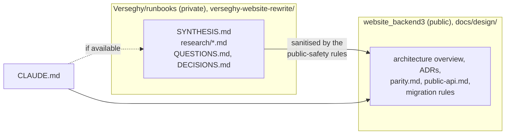
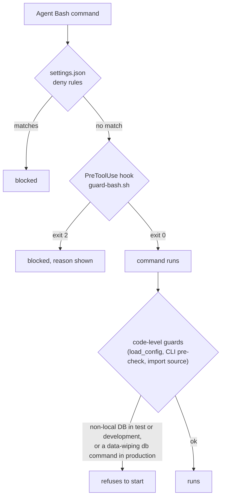

# 0024. AI maintainability: instruction files, the Loco skill, guardrails

- Status: Accepted (2026-10-24)
- Decision questions: Q24, Q37, Q43a, Q43b

## Context

AI agents will write most of backend3 and will maintain it later. They need three things: the design knowledge behind the code, instructions that are correct for this project and this framework version, and guardrails that stop a wrong command from destroying data. Every website repository is public, so it also matters where each kind of knowledge lives.

| Fact | Value | Source |
|---|---|---|
| The repositories are public | website_backend, website_backend2, website_frontend, website_k8s and website_backend3 are public. The private Verseghy/runbooks repository already exists. | research: SYNTHESIS §7.1; `gh repo view` |
| The research mixes two kinds of content | The synthesis is 667,052 bytes. It holds durable design inputs (parity IDs, API semantics, data anomalies, migration rules, decision registers) next to live security and operations findings and personal data that must not be published. | research: QUESTIONS Q24 |
| No tracked instruction files exist | No Verseghy repository tracks a `CLAUDE.md`, `AGENTS.md` or `.claude/`. An untracked `CLAUDE.md` in website_frontend is already stale: it says Angular 15, while `master` is on 14. | research: SYNTHESIS §7.6.8 |
| What Loco generates | `loco new` 1.2.0 always writes a root `AGENTS.md` and `.claude/skills/loco/`. The `AGENTS.md` names three rules (generate, then edit; use the batteries; fat model, slim controller) and a gate (`cargo fmt --all`, `cargo clippy --all-targets -- -D warnings`, `cargo test`). Loco writes no `CLAUDE.md`. | research: SYNTHESIS §6.13 |
| What the admin kit installs | The shadcn-admin-kit registry installs `rules/AGENTS.md` with `target: "~/AGENTS.md"`. Its rules say "If no Data Provider was specified, simply use `ra-data-json-server`". How the shadcn CLI resolves that target, and whether it overwrites an existing file, is unverified (O57). The kit's own `CLAUDE.md` is literally `@AGENTS.md`. | research: SYNTHESIS §6.15, §8.9 O57 |
| The skill is tied to the crate version | The skill is 17 files, 350,563 bytes. The copy inside the `loco-rs` 1.2.0 crate is byte-identical to what `loco new` 1.2.0 installs. The loco.rs website copy differs in `doctrine.md` and `workflow.md`. GitHub `master` differs in 12 of the 17 files and describes unreleased features. Neither CLI has a skill-update command. Upstream's `cargo xtask agent-skill --check` exists because the indexes drift: it caught a stale `sea-orm-index.md` after a Sea-ORM patch release. Loco ships a minor release every 4-6 weeks. | research: SYNTHESIS §6.13; QUESTIONS Q43 |
| Skill layout rules | Project skills live in `.claude/skills/<name>/SKILL.md`. `name` must match the directory name. Skills in a subdirectory's `.claude/skills/` load for sessions started in or below it. | research: SYNTHESIS §6.13 |
| Loco's test defaults are destructive | Loco's test config template sets `dangerously_truncate: true` and `dangerously_recreate: true`. `db reset` and `dangerously_recreate` call sea-orm-migration's `fresh`, which drops every table in the connected database, not only Loco's. | research: SYNTHESIS §6.9, §6.27; QUESTIONS Q37 |
| One place sees every configuration | `Hooks::load_config(env)` returns the app's `Config`; by default it calls `env.load()`. Loco's test boot helpers (`boot_test` and its variants) and its CLI entry points call it. | loco-rs 1.2.0 (crates.io): `src/app.rs` (`load_config`), `src/testing/request.rs`, `src/cli.rs` |
| What Claude Code permission rules can do | Deny rules are checked before allow rules. Compound commands are split, and a deny rule applies when any subcommand matches. A rule matches the command text Claude writes, not the same program called by path or inside `sh -c`, so a deny rule "isn't a security boundary around the program". A `PreToolUse` hook gets the command at `tool_input.command` on stdin and blocks the call by exiting with code 2; stderr becomes the reason. `$CLAUDE_PROJECT_DIR` is set for hooks. | code.claude.com docs: "Configure permissions", "Hooks reference" |
| The maintainer's standing rules | Use `oc`, never `kubectl`. Never force-delete pods. | the maintainer's global instructions |

## Decision

### 1. Where the knowledge lives



| Kind of content | Where it lives |
|---|---|
| Durable, sanitised specs: the architecture overview, the ADRs, the parity checklist, the public API contract, the data-migration rules, the target operational design | website_backend3 `docs/design/` |
| The full synthesis, all research files (including the gap files), the question list and the decision register, editor design drafts, live-state findings, security and operations findings, anything that touches personal data | the private Verseghy/runbooks repository, under `verseghy-website-rewrite/` |

- **The public docs must be enough to implement.** An agent without access to the private repository must be able to build and maintain backend3 from `docs/design/` alone. The private research is background and evidence.
- **Public-safety rules.** Every file in this repository follows them. ADR 0001 section 8 states them for the design docs, and `CLAUDE.md` repeats them for everything else:
  1. no credentials, password hashes, tokens, keys, or values from any secret;
  2. no description of live, unfixed weaknesses of a running system; describe the target design instead;
  3. no personal data: no names or e-mail addresses of editors or users, and no per-person facts. Aggregate counts are fine, and so are the public contact addresses the school site itself shows;
  4. no claude.ai session links (ADR 0012).
- **How private facts move.** A fact moves from the private research into a public document only after it passes these rules. The public document then cites it by section, for example "research: SYNTHESIS §4.12" or "research: gap-02 §4.5". Public code is cited as `<repo>@<commit>:<path>`. Private paths or scratch paths are never cited.
- **Links from CLAUDE.md.** `CLAUDE.md` links to `docs/design/` always, and to the private repository marked "if available".

### 2. Instruction files

| File | What it holds |
|---|---|
| `AGENTS.md` (root) | Loco's generated `AGENTS.md` from `loco new` 1.2.0, extended with: what backend3 is; the layout (`src/domain/`, `src/models/`, `src/controllers/`, `admin/`, `docs/design/`); the commands; the gate (`cargo fmt --all --check`, `cargo clippy --all-targets -- -D warnings`, the test suite, and the admin lint, typecheck and unit tests); a pointer to `docs/design/`. It contains nothing tool-specific. |
| `CLAUDE.md` (root) | First line `@AGENTS.md`. After it come the project rules that win over generic advice: the narrow override of Loco's doctrine (ADR 0008); the rule that external-system code takes credentials and configuration as explicit arguments; the commit and PR rules and the session-link ban (ADR 0012); the public-safety rules (section 1); linking each PR to its parity issues (ADR 0019); a summary of the guardrails (section 4); Hungarian-only UI strings (ADR 0021); the links to `docs/design/` and, "if available", to `verseghy-website-rewrite/` in Verseghy/runbooks. |
| `admin/AGENTS.md` | The kit's agent rules file exactly as the kit's registry installs it. It is not edited, so reinstalling the kit overwrites it cleanly. |
| `admin/CLAUDE.md` | First line `@AGENTS.md`. After it come overrides that win over `admin/AGENTS.md` wherever the two disagree: the data provider is backend3's custom Loco provider (never `ra-data-json-server`, `ra-data-simple-rest` or JSONPlaceholder); every UI string goes through the Hungarian message file (ADR 0021); the ts-rs bindings are generated and never edited by hand (ADR 0005); changes to vendored component directories are recorded in `THIRD_PARTY.md` (ADR 0012); the admin gate commands. Claude Code loads this file only when work happens under `admin/`. |
| `.claude/skills/loco/` | The vendored Loco skill (section 3) |
| `.claude/skills/backend3/` | The project's own skill. Its `SKILL.md` has `name: backend3` and recipes for the repeated tasks: adding a vertical slice (ADR 0012), adding an entity under the safety net (ADR 0011), adding a public endpoint with its fixtures (ADR 0019), adding an importer step (ADR 0017). |
| `.claude/settings.json`, `.claude/hooks/` | The guardrails (section 4) |
| website_k8s `CLAUDE.md` | The platform invariants, listed below. It is added through a website_k8s PR that a human reviews (ADR 0012). |

- **Precedence.** `admin/CLAUDE.md` wins over `admin/AGENTS.md`. Root `CLAUDE.md` wins over root `AGENTS.md`, and both win over the vendored skill. The ADRs are the source of truth: instruction files summarise them and link to them, they do not restate them at length.
- **Keeping them current.** A PR that changes a rule, a command or the layout updates the instruction file in the same PR.
- **Installing the kit.** The kit's registry targets `~/AGENTS.md`, and how the shadcn CLI resolves that is unverified (O57). So the bootstrap PR first runs the kit install in a scratch project with a throwaway home directory. It checks where the file lands, then places it at `admin/AGENTS.md`. The install is never run in a way that can write to a real home directory.
- **Invariants in the website_k8s `CLAUDE.md`:**
  - use `oc`, never `kubectl`; never force-delete pods;
  - never delete a PersistentVolumeClaim, PersistentVolume or Argo CD Application unless the volume's reclaim policy is `Retain` and a verified backup exists; deleting an Application deletes its resources;
  - a new app's first image tag is set by hand in its kustomization; Image Updater moves later tags;
  - a new repository's PAC `Repository` CR merges before the first push to `master` that carries `.tekton/push.yaml`;
  - the `buildah-ubi9` BuildStrategy documents its changes from upstream in its header and is diffed again after every operator upgrade;
  - CI job names are branch-protection contracts: renaming a job and changing the Prow configuration happen together;
  - the `verseghy-prow` app must be a bypass actor on any ruleset that requires reviews;
  - Red Hat documentation is read for the version that is actually running, confirmed from the live system.

### 3. Pinning and vendoring the Loco skill

- **Exact pin.** `Cargo.toml` pins `loco-rs = "=1.2.0"`; the features are set by ADR 0002 and ADR 0016. `Cargo.lock` is committed.
- **Verbatim vendoring.** `.claude/skills/loco/` is a byte-identical copy of `skills/loco/` from the `loco-rs` crate at the version locked in `Cargo.lock`: 17 files at 1.2.0. Next to them sits `LICENSE`, a byte copy of the crate's Apache-2.0 `LICENSE` (ADR 0012). `SKILL.md` keeps `name: loco`, which matches its directory. The skill is never copied from the loco.rs website, from GitHub `master`, or from any renamed or edited copy, because they describe other versions.
- **`scripts/sync-loco-skill.sh [--check]`:**
  - It runs `cargo fetch --locked`. It then reads the locked `loco-rs` package's `manifest_path` from `cargo metadata --format-version 1 --locked` with `jq`, which gives the crate directory.
  - Without `--check`, it makes `.claude/skills/loco/` equal to `<crate>/skills/loco/`, deleting files that upstream no longer has, and copies `<crate>/LICENSE` to `.claude/skills/loco/LICENSE`.
  - With `--check`, it writes nothing. It compares the two trees and the licence file, prints every difference, and exits non-zero if there is any.
  - It accepts `--crate-dir <path>` so that its tests can point it at a fixture crate. `scripts/tests/test-sync-loco-skill.sh` covers an equal tree, an edited file, an extra file, a missing file and a changed `LICENSE`.
- **CI.** A job named `Loco skill` runs `scripts/sync-loco-skill.sh --check`. It is a required context (ADR 0022).
- **Overrides never go into the vendored files.** Project rules go into `CLAUDE.md` or `.claude/skills/backend3/`. The CI check makes this binding.
- **Bumps are dedicated PRs.** Loco and Sea-ORM are bumped only in PRs titled like `build(api): bump loco-rs to X.Y.Z` (ADR 0012). Such a PR:
  1. changes the pin and runs `cargo update -p loco-rs --precise X.Y.Z`;
  2. runs `scripts/sync-loco-skill.sh`;
  3. reads the skill diff, especially `doctrine.md` and `workflow.md`, checks that every override in `CLAUDE.md` and `.claude/skills/backend3/` still holds, and updates them when they do not;
  4. passes the full test suite.

  Dependabot ignores `loco-rs` and the `sea-orm` crates, so no routine update PR bypasses this procedure.

### 4. Guardrails

There are three layers. Each layer catches what the one before it can miss.



**Layer 1: deny rules in the committed `.claude/settings.json`**

```json
{
  "permissions": {
    "deny": [
      "Bash(cargo loco db reset *)",
      "Bash(oc delete pvc *)",
      "Bash(oc delete pvc/*)",
      "Bash(oc delete persistentvolumeclaim *)",
      "Bash(oc delete pv *)",
      "Bash(oc delete pv/*)",
      "Bash(oc delete persistentvolume *)",
      "Bash(oc delete application *)",
      "Bash(oc delete applications *)",
      "Bash(oc delete applications.argoproj.io *)",
      "Bash(* --force --grace-period=0*)",
      "Bash(* --grace-period=0 --force*)",
      "Bash(kubectl *)"
    ]
  },
  "hooks": {
    "PreToolUse": [
      {
        "matcher": "Bash",
        "hooks": [
          { "type": "command", "command": "\"$CLAUDE_PROJECT_DIR\"/.claude/hooks/guard-bash.sh" }
        ]
      }
    ]
  }
}
```

**Layer 2: the `PreToolUse` hook `.claude/hooks/guard-bash.sh`**

It is a bash script that reads its input with `jq`. If `jq` is missing, it blocks and says so (it fails closed). It blocks with exit code 2, and its stderr message tells the agent what was refused and what to do instead. It checks two things:

1. **The same dangerous commands as layer 1, anywhere in the command text,** so it also catches forms the deny rules miss, such as `sh -c '...'` wrappers and other flag orders: `kubectl`; `--force` together with `--grace-period=0`; `oc delete` naming a PVC, PV or Argo CD Application in any spelling; and the destructive database subcommands of any binary. Those are Loco's `db reset`, `db down`, `db truncate` and `db seed --reset` (or `-r`), whether they run as `cargo loco`, as the app binary `<app>-cli`, or inside `oc exec ... --`, `oc rsh` or `oc debug`; and the sea-orm-cli `migrate` subcommands `fresh`, `refresh`, `reset` and `down`. Production CronJobs run the app binary, not `cargo loco` (ADR 0016), so matching only `cargo loco db reset` would miss the form that reaches the production database.
2. **The database target of database-touching commands.** The listed commands are `cargo loco`, `cargo test`, `cargo nextest`, `psql`, `pg_restore`, `mysql` and `sea-orm-cli`. For each, the hook takes the target host from the first of these that is present:
   1. an inline `DATABASE_URL=` or `PGHOST=` assignment in the command (for `mysql`, also `MYSQL_HOST=`);
   2. a `-h` or `--host` option;
   3. a URI or a `host=` key in `-d` or `--dbname`, in sea-orm-cli's `-u` or `--database-url`, or in a positional connection string (for example `psql postgres://host/db` or `psql "host=... dbname=..."`);
   4. the environment's `DATABASE_URL` or `PGHOST` (for `mysql`, also `MYSQL_HOST`).

   For `cargo` commands it also checks the importer's source, `IMPORT_SOURCE_DATABASE_URL` (inline or from the environment; [data-migration.md](../data-migration.md) §4.1), in the same way. It blocks when a target is not local. Local means `localhost`, `127.0.0.1`, `::1` or a Unix socket. When no target is found, `cargo` commands are allowed, because layer 3 checks the configuration they load, and `psql`, `pg_restore` and `mysql` count as local, because they then connect through the local Unix socket. A listed command run through `oc exec`, `oc rsh` or `oc debug` runs inside the cluster, so it counts as non-local and is blocked whatever its options say.

`scripts/tests/test-guard-bash.sh` feeds the hook sample JSON payloads and asserts the exit codes. The payloads cover blocked and allowed commands; wrapped forms; each destructive subcommand of check 1 in the `cargo loco`, app-binary, `oc exec`, `oc rsh` and `oc debug` forms; each target source of check 2 (inline variables, `-h`, `-d` URIs, `host=` strings, positional URIs, `-u`, the environment, `IMPORT_SOURCE_DATABASE_URL`); a command with no target; and a missing `jq`. It runs in CI.

**Layer 3: the code-level guard, the one that cannot be bypassed from a shell**

- `App` overrides `Hooks::load_config`. It loads the configuration as Loco does (`env.load()`) and then calls a pure check (ADR 0008) on the environment and the database settings. The check refuses:
  - in the `test` and `development` environments, any database URI whose host is not local;
  - in any environment, `dangerously_truncate` or `dangerously_recreate` set to true when the host is not local;
  - in the `production` environment, `dangerously_truncate` or `dangerously_recreate` set to true at all.
- Loco's test boot helpers and CLI entry points call `load_config`, so `cargo test`, `cargo nextest` and every `cargo loco` command (including `db reset`) that breaks these rules stop before any connection is made. The error names the environment, the host found and the fix, for example: "Refusing to start: LOCO_ENV=test, but the database host is 'db.example.org'. Tests and development may only use a local database (localhost, 127.0.0.1, ::1 or a Unix socket). Point DATABASE_URL at a local PostgreSQL."
- The check has unit tests for each rule and a proptest over generated URIs. An integration test boots the test app with a non-local URI and asserts that it fails before connecting.
- **The import source.** The import task applies the same pure check to its source URI (`IMPORT_SOURCE_DATABASE_URL`, [data-migration.md](../data-migration.md) §4.1) before it connects. In `test` and `development` it refuses a MySQL host that is not local. The importer slice adds this check with its unit tests (ADR 0017).
- **The CLI pre-check.** `src/bin/main.rs` inspects its arguments before it calls `loco_rs::cli::main`. When the environment resolves to `production` (from `-e` or `--environment`, else from `loco_rs::environment::resolve_from_env()`), it refuses `db reset`, `db truncate` and `db seed --reset`, which wipe data. `cargo loco` runs the same binary: Loco's generated `.cargo/config.toml` defines the alias `loco = "run --"`, and the generated `Cargo.toml` sets `default-run` to `<app>-cli`. So the pre-check covers both forms, for agents and operators alike. `db down` is not refused here, so an operator can still roll back one migration; the hook stops agents from running it (check 1). The pre-check is a pure function of the arguments and the environment name, with unit tests.

**Scope of the guardrails**

- website_backend3 commits all three layers in its bootstrap PR. The import-source check of layer 3 arrives with the importer slice.
- website_k8s gets the same deny rules and the same hook, check 2 included (`psql`, `pg_restore`, `mysql`, `sea-orm-cli`, and those run through `oc exec`, `oc rsh` or `oc debug`), in a website_k8s PR that a human reviews. Only the cargo command names are left out of check 2's list. Check 1 is unchanged, so the app-binary and `oc exec` forms of `db reset` are blocked there too. The website_k8s PR carries the hook tests.
- Personal `settings.local.json` files stay untracked and may add rules. They cannot remove committed deny rules, because deny rules are checked first.

## Consequences

**Positive**

- Agents get the design reasoning and the project's conventions from tracked files that are reviewed with the code. Nothing depends on a developer's local setup.
- The skill always matches the locked framework version, and drift fails CI the same way upstream's `--check` does.
- In the `test` and `development` environments, no command (a test run, a `db reset` or any other) can reach a non-local database, even if an agent gets around the deny rules and the hook.
- The public repository holds what an implementer needs and nothing that maps the live attack surface.

**Negative and risks**

- An agent without access to the private repository cannot check the evidence behind a decision. The public docs have to carry enough of it.
- Every Loco bump is a deliberate PR that reviews the skill diff. That is slower than following each release.
- Deny rules and the hook match command text. Commands that come from files (for example `oc delete -f`) or from scripts are not covered. The code-level guard covers only databases. Destructive cluster operations still depend on the website_k8s rules and on human review there.
- The hook is a dependency of every Bash call in the repository. A bug in it can block legitimate work. Its tests keep that risk small.
- Production runs the app binary (`<app>-cli task NAME`) from CronJobs, never `cargo loco` (ADR 0016). The `load_config` guard cannot see which subcommand runs, so it does not stop `db reset` in production. The hook blocks `db reset` in every form (check 1), and the CLI pre-check refuses it, with `db truncate` and `db seed --reset`, in `production`. `db down` stays possible for an operator in production.
- In `development`, the guard also refuses a database reached by a container-network host name (for example a compose service name). Development runs the app on the host against a published local port.

**Follow-up work**

- Bootstrap PR: `AGENTS.md`, `CLAUDE.md`, `admin/AGENTS.md`, `admin/CLAUDE.md`, the vendored skill and its `LICENSE`, `.claude/skills/backend3/`, `scripts/sync-loco-skill.sh` and its tests, `.claude/settings.json`, `.claude/hooks/guard-bash.sh` and its tests, the `load_config` guard and the CLI pre-check, each with its tests, the `Loco skill` CI job.
- Importer slice: the import-source check and its unit tests (layer 3).
- A website_k8s PR (human-reviewed): `CLAUDE.md` with the invariants, `.claude/settings.json`, and the hook with its tests.
- Settle O57 (where the kit's `AGENTS.md` lands) in a scratch project before the kit is installed into `admin/`.
- Keep the private `verseghy-website-rewrite/` folder current when research is redone, and update the public docs through PRs.

**What must be true in code and tests**

- `scripts/sync-loco-skill.sh --check` passes on `master`.
- `.claude/skills/loco/` contains only upstream files and `LICENSE`.
- The `load_config` guard rejects every non-local URI in `test` and `development`, which the unit tests and proptest show. The import task rejects a non-local source URI there too.
- The hook tests pass in CI. They show that the hook blocks every target form of check 2 and the `oc exec`, `oc rsh` and `oc debug` forms.
- With `LOCO_ENV=production`, `<app>-cli db reset` exits with an error before it connects.

## Alternatives considered

- **Q24 B: commit the full synthesis to `docs/research/`.** Rejected: it would publish live security findings and personal data.
- **Q24 C: keep everything in the private runbooks repository.** Rejected: agents working in the public repository need the specs next to the code.
- **Q24 D: do not keep the research; research again when needed.** Rejected: the research took one large effort, and its corrections (the gap files) are easy to lose.
- **Q43a B: as chosen, but with the website_k8s rules in the private runbooks.** Rejected: the invariants are already public in manifests and PRs, and agents working in website_k8s need them there.
- **Q43a C: one root `CLAUDE.md` covering backend and admin, with no `AGENTS.md`.** Rejected: it fights both generators and loads admin rules into every backend session.
- **Q43a D: untracked local files.** Rejected: they go stale unseen, as website_frontend's has.
- **Q43b B: a caret pin `loco-rs = "1.2"` and syncing by hand when someone notices.** Rejected: the skill silently drifts from the code.
- **Q43b C: pull the website copy ("latest") from time to time.** Rejected: it describes another version.
- **Q43b D: do not vendor; agents read the copy in `~/.cargo/registry`.** Rejected: it is not loaded as a project skill, and it is not reviewable.
- **Q37 B: document the rules in `CLAUDE.md` only.** Rejected: prose is advice, not enforcement.
- **Q37 C: leave guardrails to each developer's local settings.** Rejected: there is nothing to review, and nothing exists by default.

## References

- research: QUESTIONS Q24, Q37, Q43; research: DECISIONS rows 24, 37, 43a, 43b
- research: SYNTHESIS §6.9 (testing harness), §6.10 (CLI), §6.13 (the Loco agent skill), §6.15 (kit install model), §6.27 (corrections), §7.1 (repository inventory), §7.6.8 (AI files), §8.9 O57
- loco-rs 1.2.0 (crates.io): `skills/loco/`, `LICENSE`, `src/app.rs` (`Hooks::load_config`), `src/testing/request.rs`, `src/cli.rs` (`DbCommands`, `cli::main`), `src/environment.rs` (`resolve_from_env`)
- loco 1.2.0 (crates.io, the `loco new` CLI): `base_template/Cargo.toml.t` (`default-run`, the `<app>-cli` binary), `base_template/.cargo/config.toml.t` (the `loco` alias)
- Claude Code docs: "Configure permissions" (rule order, compound commands, limits of Bash patterns) and "Hooks reference" (`PreToolUse` input, exit code 2, `CLAUDE_PROJECT_DIR`)
- Related ADRs: [0002](0002-postgresql-as-the-database.md), [0005](0005-rust-dtos-are-the-api-contract-ts-rs-utoipa-openapi.md), [0008](0008-code-layout-a-pure-src-domain-beside-loco-models.md), [0011](0011-safety-net-soft-delete-revisions-and-an-activity-log-for-eve.md), [0012](0012-delivery-review-commits-and-licensing.md), [0016](0016-no-redis-in-memory-cache-postgres-queue-cronjob-tasks.md), [0017](0017-legacy-data-import-normalisation-and-defect-resolution.md), [0019](0019-scope-parity-tracking-retired-features-release-1-additions.md), [0021](0021-hungarian-only-admin-ui.md), [0022](0022-builds-and-ci-pac-for-production-images-github-actions-for-p.md)
