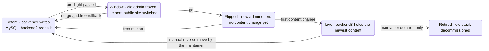
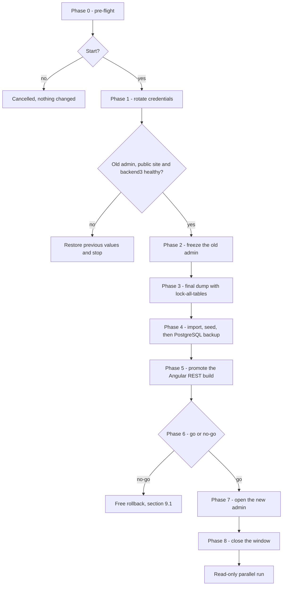

# Cut-over plan

This page outlines how backend3 takes over from backend1 (the Laravel/Backpack admin) and backend2 (the GraphQL public API). It covers what happens, in which order, what is checked, and how each step is undone.

The decision is recorded in [ADR 0003](adr/0003-cut-over-one-rehearsed-flip-then-a-read-only-parallel-run.md), as amended by [ADR 0026](adr/0026-backend2-unchanged-and-running-until-decommissioning.md). The detailed operator runbook lives in the private `Verseghy/runbooks` repository: exact commands, credential handling, and backup and restore steps. This page is public, so it describes the target procedure only.

## 1. Summary

backend3 goes live in one evening:

- Editors stop saving in the old admin.
- The data is copied once into backend3's PostgreSQL database.
- The public site switches to backend3's REST API, and the new admin opens.

backend1 and its MySQL database stay up, read-only, as a reference view until the maintainer decides to retire them. backend2 and its Redis keep running, unchanged, on the frozen data, and retire together with them ([ADR 0026](adr/0026-backend2-unchanged-and-running-until-decommissioning.md)). Nothing is retired automatically.

The public site stays up the whole time. During the freeze it shows the frozen MySQL content through backend2. After the promotion it reads backend3.

Throughout the plan, **at most one admin accepts writes at any moment**.

## 2. Components by phase

| Component | Before the window | In the window | Read-only parallel run |
|---|---|---|---|
| MySQL `verseghy` | read/write | `super_read_only = ON` | stays up, still read-only |
| backend1, old admin at `https://backend.microshift.verseghy-gimnazium.net/admin` | the admin | logins work, saves fail | reference view: read-only database, no write access to uploads |
| backend2 and its Redis | public API | serves the frozen data | running, unchanged: serves the frozen data to the website_frontend2 hub beta, old Angular bundles and the rollback path until decommissioning ([ADR 0026](adr/0026-backend2-unchanged-and-running-until-decommissioning.md)) |
| PostgreSQL ([ADR 0002](adr/0002-postgresql-as-the-database.md)) | deployed, empty schema | import target | source of truth |
| backend3 at `https://backend3.microshift.verseghy-gimnazium.net` ([ADR 0014](adr/0014-one-host-backend3-microshift-verseghy-gimnazium-net.md)) | deployed, empty database, no accounts | import, then API and admin | `/admin`, `/api/admin`, `/api/v1` |
| `/storage/**` on `verseghy-gimnazium.net` and `backend.microshift.verseghy-gimnazium.net` ([ADR 0015](adr/0015-media-separate-static-server-media-library-image-optimisatio.md)) | separate media server, if the co-mount test passed; otherwise backend1 | fallback only: backend3 takes the volume after the freeze | separate media server, or backend3 in the fallback |
| website_frontend (Angular) | GraphQL build calling backend2 | REST build promoted | REST build calling `https://backend3.microshift.verseghy-gimnazium.net/api/v1` |
| website_frontend2 beta on the hub | calls backend2 | calls backend2, which serves the frozen data | unchanged, calling backend2; scaled down when backend2 retires (Q31) |

**Media variants.** ADR 0015 chooses a separate unprivileged nginx for `/storage/**`, with backend3 co-mounting the uploads volume. That holds only if a co-mount test on a throwaway PVC passes. Otherwise backend3 serves `/storage/**` itself, at 1 replica with the `Recreate` strategy.

- With the separate media server, the `/storage` handover is a change of its own, made **before** the window. The same change removes backend1's `backend-storage` Route as an explicit runbook step, because Argo CD does not prune. The media server reads files only, so backend1 can keep uploading until the freeze.
- In the fallback, backend1 must release the volume before backend3 can mount it. That happens **in** the window, right after the freeze, and causes a `/storage` gap of about 1-2 minutes (research: gap-01 §3.2).

Either way, the old admin's pages still show images during the parallel run. Its image URLs go through the `/storage` path Routes, which point at the media server, or at backend3 in the fallback.

## 3. Roles

| Role | Who | Responsibilities |
|---|---|---|
| Window lead | the maintainer | runs the runbook, merges every `website_k8s` and `website_frontend` PR (decision R2; this project has no `website_backend2` PR, [ADR 0026](adr/0026-backend2-unchanged-and-running-until-decommissioning.md)), runs every database step by hand, decides go/no-go, rollback, reverse move and decommissioning |
| On-call editor | one editor | checks content in the new admin, makes the first content change, tells the other editors |
| Agents | Claude Code sessions | build the importer and the smoke suite, open and hold PRs, report results. They run rehearsals only by triggering and reading the staging CronJob and its report. The dress rehearsal's database steps (the import run, the freeze and unfreeze, the reset, PostgreSQL read-only) are run by the maintainer by hand, because the committed guardrails (decision 37, [ADR 0024](adr/0024-ai-maintainability-instruction-files-the-loco-skill-guardrai.md)) keep agents' database commands to local databases. Agents never merge outside `website_backend3` and `Verseghy/runbooks`, and never decommission. |

## 4. Prerequisites

**Step zero: Retain first.** Before any `website_k8s` change that touches the `mysql` or `backend` Applications or the uploads PVC, the MySQL and uploads PVs are set to `reclaimPolicy: Retain`. This includes the media-server handover and backend3's co-mount. The PostgreSQL PV is set to `Retain` as soon as it is bound, before backend3's first production deploy (P9). Deleting an Argo CD Application deletes its PVC through the finalizer, and only `Retain` keeps the volume (research: SYNTHESIS §8 O25; decision 41). Check: `oc get pv -o custom-columns=NAME:.metadata.name,RECLAIM:.spec.persistentVolumeReclaimPolicy`.

The window is scheduled only when every row holds. Rows P1-P15 are checked again in the pre-flight on the day. There is no P5: [ADR 0026](adr/0026-backend2-unchanged-and-running-until-decommissioning.md) removed it, and the other rows keep their numbers so that references to them stay valid.

| # | Prerequisite | Why | How it is checked |
|---|---|---|---|
| P1 | Parity: every parity issue is closed by a merged PR that references it, or closed as a documented parity exception (Logs, Backups, newsletter; [ADR 0019](adr/0019-scope-parity-tracking-retired-features-release-1-additions.md)) | the flip replaces backend1 completely; an ID is done when its closing PR is merged (decision 25a) | the GitHub Project board shows no open parity issue except PLT-31, PLT-32 and PLT-33, which happen in or after the window (ADR 0019 §2; PLT-33 stays open until decommissioning, [ADR 0026](adr/0026-backend2-unchanged-and-running-until-decommissioning.md)), and every closed parity issue links a merged closing PR or the exception record |
| P2 | The import task is complete, and editors have signed the defect resolution list ([ADR 0017](adr/0017-legacy-data-import-normalisation-and-defect-resolution.md)) | the window runs the import once and must not need hand fixes | the maintainer records the editors' sign-off in the private runbooks repository, with who signed and the date (ADR 0017); the public resolution-list PR carries only the date, no names; the list is merged after that record exists; the import's tests pass |
| P3 | Rehearsal exit criteria met (section 5.4) | proves the window on real data | rehearsal records |
| P4 | The Angular REST change is merged in `website_frontend` and built by PAC. Its Image Updater PR is open and held with `/hold`. | promotion becomes one merge | the PR points at the image built from the rehearsed `website_frontend` commit; no later frontend commit, or the newer image passed the same staging check. If staging uses a separate build configuration (open item 3), the production image is verified by G8-G11 before go. |
| P6 | The PVs of MySQL, the uploads volume and PostgreSQL still have `reclaimPolicy: Retain` (step zero) | re-check of step zero before anything is frozen | `oc get pv -o custom-columns=NAME:.metadata.name,RECLAIM:.spec.persistentVolumeReclaimPolicy` |
| P7 | Every dump for a rehearsal, and the final reference dump, uses `mysqldump --lock-all-tables` | the legacy tables are not transactional, so only a global read lock gives a consistent dump | the rehearsal and backup runbook commands |
| P8 | The backup runbook covers the PostgreSQL database and the new PVCs, and a PostgreSQL restore has been rehearsed on staging ([ADR 0023](adr/0023-operations-hardening-rate-limits-monitoring-backups-secrets.md)) | after the first content change PostgreSQL is the only current copy | runbook PR merged; restore drill recorded |
| P9 | backend3 runs in production against an empty, migrated database with no accounts. Its production Routes (`backend3`, `backend3-api-admin`, `backend3-api-v1`; ADR 0014) carry the ADR 0023 HAProxy connection and request-limit annotations from their first deploy. The annotations are verified against the MicroShift docs for the node's confirmed version. | proves the image, the routes, the router limits, the probes, the secrets and PostgreSQL under the cluster's default security policy before real data arrives | `/_ping` and `/_readiness` return 200; `/api/v1/openapi.json` is served; the annotations are present on the three Routes; an automatic Image Updater PR for backend3 has been seen |
| P10 | The frontend pod can reach backend3's public host | the Angular site renders on the server and calls the API through the public router | an HTTP request from the frontend pod to `https://backend3.microshift.verseghy-gimnazium.net/_ping` returns 200 |
| P11 | The media variant is settled, and with the separate media server, `/storage/**` already runs on it | media must not depend on the window | on both hosts: images load, a missing file returns 404, a directory URL returns no listing, `Access-Control-Allow-Origin: *` is present, range requests work |
| P12 | The production hardening from ADR 0023 is live on backend3 | the admin is internet-reachable from day one (decision 35) | per-IP and per-account login throttling with lockout and backoff; `remote_ip` trusting only the router hop; capped public list sizes; `secure_headers` and the admin CSP present; the router annotations present on the three backend3 Routes |
| P13 | Every manifest change of the window and of its rollback is a pre-opened, held `website_k8s` PR | Argo CD syncs from Git and does not self-heal, so live edits would drift or be reverted | PR list in the runbook. The website_frontend2 hub beta is not in GitOps; its scale-down is a hand step of the decommissioning (section 10), not of the window. |
| P14 | The release-1 seed of ADR 0019 is ready: the three partner banners (images copied to the uploads volume), the site settings and one Diáktoll issue, from what the current Angular build hard-codes. No notice is seeded. | the promoted build reads them from backend3 (Q29), and the site should look the same after the flip | the seed runs in the nightly rehearsal (open item 6); smoke suite and page checks on staging |
| P15 | Credential rotation is prepared and rehearsed on staging (section 11) | rotation is the first phase of the window | runbook inventory complete |
| P16 | The node's spare capacity covers the parallel run (backend1, MySQL, backend2 and its Redis, PostgreSQL, backend3, media server, frontend). backend2 and its Redis are counted as running, because they keep running until decommissioning ([ADR 0026](adr/0026-backend2-unchanged-and-running-until-decommissioning.md)); their memory limits are 512 MiB of the 2 GiB already committed on the node ([ADR 0016](adr/0016-no-redis-in-memory-cache-postgres-queue-cronjob-tasks.md); research: SYNTHESIS §1.5.1). | the old stack keeps running beside the new one | node capacity read before scheduling (research: SYNTHESIS §8 O13). If it fails, the window is not scheduled and the maintainer decides how to add capacity. Scaling down or removing backend1, MySQL, backend2 or its Redis is never proposed as the remedy (decision 41, ADR 0026). |
| P17 | Editors know the date one week ahead (section 12) | they must not plan saves for that evening | message sent |

## 5. Rehearsals

### 5.1 Staging

Staging is a namespace on the LAN-only hub cluster (Q42). Only developers use it. It runs:

- PostgreSQL and backend3 with the same images as production;
- a throwaway MySQL loaded from the newest production dump;
- a copy of the uploads, for the media server and for the images the import extracts;
- the media server;
- the Angular REST build, configured for the staging API (see open items);
- for the dress rehearsal, backend2 and, if it can run there, backend1.

**Data rules.** The dumps contain the 40 admin accounts with e-mail addresses and password hashes. Production data stays on staging. It is never committed, attached to an issue, pasted into a PR or used in CI. CI uses synthetic fixtures with the production-only shapes (Q25b). Only pass/fail results and aggregate counts leave staging.

### 5.2 Nightly rehearsal

A scheduled job on staging (a Kubernetes CronJob, as in [ADR 0016](adr/0016-no-redis-in-memory-cache-postgres-queue-cronjob-tasks.md)) runs every night:

1. Load the newest dump into the throwaway MySQL. The dump is taken with `--lock-all-tables`. How it reaches staging is in the private runbook.
2. Drop and recreate staging's PostgreSQL database, then run the migrations.
3. Run the import task against the throwaway MySQL, then the release-1 seed (P14).
4. Save the import report.
5. Run the smoke suite against staging's `/api/v1`.
6. Record the result.

The **import report** is machine-readable. It contains:

- per-table counts: source rows, imported rows and the expected delta, with every delta traced to a rule in the resolution list or the import rules (ADR 0017);
- the release-1 seed rows: 3 partner banners, 1 site-settings record, 1 Diáktoll issue, 0 notices;
- integrity results: every constraint created and every check at zero;
- the normalisation summary: rows changed per rule, and the images extracted to `/storage/uploads/posts/<id>/`;
- sequence checks: every identity sequence's next value is above `max(id)` and not below the legacy `AUTO_INCREMENT` ([data-migration.md](data-migration.md) V3);
- account counts: users, role assignments per role, direct grants and the dropped orphan role row ([data-migration.md](data-migration.md) V10);
- run time.

The **smoke suite** is read-only: it sends GET requests only. It checks backend3 on its own, endpoint by endpoint, against the REST spec and the production-only shapes. It does not diff against backend2. That harness was rejected (Q25b).

### 5.3 Dress rehearsal

At least once before scheduling, the whole window (section 6) runs on staging with the old stack present. The maintainer runs its database steps by hand (section 3):

- the credential rotation;
- the freeze, then a restart of the frozen MySQL pod, which must come back still read-only;
- the final dump under the freeze;
- the import, the promotion and the go/no-go checks;
- a rollback before the first content change, including the unfreeze: `SELECT @@GLOBAL.read_only, @@GLOBAL.super_read_only;` returns `0 0`, and again after a MySQL restart; then a second run through to go;
- the reverse-move steps of section 9.2, including making PostgreSQL read-only;
- a timing for every phase.

### 5.4 Exit criteria

ADR 0003 section 2 decides the dress rehearsal and the same-day rehearsal. Only the number of nights in the first criterion is a proposal that waits for the maintainer (open item 7).

- The nightly rehearsal has passed every night for the last 7 nights (proposed number).
- At least one dress rehearsal has completed, and its timings fit the 1-3 h freeze budget.
- On the day of the window, a same-day rehearsal against that day's dump has passed.

## 6. The window

T0 is the moment of the freeze. The times follow research gap-02 §4.5, without its backend2 step at T+30, which [ADR 0026](adr/0026-backend2-unchanged-and-running-until-decommissioning.md) removed. The freeze budget is 1 to 3 hours, and everything after T+20 is reserve for checks.

| Phase | T | Step | Check | If the check fails |
|---|---|---|---|---|
| 0. Pre-flight | T-60 min | Read the same-day rehearsal result. Re-check P1-P15. Confirm that Tide merges and Argo CD syncs today. Record the rollback reference: the current frontend image tag. | all green | do not start; nothing has changed |
| 1. Rotation | T-30 min | Rotate the credentials (section 11) and restart their consumers. | old admin login works; public site serves; backend3 `/_readiness` returns 200 | restore the previous values and stop; no freeze is set yet |
| 2. Freeze | T0 | On MySQL: `SET PERSIST super_read_only = ON;`. Merge the held PR that mounts the uploads volume read-only in backend1 (or removes it in the fallback) and moves its sessions, cache, compiled views and logs to an `emptyDir`. In the fallback media variant, that PR also gives the volume and the two `/storage` Routes to backend3. Tell the editors. | `SELECT @@GLOBAL.super_read_only;` returns 1; old admin login still works; a test save in the old admin fails; the public site serves; `/storage` works on both hosts | revert the PR; unfreeze with `SET PERSIST super_read_only = OFF; SET PERSIST read_only = OFF;` and check that `SELECT @@GLOBAL.read_only, @@GLOBAL.super_read_only;` returns `0 0`; stop |
| 3. Final dump | T+1 min | `mysqldump --lock-all-tables` | gzip test passes; the dump ends with the `-- Dump completed` trailer | retry once, otherwise roll back |
| 4. Import | T+2 min | Run the import task in `apply` mode with `oc exec` in the running backend3 Deployment, with the explicit arguments of [data-migration.md](data-migration.md) §4.1. The source connection string reaches the task through `IMPORT_SOURCE_DATABASE_URL`, never as a command-line argument; the private runbook has the exact commands. The task reads the frozen MySQL with read-only access and writes the empty, migrated PostgreSQL. Then run the release-1 seed (P14). Then take a PostgreSQL backup with the runbook tooling. The dress rehearsal uses the same mechanism. | G1-G7 in section 7 | no hand fixes: re-run from scratch once, otherwise roll back |
| 5. Public flip | T+10 min | Release the hold, approve and merge the frontend Image Updater PR; Argo CD syncs. | G8-G11 | revert the tag; roll back |
| 6. Gate | T+20 min | The maintainer decides go or no-go. | all of section 7 | free rollback, section 9.1 |
| 7. Admin opens | T+20 min | Editors are told the new admin is open. The on-call editor logs in at `https://backend3.microshift.verseghy-gimnazium.net/admin` and makes a small test content change, which marks the point of no return (section 8). | the change shows on the public site; the activity log records it | before that change: free rollback; after it: section 9.2 |
| 8. Close | T+20 min to the end | Watch backend3's logs and the public site. Write the window report: timings, check results, aggregate counts. Announce the end of the window. | no HTTP 5xx responses and no ERROR lines in backend3's logs (`oc logs`) for 30 minutes (proposed threshold, open item 7) | fix forward |

The import runs inside the backend3 pod because that pod mounts the uploads volume in both media variants, and the import writes the extracted inline images there.

Notes:

- **Every manifest change goes through Git.** Argo CD runs with prune and self-heal off. A live `oc scale` or `oc edit` of a GitOps-managed object would be undone by the next sync, or would silently drift. The window lead may trigger an Argo CD sync instead of waiting for its poll.
- **Live actions that change no manifest.** These are the only steps outside Git: the MySQL `SET PERSIST` statements; the rollout restarts after rotation; the forced ExternalSecret refresh; the import run and the release-1 seed; the PostgreSQL backup; in a rollback, the backend3 database reset; in a reverse move, the PostgreSQL read-only setting and the backend3 restart.
- **The import reads the frozen production MySQL directly.** It never writes to MySQL. The final dump is the reference copy of the same frozen state.
- **The import's only files** are the inline images it extracts to `/storage/uploads/posts/<id>/` (ADR 0017). They are new files and never overwrite existing ones. After a rollback they are unused and harmless.
- **No hand edits to imported data.** A data problem is a no-go. It gets fixed in the importer or the resolution list and rehearsed again.

## 7. Go/no-go checks

All checks must pass. Any failure means no-go.

| # | Area | Check | Pass criterion |
|---|---|---|---|
| G1 | Import | Exit status and report | exit 0; report saved |
| G2 | Import | Per-table counts | imported = source plus or minus the expected delta, and every delta is traced to a rule; the release-1 seed rows are present (3 partner banners, 1 site-settings record, 1 Diáktoll issue, 0 notices) |
| G3 | Import | Report against the same-day rehearsal | identical, except rows written after the rehearsal's dump; those rows are listed |
| G4 | Import | Integrity | all constraints created; all integrity checks at 0 |
| G5 | Import | Sequences | every identity sequence's next value is above `max(id)` and not below the legacy `AUTO_INCREMENT` ([data-migration.md](data-migration.md) V3) |
| G6 | Import | Accounts | imported users = source `users` rows (40 in the 2026-10-23 dump); imported role assignments = source `model_has_roles` rows minus the dropped orphan assignment (43 of 44 in that dump), with per-role counts equal to the source's minus the orphan; imported direct grants = source `model_has_permissions` rows (4 in that dump); every per-role delta is traced to a rule in the report ([data-migration.md](data-migration.md) V10) |
| G7 | Backup | PostgreSQL backup after the import | completes and passes the runbook's validation |
| G8 | API | `/_readiness` and the smoke suite against production `/api/v1` | 200; every smoke test passes |
| G9 | Public site | Every page in the list below renders from backend3 | content visible in a browser; no "Ismeretlen hiba történt!" message; the server-side response is 200. For `/posts/:id` and the preview link, the server-rendered HTML contains the title and body. Other pages render their content in the browser, as today; `/misc/diaktoll` is not server-rendered. |
| G10 | Public site | Media | images load on both hosts; the Diáktoll PDF opens |
| G11 | Public site | Preview | a draft's preview link with its token renders the draft |
| G12 | Admin | The maintainer and the on-call editor log in | existing passwords work; each sees the menus their role allows |
| G13 | Rollback | Readiness | the revert PRs are open; backend2 is still running |

Public page list for G9:

| Page | Path | What must show |
|---|---|---|
| Home | `/` | newest posts and the featured carousel; paging with "Több betöltése" reaches every published post (the count equals the report's published-post count, back-dated posts included) |
| Post | `/posts/:id` | title, body, gallery, author link, labels |
| Archive | `/archive` | months; one month opened lists its posts |
| Canteen | `/canteen` | this week and next week |
| Events | `/events` | open a month that holds imported events; start and end times equal the old admin's values |
| Information | `/information/:slug` | the page; the sidebar menu order equals today's served order ([data-migration.md](data-migration.md) §6.11), with the 5 unpositioned items first in their sections |
| Page | `/pages/:slug` | the page; the slugs hard-coded in the Angular templates resolve |
| Search | `/search/term/:term`, `/search/label/:id`, `/search/author/:id` | results |
| Colleagues | `/misc/colleagues` | the grouped list |
| Diáktoll | `/misc/diaktoll` | the PDF viewer loads the issue |
| Release-1 additions | site-wide | partner banners, footer contact details and the Diáktoll issue look as before the flip |

## 8. Point of no return

The point of no return is the **first write through the admin API**, apart from the exceptions below. This includes every create, update or delete of an admin-editable entity, and every media-library upload, rename, move and delete.

These do not count: logins and logouts with their bookkeeping (throttle counters, `token_version`, last-login time), bcrypt-to-Argon2id rehashes ([ADR 0006](adr/0006-admin-authentication-and-account-lifecycle.md)), and changes to one's own account (password change, TOTP enrolment). Public read counters are not admin writes and do not count either. A rollback loses all of these. Losing logins and rehashes costs nothing, because MySQL still holds the old password hashes. Account changes made before the first content change, such as a new password or TOTP enrolment, are lost too. Editors are told this.

## 9. Rollback

### 9.1 Before the first content change: free

The order keeps one writable admin at a time. backend3 closes before the old admin unfreezes.

| Step | Action | Result |
|---|---|---|
| 1 | Merge the PR that restores the recorded frontend tag; Argo CD syncs. backend2 and its Redis kept running, so nothing has to be scaled up ([ADR 0026](adr/0026-backend2-unchanged-and-running-until-decommissioning.md)). | the public site reads backend2 |
| 2 | Reset backend3's database to the empty, migrated schema. This is done by hand by the maintainer, because the agent guardrails refuse database-destroying commands outside localhost. | the new admin has no accounts and cannot be used |
| 3 | Revert the freeze PR: backend1 gets its write access to the uploads volume back, and in the fallback the volume and the `/storage` Routes return to it. | uploads work in the old admin |
| 4 | `SET PERSIST super_read_only = OFF; SET PERSIST read_only = OFF;` Setting only `super_read_only` to OFF would leave `read_only` ON. | `SELECT @@GLOBAL.read_only, @@GLOBAL.super_read_only;` returns `0 0`; the old admin saves again |
| 5 | Tell the editors. Write the report. Fix the cause in the importer, backend3 or the frontend, rehearse it and reschedule. | — |

This takes minutes and loses no content. Rotated credentials stay rotated.

### 9.2 After the first content change: fix forward

PostgreSQL now holds changes that MySQL does not. The default is to **fix forward**: backend3 fixes go through normal PRs and the normal image promotion.

The maintainer alone may order a **reverse move**. It is manual by design. No reverse-sync code exists.

1. Make backend3's database read-only with `ALTER DATABASE <db> SET default_transaction_read_only = on`, then restart backend3 so every connection picks up the setting. backend3 boots and stays ready against a read-only database (ADR 0003). The mechanism is rehearsed in the dress rehearsal.
2. Check that backend2 still answers on `/graphql`. G13 checked it only in the window, and backend2 may have run unattended for months since. Until it answers, the tag is not restored. Then restore the recorded frontend tag. backend2 and its Redis kept running, so the public site reads backend2 again ([ADR 0026](adr/0026-backend2-unchanged-and-running-until-decommissioning.md)).
3. List the content changes made since go-live from the activity log ([ADR 0011](adr/0011-safety-net-soft-delete-revisions-and-an-activity-log-for-eve.md)). Also list the media operations (`media_upload`, `media_rename`, `media_move`, `media_delete`). Undo renames and moves on the volume, and restore deleted files from the media trash, before re-entering content.
4. Restore backend1's write access to the uploads volume, then unfreeze MySQL with `SET PERSIST super_read_only = OFF; SET PERSIST read_only = OFF;` and check that `SELECT @@GLOBAL.read_only, @@GLOBAL.super_read_only;` returns `0 0`.
5. Re-enter the listed changes by hand in the old admin. Files uploaded through the new media library stay on the same volume under the same paths, so re-entered content can link to them.

This path exists because the read-only parallel run keeps backend1, MySQL and backend2 alive.

## 10. Read-only parallel run

| Item | State during the run |
|---|---|
| MySQL | running; `super_read_only = ON`, persisted with `SET PERSIST`, so a restart (including one caused by an image update) keeps it read-only |
| backend1 | running at its old URL; database read-only; no write access to the uploads volume; its sessions, cache, compiled views and logs on an `emptyDir` |
| backend2 and its Redis | running, unchanged, reading the frozen MySQL; they serve the frozen data to the website_frontend2 hub beta, to browsers still on the old Angular bundle and to the rollback path, until they retire with backend1 and MySQL at decommissioning ([ADR 0026](adr/0026-backend2-unchanged-and-running-until-decommissioning.md)) |
| website_frontend2 hub beta | running, calling backend2; scaled down when backend2 retires (Q31) |
| Backups | the backup runbook covers PostgreSQL, the uploads volume and MySQL (ADR 0023) |
| backend3 | the only writable admin and the public API |

**What editors can do in the old admin:** log in without "remember me", browse and open every record, and compare it with the new admin. Saves and uploads fail.

**What never happens automatically:** no timer, CronJob, TTL, scheduled PR or agent scales down or deletes backend1, MySQL, backend2, its Redis, their PVCs or their Argo CD Applications. The committed guardrails deny `oc delete pvc`, `oc delete pv` and `oc delete application` ([ADR 0024](adr/0024-ai-maintainability-instruction-files-the-loco-skill-guardrai.md)). Agents do not propose decommissioning on their own initiative.

**When the maintainer decides to decommission.** backend1, MySQL, backend2 and backend2's Redis retire together, in one decommissioning ([ADR 0026](adr/0026-backend2-unchanged-and-running-until-decommissioning.md)). This outline is for reference and is not part of the window. The private runbook has the steps.

1. Confirm that every PV involved has `reclaimPolicy: Retain`.
2. Take and verify a final MySQL dump and an uploads snapshot.
3. Move `backend-pv-claim` (used by backend3 and the media server, ADR 0015) and the ServiceAccount and RoleBinding that the `static` Deployment also uses out of the backend Application, without a cascading delete.
4. Scale the website_frontend2 hub beta Deployment to 0 by hand on the hub, because it calls backend2 (Q31). Argo CD does not manage it, and its CD workflow only restarts the Deployment, which keeps it at 0 replicas.
5. Remove each retiring Application's manifest through a `website_k8s` PR, one at a time, consumers first: backend2 and its Redis, then backend1, and MySQL last. backend2 serves until its own removal, and both backends read MySQL, so MySQL goes only after they are gone. The app-of-apps Application does not prune, so the maintainer then deletes the Application object by hand; agents are denied this (ADR 0024). The finalizer deletes the resources the Application still owns, PVCs included. With `Retain`, the PVs survive. Deleting a PV is a separate, explicit decision. The PR that removes backend2's and its Redis's manifests closes PLT-33 ([parity.md](parity.md)).
6. Remove the retired apps' ExternalSecret keys, Image Updater entries, PAC repositories, branch-protection entries and catalog entries.

## 11. Credential rotation

| Aspect | Design |
|---|---|
| Scope | The cut-over includes a full rotation of every credential the website's workloads use: database account passwords, application keys, and backend3's production keys (JWT secret, TOTP encryption key, content MAC key, database password). The content MAC key is set before the import in phase 4, so the import tags every body with the production key ([ADR 0013](adr/0013-rich-text-editor-and-html-sanitiser.md) §6). backend3's production values are new and differ from every value used on staging or in rehearsals. The full inventory is in the private runbook, and every item in it is rotated. |
| Where the values live | 1Password, delivered by the shared `backend-secrets` ExternalSecret. backend3's keys go into the same ExternalSecret ([ADR 0023](adr/0023-operations-hardening-rate-limits-monitoring-backups-secrets.md)). |
| When | Phase 1 of the window, before the freeze. A failure there is cheap: nothing is frozen and the window can stop. Once set, the freeze is lifted only by a rollback. |
| How | new values in 1Password, then a forced ExternalSecret refresh (the regular refresh interval is 24 h), then the change on the database side, then a restart of each consumer and a check of each one |
| Rollback | a cut-over rollback does not undo the rotation |
| Rescheduled window | after a no-go, the rescheduled window does not rotate again the credentials that phase 1 already rotated |

## 12. Communication

| When | Audience | Message |
|---|---|---|
| T-7 days | editors | Date and time of the window. The new admin's address is `https://backend3.microshift.verseghy-gimnazium.net/admin`. Login e-mail and password stay the same. TOTP is available but optional. The old admin becomes read-only at the start of the window and stays readable as a reference. |
| Day of the window | editors | Reminder: no saves from the start time. |
| T0 | editors | The freeze has started. |
| Go | editors | The new admin is open. The old admin is a read-only reference. A password change or TOTP enrolment made before the first content change is lost if the window rolls back. |
| No-go | editors | The old admin accepts saves again. A new date follows. |
| Any time | public visitors | none needed; the site stays up |

Messages to editors are in Hungarian, like the admin UI ([ADR 0021](adr/0021-hungarian-only-admin-ui.md)). They go through the editors' usual channel.

## 13. Open items

| # | Item | How it will be settled |
|---|---|---|
| 1 | Whether two pods can mount the uploads volume at once. This decides the media variant, and whether backend1 keeps a read-only media mount or none. (research: SYNTHESIS §8 O15) | the co-mount test on a throwaway PVC from ADR 0015, never on the production claim |
| 2 | Spare capacity on the production node for the parallel run (research: SYNTHESIS §8 O13) | read the node's capacity before scheduling (P16) |
| 3 | How the Angular REST build reaches staging's API, since the API base URL is compiled into the bundle | settled in the website_frontend REST PR: a staging build configuration or a runtime setting. The production image is verified in production during the window (G8-G11) before the go decision. |
| 4 | Whether backend1 can run on staging, to rehearse the reference view and its read-only media mount | settled when staging is built; otherwise the backend1 manifest change is reviewed and verified in the window (phase 2 checks) |
| 5 | Browsers with the old Angular service worker keep the old bundle until they reload, and that bundle calls backend2 | backend2 keeps running until decommissioning ([ADR 0026](adr/0026-backend2-unchanged-and-running-until-decommissioning.md)), so such a visitor sees the frozen data, not errors. Staging has no visitors, so the dress rehearsal cannot measure this. During the parallel run, backend2's `query_req_count` counter on its in-cluster `/metrics` ([ADR 0023](adr/0023-operations-hardening-rate-limits-monitoring-backups-secrets.md) §7) shows how long old bundles and the hub beta keep calling it, as an input to the maintainer's decision to decommission. |
| 6 | How the release-1 seed of ADR 0019 runs (P14; [data-migration.md](data-migration.md) §13 item 7). `import_mysql` does not write those tables. Entering the content in the new admin before promotion is not an option: it would cross the point of no return (section 8) and break the no-hand-edits rule. | Proposed: a separate idempotent task that reads reviewed, versioned seed files from this repository, holding the public content the current Angular build hard-codes. It runs right after the import in phase 4 and nightly with the rehearsal. Who prepares and reviews the seed files is settled with ADR 0017 and ADR 0019 before the first dress rehearsal. |
| 7 | The proposed numbers: 7 passing nights (section 5.4) and the 30-minute error-free watch in phase 8 | the maintainer confirms or changes them |
| 8 | Whether `SET PERSIST super_read_only` survives a restart of the MySQL image in use, whether `--lock-all-tables` dumps run cleanly under it, and whether the unfreeze (`super_read_only` and `read_only` both OFF) persists across a restart | the dress rehearsal (section 5.3) |
| 9 | The rotation inventory | the maintainer confirms it in the private runbook |
| 10 | The date of the window and the on-call editor | the maintainer, after the exit criteria are met |

## 14. References

- [ADR 0003](adr/0003-cut-over-one-rehearsed-flip-then-a-read-only-parallel-run.md) as amended by [ADR 0026](adr/0026-backend2-unchanged-and-running-until-decommissioning.md), and ADRs 0002, 0006, 0011, 0014, 0015, 0016, 0017, 0019, 0021, 0023, 0024
- [data-migration.md](data-migration.md) §3.3, §4.1, §6.11, §13; checks V3 and V10
- research: SYNTHESIS §1.1, §1.4, §1.5.1, §1.8.4, §1.8.5, §1.10, §1.11, §1.16.7
- research: SYNTHESIS §4.11.1, §4.11.3, §4.12.3, §4.12.7, §4.12.8
- research: SYNTHESIS §5.5.3, §5.13, §5.17.1, §5.17.3, §5.17.5; §8 (O13, O15, O16, O18, O25)
- research: gap-01 §3.2; gap-02 §1.3, §4.2, §4.5; gap-07 §4; frontend-contract §3, §7; side-projects-iam §1.6
- research: QUESTIONS Q2, Q17, Q25, Q29, Q31, Q32, Q33, Q41, Q42; decisions of 2026-10-24 (2, 17, 20, 25a, 31, 35, 37, 41, R2) and of 2026-10-25 (R6, R7)
- website_frontend@f74c765:apps/frontend/src/environments/environment.prod.ts, apps/frontend/ngsw-config.json
- website_k8s@34b8b55:verseghy-website/frontend/kustomization.yaml, verseghy-website/backend/serviceaccount.yaml, verseghy-website/image-updater/imageupdater.yaml
- MySQL 8.4 Reference Manual: [`read_only`](https://dev.mysql.com/doc/refman/8.4/en/server-system-variables.html#sysvar_read_only), [`super_read_only`](https://dev.mysql.com/doc/refman/8.4/en/server-system-variables.html#sysvar_super_read_only), [persisted system variables](https://dev.mysql.com/doc/refman/8.4/en/persisted-system-variables.html), [mysqldump `--lock-all-tables`](https://dev.mysql.com/doc/refman/8.4/en/mysqldump.html#option_mysqldump_lock-all-tables)
- PostgreSQL 16 documentation: [`default_transaction_read_only`](https://www.postgresql.org/docs/16/runtime-config-client.html#GUC-DEFAULT-TRANSACTION-READ-ONLY), [`ALTER DATABASE ... SET`](https://www.postgresql.org/docs/16/sql-alterdatabase.html)
