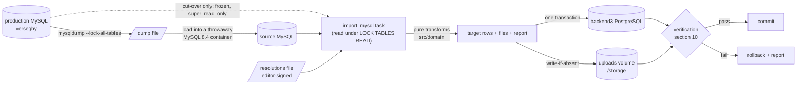

# Data migration: legacy MySQL to backend3 PostgreSQL

This is the specification of backend3's import task. The task copies the legacy `verseghy` MySQL database (written by website_backend, read by website_backend2) into backend3's PostgreSQL database. It runs many times as a rehearsal and once for real, in the cut-over window.

Binding decisions behind this document:

| ADR | What it fixes for the importer |
|---|---|
| [ADR 0002](adr/0002-postgresql-as-the-database.md) | the target is PostgreSQL |
| [ADR 0003](adr/0003-cut-over-one-rehearsed-flip-then-a-read-only-parallel-run.md) | nightly rehearsals; one import in an evening write freeze |
| [ADR 0009](adr/0009-clean-domain-schema-with-preserved-integer-ids.md) | the target tables and constraints; ids preserved |
| [ADR 0010](adr/0010-all-instants-stored-as-timestamptz.md) | every instant is `timestamptz`, calendar dates included (as Europe/Budapest midnights); event wall times are Europe/Budapest |
| [ADR 0011](adr/0011-safety-net-soft-delete-revisions-and-an-activity-log-for-eve.md) | audit columns, soft delete, revisions, activity log |
| [ADR 0013](adr/0013-rich-text-editor-and-html-sanitiser.md) | the editor schema (the content-v1 shape of decision 15b) and the sanitiser allow-list that the body normaliser targets; [editor.md](editor.md) §3 defines content-v1 and §9 lists the import rules |
| [ADR 0017](adr/0017-legacy-data-import-normalisation-and-defect-resolution.md) | body normalisation, the editor-signed defect list, the dump flags |
| [ADR 0018](adr/0018-content-model-publishing-pages-menu-tree-canteen-week-editor.md) | posts, pages and menu model |

Counts in this document come from the production dump of 2026-10-23 17:01 UTC unless marked **[500]**, which means the 500-post / 24-page harvest of the public API (research: SYNTHESIS §4.7). They are reference values. The importer measures the real values on every run and reports them.

## Contents

1. [Scope](#1-scope)
2. [Pipeline](#2-pipeline)
3. [Source requirements](#3-source-requirements)
4. [Running the importer](#4-running-the-importer)
5. [Global transformation rules](#5-global-transformation-rules)
6. [Table mappings](#6-table-mappings)
7. [Rich-text normalisation](#7-rich-text-normalisation)
8. [Defect resolutions (editor sign-off)](#8-defect-resolutions-editor-sign-off)
9. [Not migrated](#9-not-migrated)
10. [Verification](#10-verification)
11. [Idempotence, dry run and determinism](#11-idempotence-dry-run-and-determinism)
12. [Testing the importer](#12-testing-the-importer)
13. [Open items](#13-open-items)
14. [References](#14-references)

## 1. Scope

In scope:

- every row of the 14 legacy tables that hold content, accounts and grants, mapped to 14 of the 15 target tables of ADR 0009 (the 15th, `roles`, is seeded by a migration and verified against the source);
- the rich-text bodies of posts and pages, normalised once to the new editor's form;
- the inline `data:` images inside bodies, which become files on the uploads volume;
- checks that every file the database points at exists on the uploads volume.

Out of scope:

- the media files themselves. They stay where they are, and their paths and URLs do not change (ADR 0015);
- the content that release 1 adds (notices, partner banners, site settings, Diáktoll issues). It has no legacy rows. ADR 0019 defines what is seeded at the cut-over (the current partner banners, the site settings, one Diáktoll issue); how that seed runs is open item 7 of §13;
- anything that writes to the legacy MySQL database. The importer only reads it.

## 2. Pipeline



The task reads the whole source in one locked session, computes every target row in memory with pure functions, writes everything in one transaction, verifies inside that transaction, and commits only if every check passes. The legacy data is 6.05 MiB, so the whole run takes seconds.

## 3. Source requirements

### 3.1 The dump

| Requirement | Why |
|---|---|
| Every dump used as an import source is taken with `mysqldump --lock-all-tables` (decision 32b) | The legacy tables are not transactional, so only a global read lock gives a consistent dump. `--lock-all-tables` holds that lock for the whole dump, which takes seconds at this size. |
| Default time-zone handling kept (never `--skip-tz-utc`) | `TIMESTAMP` values are then written in UTC, which §5.2 relies on. |
| Character set `utf8mb4` (the MySQL 8.4 default) | Hungarian `ő` and `ű` are outside `latin1`. |
| Contains the `verseghy` database | It is the only source database. |
| Handled as personal data | The dump contains the admin accounts. It is never committed, never attached to an issue or PR, and never uploaded to CI. It is stored only in the locations the private runbook names and on the LAN-only staging environment (ADR 0003). |

### 3.2 The production database before cut-over

Production MySQL is left as it is until the cut-over (decision 32b):

- no engine conversion, no change of the database default charset, no data clean-up. Every clean-up happens in the importer;
- backend2's hand-run migration 12 (website_backend2@7ba71da:`migrations/12-menu_items_fix_types.sql`) is **never** applied. It fails on today's data (`ERROR 1265 Data truncated for column 'lft'`), and after a back-fill it would break menu creation in the current admin (research: gap-07 §4).

### 3.3 How the importer reads the source

| Rule | Detail |
|---|---|
| Source kinds | Rehearsals read a throwaway MySQL 8.4 container loaded from a dump. The cut-over import reads the frozen production server directly with read-only access; the final dump taken just before it is the reference copy of the same frozen state (ADR 0003, [cutover.md](cutover.md)). The code path is the same. |
| Account | The source account needs only `SELECT` and `LOCK TABLES` on `verseghy`. Rehearsals use the throwaway container's own account. The cut-over uses a dedicated account with exactly these grants. The private runbook creates it in phase 1 of the window, together with the credential rotation and before the freeze ([cutover.md](cutover.md) §6, §11), because `super_read_only` also refuses account-management statements; the dress rehearsal verifies this. Creating it changes no `verseghy` table (decision 32b). Its connection URL is a key in the shared `backend-secrets` ExternalSecret (decision 33), exposed to the task as `IMPORT_SOURCE_DATABASE_URL` (§4.1). The key is removed once G1-G7 pass ([cutover.md](cutover.md) §7). Dropping the account is an account-management statement too, so it waits until the maintainer decommissions the legacy database (decision 41); until then the account can only read a frozen database. |
| Session settings | `SET time_zone = '+00:00'` (so `TIMESTAMP` columns come back in UTC), `SET NAMES utf8mb4`, `SET information_schema_stats_expiry = 0` (so `AUTO_INCREMENT` values are current). |
| Consistency | One session takes `LOCK TABLES <every source table> READ`, reads every row, reads every table's `AUTO_INCREMENT`, then unlocks. Even a writable source cannot change in the middle of the read. |
| Schema fingerprint | Before reading rows, the importer compares every source table's columns, types and nullability with the expected legacy DDL (research: gap-03 §5). Any difference stops the run with a message that names the table and column. |
| Driver | Plain `sqlx` queries with its `mysql` feature, behind a Cargo feature `import-mysql`. There are no Sea-ORM entities for the legacy tables. `import-mysql` is a default feature until the removal PR (open item 9). The PAC production build (decision 34a) and the GitHub Actions checks build with it, so the production image can run the cut-over import. CI also builds and tests once without `import-mysql`, to prove that the rest of backend3 does not depend on it. |

## 4. Running the importer

### 4.1 Interface

The importer is a Loco task named `import_mysql`. Only the task touches `AppContext` and the environment; everything below it takes explicit arguments (ADR 0008).

```sh
cargo loco task import_mysql \
  mode:dry-run \
  snapshot_at:2026-10-23T17:01:02Z \
  resolutions:data/import/resolutions.toml \
  storage_root:/path/to/storage \
  report:/path/to/report-dir
```

| Argument | Required | Meaning |
|---|---|---|
| `mode` | no, default `dry-run` | `dry-run` computes, writes and verifies everything, then rolls back and writes no files to `storage_root`. `apply` commits. |
| `snapshot_at` | yes | The moment the source was frozen or dumped (RFC 3339, UTC). It is the `created_at` and `updated_at` of rows whose legacy table has no timestamps. It must not be earlier than any timestamp in the source. |
| `resolutions` | yes | Path of the editor-signed resolution file (§8). |
| `storage_root` | yes | The directory that is served as `/storage` (the uploads volume's public root). Read for file checks, written only in `apply` mode for the inline images of §7. |
| `report` | yes | An empty directory for the run report (§11.3). |
| `canteen_audit_local_before` | no, default `2022-01-21T00:00:00Z` | Which `canteen_data` audit values are Budapest wall time (§5.2, ADR 0010 open item): values before this instant are, values at or after it are UTC. An RFC 3339 instant, or `all`. The default is the end of the backend2 fix window; backend2's fix 03 shifted only the rows that existed then (322 rows; research: SYNTHESIS §4.4.2). |

Loco 1.2.0 splits each task argument at its first `:` (loco-rs@1.2.0:`src/cli.rs`, `parse_key_val`), so values such as RFC 3339 instants may contain colons.

The source connection string comes from the environment variable `IMPORT_SOURCE_DATABASE_URL` (at the cut-over, a key of the shared `backend-secrets` ExternalSecret, §3.3), read by the task and passed on as an argument. It is never a command-line argument, so it never lands in shell history or a process list. The target is backend3's own configured database.

### 4.2 Refusal rules

The task refuses to start, or stops and rolls back, with a message that tells the operator what to fix, when:

| Condition | Message names |
|---|---|
| any table the import writes already holds a row (`roles`, seeded by a migration, is only read) | the first non-empty table. The importer never merges into existing data, so it can never run again after go-live. |
| the source schema differs from the expected DDL | the table and column |
| the resolution file does not parse or fails validation | the entry and field |
| an entry's precondition does not match the source (the row changed since sign-off) | the defect id, the row id, the expected and the found value |
| a defect rule finds a row that the resolution file does not cover | the defect id and the row id |
| a target `NOT NULL`, `CHECK`, unique or foreign-key rule would fail | the table, row id and rule |
| an inline image file would overwrite a different existing file | the path |
| any verification check of §10 fails | the check id and the first failing rows |

Database-touching agent commands are additionally blocked by the repository guardrails when `DATABASE_URL` is not local (ADR 0024). The production run is done by the operator in the cut-over window (ADR 0003).

### 4.3 Order of operations

```mermaid
sequenceDiagram
    participant T as import_mysql task
    participant S as source MySQL
    participant D as src/domain (pure)
    participant F as storage_root
    participant P as PostgreSQL
    T->>T: validate arguments and resolution file
    T->>S: session settings, LOCK TABLES ... READ
    T->>S: fingerprint, read all rows, AUTO_INCREMENT values
    T->>S: UNLOCK TABLES
    T->>D: build target rows, apply resolutions, normalise bodies, compute menu positions
    D-->>T: rows, inline images, expected digests, report data
    T->>F: write inline images if absent (apply) or to a temp dir (dry-run)
    T->>P: BEGIN
    T->>P: insert in foreign-key order, revisions, activity entry
    T->>P: set identity sequences
    T->>P: verification queries and read-back digests (section 10)
    alt every check passes and mode is apply
        T->>P: COMMIT
    else dry-run or a failed check
        T->>P: ROLLBACK
    end
    T->>T: write the report
```



Insert order: `users`, `user_roles`, `user_permissions`, `authors`, `labels`, `posts`, `post_labels`, `dishes`, `canteen_days`, `canteen_day_dishes`, `events`, `colleagues`, `pages`, `menu_items` (parents before children), then the revisions and the activity-log entry of §5.4. `roles` is seeded by a migration before the import and is only read.

Rows are written with bulk inserts that carry every value explicitly. Model save hooks do not run, so no hook can overwrite a preserved timestamp or generate a second token. The importer calls the domain validators on every row, except the save-time rules that the resolution list or §6-§7 leave to the next edit: the date requirement on drafts (D5), the 2-3 dish rule (D7), the length limits (§5.3, reported), the mandatory image alt (decision 15, §7.1) and the images-only rule for gallery entries (the 5 legacy non-image entries stay, §6.1, [parity.md](parity.md) POS-F02). Each exemption is a named flag in the importer. Every exempted row is listed in the report. Database constraints are never exempted.

## 5. Global transformation rules

### 5.1 Ids and sequences

| Rule | Detail |
|---|---|
| Ids preserved | Every legacy row keeps its id. Ids are never renumbered. Gaps from hard deletes stay gaps (for example pages 1-7). |
| Join tables | Have no id (ADR 0009). |
| Sequence reset | After the inserts, each identity sequence is set so that the next id is `greatest(max(id), legacy AUTO_INCREMENT - 1) + 1`, with `setval(pg_get_serial_sequence('<table>', 'id'), <next> - 1)`. No id that MySQL issued is reissued (posts: 620 issued, 576 rows). |
| Dropped rows | Ids of rows dropped by a resolution (merged labels, duplicate canteen days) are never reused either, by the same rule. |
| New rows | A row the importer creates (the optional generic author of D2) gets its id from the sequence after the reset. |

### 5.2 Time values

Every legacy time column falls into one of these kinds (ADR 0010):

| Legacy kind | Columns migrated | Rule |
|---|---|---|
| `TIMESTAMP` (UTC instant) | `users.created_at/updated_at`, `menu_items.created_at/updated_at` | Read in the `+00:00` session; stored as that UTC instant. A `NULL` becomes `snapshot_at` and is reported. |
| `DATETIME` audit column written by Laravel (UTC wall time) | `posts_data`, `pages`, `events_data`, `canteen_menus` `created_at/updated_at` | Interpreted as UTC. |
| `DATETIME` audit column of `canteen_data` | `canteen_data.created_at/updated_at` | Values before `canteen_audit_local_before` (default `2022-01-21T00:00:00Z`) are interpreted as Europe/Budapest wall time and converted to UTC, because backend2's fix 03 shifted them to local time. Values at or after it were written by Laravel in UTC and are interpreted as UTC. |
| `DATETIME` event time (Europe/Budapest wall time) | `events_data.date_from/date_to` | Converted Europe/Budapest to UTC. An ambiguous autumn time takes the earlier instant (`+02:00`). A non-existent spring time stops the run (expected: 0 rows; the legacy times are almost all `00:00`-`00:01` and `23:58`-`23:59`). Seconds are kept. |
| `DATE` | `posts_data.date`, `canteen_data.date` | Converted to the `timestamptz` of the Europe/Budapest midnight of that day (decision 9, ADR 0010 point 2, ADR 0018 §1.3). Post dates first get the D1 and D5 resolutions of §8. Every day from 1984 on has exactly one Budapest midnight, so this conversion never meets the spring gap or the autumn overlap; an earlier day without one is refused by the ADR 0010 conversion module and stops the import (§4.2). |
| No timestamps in the legacy table | `posts_labels`, `posts_authors`, `colleagues_data`; the join tables | `created_at = updated_at = snapshot_at`, the import instant of ADR 0011. Join tables have no timestamps in the target either. |
| Not migrated | `roles`, `permissions`, `password_resets`, `newsletter`, `migrations`; `pages.deleted_at`, `menu_items.deleted_at` | See §9. |

The conversion uses the one Europe/Budapest module of ADR 0010. Every converted event is checked by the round trip of §10 (V11).

### 5.3 Text, numbers, booleans and NULLs

| Rule | Detail |
|---|---|
| Plain text | Copied verbatim: no trimming, no Unicode normalisation, newlines kept. Titles, descriptions, names and colleague fields contain 0 HTML entities (research: SYNTHESIS §4.7.1), so they are not decoded. |
| Encoding | Every string must be valid UTF-8. A decoding error stops the run. |
| Length | No database length limits apply (ADR 0009). The domain validation limits are checked and every legacy value over a limit is reported, not truncated. |
| Unsigned integers | `int unsigned` and `smallint unsigned` become `bigint` and `smallint`. The largest legacy id is 1,222. |
| Booleans | `tinyint(1)` 0 and 1 become `false` and `true`. Any other value stops the run. |
| NULL | A NULL stays NULL unless a rule in §6 or §8 says otherwise. A NULL bound for a `NOT NULL` target column stops the run, naming table, id and column. |
| Codes | `canteen_menus.type` and `colleagues_data.category` are copied as `smallint` and must be in range (0-2, 0-4). `menu_items.type` is copied as text and must be one of `page_link`, `internal_link`, `external_link`. |

### 5.4 Columns and records every imported entity row gets

| Column or record | Value |
|---|---|
| `created_by`, `updated_by`, `deleted_by` (ADR 0011) | NULL. The legacy data records no authorship of changes. |
| `deleted_at` (ADR 0011) | NULL. No legacy row is soft-deleted. |
| `posts.content_text` (ADR 0020) | Computed from the normalised body by `html_to_search_text`, the same pure function the post model runs on every write. |
| `import` revision (ADR 0011) | Every imported row of an entity table gets a revision with reason `import` that holds its imported state. The users snapshot follows ADR 0011's allow-list, so it never contains a password hash. Join-table rows are recorded in their parent's snapshot. |
| `import_original` revision (ADR 0011) | When §7 changed a body, the row first gets an `import_original` revision that holds the legacy body exactly as stored in MySQL (decision 19: "original kept as a revision"), then its `import` revision. Reverting to it later goes through the normal write path, so the sanitiser applies. |
| Activity log (ADR 0011) | One `import` entry per table per run, by the `import` actor, with the row count, `snapshot_at`, the SHA-256 of the resolution file and the ids changed by each resolution in its details. No per-row entries. |

## 6. Table mappings

Each subsection maps one target table. "Verbatim" means the value is copied unchanged after the global rules of §5. Every entity table also gets the columns and records of §5.4; join tables get none.

### 6.1 `posts` from `posts_data` (576 rows: 541 published, 35 drafts)

| Target column | Source column | Rule |
|---|---|---|
| `id` | `id` | preserved |
| `title` | `title` | verbatim (longest 95 characters) |
| `color` | `color` | verbatim; must match `^#[0-9A-Fa-f]{6}$` (576 of 576 do) |
| `description` | `description` | verbatim plain text; NULL kept (165 rows) |
| `content` | `content` | normalised by §7; NULL kept (34 rows, 28 of them published; D4) |
| `content_text` | none | derived from the normalised `content` (§5.4, ADR 0020); `''` when `content` is NULL |
| `index_image` | `index_image` | verbatim disk-relative path `index/<32 hex>.<ext>` (575 of 575 non-NULL values); the file must exist (V7); never NULL on a published post (D3) |
| `author_id` | `author_id` | verbatim; NULL on 7 rows: published 55, 61, 66 (D2) and 4 drafts, which stay NULL |
| `images` | `images` | `jsonb` array of file names. A JSON array is kept in order. A JSON object (36 rows, written by Backpack after a removal) becomes the array of its values ordered by numeric key. Every element must match `^[0-9a-f]{32}\.[A-Za-z0-9]+$`. Any other JSON shape stops the run. 5,053 references; the 5 non-image entries (3 PDFs on post 59, an `.asd` and an `.mp3` on post 385) are kept and reported. |
| `date` | `date` | the Europe/Budapest midnight of the legacy day, as `timestamptz` (§5.2); +1 day for the 181 rows of D1 before the conversion; `1970-01-01` to NULL on the 11 drafts of D5; NULL kept on 5 drafts |
| `featured` | `featured` | boolean (5 rows true, all published) |
| `published` | `published` | boolean |
| `preview_token` | `previewToken` | verbatim (573 tokens, each exactly 80 characters of `[A-Za-z0-9]`, so URL-safe). The 3 drafts with NULL get a new token in the format of ADR 0018. Tokens must be unique. |
| `publish_at` | none | NULL (column exists, unused in release 1; decision 21) |
| `created_at`, `updated_at` | same | `DATETIME` written as UTC (§5.2) |

### 6.2 `labels` from `posts_labels` (93 rows)

| Target column | Source column | Rule |
|---|---|---|
| `id` | `id` | preserved, except the merged duplicates of D8 |
| `name` | `name` | verbatim |
| `color` | `color` | verbatim; must match the colour pattern (93 of 93 do) |
| `created_at`, `updated_at` | none | `snapshot_at` |

D8 merges the 5 rows of 2 duplicate-name groups into 2 rows. Expected target rows: 90.

### 6.3 `post_labels` from `posts_pivot_labels_data` (655 rows)

| Target column | Source column | Rule |
|---|---|---|
| `post_id` | `posts_id` | verbatim |
| `label_id` | `labels_id` | verbatim, re-pointed to the surviving label for merged ids (D8) |

Pairs that become identical after re-pointing collapse into one row; the dry run reports how many. The legacy table has 0 dangling references in either direction.

### 6.4 `authors` from `posts_authors` (49 rows)

| Target column | Source column | Rule |
|---|---|---|
| `id` | `id` | preserved |
| `name` | `name` | verbatim |
| `description` | `description` | verbatim; NULL kept (set on 6 rows, at most 27 characters) |
| `image` | `image` | verbatim bare file name in `authors_images/`; NULL kept; the file must exist (V7) |
| `created_at`, `updated_at` | none | `snapshot_at` |

If D2 chooses the generic author, the importer adds one row named `Szerkesztőség` with no description and no image.

### 6.5 `colleagues` from `colleagues_data` (70 rows)

| Target column | Source column | Rule |
|---|---|---|
| `id` | `id` | preserved |
| `name` | `name` | verbatim; `NOT NULL` in the target (never NULL in the source) |
| `jobs`, `subjects`, `roles`, `awards` | same | verbatim free text, newlines kept; NULL kept |
| `image` | `image` | verbatim bare file name in `colleagues_images/`; NULL kept (13 rows); the file must exist (V7) |
| `category` | `category` | `smallint` 0-4 (0 management, 1 teachers, 2 lecturers, 3 administration, 4 maintenance) |
| `created_at`, `updated_at` | none | `snapshot_at` |

### 6.6 `dishes` from `canteen_menus` (624 rows)

| Target column | Source column | Rule |
|---|---|---|
| `id` | `id` | preserved |
| `name` | `menu` | verbatim (longest 58 characters) |
| `course` | `type` | `smallint`: 0 soup, 1 main dish, 2 dessert |
| `created_at`, `updated_at` | same | `DATETIME` written as UTC |

Dishes with equal names are not merged. The week editor shows such duplicates with their usage counts (decision 39).

### 6.7 `canteen_days` from `canteen_data` (1,187 rows)

| Target column | Source column | Rule |
|---|---|---|
| `id` | `id` | preserved, except the dropped duplicates of D6 |
| `date` | `date` | the Europe/Budapest midnight of the legacy day, as `timestamptz` (§5.2) (weekdays only, 2019-04-01 onwards) |
| `created_at`, `updated_at` | same | Europe/Budapest wall time converted to UTC (§5.2) |

D6 keeps one row per date. Expected target rows: 1,179. The 16 days that break the 2-3 dish rule are imported unchanged (D7).

### 6.8 `canteen_day_dishes` from `canteen_pivot_menus_data` (2,921 rows)

| Target column | Source column | Rule |
|---|---|---|
| `canteen_day_id` | `data_id` | verbatim |
| `dish_id` | `menu_id` | verbatim |
| `position` | none | 0, 1, 2 within the day, ordered by the dish's course, then dish id (the legacy data has no slot order; ADR 0018) |

Links of the canteen days dropped by D6 are not imported. The legacy primary key order `(menu_id, data_id)` is not carried over; the target key is `(canteen_day_id, dish_id)`.

### 6.9 `events` from `events_data` (293 rows)

| Target column | Source column | Rule |
|---|---|---|
| `id` | `id` | preserved |
| `title` | `title` | verbatim |
| `description` | `description` | verbatim; NULL kept (199 rows) |
| `color` | `color` | verbatim; must match the colour pattern (293 of 293 do) |
| `starts_at` | `date_from` | Europe/Budapest wall time to UTC (§5.2) |
| `ends_at` | `date_to` | Europe/Budapest wall time to UTC; must not be earlier than `starts_at` (0 legacy violations) |
| `created_at`, `updated_at` | same | `DATETIME` written as UTC |

### 6.10 `pages` from `pages` (39 rows)

| Target column | Source column | Rule |
|---|---|---|
| `id` | `id` | preserved |
| `title` | `title` | verbatim |
| `slug` | `slug` | verbatim; all 39 are distinct and match `^[a-z0-9-]+$` |
| `internal_note` | `name` | verbatim when it differs from `title` (at least 14 rows, several used as notes such as "Eredmények <-- feltöltendő"); NULL when it equals `title`, which loses nothing |
| `content` | `content` | normalised by §7 (`NOT NULL`; the largest legacy page is 63,082 bytes) |
| `seo_description` | `extras.meta_description` | NULL (the key is NULL on all 39 rows) |
| `published` | none | `true` for every row, because every legacy page is publicly served today; D10 lets editors list pages to import as hidden |
| `created_at`, `updated_at` | same | `DATETIME` written as UTC |

Dropped after an assertion: `template` must be `page` on every row (39 of 39), `extras` must be the all-NULL triple `{"meta_title": null, "meta_keywords": null, "meta_description": null}` on every row (39 of 39), and `deleted_at` must be NULL (39 of 39). Any other value stops the run. The public API keeps returning `template = 'page'` and an empty `extras` object (ADR 0018), so the Angular contract does not change.

### 6.11 `menu_items` from `menu_items` (23 rows)

| Target column | Source column | Rule |
|---|---|---|
| `id` | `id` | preserved |
| `name` | `name` | verbatim |
| `kind` | `type` | verbatim; must not be NULL (0 NULL today): 20 `page_link`, 3 `internal_link`, 0 `external_link` |
| `link` | `link` | verbatim for `internal_link` and `external_link`; must be NULL for `page_link` |
| `page_id` | `page_id` | verbatim for `page_link`, and the page must exist; set to NULL for every other kind. This fixes the 3 `internal_link` rows (ids 9, 10, 14) that carry the non-existent `page_id = 1` left by the old edit form. |
| `parent_id` | `parent_id` | verbatim (2 roots, 0 dangling) |
| `position` | `lft` (and the resolution file) | contiguous integers from 0 per parent, in today's served order (below) |
| `created_at`, `updated_at` | same | `TIMESTAMP` UTC (§5.2) |

Dropped: `rgt`, `depth` and `lft` (used only to compute `position`), and `deleted_at` after asserting it is NULL on every row.

**Served order.** Today both public APIs order siblings by `lft ASC`. The 5 items created after the last reorder (ids 25, 26, 29, 30, 31) have a NULL `lft`, so they are served first, in MyISAM's physical row order, which is not id order (research: gap-07 §3-4). The import reproduces that order (decision 23b, ADR 0018 §3.6):

1. Within each parent, the rows with a NULL `lft` come first, in the source's physical row order: the order in which a plain `SELECT` without `ORDER BY` returns them, which is the order of the dump's `INSERT` and what `ORDER BY lft` serves today. The numbered rows follow in `lft` order.
2. Physical order is an accident of storage, so it is also pinned: the resolution file records the order of the unpositioned items as captured from the live public API (D9). If step 1 gives a different order, the run stops.
3. V9 compares the whole resulting tree with the captured tree below.

| Parent | Children in served order (id, name) |
|---|---|
| 7 Rólunk | **25** Az iskola nyitvatartása, 8 Iskolatörténet, 14 Archívum, 13 Tablók, 12 Alapítvány, 11 Iskolapszichológus, 10 Fejlesztők, 9 Munkatársak |
| 15 További információk | **26** Versenyeredmények, **30** Szegő-verseny 1994-2023, **29** Egyetemi tanárok lettek, **31** Adatvédelem, 17 Tagozatok, 23 Búvárkodj a biológiában verseny, 22 Tarján Imre Emlékverseny, 21 Szegő Gábor Matematikaverseny, 20 Közösségi szolgálat, 19 OKTV eredmények, 24 Statisztikák, 18 Dokumentumok, 16 Beiskolázás |

Roots in served order: 7, then 15. The menu resource is capped at two levels (decision 23b); the importer asserts that no row is deeper. An unpositioned item that the resolution file does not list stops the run.

### 6.12 `users` from `users` (40 rows)

| Target column | Source column | Rule |
|---|---|---|
| `id` | `id` | preserved |
| `pid` | none | a new random UUID (Loco shape, ADR 0006) |
| `email` | `email` | verbatim; must be unique case-insensitively |
| `name` | `name` | verbatim |
| `password_hash` | `password` | the Laravel bcrypt string, carried unchanged. All 40 are 60-character `$2y$10$` hashes. backend3 verifies `$2y$` at login and rehashes to Argon2id on success (ADR 0006). Any other format stops the run. |
| `active` | none | `true` (decision 10e; stale accounts are deactivated later, based on `last_login_at`) |
| `last_login_at` | none | NULL |
| `token_version` | none | 0 |
| `must_change_password` | none | `false` |
| `temp_password_expires_at` and the two-factor columns | none | NULL (two-factor off) |
| `created_at`, `updated_at` | same | `TIMESTAMP` UTC; NULL becomes `snapshot_at` |

Dropped: `remember_token` (decision 10a). The report shows users as counts only, never e-mail addresses, names or hashes.

### 6.13 `roles` (4 rows; verified, not copied)

`roles` is seeded by a backend3 migration with the 4 roles `writer`, `secretary`, `supervisor` and `admin` (ids 1-4, as in the legacy table). The importer asserts that the source has exactly these ids and names with `guard_name = 'web'`, and maps source role ids to target roles by name.

### 6.14 `user_roles` from `model_has_roles` (44 rows)

| Target column | Source column | Rule |
|---|---|---|
| `user_id` | `model_id` | `bigint`; `model_type` must be `App\User` on every row |
| `role_id` | `role_id` | mapped by role name (§6.13) |

The one row that points at a deleted user is dropped and reported (decision 10a). Users with two roles keep both (3 users); the user with no role is imported without one and reported. Expected target rows: 43.

### 6.15 `user_permissions` from `model_has_permissions` (4 rows)

| Target column | Source column | Rule |
|---|---|---|
| `user_id` | `model_id` | `bigint`; `model_type` must be `App\User` |
| `permission` | `permission_id` | the permission's name from `permissions`; must be one of the 8 legacy names that ADR 0007 keeps |

The 4 legacy grants are 3 × `edit events` and 1 × `edit canteens`. Permissions themselves live in code (ADR 0007). The importer asserts that the source `permissions` table has exactly the 9 legacy names, and that the 20 `role_has_permissions` rows are the legacy map below. Of those 20 links, the 18 that use the 8 kept permissions must equal the role mapping in code. The 2 links to `edit newsletter` are the only ones dropped, because the newsletter is retired (decision 30) and no user holds that permission as a direct grant.

| Role | Legacy permissions |
|---|---|
| writer | edit posts, edit labels, edit authors |
| secretary | edit events, edit canteens, edit newsletter, edit colleagues |
| supervisor | edit posts, publish posts, edit labels, edit authors |
| admin | all 9 |

Permissions added by ADR 0007 (edit pages, edit menu, manage media and the rest) are granted to roles in code, not by the importer.

## 7. Rich-text normalisation

`posts.content` and `pages.content` are rewritten once, at import, into the exact form the new editor stores (decision 19, ADR 0017). The legacy bodies come from CKEditor 4.12.1, whose `entities` plugin encoded accented letters and typographic punctuation as named entities, plus markup saved in source mode that the new editor's schema does not know (research: SYNTHESIS §4.7, gap-05 §2, gap-06 §1-4). The first save in any DOM-based editor would rewrite these bytes anyway, and would silently drop the embeds. One deterministic, diffed conversion is the only form that can be verified.

### 7.1 Steps

The normaliser is one pure function in `src/domain/` (ADR 0008): legacy HTML in, normalised HTML plus a list of rule hits and extracted images out. It parses with html5ever and works on the DOM, not on strings.

| Step | Rule | Expected hits |
|---|---|---|
| N0 Parse | Parse as an HTML fragment in a `body` context. This decodes every character reference, lower-cases tag names (posts 520, 524 and 532 have `<P STYLE=…>`), normalises `\r\n` to `\n` and void elements (`` to ``). | every non-NULL body |
| N1 Legacy oEmbed wrappers | `div[data-oembed-url]` (CKEditor's `embed` plugin through the Iframely demo endpoint, at most 320 px wide today) becomes the editor's YouTube node for a YouTube iframe and the editor's padlet node for a padlet iframe. Any other provider becomes a paragraph with a link to the embedded URL, because iframes are allowed only from YouTube and padlet (decision 15). The Iframely comment, the 320 px wrapper and the 16:9 box are removed. | 8 wrappers in 7 published posts (107, 118, 140 ×2, 156, 167, 176, 207) and 1 draft; post 118 is a Facebook video and becomes a link |
| N2 Bare YouTube iframes | `<p><iframe src="…youtube.com/embed/…">` becomes the editor's YouTube node, in the content-v1 embed markup ([editor.md](editor.md) §3.7). The video id, `start`, `list` and `title` are kept, and the host becomes `www.youtube-nocookie.com`. Every legacy attribute (the fixed 560-853 px `width` and `height`, `frameborder`, `allow`, `referrerpolicy`, `style`) is replaced by the canonical markup, whose `allow`, `allowfullscreen` and `referrerpolicy` each have one fixed value, because content-v1 keeps no legacy node variants (decision 15b). | 13 posts **[500]** (214, 263, 398, 402, 418, 423, 427, 444, 477, 484, 552, 557, 605) |
| N3 `<center>` | Unwrapped. The contained blocks get `text-align: center`. When the only child is an embed, the wrapper is just removed. | 9 posts **[500]** (398, 402, 418, 423, 427, 444, 477, 484, 532) |
| N4 Inline `data:` images | Each `img[src^="data:image/"]` is decoded. An image of at most 1×1 px is removed, together with a paragraph left empty. Every other image is written to `/storage/uploads/posts/<id>/inline-<n>.<ext>` and its `src` is replaced by that root-relative URL; `alt` and `style` are kept. `<n>` counts the written images of that body from 1 in document order. `<ext>` follows the MIME type (`image/jpeg` → `jpg`, `png`, `gif`, `webp`); any other type stops the run. Files are written byte-for-byte as decoded; the upload optimiser of ADR 0015 does not run on them. Page bodies use `/storage/uploads/pages/<id>/` (open item 3). | 16 images in 6 posts (91 ×7, 92 ×5, 335, 408, 473, 538): 14 files written, the two 1×1 px images of 473 and 538 removed, bodies about 1.63 MB smaller; 1 image in page 50 |
| N5 Legacy presentational markup | Mapped onto content-v1 (ADR 0013, [editor.md](editor.md) §9): `p[align]` → `text-align` style; `table[align]` dropped, because both sites centre every content-v1 table; `img.left` / `img.right` handled by N5b; `span.marker` → `<span style="background-color: #ffff00">`; `big` unwrapped; `ins` → `u`; `b` → `strong`, `i` → `em`, `strike` and `del` → `s`; `h5` and `h6` → `h4`; an `h2` with an italic style → `<h2><em>`; `span[dir]` unwrapped; `p[lang]` stripped. | **[500]**: 23 `p[align]`, 19 `table[align]`, 3 `img.left` (to N5b), 1 `span.marker`, 1 `big`, 1 `ins`, 23 `span[dir]`, 5 `p[lang]`, 2 italic `h2` |
| N5b content-v1 layout (decision 15b) | Old and new content get one content-v1 shape ([editor.md](editor.md) §3.7, §9), and no legacy editor node variants are kept. (1) Every image becomes the content-v1 image paragraph. A floated image (`img.left`, `img.right` or a `float` style) loses its float and is centred. Its `width` stays, also above 700 px. A legacy `height: Npx` becomes `height: auto`, with `width` and `height` attributes from the stored ratio. An image inside a heading, a link, inline formatting, a cell, a list item or a quote moves into its own paragraph before the enclosing top-level block, and a link around it is dropped and reported. (2) Every YouTube and padlet node from N1 and N2 gets the content-v1 embed markup; YouTube becomes the responsive player of at most 640 px. An embed inside a cell, list item, quote, heading or link moves into its own top-level paragraph before the enclosing block, as [editor.md](editor.md) §5.2 step 11a says. (3) Every table gets the content-v1 table shape: no table width, the locked `border-collapse`, `max-width` and `tbody` declarations, `thead` rows moved into `tbody`, ragged rows padded with empty cells, `box-sizing: content-box` on sized cells, and a `caption` becomes a paragraph before its table. No table stretches to the 1000 px content width any more, and cell layout (borders, fills, widths, alignment) is kept (decision 15c). (4) A lone paragraph in a cell, list item or quote is stored without its `<p>`, empty links are dropped, loose inline content is wrapped in a paragraph, and whitespace follows the editor's rule. N5b reproduces every load-time normalisation of the editor, so that N9 holds. | **[500]**: 7 floated images (4 `float:left` styles and 3 `img.left` classes; research: gap-06 §4.2-§4.3), about 11 images inside headings, inline formatting or links, 19 YouTube nodes (6 from N1, 13 from N2), 114 tables (102 in posts, 12 in pages), 82 table widths, 8 `thead`, 1 ragged table, empty links in 3 bodies. The full dump may hold more tables in pages (research: QUESTIONS Q15); the first dry run reports the real counts (open item 4). |
| N6 Dead-host links | In `src` and `href` attributes, the prefixes `https://backend.verseghy-gimnazium.net/storage/` and `http://backend.verseghy-gimnazium.net/storage/` become `/storage/`. The host has no DNS record, so these images and links are broken today. Other occurrences of the host are reported, not changed. | **[500]** 15 attributes (14 `img src`, 1 `href`) in posts 76, 85, 137, 203, 208, plus 1 page `href`; at row level the host appears in 11 published posts, 4 drafts and 1 page |
| N7 Sanitise | The result goes through the same sanitiser that every API write uses (ADR 0013, [editor.md](editor.md) §7). Comments and everything outside content-v1 are removed: any `script` element left after N1, iframe `tabindex`, `scrolling` and `style`, and the table attributes that content-v1 drops (`border`, `cellspacing`, `cellpadding`). Style values are re-spelled canonically ([editor.md](editor.md) §3.1): named colours become hex, border sides without a style become `none`, `cm` and `pt` become px, and invalid values such as `100%px` are dropped. These are planned N7 changes, counted per rule. Any removal that no earlier step planned is listed per row and stops the run, unless the resolution file accepts that row (key `N7-accept`). | **[500]** iframe `tabindex` 7, `scrolling` 6, `style` 7; `cellspacing` 99, `cellpadding` 14, `table[border]` 14; about 11,500 `black` colours; 123 `100%px` widths |
| N8 Serialise | html5ever serialisation, which is the same algorithm a browser's `innerHTML` uses: in text only `&`, `<`, `>` and U+00A0 are escaped (`&amp;`, `&lt;`, `&gt;`, `&nbsp;`), in attributes `&`, `"`, `<`, `>` and U+00A0 (`&amp;`, `&quot;`, `&lt;`, `&gt;`, `&nbsp;`; html5ever@0.40.1:`src/serialize/mod.rs`, `write_escaped`). Every other named entity disappears; `&quot;` and `&#39;` in text become `"` and `'`. Whitespace follows the editor's form ([editor.md](editor.md) §3.8). | entity-encoded bodies: 485 of 541 published posts, 27 of 35 drafts, 38 of 39 pages |
| N9 Fixed point | Assertions on every output body: `normalise(out) == out`, `sanitise(out) == out`, and the editor round trip (load into the admin editor, serialise) returns `out` byte for byte (§10, V13). | 0 failures |
| Missing alt (no change) | Images without `alt` are imported without one. The importer never invents alt text. Each is listed in the report for editors. The editor accepts a missing alt on load without changing bytes, and requires it before the next save (decision 15, ADR 0013). Images with an empty `alt` are listed too: ADR 0013 treats an empty or whitespace-only `alt` as missing, so they also need alt text before the next save. | **[500]**: of 110 images, 9 have no `alt` and 14 an empty one (research: gap-06 §4.2) |

Not changed on purpose:

- table cell styles. Pasted Word and Excel tables must keep their styling (decision 15); there is no cell-style compaction. Cell layout (borders, fills, widths, alignment) is always kept (decision 15c). N7 only re-spells the declarations canonically, which does not change how they render ([editor.md](editor.md) §3.1);
- `text-align`, image widths (N5b removes the float of floated images and turns a fixed height into `height: auto` with the same aspect ratio, and images wider than 700 px keep their width, decision 15b), and root-relative `/storage/uploads/…` links;
- plain-text columns (`title`, `description` and the others), which contain no entities.

### 7.2 What the normaliser records

| Record | Where |
|---|---|
| The original body bytes | the row's `import_original` revision (§5.4) |
| Rule hits per row (N1-N7, N5b included), and the images without `alt` | the run report |
| A readable diff per changed row | the dry-run report: both sides pretty-printed one element per line, then a unified diff |
| Extracted images: path, size, SHA-256, pixel size | the run report |

### 7.3 Re-running over backend3's own data

The same function is exposed as a second Loco task, `content_normalize` (`mode:dry-run` by default). It runs over backend3's `posts` and `pages` and changes only rows that are not already at the fixed point. Right after an import it must report zero changes (V13). It is the tool for any later re-normalisation, for example after an editor schema change, and it records a revision for every row it changes. It also selects rows whose integrity tag does not verify or whose `content_policy` is not the current policy; a row whose bytes are already at the fixed point only gets a new tag, without a revision (ADR 0013, [editor.md](editor.md) §8.3).

## 8. Defect resolutions (editor sign-off)

Several defects in the legacy data are visible on the public site or block the new constraints of ADR 0009. They can be fixed only in the data (decision 20). The importer applies a resolution list that editors sign off before the cut-over; then the constraints go on.

### 8.1 The proposed list

Rows are those of the 2026-10-23 dump. Every rehearsal re-detects each defect from its rule, so new cases show up in the nightly report before the window.

| Id | Defect | Rows | Proposed resolution | Unblocks |
|---|---|---|---|---|
| D1 | Post dates one day early. The post date was once a `TIMESTAMP` holding local midnight; backend2's fix 11 cast it to `DATE` without the zone correction. | 181 rows: `created_at < '2022-01-21'`, date not NULL and not `1970-01-01` | +1 day on all 181. This moves their public dates and, for posts now dated on the last day of a month, their archive month. | correct dates and archive buckets |
| D2 | Published posts without an author. These posts do not render on the public site today. | 55, 61, 66 | Editors name the real author. Where nobody knows it, the post gets a generic author `Szerkesztőség`: an existing author of exactly that name if there is one, otherwise one the importer creates. The 4 drafts without an author stay without one. | `CHECK (NOT published OR author_id IS NOT NULL)` |
| D3 | Published post without an index image; its `og:image` points at a directory today. | 70 | Editors choose an index image for post 70 and set it in the current admin before the final dump. This is an ordinary editor edit; decision 32b forbids only engine, charset and clean-up changes. The resolution entry is signed after that edit and records the precondition `index_image` = the chosen `index/<32 hex>.<ext>`. The importer refuses a published post without an index image. | `CHECK (NOT published OR index_image IS NOT NULL)` (ADR 0009) |
| D4 | Posts without a body. | 28 published, 6 drafts | Keep NULL. These are gallery-only or description-only posts. Editors confirm that no body is missing. | none (`content` stays nullable) |
| D5 | Sentinel dates on drafts. backend2's fix 13 set NULL dates to `1970-01-01`. | 11 drafts (65, 77, 162-164, 168-173) | Set to NULL. The 5 drafts that already have a NULL date stay NULL. The admin then requires a date on the next save, defaulting to today (decision 21). | `CHECK (NOT published OR date IS NOT NULL)`, and no latent 1970 archive month |
| D6 | Duplicate canteen days; the public site shows only the first of a pair. | 8 dates, 16 rows (below) | Keep one row per date: the row with more dishes; on a tie, the later id. Links of the dropped row are not imported. Editors confirm each date on the sign-off sheet of §8.2, which shows both menus side by side. | one live day per Budapest date (ADR 0009, ADR 0018 §4.1) |
| D7 | Canteen days that break the 2-3 dish rule. | 16 days (1 with no dish, 15 with one) | Import unchanged. The rule applies when such a day is next saved. | none (the rule is application-level) |
| D8 | Duplicate label names (equal under MySQL's case- and accent-insensitive collation). | `filozófia` ×2, `környezetvédelem` ×3 | Merge each group into one label: the one with most posts; on a tie, the lowest id; its colour is kept. Posts are re-pointed. Detection uses the legacy collation (case and accents ignored); the new uniqueness ignores case only, because accents tell Hungarian words apart. | unique `lower(labels.name)` |
| D9 | Menu items without a position, served first today. | 25; 26, 30, 29, 31 | Keep today's served order (decided, Q23b). The resolution file records the order captured from the live public API (§6.11). | contiguous `position` per parent |
| D10 | Pages linked from nowhere but publicly reachable by URL. | 15 of 39 | Import every page as published (parity). Editors may list pages to import as hidden. | none |

D6 detail (research: gap-02 §1.4, gap-03 §6.13):

| Date | Row ids | Menus |
|---|---|---|
| 2021-11-24 | 307, 310 | identical |
| 2021-11-25 | 308, 311 | differ |
| 2021-11-26 | 309, 312 | identical |
| 2022-04-01 | 393, 398 | differ (393: soup and main; 398: soup, main and dessert) |
| 2022-05-18 | 428, 429 | identical |
| 2023-01-24 | 544, 549 | differ |
| 2024-06-14 | 818, 823 | differ |
| 2024-12-02 | 890, 891 | identical |

Fixes that need no sign-off, because they change nothing an editor or reader can see:

- `page_id` set to NULL on the 3 `internal_link` menu items (§6.11);
- the one role assignment that points at a deleted user dropped (§6.14);
- object-shaped `images` turned into arrays in key order (§6.1);
- the two invisible 1×1 px inline images removed (§7.1 N4).

### 8.2 The resolution file

The resolutions live in a versioned file in the repository (proposed path `data/import/resolutions.toml`; settled in the import PR). It holds only ids, dates, enum choices and source values: no names of people. Who signed and when is recorded in the private runbook.

Every entry carries a **precondition**: the source value the editors saw when they signed. If the source row has changed since then, for example because someone corrected a date in the old admin, the importer stops and names the entry. The entry is then re-signed. This keeps the list honest without freezing the old admin for weeks.

**Sign-off procedure.** Staging is LAN-only and used only by developers (decision 42), and run reports stay private (§11.3), so editors never see a report. The maintainer exports a sign-off sheet from a staging dry-run report. It holds only defect ids, row ids, the public URLs of the affected posts, and both menus of each D6 date. The maintainer hands it to the editors outside staging, as the private runbook describes, and records there who signed and when. The PR that changes `resolutions.toml` cites the runbook entry by date only.

```toml
# Shape sketch. The import PR defines the schema and its validation.
version = 1
signed_against = "2026-10-23T17:01:02Z"   # snapshot the list was reviewed on

[post_date_shift]                          # D1
rule = "created_before_2022_01_21"
expected_rows = 181
expect_digest = "sha256:<hex>"             # precondition: SHA-256 of the (id, date) pairs at sign-off

[[post_author]]                            # D2
post_id = 55
expect_author_id = "null"                  # precondition
set_author = "generic"                     # or an author id

[[post_index_image]]                       # D3
post_id = 70
expect_index_image = "index/<32 hex>.<ext>"  # precondition: the image editors set in the current admin

[[canteen_duplicate]]                      # D6
date = "2022-04-01"
expect_ids = [393, 398]                    # precondition
keep = 398

[[menu_unpositioned]]                      # D9
parent_id = 15
expect_null_lft = [26, 29, 30, 31]         # precondition
served_order = [26, 30, 29, 31]
```

The file is deserialised into typed Rust structs and validated before any read of the source: unknown keys, unknown ids, a `keep` that is not among `expect_ids`, and duplicate entries are errors with a message that names the entry.

## 9. Not migrated

### 9.1 Tables

| Legacy table | Rows | Why it is not migrated |
|---|---:|---|
| `newsletter` | 0 (in every snapshot since 2020) | The feature is retired as a documented parity exception (decision 30). |
| `password_resets` | 6 | Account recovery becomes admin-issued one-time links or temporary passwords (decisions 10a, 10b). |
| `migrations` | 20 | Laravel's migration bookkeeping. backend3 has its own `seaql_migrations`. |
| `permissions` | 9 | Permission names are defined in code (ADR 0007), which keeps 8 of them and drops `edit newsletter`. The importer verifies the 9 legacy names (§6.15). |
| `role_has_permissions` | 20 | The role-to-permission map is defined in code. The importer verifies the 18 links of the kept permissions against it (§6.15). |
| `roles` | 4 | Seeded by a backend3 migration and verified, not copied (§6.13). |

### 9.2 Columns

| Legacy column | Why it is dropped |
|---|---|
| `users.remember_token` | Not portable; backend3 has its own session model (ADR 0006). |
| `pages.template` | Constant `page` (asserted). The public API returns the constant. |
| `pages.extras` | Never filled; the all-NULL triple on every row (asserted). |
| `pages.name` | Becomes `internal_note` (NULL when equal to the title). |
| `pages.deleted_at`, `menu_items.deleted_at` | Never set (asserted). Soft delete is new behaviour with its own `deleted_at` (ADR 0011). |
| `menu_items.lft`, `rgt`, `depth` | The nested set is replaced by `parent_id` + `position`; `lft` is used once to compute `position`. |
| `roles.guard_name`, `permissions.guard_name` | Always `web` (asserted). |
| `model_has_*.model_type` | Always `App\User` (asserted). |

### 9.3 Files on the uploads volume

The importer does not copy media. The media payload (`posts_images/`, `authors_images/`, `colleagues_images/`, `uploads/`) stays in place with unchanged paths and is served as before (ADR 0015). The importer only reads it for V7 and adds the inline images of N4.

| Path on the volume | Fate |
|---|---|
| Laravel `framework/` and `logs/` | not payload; left behind with backend1 |
| other Laravel-era files outside the media folders | not payload; handled by decision 28 as described in the private runbook |
| `sitemap.xml` (written in 2020) | replaced by a sitemap that backend3 generates from published posts and visible pages (decision 28) |
| `.htaccess` (sets `Access-Control-Allow-Origin: *`) | its header moves to the media server (ADR 0015) |

## 10. Verification

Checks V1-V11 run inside the import transaction, before the commit. A failure rolls everything back and the report names the check and the first failing rows. V12-V14 run across runs or after the commit.

Two helper definitions are used below:

- `dom(x)`: parse `x` as in N0, drop whitespace-only text nodes between block elements, serialise as in N8. It removes differences of encoding and formatting, not of content.
- `text(x)`: the text content of `dom(x)` without `script` and `style` content, with runs of whitespace collapsed to one space.

| Id | Check | Pass condition |
|---|---|---|
| V1 | Row counts | Every target table has the source count minus the documented deltas (table below). |
| V2 | Id preservation | The id set of every entity table equals the source id set, minus ids dropped by D6 and D8, plus a generic author created by D2. |
| V3 | Sequences | For every identity sequence, the next value is greater than `max(id)` and not lower than the legacy `AUTO_INCREMENT`. |
| V4 | Column digests | For each table, a SHA-256 over `(id, column values)` in id order. Columns copied verbatim: the digest of the source values equals the digest of the read-back target values. Transformed columns: the digest of the expected values (computed by the pure transforms) equals the digest of the read-back values. |
| V5 | Body checks | For every body: (a) the stored bytes equal the normaliser output (SHA-256 per row); (b) rows with no N1-N7 hit (N5b included) satisfy `dom(source) == dom(target)`, so only encoding and serialisation changed; (c) every row satisfies `text(source) == text(target)`, except rows changed by N1, whose difference must be exactly the inserted link text; (d) no named entity other than `&amp; &lt; &gt; &nbsp; &quot;` remains; (e) the `&nbsp;` count per row is unchanged except on rows with an N1, N3 or N4 hit, which are listed. The report lists, per row, the SHA-256 of the raw source, of `dom(source)` and of the target. |
| V6 | Legacy markup gone | 0 `data:` image sources, 0 dead-host `/storage/` URLs, 0 `div[data-oembed-url]`, 0 `center`, 0 `script`, 0 iframes outside the YouTube and padlet nodes, 0 floated images, 0 YouTube nodes with legacy sizes, 0 tables at the 1000 px stretch (decision 15b). |
| V7 | Files exist | Every `posts.index_image`, gallery entry, author image, colleague image and extracted inline image exists under `storage_root` (0 missing in the 2026-10-23 cross-check). Every extracted file's SHA-256 equals the decoded `data:` bytes. |
| V8 | Constraints and invariants | All foreign keys, unique indexes and checks hold. Explicit queries, for readable failures: published posts without an author or a date = 0; published posts without an index image = 0; duplicate live canteen dates = 0; duplicate live `lower(label name)` = 0; menu items deeper than two levels = 0; `page_link` items whose page is missing = 0. |
| V9 | Menu order | Per parent, the ordered list of child ids equals the served order captured from the live public API (§6.11), and the roots are 7, then 15. |
| V10 | Accounts | 40 users; every `password_hash` is a 60-character `$2y$` string; 43 `user_roles` rows whose per-role counts equal the source's minus the dropped orphan; 4 `user_permissions` rows. Only counts go to the report. |
| V11 | Times | Every event's `starts_at` and `ends_at`, converted back to Europe/Budapest, equals the source `DATETIME` to the second. UTC columns equal their source values as instants. Canteen audit values follow the configured rule. Every `posts.date` and `canteen_days.date` is a Europe/Budapest midnight, and its Budapest calendar day equals the source `DATE` after D1 and D5. |
| V12 | Determinism | Two runs over the same source and resolution file produce reports with equal digests, apart from the generated values listed in §11.2. Checked in CI with two fresh databases (§12), and in every nightly rehearsal, whose `apply` run follows a dry run over the same dump and must match its digests. |
| V13 | Fixed point | After the commit, `content_normalize mode:dry-run` reports 0 changes. In rehearsals, the admin editor round trip over every normalised body returns the stored bytes. |
| V14 | Public behaviour | The read-only smoke suite of ADR 0003 (checked against the REST spec, no diff against backend2, decision 25b) passes against staging's `/api/v1` after every `apply` rehearsal, and against production `/api/v1` as G8 in the window ([cutover.md](cutover.md) §7). The REST-spec request tests stay CI-only, on fixtures. |

Reference counts (2026-10-23 dump):

| Target table | Source rows | Expected target rows | Delta |
|---|---:|---:|---|
| `posts` | 576 | 576 | none |
| `labels` | 93 | 90 | D8 merges 5 rows into 2 |
| `post_labels` | 655 | 655 minus collapsed pairs | D8; the count is reported |
| `authors` | 49 | 49 or 50 | D2 may add the generic author |
| `colleagues` | 70 | 70 | none |
| `dishes` | 624 | 624 | none |
| `canteen_days` | 1,187 | 1,179 | D6 drops 8 rows |
| `canteen_day_dishes` | 2,921 | 2,921 minus the dropped days' links | D6; the count is reported |
| `events` | 293 | 293 | none |
| `pages` | 39 | 39 | none |
| `menu_items` | 23 | 23 | none |
| `users` | 40 | 40 | none |
| `roles` | 4 | 4 | seeded, verified |
| `user_roles` | 44 | 43 | the orphan row |
| `user_permissions` | 4 | 4 | none |

## 11. Idempotence, dry run and determinism

### 11.1 Dry run

Dry run is the default mode. It does everything `apply` does, inside the same single transaction, so every database constraint is exercised. Then it rolls back. Inline images go to a temporary directory and are discarded. The report is complete.

Dry run is the default for manual checks. The nightly rehearsal and the dress rehearsal on staging run `mode:apply` into a freshly recreated staging database and the staging copy of the uploads ([cutover.md](cutover.md) §5.2); the nightly rehearsal runs a dry run over the same dump first (V12). The smoke suite then runs against staging's `/api/v1` (V14). The cut-over runs the same `apply` path once (ADR 0003), so the commit and the inline-image writes to `storage_root` are rehearsed every night. The staging copy of the uploads keeps the inline images of earlier nights; write-if-absent accepts them when their bytes are equal (§11.2).

### 11.2 Idempotence and determinism

| Property | How it holds |
|---|---|
| The import never runs twice into the same database | The target must be empty (§4.2). "Re-running" means a fresh database each time. |
| Same inputs, same result | Rows are sorted by primary key before they are transformed, and no transform reads the clock (`snapshot_at` is an argument). The only order that cannot be derived from keys, the unpositioned menu items, comes from the resolution file. |
| Generated values | `users.pid`, the new preview tokens of the 3 drafts, and the creation times of the `import` revisions and activity-log entries are random or real-time. They are excluded from digests and comparisons. |
| Normaliser | `normalise(normalise(x)) == normalise(x)` for every input, by a property test and by V13. `content_normalize` on normalised data changes nothing. |
| Files | Writing an inline image is write-if-absent. An existing file with identical bytes is accepted; different bytes stop the run. |

### 11.3 The run report

Every run writes a report to the `report` directory:

| Part | Content |
|---|---|
| Summary | mode, `snapshot_at`, source fingerprint result, resolution-file SHA-256, row counts per table, result of every check V1-V12 |
| Defects | every detected instance of D1-D10 with the resolution applied and its precondition |
| Rule hits | per row, the hits of N1-N7 (N5b included), the images without `alt`, the rows exempted from a save-time rule (§4.3) and the values over a validation limit |
| Diffs | for each changed body, a unified diff of the pretty-printed source and target |
| Files | every extracted image: target path, size, SHA-256, pixel size |
| Accounts | counts only: users, roles per role, grants, users without a role, dropped orphans |

The report contains draft content, so it is kept privately, with the rehearsal tooling (ADR 0003). It is never attached to an issue, PR or public CI run. The sign-off sheet of §8.2 is the only extract made from it for people outside staging. CI runs use only synthetic fixtures, so their reports contain no real data.

## 12. Testing the importer

The importer meets the same bar as the rest of backend3 (ADR 0008, ADR 0022):

| Layer | What is tested |
|---|---|
| Unit tests of the pure transforms (`src/domain/`) | every rule of §5-§7 with small focused fixtures: JSON object to array; nested set and resolution order to `position`; spatie to `user_roles` and `user_permissions`, including the orphan; every time kind including the spring gap and the autumn overlap; each of D1-D10, including a precondition mismatch and a published post without an index image, which is refused (D3); each of N0-N9 and N5b with a before and after fixture; the exemption flags of §4.3 |
| Property tests (proptest) | normaliser idempotence and the sanitiser fixed point over generated HTML; the Budapest round trip of ADR 0010 |
| Resolution file | parsing and validation, asserting the exact error message for each invalid case |
| Integration test in CI | GitHub Actions starts MySQL 8.4 loaded with a synthetic legacy fixture whose DDL matches the source fingerprint, and Postgres. The test runs `import_mysql` in dry-run and apply mode, asserts V1-V13, asserts that a second run into the same database is refused, that two fresh databases end with equal digests, and that a fixture variant with a published post without an index image is refused. |
| Admin editor round trip | the admin test suite loads the normaliser's fixture outputs into the editor and asserts byte equality (ADR 0013), including a body with an image without `alt` |

The synthetic fixture reproduces every production shape that the REST-spec fixtures also need (decision 25b): entity-encoded bodies, a published post with a NULL author, NULL content, object-shaped `images`, unpositioned menu items whose served order is not id order, a duplicate canteen date, a duplicate label, a 1970 sentinel, `data:` images including a 1×1 px one, a dead-host link, a legacy oEmbed wrapper, a bare iframe, a `center`, a floated image, a table that stretches to 1000 px, an image without `alt`, a dangling menu `page_id`, an orphan role row, an event inside a daylight-saving transition, and a bcrypt `$2y$` hash generated for the test. Fixtures are written by hand; they never copy rows from a production dump.

## 13. Open items

| # | Open item | How it is settled |
|---|---|---|
| 1 | Which `canteen_data` audit values are Budapest wall time. backend2's fix 03 shifted only the 322 rows that existed in January 2022 (website_backend2@7ba71da:`migrations/03-canteen_data_add_time.sql`; research: SYNTHESIS §4.4.2); later rows were written by Laravel in UTC. | `canteen_audit_local_before` defaults to `2022-01-21T00:00:00Z`. The first rehearsal compares the hour-of-day distribution of `created_at` before and after the cut-off and confirms or moves it. At most two hours of admin-only metadata are at stake (ADR 0010). |
| 2 | Settled: the type of the two calendar-date columns. | Decision 9 ("Everything `timestamptz`") covers them. They are `timestamptz` values at the Europe/Budapest midnight of the day (ADR 0010 point 2, ADR 0018 §1.3, §5.2 above). The row stays so that the other items keep their numbers. |
| 3 | The path of inline images extracted from page bodies (page 50). Decision 19 names only `/storage/uploads/posts/<id>/`. | Proposed `/storage/uploads/pages/<id>/inline-<n>.<ext>`. The first dry run checks that no existing folder under `uploads/pages/` collides; the maintainer confirms. |
| 4 | Link-level detail over the full dump. Attribute counts for N5-N7 and the dead-host links exist only for the 500-post harvest (research: SYNTHESIS §8, O48). | The first dry run over the full dump reports every occurrence; editors review the dead-host occurrences that N6 does not rewrite. |
| 5 | Settled: the exact content-v1 markup (the editor's YouTube and padlet nodes, the centred image, the table shape, the style serialisation and the whitespace handling). | ADR 0013 (Accepted) and [editor.md](editor.md) §3 define it, and [editor.md](editor.md) §9 lists the rules that N2, N5, N5b and N7 apply. N9 and V13 check that every output is the editor's fixed point. The row stays so that the other items keep their numbers. |
| 6 | Public links to the 3 label ids that D8 merges away (`/search/label/<id>`). | The maintainer decides, before the PR that implements `/search/label/{id}` merges, whether the public API answers them with the surviving label or with 404, and [public-api.md](public-api.md) records the answer. Until then the importer reports the 3 merged ids and their survivors. Low traffic is expected. |
| 7 | How the release-1 seed of ADR 0019 (partner banners, site settings, one Diáktoll issue) runs at the cut-over. `import_mysql` does not write those tables. | Proposed: a separate idempotent task that reads versioned seed files from the repository and runs right after the import in the window, rehearsed nightly together with it. Settled with ADR 0019 and [cutover.md](cutover.md) before the first dress rehearsal. |
| 8 | The path and schema of the resolution file. | The import PR. |
| 9 | Removal of the importer. | After the maintainer decommissions the legacy stack (backend1, MySQL, backend2 and its Redis; decision 41, [ADR 0026](adr/0026-backend2-unchanged-and-running-until-decommissioning.md)), a dedicated PR removes the `import-mysql` feature and the `import_mysql` task. `content_normalize` stays. |

## 14. References

- research: DECISIONS 8, 9, 10a, 10e, 15, 15b, 15c, 19, 20, 21, 22, 23b, 25b, 28, 30, 32b, 33, 34a, 39, 41, 42
- research: SYNTHESIS §4.1-§4.10, §4.12.3, §4.13, §4.14, §5.6, §5.7
- research: gap-02 §1.1, §1.4, §1.5, §4.2, §4.5; gap-03 §4, §5, §6, §8, §9, §10; gap-05 §2-§6; gap-06 §4, §5, §7; gap-07 §3, §4, §7.4; gap-09 §3, §5, §8
- website_backend@0dead98: `app/Models/Posts.php`, `app/PageTemplates.php`, `database/migrations/`
- website_backend2@7ba71da: `migrations/03-canteen_data_add_time.sql`, `migrations/11-posts_data_fix_types.sql`, `migrations/12-menu_items_fix_types.sql`, `migrations/13-posts_fix_null_date.sql`
- loco-rs@1.2.0: `src/schema.rs`, `src/cli.rs`, `src/task.rs`; sea-query@1.0.2: `src/backend/postgres/table.rs`; html5ever@0.40.1: `src/serialize/mod.rs`
- ADR 0002, ADR 0003, ADR 0006, ADR 0007, ADR 0008, ADR 0009, ADR 0010, ADR 0011, ADR 0013, ADR 0015, ADR 0017, ADR 0018, ADR 0019, ADR 0020, ADR 0022, ADR 0024, ADR 0026
