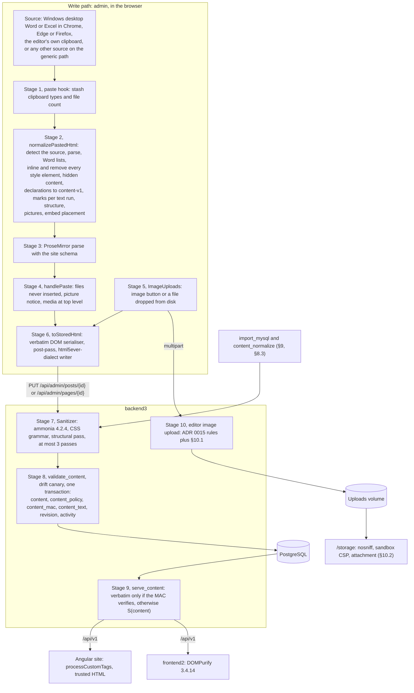
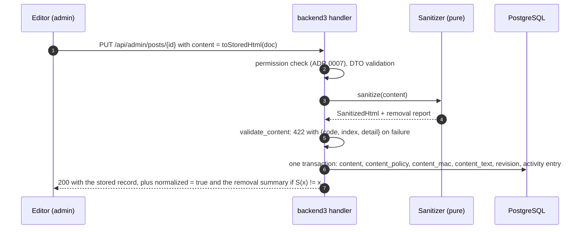

# Rich-text editor and content-v1

This is the implementable specification of backend3's rich-text pipeline. [ADR 0013](adr/0013-rich-text-editor-and-html-sanitiser.md) is the decision. When this document and the ADR disagree, the ADR wins ([ADR 0001](adr/0001-record-architecture-decisions.md#5-the-source-of-truth-and-precedence)).

It covers:

- **content-v1**, the one stored HTML dialect;
- the TipTap schema;
- the Office paste filter;
- the stored-HTML serialiser;
- the server sanitiser;
- the integrity rule on read;
- the editor image upload and the `/storage` headers;
- the editor stylesheet and the preview;
- the import rules;
- the test plan.

The text adapts the private editor design and its research files (research: editor design), checked on 2026-10-24. Names, paths and numbers follow the accepted ADRs.

Counts marked **[500]** come from the 500-post and 24-page harvest of the public API, as in [data-migration.md](data-migration.md). The importer re-takes every count on the real dump. Hungarian strings in this document are indicative. The final wording lives in the message file ([ADR 0021](adr/0021-hungarian-only-admin-ui.md), `editor.*` keys).

## Contents

1. [Scope](#1-scope)
2. [Pipeline](#2-pipeline)
3. [content-v1](#3-content-v1)
4. [TipTap schema](#4-tiptap-schema)
5. [Paste pipeline](#5-paste-pipeline)
6. [Stored-HTML serialiser](#6-stored-html-serialiser)
7. [Server sanitiser](#7-server-sanitiser)
8. [Integrity and the read path](#8-integrity-and-the-read-path)
9. [Import normalisation to content-v1](#9-import-normalisation-to-content-v1)
10. [Uploads and /storage](#10-uploads-and-storage)
11. [Editor stylesheet](#11-editor-stylesheet)
12. [Preview and revision view](#12-preview-and-revision-view)
13. [Test plan](#13-test-plan)
14. [Risks](#14-risks)
15. [Later work](#15-later-work)
16. [Open items](#16-open-items)
17. [References](#17-references)

## 1. Scope

### 1.1 Requirements

| Id | Requirement | Source (research: DECISIONS) | Where |
|---|---|---|---|
| R1 | Extended TipTap 3, open-source extensions only. Any paid one is named. | 15 | §4 |
| R2 | Paste from Microsoft Excel and Word keeps its styling. v1 scope: Windows desktop Word and Excel pasted into Chrome, Edge or Firefox. | 15, 15e | §5 |
| R3 | Tables with custom cell styles | 15 | §3.3, §4.3 |
| R4 | Text alignment | 15 | §4.3 |
| R5 | YouTube, including bare iframes | 15 | §4.3 |
| R6 | A padlet iframe node | 15 | §4.3 |
| R7 | Image sizes | 15 | §4.3 |
| R8 | Real uploads, never base64 | 15 | §5.4, §10.1 |
| R9 | Mandatory alt text | 15 | §4.5, §7.6 |
| R10 | No raw HTML view | 15 | the sanitiser is the only way HTML gets in |
| R11 | Server ammonia allow-list on every write. Iframes only from YouTube, youtube-nocookie and padlet embeds. | 15 | §7 |
| R12 | The editor surface looks like website_frontend2's PageRenderer. Tables, images and embeds lay out identically on both public sites. | 15, 15a | §3.7, §11 |
| R13 | The import normalises old bodies to content-v1. After it, load then save changes no byte. Originals are kept as revisions. | 15b, 19 | §9 |
| R14 | Pasted text colour, highlight and font size (relative to the body size) are kept. Font family is dropped. | 15c | §5.6 |
| R15 | Pictures from outside sources are never pasted, and a notice names the image button. Images copied or cut inside the editor paste normally. A file dropped from disk is uploaded. | 15d, 15f | §5.3, §5.4 |
| R16 | No file under `/storage` runs script on the one backend3 host or on the public hosts | 15g, 16 | §10.2 |

### 1.2 Derived requirements

| Id | Requirement |
|---|---|
| D1 | A stored body renders with the same layout on the live Angular site and on website_frontend2 at its snapshot, without changing either renderer. "Layout" means the box sizes and positions of paragraphs, tables, cells, images and embeds. Typographic differences that only renderer CSS can fix are documented (§11.4). |
| D2 | The server sanitiser is the barrier in front of both renderers. It runs on every write, and on every read of a row that backend3 did not provably write (§8). No code path hands bytes that the sanitiser did not produce to a renderer or to the editor. |
| D3 | Editor output is inside the allow-list. The sanitiser is the identity on editor output. The import produces editor fixed points. |
| D4 | No file under `/storage` can run script in an origin that serves it (§10.2). |
| D5 | Revision bytes, legacy bytes and preview bytes are never rendered raw in the admin origin (§12). |
| D6 | Modules that talk to external systems take their dependencies as arguments: `uploadImage`, `notify` and `policy` on the client, `SanitizePolicy` and the key ring on the server ([ADR 0008](adr/0008-code-layout-a-pure-src-domain-beside-loco-models.md)). Errors at boundaries tell the operator what to fix, in Hungarian in the UI. |

### 1.3 Non-goals

| Not built | Why |
|---|---|
| DOCX file import | The only option is paid (Tiptap Conversion). |
| An HTML source view | R10 |
| Column drag-resizing | Widths come from pastes and the cell dialog. Resizing would add a colgroup that breaks D1. |
| Pasting pictures from outside sources | 15d |
| Paste fidelity for Office setups other than Windows desktop Word and Excel in Chrome, Edge or Firefox | 15e. Later work, §15.1. |
| Legacy node variants for old content | 15b |
| Images inside tables, links, lists, quotes or headings, and floated images | None of these renders the same on Angular (§4.2, §9). |
| Embed hosts other than YouTube and Padlet | R11 |
| Dark mode inside content, collaborative editing | Neither site has them. |
| Changes to either public renderer | Recommended in §15.2, never required. |
| Fetching remote images on the server | Pasted pictures are never fetched (15d). |
| Resizing images | Uploads are optimised, never resized (research: DECISIONS 27). |

## 2. Pipeline



| Stage | Module (proposed path) | Input and output | Invariant, and the test that holds it |
|---|---|---|---|
| 1 | `admin/src/rich-text/extensions/office-paste.ts`, `handleDOMEvents.paste` | a `ClipboardEvent`; stashes `{types, fileCount}` in extension storage | Never consumes the event. Never reads `text/rtf`. |
| 2 | `admin/src/rich-text/paste/normalize-pasted-html.ts` | HTML string to `{html, source, report}` | Pure, synchronous, never throws. The output holds only content-v1 tags, attributes and properties, no `<style>`, and no picture from an outside source (P-paste, §13.5). |
| 3 | ProseMirror with `siteExtensions()` parse rules | HTML to a `Slice` | Parse rules read styles from the raw `style` attribute (`readStyleDecls`), never through `element.style`, so jsdom and every browser agree. |
| 4 | `office-paste.ts`, `handlePaste` | `Slice` to an inserted slice, plus the notice | `clipboardData.files` is never inserted. Images and embeds land at the top level. |
| 5 | `admin/src/rich-text/extensions/image-uploads.ts` | a `File` from the image button or a drop, to a pending `SiteImage`, to an uploaded `src` | Never fed from a paste. The pending count blocks the save. The client's type check is for faster feedback only. |
| 6 | `admin/src/rich-text/serialize/to-stored-html.ts` | ProseMirror document to a canonical string | `toStoredHtml(load(z)) == z` for every canonical `z` (P-fix, §13.4) |
| 7 | `src/domain/rich_text/` | string to `SanitizedHtml` plus a removal report | `S(S(x)) == S(x)`; `S(e) == e` for editor output `e`; the same bytes in every process (§7) |
| 8 | the content write service in `src/models/` (posts, pages) | `SanitizedHtml` to a row | One transaction ([ADR 0011](adr/0011-safety-net-soft-delete-revisions-and-an-activity-log-for-eve.md)). Only this service writes `content_policy` and `content_mac`. |
| 9 | `src/domain/rich_text/integrity.rs` and `serve_content`, used by every handler that returns `content` | row to response body | Verbatim if and only if the tag verifies and the policy is current; otherwise `S(content)`; never raw bytes (P7) |
| 10 | the editor image endpoint and `src/models/media.rs` ([ADR 0008](adr/0008-code-layout-a-pure-src-domain-beside-loco-models.md)) | multipart file to `/storage/uploads/…` | §10.1 (P8). The response headers of §10.2 hold on all three hosts (P9). |

## 3. content-v1

content-v1 is the only HTML that backend3 stores. It is defined as data in `src/domain/rich_text/policy.rs` and exported as `policy.json` (§3.9). `POLICY_VERSION` is `"content-v1"`. Any change to this section is a policy change: it bumps the version, ships with a `content_normalize` run (§8.3), and needs an ADR when it changes a decision of ADR 0013.

### 3.1 Canonical style string

There is one spelling for each visual result.

1. **Shorthands are expanded before sorting.** Property names are lower-cased. `border`, `border-width`, `border-style`, `border-color` and `border-<side>` are resolved in source order, with CSS cascade semantics, into four per-side triples. A single-colour `background` becomes `background-color`. No shorthand survives, so alphabetical order cannot change the cascade.
2. **Border sides.** A side whose style is `none` or missing is written as `none`. That covers the corpus' 9,782 `medium` sides and the 70 `medium`/`none`/`currentcolor` triplets **[500]**, all of which render as no border. Any other side is written `<width>px <style> <colour>`. `thin`, `medium` and `thick` become 1, 3 and 5 px. A missing colour becomes `currentcolor`. `hidden` stays `hidden`.
3. **Colours** become lower-case `#rrggbb`, or `#rrggbbaa` when the alpha is below 1. Named colours become hex (`black` to `#000000`, `whitesmoke` to `#f5f5f5`), and so do `rgb()` and `rgba()`. `windowtext` becomes `#000000`. `transparent` and `currentcolor` are kept, except where §3.3 forbids them (`span` `color`).
4. **Lengths** are px, with at most 2 decimals and trailing zeros removed. `pt` is ×4/3, `cm` ×96/2.54 (`1.0cm` becomes `37.8px`), `in` ×96, plus `mm`, `pc` and `q`. `%` is accepted only where §3.3 lists it. Negative values are rejected. A **locked** value is compared after this normalisation (so `0px auto` matches `0 auto`) and is always written in its one spelling.
5. **Order and syntax.** Declarations are sorted alphabetically by property and written `prop: value`, joined with `; `, with no trailing `;`. The last occurrence of a property wins. `!important` is stripped. An empty result removes the `style` attribute.
6. **Alphabet guard (server).** The output may contain only `a-z`, `0-9`, space and `# . % : ; / -`. `/` exists only for `aspect-ratio: 16 / 9`. A CSS comment needs `*` and `url(` needs `(`, so neither can appear. An output outside the alphabet is a bug: the attribute is dropped and an error is logged.

The admin's `canonicalStyle` (TypeScript) and the server's grammar (Rust) are the same rules written twice. Both must match every line of `css-vectors.jsonl`, which the Rust side generates (§13.6).

### 3.2 Elements and attributes

Attributes are written in the order listed. The editor's serialiser and the server's structural pass both enforce that order (§6, §7.5).

| Element | Attributes, in canonical order | Value rules |
|---|---|---|
| `p` | `style`, `data-youtube-video`, `data-padlet-embed` | `style` per §3.3. The two data attributes mark embed wrappers, and their value is always `""`. |
| `h1`, `h2`, `h3`, `h4` | `style` | `text-align` only. The toolbar offers H2-H4. `h1` exists for the legacy bodies that use it (33 **[500]**). |
| `strong`, `em`, `u`, `s`, `sub`, `sup`, `br`, `hr`, `blockquote`, `li`, `tr` | none | A `sub` or `sup` inside another `sub` or `sup` is unwrapped (§7.5). |
| `tbody` | `style` | locked (§3.3) |
| `span` | `style` | §3.3 |
| `ul` | `style` | §3.3 |
| `ol` | `start`, `type` | `start`: a non-negative integer of at most 4 digits; `1` is omitted. `type`: `a`, `A`, `i` or `I`; `1` is omitted. |
| `a` | `href`, `target`, `rel` | `href` per §3.6. `target` is forced to `_blank`. `rel` is always `noopener noreferrer` and always last. |
| `img` | `src`, `alt`, `width`, `height`, `style` | `src` per §3.6. `alt` is text. `width` and `height` are integers from 1 to 5000. |
| `table` | `style` | locked (§3.3) |
| `td`, `th` | `colspan`, `rowspan`, `style` | `colspan` 2-1000 and `rowspan` 2-65534; `1` is omitted. |
| `iframe` | `src`, `width`, `height`, `title`, `style`, `allow`, `allowfullscreen`, `referrerpolicy` | `src` per §3.6. `width` is an integer from 1 to 4000, or `100%`. `height` is an integer from 1 to 4000. `title` is text. `allow`, `allowfullscreen` and `referrerpolicy` are forced to their canonical values below. An `iframe` has no child nodes (§7.5). |

The canonical iframe values:

| Attribute | Value |
|---|---|
| `allow` | `accelerometer; autoplay; clipboard-write; encrypted-media; gyroscope; picture-in-picture; web-share` |
| `allowfullscreen` | `""` |
| `referrerpolicy` | `strict-origin-when-cross-origin` |

`frameborder` is not stored. Both sites already reset borders with `* { margin: 0; padding: 0; border: 0 }`, and the editor's stylesheet does the same.

Never stored on any element: `class`, `id`, `name`, `lang`, `dir`, `title` (except on `iframe`), `aria-*`, `role`, `on*`, `srcset`, `sizes`, `srcdoc`, and every `data-*` attribute other than the two embed markers.

### 3.3 CSS properties per element

"Locked" means exactly one canonical value is accepted. Locked declarations cannot be used to restyle the page, and they exist only to make the layout identical on both renderers. Corpus counts are declarations **[500]**.

| Element | Property | Accepted input, and its canonical output | Corpus | Status |
|---|---|---|---:|---|
| `td`, `th` | `border-top`, `border-right`, `border-bottom`, `border-left` | `none`, `hidden`, or at most 3 components: a width from 0 to 20 px, a style (`solid`, `dashed`, `dotted`, `double`, `groove`, `ridge`, `inset`, `outset`, `none`, `hidden`) and a colour. Output per §3.1 rule 2. | 8,924 each, in 62 documents | kept |
| `td`, `th` | `border`, `border-width`, `border-style`, `border-color` | input only, expanded into the four sides | 70 × 3 | input only |
| `td`, `th` | `vertical-align` | `top`, `middle`, `bottom`, `baseline` | 8,522 | kept |
| `td`, `th` | `white-space` | `nowrap`, `normal` | 6,214 | kept |
| `td`, `th` | `width` | px from 1 to 2000. **`%` is not accepted**: the two renderers resolve it differently. The paste filter converts Word `%` widths to px (§5.2 step 8). | 5,173, plus 123 invalid `100%px`, which are dropped | kept |
| `td`, `th` | `height` | px from 1 to 2000 | 3,365 | kept |
| `td`, `th` | `box-sizing` | **locked** `content-box`. Present if and only if `width` or `height` is present: the canonicaliser and the sanitiser add it then and remove it otherwise. Angular has no `box-sizing` reset and frontend2 sets `border-box`, so a 64 px cell measured 75 px on one site and 64 px on the other. `content-box` keeps today's live geometry. | 0 | new |
| `td`, `th` | `text-align` | `left`, `center`, `right`, `justify` | 3,089 | kept |
| `td`, `th` | `background-color` (and a single-colour `background`) | a colour | 182 | kept |
| `table` | `border-collapse` | **locked** `collapse`, always present | 85 | kept |
| `table` | `max-width` | **locked** `fit-content`, always present | 0 | new |
| `tbody` | `display` | **locked** `table-row-group`, always present | 0 | new |
| `p`, `h1`-`h4` | `text-align` | `left`, `center`, `right`, `justify` | 12, plus 23 `p[align]` and 9 `<center>` that the import converts | kept |
| `ul` | `list-style-type` | `circle`, `square` (`disc` is the default and is omitted) | 8 | kept |
| `span` | `color` | a colour, **opaque only**: `transparent`, `currentcolor` and any alpha below 1 are rejected. The paste filter drops black. | 0 | new |
| `span` | `background-color` (and a single-colour `background`) | a colour | 0 | new |
| `span` | `font-size` | `em` from 0.5 to 3. Dropped on a span that has an ancestor span with `font-size`, so the bound cannot compound (§7.5). | 0 | new (15c) |
| `img` | `width` | px from 1 to 2000. The editor's presets stop at 700. Legacy widths are kept (53 are wider than 700 px). | 103 | kept |
| `img` | `display`, `height`, `margin`, `max-width` | **locked** `block`, `auto`, `0 auto`, `100%`, always present | 0 (103 legacy `height: Npx` become `auto`) | new |
| `iframe` | `width` | **locked** `100%` | 7 | new |
| `iframe` | `max-width` | px from 200 to 1280 | 0 | new (YouTube: 640) |
| `iframe` | `height` | `auto`, or px from 100 to 2000 | 7 | new (Padlet: 608) |
| `iframe` | `aspect-ratio` | **locked** `16 / 9` | 0 | new (YouTube) |

Why this list:

- **It covers the corpus.** 11 properties make up 99.6 % of the 62,935 stored declarations, and all 11 are on `td` and `table`. Every one of them is kept.
- **It covers new pastes.** The corpus has no `color`, `font-size` or `font-family`, only because the legacy editor build loaded no font or colour plugin. Word and Excel do send colour, size and highlight. Keeping them on spans is what makes "keep the styling" true for new pastes (15c).
- **Inline styles reach the readers.** They survive both renderers untouched. Across the 524 documents **[500]**, DOMPurify removed 0 style attributes. So this list, not the sites' own sanitisers, decides what readers see.

### 3.4 Rejected properties

| Property | Corpus | Emitted by | Why it is rejected |
|---|---:|---|---|
| `font-family`, `font` | 0 | Word and Excel, always | Renders only where Office fonts are installed, and overrides the site's typography (15c). |
| `font-weight`, `font-style`, `text-decoration`, `color`, `font-size` on `td`, `th` or a block | 2 (`h2` `font-style`) | Excel classes | They become marks inside the cell. TipTap's style parse rules read them on any element, so cell typography would never be a fixed point. The import turns `h2` with `font-style: italic` into `<h2><em>`. |
| `padding` and its sides | 0 | Word cells, Excel's `td { padding: 1px }` | The sites pad cells by 5 px. |
| `margin` (except the locked `img` value), `text-indent`, `line-height` | 7 (an embed wrapper `div`) | Word's `MsoNormal` | They break the sites' 700 px column centring. |
| `float` | 4 on `img`, plus 3 `img.left` | the legacy editor | Not layout-safe: Angular floats inside the 1000 px article, frontend2 inside the 700 px column. The import centres these images. |
| `position` (12), `top` and `left` (12), `padding-bottom` (6), `max-width` on `div` (7), `border` on `iframe` (7) | | legacy embed wrappers | Replaced by the canonical embed (§9, N1). |
| `width` and `min-width` on `table`; `col` and `colgroup` | 82, 0 | Excel, stock TipTap | Measured to break the layout match between the sites (§11.4). Widths live on cells. |
| `display`, `visibility` (except the locked values) | 0 | hidden Excel rows | Hidden rows are dropped at paste. |
| `background-image`, `list-style*` (except `list-style-type` on `ul`), `border-image`, `url()`, `var()`, `calc()`, `expression()`, `attr()`, `behavior`, `-moz-binding`, `mso-*`, `-webkit-*`, `--*` | 0 | web pages, Office noise | Exfiltration and tracking (`https:` `url()` would survive ammonia's own style filter), legacy script vectors, noise. |

### 3.5 Removed, unwrapped and forbidden elements

| Class | Elements | Behaviour |
|---|---|---|
| Removed together with their content | `script`, `style`, `title`, `xml`, `template`, `noscript`, `noembed`, `noframes`, `object`, `embed`, `applet`, `svg`, `math`, `textarea`, `select`, `button`, `marquee`, `video`, `audio`, `canvas`, `frameset`, `frame` | ammonia `clean_content_tags`. These are executable or raw-text content, Word's `<xml>` metadata (whose text would otherwise leak), the SVG and MathML namespace surface, and form controls. `button` and `marquee` are paragraph-scope boundaries: unwrapping them could leave a `<p>` inside a `<p>`. |
| Never in the tag list | `noscript`, `template`, `style`, `script`, `xmp`, `noembed`, `noframes`, `plaintext`, `textarea`, `title`, `listing`, `select`, `option` | A manifest CI guard fails if any of them enters the tag list (§13.6). Their parsing depends on the scripting flag, on raw text or on quirks mode, which is exactly what differs along the live sink chain (§7.5). `iframe` is the only raw-text element allowed, and it stays childless. |
| Unwrapped, text kept | everything else: `div`, `center`, `font`, `b`, `i`, `mark`, `code`, `pre`, `thead`, `tfoot`, `caption`, `colgroup`, `col`, `h5`, `h6`, `o:p`, … | The editor never emits them. The import maps the ones whose meaning matters before it sanitises (`b`, `i`, `thead`, `caption`, `h5`, `h6`, `center`; §9). Unwrapping `thead` or `caption` can leave HTML that re-parses differently, and the fixed-point loop absorbs that (pass 2 is stable). |

### 3.6 URL rules

| Attribute | Rule |
|---|---|
| `img[src]` | After WHATWG parsing and dot-segment normalisation: a root-relative path that starts with `/storage/uploads/`, with no query and no fragment, whose last segment ends in `.jpg`, `.jpeg`, `.png`, `.gif` or `.webp` (any case). Absolute URLs on backend3's own hosts (`verseghy-gimnazium.net`, `backend.microshift.verseghy-gimnazium.net`, `backend3.microshift.verseghy-gimnazium.net`, and the retired `backend.verseghy-gimnazium.net`) are rewritten to root-relative. `data:`, `blob:`, `file:`, `cid:` and every other host are dropped, and an admin write is rejected with `image_src_rejected`. The characters are not restricted beyond what the `url` crate serialises, because 9 legacy image paths contain `(` and `)`. All 74 distinct legacy `/storage` image sources pass. An `img` left without `src` is removed (§7.5). |
| `a[href]` | `http`, `https`, `mailto` and `tel`, plus relative URLs that resolve to the page's own origin. A custom same-origin check rejects `//host`, `/\host` and tab- or newline-obfuscated forms, which the `url` crate classifies as relative. `#fragment` links are allowed. **Rejected:** a link that resolves to `/storage/…` on an own host (relative included) whose last segment ends in `.svg`, `.svgz`, `.htm`, `.html`, `.xhtml`, `.xht`, `.xml`, `.xsl` or `.xslt`. The corpus has 0 such links. |
| `iframe[src]` | `https` only. The host is exactly `www.youtube.com`, `www.youtube-nocookie.com` or `padlet.com`, with no user info and no port. The path is `/embed/<id>`, where the id matches `[A-Za-z0-9_-]+`. A YouTube URL may carry only `start=<integer>` and `list=<[A-Za-z0-9_-]+>` in its query, in that order. A Padlet URL has no query. No fragment. The editor always writes `www.youtube-nocookie.com`. |

ammonia's same-origin check for relative URLs runs after `attribute_filter`, and the filter's output is never checked against the scheme list again. The rules above are safe under that order: `image_src` returns a root-relative path, `embed_src` returns an `https` URL, and `a[href]` is returned unchanged. The P0 oracle re-checks every rule on the output anyway (§13.6).

### 3.7 Canonical shapes

These are the shapes that the editor, the paste filter and the import emit. The sanitiser accepts them unchanged.

**Paragraphs, headings, lists and quotes.**

```html
<h2 style="text-align: center">Eredmények</h2>
<p>Szöveg <strong>félkövér</strong>, <span style="color: #c00000; font-size: 1.25em">piros és nagy</span>.</p>
<ol start="5" type="a"><li>első</li><li><p>két</p><p>bekezdés</p></li></ol>
<ul style="list-style-type: circle"><li>pont</li></ul>
<blockquote>Egy bekezdéses idézet</blockquote>
```

**Tightening.** A lone paragraph without attributes is stored without its `<p>` when it is the only child of `td`, `th`, `blockquote` or `li`, or the first child of an `li` whose other children are all lists. A lone cell paragraph whose only attribute is `style="text-align: …"` is tightened too, and the declaration moves to the cell. TipTap re-wraps such text in a paragraph on load. Without tightening, frontend2 would wrap every `nowrap` cell and add 21 px under every list item.

**Table.** The cell styles come from an Excel paste:

```html
<table style="border-collapse: collapse; max-width: fit-content"><tbody style="display: table-row-group"><tr><td colspan="2" style="background-color: #d9d9d9; border-bottom: 1px solid #000000; border-left: none; border-right: 1px solid #000000; border-top: 1px solid #000000; box-sizing: content-box; height: 20px; text-align: center; vertical-align: middle; white-space: nowrap; width: 128px"><strong>Eredmény</strong></td></tr></tbody></table>
```

There is no table width, no `colgroup`, no `thead` and no `caption`. Header cells are `th` inside `tbody`. Measured in Chrome 156, this shape gives identical table geometry on the live Angular article and on the frontend2 replica at a 1280 px window: a 579 px table, centred, with cells of 383 and 176 px (research: editor design §4.3).

**Image.** Always a paragraph of its own, at the top level:

```html
<p></p>
```

`width` and `height` are the natural pixel size scaled to the display width, so the aspect ratio is known before the image loads. Angular moves the `img` in front of its paragraph and sets `max-width` from the inline width. frontend2 keeps it in place. With this shape both give the same box.

**YouTube.**

```html
<p data-youtube-video=""><iframe src="https://www.youtube-nocookie.com/embed/VIDEOID?start=30" width="640" height="360" title="Videó" style="aspect-ratio: 16 / 9; height: auto; max-width: 640px; width: 100%" allow="accelerometer; autoplay; clipboard-write; encrypted-media; gyroscope; picture-in-picture; web-share" allowfullscreen="" referrerpolicy="strict-origin-when-cross-origin"></iframe></p>
```

The id matches `[A-Za-z0-9_-]{6,20}`. Query parameters other than `start` and `list` (for example `si`, `rel`, `feature`) are dropped by the editor.

**Padlet.**

```html
<p data-padlet-embed=""><iframe src="https://padlet.com/embed/KEY" width="100%" height="608" title="Padlet" style="height: 608px; width: 100%" allow="accelerometer; autoplay; clipboard-write; encrypted-media; gyroscope; picture-in-picture; web-share" allowfullscreen="" referrerpolicy="strict-origin-when-cross-origin"></iframe></p>
```

**Link.**

```html
<a href="https://example.org/" target="_blank" rel="noopener noreferrer">link</a>
```

### 3.8 Serialisation dialect and whitespace

The stored string is what html5ever 0.40.1 writes, so the server's re-serialisation is byte-identical (html5ever@0.40.1:src/serialize/mod.rs, `write_escaped`):

- In text, only `&`, `<`, `>` and U+00A0 are escaped (`&amp;`, `&lt;`, `&gt;`, `&nbsp;`).
- In attributes, `&`, `"`, `<`, `>` and U+00A0 are escaped.
- Every other character is literal UTF-8. No other named entity remains.
- Attribute values are always double-quoted. An empty value is written `=""`. Void elements get no slash.
- There are no comments and no whitespace-only text nodes between block elements.
- **Whitespace inside textblocks.** Collapsible ASCII whitespace (space, tab, LF, CR, FF) is stripped at the start of a textblock, at its end and directly after a `<br>`. Each inner run is written as one space when it is one character long, and otherwise as (n − 1) U+00A0 followed by one space. This equals what prosemirror-model 1.25.12 keeps on the next load (`from_dom.ts`, `addTextNode` and `finish`). Without it, a paragraph split at an image or embed, or two typed spaces, would not be a fixed point.

### 3.9 The policy manifest

- `cargo loco task rich_text_manifest` writes two files from the Rust policy:
  - `policy.json`: the tags, the attributes per tag with their value rules, the CSS properties per element with their grammar and locked values, the URL rules, the embed providers, the forbidden-tag list and `POLICY_VERSION`;
  - `css-vectors.jsonl`: one line per test case, `{element, input, output}`, where `output` is the canonical string or `null` for a rejected declaration.
- Both are committed under `admin/src/rich-text/`. The admin's paste filter, `canonicalStyle` and the custom TipTap attributes import `policy.json`.
- CI fails if the committed copies differ from the task's output ([ADR 0022](adr/0022-builds-and-ci-pac-for-production-images-github-actions-for-p.md)).

## 4. TipTap schema

### 4.1 Packages and pins

- Every `@tiptap/*` package is **3.32.0** (MIT, published 2026-10-13): `core`, `react`, `pm`, `starter-kit`, `extension-document` (for `Document.extend`, §4.2; StarterKit does not re-export it), `extensions` (Placeholder, §4.3 row 14), `extension-table`, `extension-text-style`, `extension-text-align`, `extension-list`, `extension-link`, `extension-subscript`, `extension-superscript`.
- They sit on prosemirror-view 1.42.7, prosemirror-model 1.25.12 and prosemirror-tables 1.8.5, all MIT, through `@tiptap/pm`. `@tiptap/pm` only requires caret ranges (`^1.42.6`, `^1.25.12`, `^1.8.5`), so these three are pinned exactly through the package manager's overrides and the lockfile.
- Versions are pinned exactly. A Renovate or Dependabot PR for `@tiptap/*` or `prosemirror-*` must pass the private corpus job (§13.4), because the serialiser relies on a prosemirror-model internal (§6) and the paste filter relies on prosemirror-view's paste order (§5.1).

### 4.2 Document and the media group

- `Document.extend({ content: '(block | media)+' })`, with StarterKit's own document switched off.
- `SiteImage`, `YoutubeEmbed` and `PadletEmbed` are in the group **`media`**. That makes them legal only at the top level: never in a cell, list item, quote, heading or link. Toolbar buttons use `editor.can()` and disable themselves elsewhere.
- The reason is Angular's `processCustomTags`. It moves every `` in front of its parent element. An image in a link loses the link, an image in a cell is moved above the table, and an image directly in the article jumps to its top (website_frontend@f74c765:apps/frontend/src/app/modules/shared/components/page-renderer/page-renderer.component.ts).

### 4.3 Extensions and custom attributes

| # | Extension | Configuration | Parse rules | Canonical output |
|---|---|---|---|---|
| 1 | `StarterKit` | `document: false`, `code: false`, `codeBlock: false`, `trailingNode: false` (otherwise `<p></p>` is appended after every final table), `heading: { levels: [1, 2, 3, 4] }`. **No `HTMLAttributes.class` anywhere**: the kit's `text-node`, `heading-node`, `list-node`, `block-node` and `link` classes would be serialised into storage. | stock | `p`, `h1`-`h4`, `strong`, `em`, `u`, `s`, `br`, `hr`, `blockquote`, `ul`, `ol`, `li` |
| 1a | Heading | Levels 1-4. Heading's parse rules map only the configured levels, so `h1` must stay in the list or a legacy `h1` would become a paragraph. The paste filter maps Word's `h1` to `h2`, `h2` to `h3`, and `h3` and below to `h4`. | stock | `<h2 style="text-align: center">` |
| 1b | Link | `openOnClick: false`. `autolink: true` applies to typing only: the load transaction carries `preventAutolink`. Protocols http, https, mailto and tel. `isAllowedUri` also accepts relative URLs and `#`. `HTMLAttributes: { target: '_blank', rel: 'noopener noreferrer', class: null }`. | stock | `<a href="…" target="_blank" rel="noopener noreferrer">`, `rel` always last |
| 1c | OrderedList | Stock `start` and `type` attributes. 3.32 parses `type` from the `type` attribute, from `list-style-type` on the `ol`, or from the first `li`. It renders `type` only when it is not `1`, and `start` only when it is not 1. In the **editor view only**, a node decoration adds `data-vfg-list-type` (`lower-alpha`, `upper-alpha`, `lower-roman`, `upper-roman`), which the stylesheet maps to `list-style-type` after its reset (§11.2). `toStoredHtml` serialises the document, not the view, so the decoration is never stored. | stock | `<ol start="5" type="a">` |
| 1d | BulletList | `.extend` with the attribute `listStyleType`, `circle` or `square` (`disc` is the default and becomes `null`), read by the raw style reader | adds `ul[style]` | `<ul style="list-style-type: circle">` |
| 2 | `TextAlign` | `types: ['paragraph', 'heading']`, `alignments: ['left', 'center', 'right', 'justify']`, `defaultAlignment: null`. `parseHTML` is overridden to use the raw style reader instead of `element.style.textAlign`. When the selection is a cell selection or sits in a cell, the toolbar's align command sets the cell's `textAlign` and clears the paragraph's, so the cell stays tight (§3.7). | — | `style="text-align: justify"` |
| 3 | `Underline` (in StarterKit), `Subscript` and `Superscript` (separate packages, added explicitly) | `Subscript.extend({ excludes: 'superscript' })` and `Superscript.extend({ excludes: 'subscript' })`. The stock 3.32.0 marks set no `excludes`, so toggling both on one run would store `<sub><sup>2</sup></sub>`, which the server's structural pass rewrites. With `excludes`, the mark applied last (or parsed innermost) wins. | stock | `u`, `sub`, `sup` |
| 4 | `TextStyleKit` (`@tiptap/extension-text-style`) | `fontFamily: false`, `lineHeight: false`. `color` and `backgroundColor` get a `parseHTML` override that sends the value through `canonicalStyle` (hex only, so `var()` is rejected and the kit's `var(--mt-accent-…)` palette is replaced by literal hex). `fontSize` is kept only as `em` from 0.5 to 3 (15c). `mergeNestedSpanStyles` stays on. | `span[style]` | `<span style="background-color: #ffff00; color: #c00000; font-size: 1.82em">` |
| 5 | `Table` | `.extend`: `resizable: false`, `renderWrapper: false`, **`View: null`**. In 3.32, `addNodeView` installs its table view even when the table is not resizable, and that view writes a colgroup and `min-width`. With `View: null` the editor shows our `renderHTML`, which is the public shape. `renderHTML` is overridden, because the stock one always writes a colgroup and `width` or `min-width`. | `table` | `<table style="border-collapse: collapse; max-width: fit-content"><tbody style="display: table-row-group">…</tbody></table>` |
| 6 | `TableRow` | stock | `tr` | `<tr>` |
| 7 | `TableCell`, `TableHeader` | `.extend` with the attributes `backgroundColor`, `borderTop`, `borderRight`, `borderBottom`, `borderLeft`, `height`, `textAlign` (replaces the parent's `align`, which lacks `justify`: 17 cells **[500]**), `verticalAlign`, `whiteSpace` and `width` (px only). All are parsed from one memoised `readCellDecls(el)`, which reads the raw `style` plus the `align`, `valign`, `bgcolor`, `width` and `height` attributes and returns canonical declarations. `colspan` and `rowspan` come from the parent (`1` omitted). `colwidth` is `rendered: false`. Each attribute has `renderHTML: () => ({})`, and a node-level `renderHTML` builds one sorted style string, so the order in which attributes are registered cannot change the bytes. It adds `box-sizing: content-box` whenever `width` or `height` is set. | `td`, `th` | see §3.7 |
| 8 | **`SiteImage`** (own node; nothing reused from the stock Image) | `group: 'media'`, `atom`, `draggable`. Attributes: `src` (required), `alt` (`null` means missing), `displayWidth` (px), `ratio` (height over width, from the natural size or a legacy style), `uploadState` (`pending` or `failed`; not rendered) and `localKey` (not rendered). React node view through `ReactNodeViewRenderer(SiteImageView, { as: 'p' })`, so the wrapper is a `p` and gets the paragraph margins of the stored `<p></p>`. Inside it the view renders phrasing elements only: `NodeViewWrapper as="span"`, plus `span`, `button` and `img`, with dialogs portalled out. The chrome carries `data-vfg-ui` (§11.2): upload progress, the red „Alt szöveg hiányzik” badge, the alt dialog, size presets of **175, 350, 525 and 700 px** (a quarter to the whole 700 px column), and a drag handle clamped to 50-700 px. | ① a `p` whose only content is one `img[src]`, optionally inside one `a`, `strong`, `em` or `span` chain, which is dropped and reported (priority 60); ② `img[src]` (priority 50), a fallback only. A paste brings no outside picture (§5.3), and the import moves legacy images out of cells, lists, quotes, headings and links (§9), because ProseMirror's own placement would cut a table or list in two around the image. | §3.7 |
| 9 | **`YoutubeEmbed`** (own node; the stock YouTube extension writes about 12 option attributes and parses only its own wrapper) | `group: 'media'`, `atom`. Attributes: `videoId` (`[A-Za-z0-9_-]{6,20}`), `start` (integer or null), `list` (playlist id or null), `title`. An insert dialog, plus a paste rule for a lone URL: watch, `youtu.be`, shorts, embed and youtube-nocookie URLs, with or without `m.` or `music.`. | `p[data-youtube-video]` (70), `div[data-youtube-video]` (70, other TipTap installs), a `p` with one allowed iframe (65, legacy), a bare `iframe[src]` on an allowed host (60, YouTube's "Share, Embed" code) | §3.7 |
| 10 | **`PadletEmbed`** (own node) | `group: 'media'`, `atom`. Attributes: `key` (`[A-Za-z0-9_-]+`), `height` (px, default 608), `title`. The paste filter reduces Padlet's embed snippet (a wrapper `div` and a "Made with Padlet" link) to the iframe. The current snippet markup is unverified and must be captured as a fixture (§16). | `p[data-padlet-embed]`, a lone `iframe[src^="https://padlet.com/embed/"]` | §3.7 |
| 11 | **`OfficePaste`** (own extension; options `{ policy, notify }`) | Uses TipTap's extension-level `transformPastedHTML` (core 3.20 and later, chained) and a ProseMirror plugin with `handleDOMEvents.paste` and `handlePaste`. §5 is its specification. | — | — |
| 12 | **File drops** (own `handleDrop` in `ImageUploads`; neither the official `@tiptap/extension-file-handler` nor the kit's copy, which always base64-encodes) | §5.4. The 3.32.0 FileHandler consumes every drop that holds an allowed file before it calls `onDrop`, including a drop that also carries HTML (@tiptap/extension-file-handler@3.32.0:src/FileHandlePlugin.ts), so it cannot tell a dragged Word selection from a dropped file. | — | — |
| 13 | **`ImageUploads`** (own plugin; option `uploadImage(file): Promise<{src, width, height}>`) | Uploads only a `File` chosen in the image dialog or dropped from disk. An image picked from the media library is inserted with its existing `src`, which must pass the §3.6 image rule, and is not uploaded again. Nothing from a paste is ever uploaded. `setNodeMarkup(…, { addToHistory: false })` when an upload finishes. The pending count lives in the extension's storage. | — | — |
| 14 | UndoRedo, Dropcursor, Gapcursor, ListKeymap (StarterKit); Placeholder (the hint text of an empty editor) | stock | — | — |

`toStoredHtml` writes every element's attributes in the order of §3.2, so the stored order never depends on how TipTap merges attributes.

### 4.4 Not used, and what is paid

| Package | Licence | Used? |
|---|---|---|
| The `@tiptap/*` 3.32.0 packages of §4.1 | MIT | yes |
| `@tiptap/extension-youtube`, `-image`, `-highlight`, `-font-family`, `-typography`, `-code-block-lowlight`, `-file-handler`; Code; LineHeight | MIT | no. Own nodes replace YouTube, Image and FileHandler. A `span` `background-color` mark replaces Highlight. Typography's quote rules are English-style, while Hungarian uses „…”. |
| `@tiptap-pro/extension-paste-handler` (Word, Excel and Google paste) | **paid**: Tiptap Team plan and up, from a private registry (read 2026-10-24, research: editor design §7.2) | no |
| Tiptap Conversion (DOCX import and export) | **paid**: Start plan and up, in beta | no (DOCX import is a non-goal) |
| `@intevation/tiptap-extension-office-paste` 0.1.2 | MIT. Word lists only, no Excel, unmaintained since 2025-09. | no; reference only |
| CKEditor 5 `paste-from-office` 49.0.0 | GPL-2.0-or-later or commercial; version 49 marks it premium | no |
| TinyMCE PowerPaste | commercial | no |
| react-admin Enterprise `ra-history`, `ra-audit-log` | commercial | no ([ADR 0011](adr/0011-safety-net-soft-delete-revisions-and-an-activity-log-for-eve.md)) |

**Nothing in this design depends on a paid package.**

### 4.5 The admin input: `SiteRichTextInput`

The kit's `rich-text-input` block is forked at shadcn-admin-kit@c1503dd into `admin/src/components/site-rich-text/`. It is registry source code, so copy-and-own is the intended way to extend it. The fork keeps its MIT notice and gets a `THIRD_PARTY.md` row ([ADR 0012](adr/0012-delivery-review-commits-and-licensing.md) §4). It keeps the toolbar shell, the link bubble and the dialogs, and changes the following.

- **Loading.** The kit's `useMinimalTiptapEditor` is replaced. The kit's value-sync effect reloads with `preserveWhitespace: "full"` whenever `getHTML()` differs from the value, which is true for every legacy body. It turns source indentation into empty paragraphs (post 532: 12 to 24 `<p>`). The fork loads through `loadDocument(editor, html)`, which is `setContent` with default whitespace handling inside a chain that carries `preventAutolink`. It compares against `lastEmitted`, the last `toStoredHtml` output.
- **Updates.** `onUpdate` calls `field.onChange(toStoredHtml(editor.state.doc))`, throttled to about 150 ms. Bodies reach about 150 KB.
- **Validators**, through `useInput`'s `validate`, with Hungarian messages:
  - `requireImageAlt`: every `SiteImage` has an `alt` that is not empty after trimming;
  - `noPendingUploads`;
  - `noLegacyLoss`, the load-time loss guard: if the inventory of the stored body is not contained in the inventory of its canonical form, apart from the documented one-time normalisations, a banner names what would be lost and the save is blocked. This catches rows that were never imported or that were written through the API.
- **Toolbar** (Hungarian):
  - H2, H3, H4; bold, italic, underline, strike, sub and superscript;
  - text colour and highlight from a palette of literal hex values; font size presets 0.85, 1, 1.25, 1.5 and 2 em (15c);
  - align left, centre, right and justify (in a cell, the cell is aligned); bullet and numbered lists with type and start; quote, rule, link;
  - image (upload or media library), video (a YouTube URL), Padlet (a URL);
  - table: insert, add or remove a row or column, merge and split, header cell, cell fill, border presets (all, none, outer; `1px solid #000000`), vertical alignment, wrap toggle;
  - clear formatting.
- **Image button before the first save.** A post or page that has never been saved has no id and no upload folder. The image button's upload tab and file drops are disabled until the first save, with the hint „Képfeltöltés az első mentés után lehetséges.” ([ADR 0015](adr/0015-media-separate-static-server-media-library-image-optimisatio.md) §5). The media-library picker works at once.
- **Surface width.** The editing surface has a fixed `width: 960px`, frontend2's post box (15a), inside its own horizontally scrolling container. Line breaks and table widths therefore match frontend2's box at any window width. The kit's sidebar is 16 rem and the content column has `px-4`, which leaves at most 992 px at a 1280 px window. A „Teljes szélesség” toggle collapses the sidebar (`useSidebar().setOpen(false)`). The editor starts with the sidebar collapsed when the window is narrower than the surface, the sidebar and the padding together. That automatic collapse is undone when the editor unmounts, because `setOpen` also writes the kit's `sidebar_state` cookie.

## 5. Paste pipeline

### 5.1 Hooks and order

1. `handleDOMEvents.paste` stores the clipboard's `types` and the number of files, and returns `false`, so ProseMirror continues. It never reads `text/rtf`.
2. ProseMirror reads `text/html` and calls `transformPastedHTML`, which runs `normalizePastedHtml(html, { policy, createDocument })`.
3. prosemirror-view 1.42.7's `readHTML` runs its own `<style>` inliner. It finds nothing, because step 2 has removed every `<style>`. The schema's parse rules build the slice.
4. `handlePaste` applies the file and placement rules of §5.3 and shows the notices.

### 5.2 Steps of `normalizePastedHtml`

The filter runs on every HTML paste.

- **Source-specific rules** exist only for Windows desktop Word and Excel (15e). Every source that step 1 does not detect as Word or Excel desktop runs the same steps without the Word- and Excel-only rules (§5.5).
- **The editor's own clipboard.** For HTML that ProseMirror wrote (marked `data-pm-slice`), only steps 1, 3 and 8 to 12 (11a included) run, and step 9 keeps `em` sizes as they are. That HTML carries Chrome's CSSOM spelling (`rgb()`, grouped borders), which `canonicalStyle` reads back.

| # | Step | Rules |
|---|---|---|
| 1 | Detect the source | **Word desktop**: `xmlns:w="urn:schemas-microsoft-com:office:word"` or `<meta name=ProgId content=Word.Document>`. **Excel desktop**: `xmlns:x="urn:schemas-microsoft-com:office:excel"`. **The editor's own clipboard**: `data-pm-slice`. **Anything else: generic.** macOS Office writes the same dialect as Windows, so its HTML may be detected as Word or Excel desktop. That is best effort, not a supported setup. |
| 2 | Pre-clean the string | Cut everything after `</html>`. **Never slice on `<!--StartFragment-->`**: Excel desktop places it inside `<table>`. |
| 3 | Parse | `DOMParser` with `text/html` on the whole string. A `DOMParser` document runs no scripts and loads no images. |
| 4 | Stash Office-only CSS | Copy raw `mso-list`, `mso-highlight`, `mso-spacerun` and `mso-ignore` from the **raw** `style` attribute into `data-office-*` attributes before any CSSOM access, because CSSOM drops them. |
| 5 | Lists | Word paragraphs with `mso-list:lN levelM lfoK` become nested `ul` and `ol`. The list type comes from the raw `@list lN:levelM { mso-level-number-format }` rule. The bullet glyphs `·`, `o` and `§` map to disc, circle and square, and `mso-level-start-at` becomes `start`. The `span[style*="mso-list:Ignore"]` marker is deleted. The base is Quill 2.0.3's `msWord.js` (BSD-3-Clause, §13.1), extended with nesting and continuation. **Headings are never list items**: an `h1`-`h6`, or a `p` whose Word class maps to a heading, that carries `mso-list` stays a heading after the level shift. Its marker text (for example `1.`, with non-breaking and other whitespace collapsed) is prepended to the heading text with one space. TipTap's list item content is `paragraph block*`, so `ol > li > h2` would otherwise parse into empty items, drop the numbering and turn the next list into a `ul`. |
| 6 | Inline `<style>` | Collect the rules from the **whole** document, `<body>` included. Sort by specificity, then source order. Append the element's own `style` last. Normalise through a scratch element. Then **remove every `<style>`**, which makes prosemirror-view's inliner a no-op. |
| 7 | Hidden content | Remove elements whose effective style has `display: none` or `visibility: hidden`: hidden Excel rows and columns. |
| 8 | Declarations to content-v1 | Per element, keep only the §3.3 properties. Units become px. **Paste-time rounding**: widths and heights to whole px. **Borders**: from Excel desktop, its discrete weights map to Excel's on-screen widths instead of being rounded (`.5pt` thin to `1px`, `1.0pt` medium to `2px`, `1.5pt` thick to `3px`, `2.0pt double` or `2.25pt` to `3px`), so medium and thin stay different. From other sources, widths are ×4/3, rounded to whole px, at least 1 px. **Cell `%` widths** are resolved to px against the source table's width (`<table width=N>`, or a px `width` in the table's `style`, or else 700 px, the content column) before the table width is dropped. **Wrapping**: a Word cell, and on the generic path any cell without its own `white-space`, gets `white-space: normal`, so it wraps as in the source. Only Excel desktop cells rely on their explicit value or on the sites' `nowrap`. `windowtext`, `auto` and `currentcolor` text colours become `#000000`. `background` becomes `background-color`, `border` becomes four sides. Values equal to the source's base rule (Excel's `td {}`) are dropped, **except** `vertical-align` and `white-space`, which stay on every Excel cell (6,214 `white-space` declarations **[500]**). **Excel "General" alignment**: a cell with no effective `text-align` after inlining is General. Until the captures decide the rule (§16), the fallback right-aligns a General cell only when the source is Excel desktop and the cell's text looks numeric **and contains a digit**: `^[−+-]?[\d\s.,]*\d[\d\s.,]*%?$`, extended with the captured currency and date shapes. JavaScript's `\s` matches U+00A0, so without the digit every `&nbsp;`-only cell would be right-aligned. |
| 9 | Marks, per text run | First `font[class=fontN]` becomes `span`. Then, inside each textblock (`p`, `h1`-`h6`, `li`, `td`, `th`), each text node's **effective** weight, style, decoration, vertical alignment, colour, background and size is computed from the inlined chain of ancestors up to and including the block. **An element's own tag counts as its lowest-precedence declaration**: Word writes bold as a bare `<b>`, and ProseMirror's clipboard writes a bare `<strong>`. So `b` and `strong` mean `font-weight: 700`, `i` and `em` italic, `u` and `ins` underline, `s`, `strike` and `del` line-through, `sub` and `sup` vertical alignment, and `font[color]` a colour. An explicit declaration on the same element or a nearer one overrides the tag: `<b><span style="font-weight:400">` is not bold. The block's own browser defaults (bold headings and `th`) are not counted, because the site styles those. Every inline formatting element in the block is unwrapped, and each run is re-wrapped only in the marks it actually has: weight 600 or more to `strong`, italic to `em`, underline to `u`, line-through to `s`, super and sub to `sup` and `sub`, a colour other than black to `span[color]`, a highlight or background to `span[background-color]` (`transparent` and white are dropped). Links and `br` stay where they are, and adjacent runs with identical marks are merged. **Font size** becomes `em`, clamped to 0.5-3 and dropped within ±10 % of 1 (15c). The reference is the source's base size (Excel's `td { font-size: 11pt }`, Word's `p.MsoNormal`), except inside `h1`-`h6`, where it is the heading's own source size, because the site applies its own heading scale. |
| 10 | Structure | Delete comments and `head`, `meta`, `link`, `title`, `xml`, `script`, `v:*`, `w:*` and `m:*`. Unwrap `o:p`, `font`, `center` (which becomes `text-align: center` on its child blocks) and `div` (except embed wrappers). `mso-spacerun` runs become U+00A0 for every space but the last, because ProseMirror collapses ASCII space runs. `colgroup` and `col` widths move to the first-row cells (span- and colspan-aware), then are removed. A `tr` height moves to its first cell. `thead` and `tfoot` rows move into `tbody`. A cell whose only child is one paragraph takes that paragraph's `text-align`, and the paragraph loses it. Strip `class`, `id`, `lang`, `xml:lang`, `dir`, `v:shapes`, `x:*`, `aria-*`, `role` and every other attribute outside §3.2. `align`, `valign` and `bgcolor` become styles. Word bookmarks (`a[name]` without `href`) are unwrapped. Word-for-the-web table handles are `div`s and are unwrapped like any other. |
| 11 | Pictures | §5.3 |
| 11a | Media placement | Pasted outside pictures are already gone, so at paste this step meets embed iframes and images from the editor's own clipboard. An embed or image inside `td`, `th`, `li`, `blockquote`, `h1`-`h6` or `a` moves into its own top-level paragraph **before** the enclosing top-level block, and a link around it is dropped. One inside running text **splits the textblock**: both halves keep the block's attributes (alignment), the halves are trimmed at the split, a half with no text and no `br` is dropped, and the media paragraph goes between them. Every move is listed in the report. The import's rule N5b applies the same placement to legacy images and embeds (§9). |
| 12 | Return | `body.innerHTML` and the report `{ source, pictures: { removed, kept }, moved: { media[] }, dropped: { hiddenRows, fontFamilies, … } }`. `handlePaste` adds `files: { ignored }` from the stash of §5.1. |

### 5.3 Pictures, and the editor's own clipboard

**Pictures from outside sources are removed** (15d, 15f). In step 11, every picture in HTML from an outside source (Word, Excel, a web page or any other generic-path source) is removed and counted, whatever its `src`:

- `img` with a `file:`, `blob:`, `data:`, `cid:`, `http(s)` or relative source;
- `picture`, an inline `svg`, `object` and `embed`;
- the `` of Word's `<![if !vml]>` fallback (the VML itself is a comment or a `v:*` element, both deleted in step 10).

Further rules:

- An inline element (`a`, `span`, `strong`, …) or a paragraph whose only content was the picture goes with it, so no empty link or paragraph is left. A table cell keeps its place and is left empty.
- Nothing is uploaded, fetched or read: no RTF, no `blob:` fetch and no `data:` decoding. Neither the `src` nor the `alt` of a removed picture is kept, so Word's file paths and alt texts, which can contain user names, never reach storage.
- `handlePaste` never inserts `clipboardData.files`. A paste whose only content is files (a screenshot, for example) is consumed with nothing inserted. Otherwise the HTML or text is pasted without the files.
- **The notice.** When step 11 removed at least one picture, or the paste carried files and no HTML, `notify` shows one short Hungarian notice per paste, for example „A más programból vagy weboldalról beillesztett képek kimaradtak. Képet a Kép gombbal tölthet fel, vagy választhat a médiatárból.” Excel's "picture of the range", which arrives in `files` next to its HTML, is ignored without a notice.

**Images from the editor itself are kept** (15f). When step 1 detected the editor's own clipboard, step 11 keeps an `img` whose `src` passes the §3.6 image rule, with its `alt`, `width`, `height` and `style`. It parses as a `SiteImage`. An image in that HTML whose `src` fails the rule is removed and counted like an outside picture. So:

- copy and paste duplicates an image, and cut and paste moves it, inside a document or between documents (the file stays where it was uploaded);
- a page that forges `data-pm-slice` gains nothing: an image it keeps must already be a `/storage/uploads/` image, which is the same as inserting it from the media library;
- when the slice is pasted into a cell, list item, quote or heading, `handlePaste` places the slice's top-level images and embeds after the enclosing top-level block, never through ProseMirror's fitting, which could split the table.

### 5.4 File drops, the image button and the media library

| Way in | Behaviour |
|---|---|
| Image button, "Feltöltés" tab | A chosen file of type PNG, JPEG, GIF or WebP (checked by `File.type` and its first bytes) becomes a pending `SiteImage` and is uploaded through `uploadImage` (§10.1). Any other file is refused with „Csak JPEG, PNG, GIF vagy WebP kép tölthető fel.” and never sent. |
| Image button, "Médiatár" tab | Inserts the root-relative `/storage/uploads/…` URL of the chosen file as a `SiteImage`, with no new upload ([ADR 0015](adr/0015-media-separate-static-server-media-library-image-optimisatio.md) §5). Files whose extension fails the §3.6 image rule (for example `.jfif`) cannot be inserted as images. The picker says why, and offers to insert a link instead. |
| A file dropped from disk | Uploaded through the image button's path (15f). Every file of the four types becomes a pending `SiteImage` at the drop position, or after the enclosing top-level block when that position is inside a cell, list item, quote or heading. Any other file is refused with the Hungarian message. A drop that carries files is always consumed, so the browser never navigates to a dropped file. |
| A drag inside the editor | A drag that started in this editor (ProseMirror's own drag state) is left to ProseMirror, which moves the node. |
| A dropped selection from Word, a web page or another editor tab | A drop that carries `text/html` goes through `transformPastedHTML` like a paste. Outside pictures are removed and the notice is shown. Images from the editor's own clipboard format are kept (§5.3). |

`handleDrop` classifies a drop in this order: a drag from this editor, then a drop with `text/html`, then a drop with files. An image dragged from a web page usually carries both HTML and a file, so it takes the HTML path and is refused like any outside picture.

Pending uploads block the save (`noPendingUploads`). A failed upload leaves a red, removable placeholder with the server's message.

### 5.5 The generic path and the fallback

- Every source that step 1 does not detect as Word desktop, Excel desktop or the editor's own clipboard takes the generic path: Microsoft 365 web, Safari, LibreOffice, Google Docs and Sheets, and web pages. It runs every step without the Word- and Excel-only rules. macOS Office HTML may be detected as Word or Excel desktop (step 1) and then runs those rules, best effort, with no fidelity promise (15e). Its output is sanitised content-v1, and the filter never throws on it. The "degrade safely" suite checks that (§13.5). v1 promises no fidelity for these sources (§15.1).
- **Last line of defence.** `transformPastedHTML` wraps `normalizePastedHtml` in `try`/`catch`. On an unexpected exception it returns the parsed input's text content, escaped, as plain paragraphs: no tags, attributes or styles, so trivially content-v1. It logs the error with the detected source. `handlePaste` then shows „A beillesztett tartalom formázását nem sikerült feldolgozni, ezért csak a szövege került be.” No clipboard content can break the paste or the editor.

### 5.6 What "keeping the styling" means

"Kept" is promised for Windows desktop Word and Excel pasted into Chrome, Edge or Firefox (15e). Every other source is sanitised content-v1, with no promise.

| Kept: stored, and rendered on both sites | Not kept: the site's own look applies |
|---|---|
| Cell borders per side (width, style, colour; Excel's thin, medium and thick weights), cell fill, horizontal and vertical alignment, wrap or no-wrap (Word cells keep wrapping), column widths (Word `%` widths become px against the source table width), row heights, merged cells | `font-family` (Calibri, Times New Roman, …): it renders only where Office is installed |
| Bold, italic, underline, strike, sub and superscript (also when Excel puts them on the cell), resolved **per text run**, so a plain run inside a bold red cell stays plain | Paragraph `margin`, `text-indent` and `line-height`: Word's box model breaks the sites' 700 px column centring |
| Text colour, highlight or background colour on text | Cell `padding` (Word's `0cm 5.4pt`, legacy `cellpadding`): the sites pad 5 px |
| Font size, as a relative `em` (Excel's 20 pt title row stays large) | Number formats as formats. Excel puts the *displayed* text on the clipboard, and that text is kept. |
| Bullet and numbered lists rebuilt from Word's `mso-list` paragraphs: nesting, `start`, `a`/`A`/`i`/`I` types, `circle` and `square` bullets | Patterned fills, conditional-format icons, charts, shapes, text boxes, comments, tracked changes |
| Headings (Word Heading 1-3 become `h2`-`h4`, because the post title is the page's `h1` on both sites; outline-numbered headings stay headings with their number as text) and paragraph alignment | **Hidden rows and columns**: they are dropped, because they would otherwise become visible (`display` is not allowed) |
| Links (http, https, mailto, tel, relative) | Exact Excel geometry: columns sized for Calibri 11 pt grow when the site renders 16 px Roboto with `nowrap` |
| — | **Pictures from outside sources**: removed, with the notice (§5.3). Images copied inside the editor are kept. |

## 6. Stored-HTML serialiser

`toStoredHtml(doc)` produces the stored string. It never uses `editor.getHTML()`, which returns the browser's CSSOM re-serialisation (`rgb()` colours, grouped `border-width`) and differs between engines.

1. **Verbatim DOM serialiser.** `DOMSerializer.fromSchema(schema).serializeFragment(doc.content, { document: verbatimDoc })`. In `verbatimDoc`, `createElement` returns elements whose own `style` property is shadowed with `undefined`. prosemirror-model 1.25.12 then takes its `setAttribute` branch for `style` instead of assigning `dom.style.cssText` (prosemirror-model@1.25.12:src/to_dom.ts), so no CSSOM re-serialisation happens. This relies on a prosemirror-model internal. The version is pinned, and a guard test fails if `rgb(` or `border-width:` ever appears in the output.
2. **Post-pass on the fragment:**
   1. every `style` goes through `canonicalStyle(tag, value)`;
   2. a `span` without attributes is unwrapped, because a bare text-style span does not survive a reload;
   3. lone paragraphs are tightened as §3.7 says, including the move of a lone cell paragraph's `text-align` to the cell;
   4. attributes are reordered per element into the §3.2 order;
   5. an empty `style` is removed;
   6. whitespace follows the rule of §3.8.
3. **html5ever-dialect writer.** A string writer of about 40 lines that depends on no engine's `innerHTML`, with the escaping and quoting of §3.8.

**Fixed-point requirements:**

| Id | Property | Where it is tested |
|---|---|---|
| P-fix | `toStoredHtml(load(z)) == z` for every canonical `z`. Loading and saving a body without changes leaves the form clean and writes no revision. | L2 (§13.4) |
| P-paste | The output of `normalizePastedHtml` holds only content-v1 tags, attributes and properties, and no `<style>` | L1, L3 (§13.3, §13.5) |
| P2 | `S(e) == e` for every editor output `e`: the server is the identity on editor output | §13.6 |
| P3 | `inventory(S(e)) == inventory(e)`: the server removes nothing the editor emits | §13.6 |
| J | For every imported body `c`: `J(c) == c`, where `J` is the admin's `loadDocument` plus `toStoredHtml` run headless under Node and jsdom 30.1.3, and `J_chromium(c) == c` in Playwright Chromium | §9, §13.4 |

## 7. Server sanitiser

### 7.1 Module layout

Everything that decides what HTML is allowed is pure and lives in `src/domain/rich_text/` ([ADR 0008](adr/0008-code-layout-a-pure-src-domain-beside-loco-models.md)). Only controllers, workers, tasks and initializers touch `AppContext`.

```text
src/domain/rich_text/
  mod.rs          module docs: why the module exists, the invariants (allow-list == editor output; S(S(x)) == S(x))
  policy.rs       SanitizePolicy, POLICY_VERSION, validation of the policy itself
  sanitize.rs     Sanitizer: the ammonia Builder, the fixed-point loop, SanitizedHtml, the removal report
  attrs.rs        attribute_filter dispatch, integer and enum helpers
  url_rules.rs    same-origin relative URLs, image_src, embed_src, the /storage link rule
  css/            the per-element grammar, value parsers, canonical form, alphabet guard
  structure.rs    the structural pass (§7.5)
  validate.rs     validate_content (§7.6)
  integrity.rs    ContentIntegrity: compute and verify content_mac with a key ring (§8)
  manifest.rs     policy.json and css-vectors.jsonl (§3.9)
src/tasks/rich_text_manifest.rs   writes the manifest files
```

The importer's normaliser of [data-migration.md](data-migration.md) §7 is a sibling pure module, and it calls `Sanitizer::sanitize` as its rule N7.

### 7.2 Policy and builder configuration

- `SanitizePolicy` is plain data built at boot from Loco settings and passed in explicitly. It holds:
  - the embed providers: YouTube (`www.youtube.com`, `www.youtube-nocookie.com`) and Padlet (`padlet.com`), each with its path prefix `/embed/`;
  - the image path prefix `/storage/uploads/`;
  - backend3's own hosts, for rewriting absolute image URLs;
  - `max_input_bytes`, 2 MiB by default, above the largest legacy body.
- `SanitizePolicy::validate` fails at boot with a message that names the bad key: prefixes must start and end with `/` and contain no `//` or `..`, hosts must parse as lower-case domains, and the byte limit must be between 1 KiB and 16 MiB.
- An initializer builds the `Sanitizer` once and puts it in Loco's shared store. Handlers and tasks receive it as an argument.

The builder configuration below is a sketch against ammonia 4.2.4 (research: editor design §3.5), not compiled code. The editor PR pins each call against the 4.2.4 API documentation.

```rust
// content-v1 tags only; everything else is unwrapped or, for CLEAN_CONTENT_TAGS, removed with its content.
const TAGS: &[&str] = &[
    "p", "h1", "h2", "h3", "h4", "strong", "em", "u", "s", "sub", "sup", "br", "hr",
    "blockquote", "ul", "ol", "li", "a", "span", "img", "table", "tbody", "tr", "td", "th", "iframe",
];

let mut b = ammonia::Builder::empty();       // empty() clears only `tags`: every other field is set below
b.tags(TAGS.iter().copied().collect())
    .clean_content_tags(CLEAN_CONTENT_TAGS.iter().copied().collect())   // §3.5
    .generic_attributes(HashSet::new())
    .generic_attribute_prefixes(HashSet::new())
    .allowed_classes(HashMap::new())
    .tag_attributes(tag_attributes())        // §3.2, without the enumerated and forced attributes
    .tag_attribute_values(tag_attribute_values())
    // forced: iframe allow / allowfullscreen / referrerpolicy, a target. Each is ALSO listed in
    // tag_attribute_values with its one canonical value, so a correct value is kept in place (§7.4).
    .set_tag_attribute_values(forced_attributes())
    .url_schemes(HashSet::from(["http", "https", "mailto", "tel"]))
    .url_relative(ammonia::UrlRelative::Custom(Box::new(url_rules::same_origin_relative)))
    .link_rel(Some("noopener noreferrer"))
    .strip_comments(true)
    .id_prefix(None);
// filter_style_properties is never called: CSS is validated by css::sanitize_style inside the filter.
let p = Arc::clone(&policy);
b.attribute_filter(move |element, attribute, value| attrs::filter(&p, element, attribute, value));
```

- **Enumerated attributes** (`ol[type]`, `a[target]`, the forced iframe attributes) are listed **only** in `tag_attribute_values`. ammonia admits an attribute listed in both maps with any value. `tag_attribute_values` matches values case-insensitively and keeps them verbatim, so the filter canonicalises them.
- **`rel`** is never in `tag_attributes`, because `link_rel` asserts that it is not.
- **`Sanitizer::sanitize(input)`** cleans, runs the structural pass, and repeats until the output equals the input of the pass, at most three passes. A non-converging input is refused (`content_not_normalisable`) and logged as an error, because it means a parser or serialiser mismatch. It returns `SanitizedHtml`, a newtype that only this function constructs, plus a removal report: counts per rule, which the drift canary, the import, revert and `content_normalize` use.

### 7.3 Attribute filter and the CSS grammar

| Element, attribute | Filter |
|---|---|
| any, `style` | `css::sanitize_style(element, value)`: canonical string or `None` |
| `a`, `href` | returned unchanged (scheme and same-origin rules: §3.6), except own-host `/storage` links to the forbidden extensions, which are dropped |
| `a`, `target` | `_blank` |
| `a`, `rel` | passed through: `link_rel` pushes it |
| `img`, `src` | `url_rules::image_src`: own hosts rewritten to root-relative; anything outside §3.6 is `None` |
| `iframe`, `src` | `url_rules::embed_src` |
| `img`, `width` and `height` | integers from 1 to 5000 |
| `iframe`, `width` | an integer from 1 to 4000, or `100%` |
| `iframe`, `height` | an integer from 1 to 4000 |
| `td`, `th`, `colspan` and `rowspan` | 2-1000 and 2-65534; `1` becomes `None` |
| `ol`, `start` | a non-negative integer of at most 4 digits; `1` becomes `None` |
| `ol`, `type` | trimmed; `1` becomes `None` |
| `p`, `data-youtube-video` and `data-padlet-embed` | `""` |
| anything else that passed the allow-list (`alt`, `title`, forced values) | unchanged |

`css::sanitize_style` parses with the cssparser 0.38 tokenizer that ammonia already depends on:

- **Recovery** is per declaration: on an error it skips to after the next top-level `;`.
- **Names.** Property names are matched case-insensitively against the element's list in §3.3.
- **Values** are read component by component. Functions other than `rgb()` and `rgba()`, blocks, strings, `url()` and bad tokens are rejected. A trailing `!important` is stripped.
- **Limits.** At most 32 declarations are read. The last occurrence wins. Values are re-emitted in canonical form (§3.1). The alphabet guard runs last.
- **Numbers** are formatted with 2 decimals, then trailing zeros and a trailing dot are removed (`20.00` becomes `20`, `0.67` stays).

### 7.4 ammonia mechanics that the byte-exact output depends on

These were read in ammonia@4.2.4:src/lib.rs (research: editor design §3.5):

- **The allow-list check keeps attribute order.** It uses `attrs.retain(…)`.
- **`set_tag_attribute_values` overwrites a value in place** when the attribute is still present. Otherwise it **appends** it, iterating a `std::collections::HashMap` with a per-instance random seed. If a forced attribute were not also admitted by the allow-list, `retain` would drop it, and it would be re-appended in an order that differs between server processes. The fix has two parts:
  - each forced attribute is admitted in `tag_attribute_values` with its one canonical value, so a correct value stays in place;
  - the structural pass writes every element's attributes in the §3.2 order (§7.5), so an appended attribute lands in the same place in every process.
- **`link_rel` pushes `rel` after `retain` has removed the existing one.** The canonical order puts `rel` last, so editor output stays byte-identical.
- **`attribute_filter` drops with `swap_remove`**, which reorders. The structural pass's canonical order makes that harmless.
- **The `UrlRelative::Custom` same-origin check runs after `attribute_filter`**, and only on relative filter output. P0 therefore re-checks every URL rule on the output (§3.6).
- **`frameborder`** is not stored (§3.2).

### 7.5 The structural pass

ammonia's `attribute_filter` sees one element, attribute and value at a time, never the ancestors, and ammonia keeps an element whose URL attribute it dropped. `structure.rs` therefore runs a tree-level pass inside the same fixed-point loop. It works on a fresh html5ever 0.40.1 parse of ammonia's output, as a fragment in a `div` context like ammonia's own, and serialises with html5ever's serializer, so the dialect does not change.

| Rule | Why | Changes editor output? |
|---|---|---|
| Remove every child node of an `iframe` | html5ever writes iframe text raw, and ammonia keeps text children. That text is inert to an HTML5 parser, but it is live markup for an XML or feed consumer, a regex rewriter or another sanitiser, and DOMPurify on frontend2 deletes the whole embed because of it. An admin write that carried such children gets `422 iframe_content`. | no: embeds are atoms |
| Remove an `img` that has no `src` | ammonia keeps the element when it drops the `src`. Angular's image rewrite calls `new URL()` on every image's `src` and needs a valid one (website_frontend@f74c765:…/page-renderer.component.ts). This matters for the read fallback (§8) and for the import. | no: the editor never emits an `img` without `src`. An admin write that loses an `img` here is refused with `422 image_src_rejected`, taken from the removal report (§7.6). |
| Drop `font-size` from a `span` that has an ancestor `span` with `font-size` | Otherwise the per-element `em` bound would compound: ten nested `3em` spans are about 59,049 em. | no: one text-style mark per run, and nested spans are merged on parse |
| Unwrap a `sub` or `sup` inside another `sub` or `sup` | Each level is smaller again. | no: Subscript and Superscript exclude each other (§4.3) |
| Write every element's attributes in the §3.2 order | Makes the output byte-identical across processes whatever ammonia appended (§7.4). | no: the editor already writes this order |
| **Assert**: no `table` has a `p` ancestor; every element is a content-v1 tag; no raw-text element other than a childless `iframe` | These pin the invariants the live sink chain relies on. On Angular that chain is a quirks-mode, scripting-disabled `DOMParser` in `processCustomTags`, then `innerHTML` into a no-quirks document, and domino 2.1.6 for server-side rendering. html5ever in no-quirks mode always closes a `p` before a `table`, and no output contains `noscript`. | never, by construction. A violation is a bug: a write fails with `500` and an error log; a read serves an empty body and raises the alert metric, never a body that breaks an invariant. |

### 7.6 Validation and errors

`validate_content(original, &clean, &report, &policy)` uses scraper 0.29, which shares html5ever 0.40 and cssparser 0.38 with ammonia. It checks admin writes. It takes the sanitiser's removal report (§7.2), because the sanitised output alone cannot show every case: the structural pass removes an `img` without `src` and the children of an `iframe` (§7.5). `image_src_rejected` and `iframe_content` come from the report's per-rule counts, `content_too_large` from the input length and `content_not_normalisable` from the fixed-point loop. `image_alt_missing` and `embed_rejected` are checked on the **sanitised** output. The original input is read only to explain a rejection. Admin writes answer `422` with a list of `{code, index, detail}`. The admin shows each entry next to the editor, in Hungarian.

| Code | When | Message (indicative) |
|---|---|---|
| `image_alt_missing` | an `img` with no `alt`, or with an empty one after trimming | „A(z) 3. képnek nincs alternatív szövege.” |
| `image_src_rejected` | an `img` whose `src` the sanitiser dropped (`data:`, `blob:`, `file:`, a foreign host, outside `/storage/uploads/`) | „A(z) 2. kép forrása nem engedélyezett. Képet a Kép gombbal töltsön fel.” |
| `embed_rejected` | an iframe from a host or path outside §3.6 | „Csak YouTube- és Padlet-beágyazás engedélyezett.” |
| `iframe_content` | an iframe with child nodes in the input | „A beágyazás nem tartalmazhat szöveget.” |
| `content_too_large` | input above `max_input_bytes` | names the limit |
| `content_not_normalisable` | no fixed point within three passes | asks the user to report it; the server logs an error |

The JSON route limit of 4 MiB applies first ([ADR 0023](adr/0023-operations-hardening-rate-limits-monitoring-backups-secrets.md) §5). The importer and `content_normalize` never call `validate_content`. They record the same findings in their reports, and the importer's save-time exemptions apply ([data-migration.md](data-migration.md) §4.3).

### 7.7 The write path



- **One service writes bodies.** The content write service in `src/models/` takes `SanitizedHtml`, never `String`. It writes `content`, `content_policy = 'content-v1'`, `content_mac` (§8.1) and, for posts, `content_text` ([ADR 0020](adr/0020-search-and-hungarian-ordering.md)) in one statement. The revision and the activity entry of [ADR 0011](adr/0011-safety-net-soft-delete-revisions-and-an-activity-log-for-eve.md) go in the same transaction. Model `before_save` hooks do not sanitise, because they cannot receive the policy explicitly.
- **Drift canary.** If `S(x) != x` for an admin write, the response carries `normalized: true` and the removal summary. The exact DTO fields are set in the editor PR ([ADR 0005](adr/0005-rust-dtos-are-the-api-contract-ts-rs-utoipa-openapi.md)). The admin replaces its form value with the stored bytes, so the form is not left dirty, and shows a non-blocking toast. backend3 increments `rich_text_normalized_total{rule}`. When the editor and the server agree, this never fires. When it fires, a P2 or P3 golden file is missing.
- **Metrics.** Besides the canary, backend3 exports `rich_text_read_resanitized_total{entity}` (§8.2) and `rich_text_sanitize_failed_total{reason}`, beside the minimum set of [ADR 0023](adr/0023-operations-hardening-rate-limits-monitoring-backups-secrets.md) §9.

## 8. Integrity and the read path

### 8.1 The integrity tag

`posts` and `pages` gain two columns:

| Column | Type | Content |
|---|---|---|
| `content_policy` | `text NULL` | the policy the body was sanitised under, `'content-v1'` |
| `content_mac` | `text NULL` | `"k<key id>:" + hex(HMAC-SHA256(key, policy ‖ 0x00 ‖ entity ‖ 0x00 ‖ id ‖ 0x00 ‖ content))`. `entity` is `posts` or `pages`, `id` is the decimal row id, and `content` is the UTF-8 bytes. |

- **Who writes it.** Only the content write service sets both columns, in the same `UPDATE` as `content`. That covers admin writes, reverts, `import_mysql` and `content_normalize`. Nothing else in backend3 writes them, and nothing outside backend3 can compute the tag without the key.
- **Why it is bound.** Binding the policy, entity and id means a valid tag cannot be replayed onto another row, another entity or another policy.
- **NULL bodies.** A NULL `posts.content` keeps NULL in both columns, and the API serves `""` as before ([public-api.md](public-api.md) DEC-5a).
- **The key ring.** `ContentIntegrity::new(keys)` takes the ring as an argument and never reads the environment ([ADR 0008](adr/0008-code-layout-a-pure-src-domain-beside-loco-models.md)). The ring is a list of `{id, key}`: the first entry is current and signs, and every entry verifies. Verification is constant-time (`Mac::verify_slice` of the `hmac` crate). The crates are `hmac` 0.13.0 and `sha2` 0.11.1 (MIT OR Apache-2.0, checked on crates.io on 2026-10-24).
- **Where the key comes from.** Production reads the key in `config/production.yaml` through `get_env` ([ADR 0023](adr/0023-operations-hardening-rate-limits-monitoring-backups-secrets.md) §11). It is a new key of the shared `backend-secrets` ExternalSecret, proposed as `backend3-content-mac-key`: at least 32 random bytes, base64-encoded. It is listed with backend3's other keys in ADR 0023 §11. Phase 1 of the cut-over window, the credential rotation, sets its production value before the import ([ADR 0003](adr/0003-cut-over-one-rehearsed-flip-then-a-read-only-parallel-run.md), [cutover.md](cutover.md) §11), so the import tags every body with the production key. Staging has its own key.

### 8.2 `serve_content`

Every handler that returns a body uses one function, `serve_content(row)`:

- `GET /api/v1/posts/{id}`, including the token-gated draft preview, and `GET /api/v1/pages/{slug}` ([public-api.md](public-api.md) §7.3, §7.12);
- any later public response that embeds `content`;
- the admin API's reads of a post or page for editing, so a body that backend3 did not write never reaches the editor raw either.

The rule:

| Condition | Body served |
|---|---|
| The tag verifies with a key in the ring **and** `content_policy` is `'content-v1'` | the stored bytes, verbatim |
| Anything else: a stale tag (the content was changed outside the write service), a tag copied from another row, entity or policy, an unknown key id, a missing tag, an older policy | `S(content)`. The result is cached by `(sha256(content), POLICY_VERSION)` in Loco's in-memory cache ([ADR 0016](adr/0016-no-redis-in-memory-cache-postgres-queue-cronjob-tasks.md)), because `S` is pure and idempotent. `rich_text_read_resanitized_total{entity}` is incremented, and the row id is logged once per process. |
| `content` is NULL | NULL, served as `""` |

Raw bytes that backend3 did not write never reach a renderer. The fallback also removes an `img` without `src`, which keeps the Angular page renderer working (§7.5).

### 8.3 Re-normalisation, key rotation and restores

`content_normalize` ([data-migration.md](data-migration.md) §7.3, `mode:dry-run` by default) selects every row that matches any of:

- the body is not at the normaliser's fixed point;
- its tag does not verify with the current key;
- its `content_policy` is not the current policy.

For each selected row it computes `c' = S(normalise(content))`:

| Case | What the task writes |
|---|---|
| `c' == content` | only `content_policy` and `content_mac`, with the current key. No revision. One activity entry per run counts these rows. |
| `c' != content` | `content = c'`, the policy, the tag and `content_text`, plus a revision with reason `update` and `created_by` NULL, and an activity entry with actor kind `system` whose details hold the SHA-256 of the replaced bytes and the rule counts ([ADR 0011](adr/0011-safety-net-soft-delete-revisions-and-an-activity-log-for-eve.md)). The dry run shows each diff first, and the run report keeps the replaced bytes privately, like the import report. |

Every `UPDATE` is a compare-and-set on the bytes the task read, so an editor's save that happens meanwhile is never overwritten.

- **After a policy change:** bump `POLICY_VERSION` and run `content_normalize`. Until a row is re-normalised, the read fallback covers it.
- **Key rotation:** put the new key first in the ring and keep the old one second. Run `content_normalize`, which re-tags every row. Then remove the old key.
- **Lost key:** every body takes the read fallback, which is safe and slower. Create a new key and run `content_normalize`.
- **Restoring a backup into another environment** (for example production data on staging): the tags do not verify under staging's key, so the bodies take the fallback until `content_normalize` re-tags them. No bytes change if they are at the fixed point.
- **The metric** `rich_text_read_resanitized_total` is non-zero only after an out-of-band write or one of the cases above. backend3 exports it with the minimum metric set of [ADR 0023](adr/0023-operations-hardening-rate-limits-monitoring-backups-secrets.md) §9. The planned hub monitoring alerts on any non-zero value, and the operator then runs `content_normalize`.

## 9. Import normalisation to content-v1

The importer's normaliser ([data-migration.md](data-migration.md) §7, [ADR 0017](adr/0017-legacy-data-import-normalisation-and-defect-resolution.md)) writes content-v1 directly, in Rust. The admin's editor round trip is the check, not a step: data-migration.md N9 and V13 require that loading and saving every imported body returns it byte for byte. **The normaliser must therefore reproduce every load-time normalisation the editor makes.** The list below is the known set. The L2 corpus job (§13.4) finds any missing rule before the first `apply` rehearsal relies on it.

| data-migration step | content-v1 rule |
|---|---|
| N0 Parse | html5ever fragment parse. Character references decoded, tags lower-cased, `\r\n` normalised. |
| N1 oEmbed wrappers | YouTube becomes the canonical YouTube embed (§3.7), Padlet the canonical Padlet embed. Any other provider becomes a paragraph with a link. |
| N2 Bare YouTube iframes | The canonical YouTube embed. The video id, `start`, `list` and `title` are kept. The host becomes `www.youtube-nocookie.com`. Every legacy attribute (the fixed 560-853 px `width` and `height`, `frameborder`, `allow`, `referrerpolicy`, `style`, `tabindex`, `scrolling`) is replaced by the canonical markup. |
| N3 `<center>` | `text-align: center` on each child block, and unwrapped around embeds |
| N4 Inline `data:` images | Extracted to files, then shaped by N5b like any other image |
| N5 Legacy presentational markup | `p[align]` becomes `text-align`. `table[align]` is dropped: both sites centre every content-v1 table. `span.marker` becomes `<span style="background-color: #ffff00">`. `big` is unwrapped. `ins` becomes `u`. `b` becomes `strong`, `i` becomes `em`, and `strike` and `del` become `s`. `h5` and `h6` become `h4`. An `h2` with `font-style: italic` becomes `<h2><em>`. `span[dir]` is unwrapped and `p[lang]` is stripped. |
| N5b content-v1 layout | **Images:** every image becomes the canonical image paragraph (§3.7). Its `width` is kept, also above 700 px (15b). A legacy `height: Npx` becomes `height: auto`, with `width` and `height` attributes from the stored ratio. A float or `img.left`/`img.right` is removed, so the image is centred. An image inside a heading, a link, inline formatting, a cell, a list item or a quote moves into its own paragraph **before** the enclosing top-level block, which is also where Angular shows it today. A link around it is dropped and reported. An image inside running text splits the paragraph as §5.2 step 11a says. **Embeds:** the canonical markup of §3.7. An embed inside a cell, list item, quote, heading or link moves into its own top-level paragraph before the enclosing block, as §5.2 step 11a says. **Tables:** the canonical table: no table width, `border-collapse: collapse; max-width: fit-content` on `table`, `display: table-row-group` on `tbody`, `thead` rows moved into `tbody`, ragged rows padded with empty cells to the full column count, and `box-sizing: content-box` on sized cells. Cell layout is kept (15c). **Tightening:** lone paragraphs in cells, list items and quotes, as §3.7 says. **Structure:** empty links are dropped. Top-level inline content left by unwrapping is wrapped in a `p`, as the editor would on load. A `caption` becomes a paragraph before its table. **Whitespace:** the §3.8 rule. |
| N6 Dead-host links | `https://backend.verseghy-gimnazium.net/storage/` and its `http` form become `/storage/` |
| N7 Sanitise | `Sanitizer::sanitize`. It drops the table attributes that content-v1 does not keep: `border` (both sites already suppress its grid, so no visible line is lost), `cellspacing` and `cellpadding` (cells fall back to the sites' 5 px). Style values are re-spelled canonically (§3.1): about 11,500 `black` become `#000000`, `medium` and other style-less border sides become `none`, `cm` and `pt` become px, and invalid values such as `100%px` are dropped. These are planned N7 changes, counted per rule. |
| N8 Serialise | the §3.8 dialect |
| N9 Fixed point | `normalise(out) == out`, `S(out) == out`, `J(out) == out` under Node and jsdom, and `J_chromium(out) == out` in CI (§6) |
| Tag | The importer writes `content_policy` and `content_mac` (§8.1) for every body in the same insert. |

Expected one-time changes on the live site, accepted by 15b **[500]**: 114 tables stop stretching to 1000 px, 82 tables lose their table width, 7 floated images are centred, 19 legacy YouTube players become the responsive player of at most 640 px, about 11 images move out of headings, inline formatting or links, and 8 `thead` sections become ordinary rows. One ragged table gains 3 empty cells. Empty links are dropped in 3 bodies. The dry run re-takes every count on the real dump ([data-migration.md](data-migration.md) §13).

**Images without alt.** Imported images without `alt` (9 **[500]**) or with an empty `alt` (14) keep that state. The editor loads them without changing any bytes, shows the red badge, and blocks the next save until each has an alt text. The import report lists them for the content owners.

## 10. Uploads and /storage

### 10.1 The editor image upload

The editor's image upload is a media upload under [ADR 0015](adr/0015-media-separate-static-server-media-library-image-optimisatio.md) §6 and §7. It runs through the media model (`src/models/media.rs`, [ADR 0008](adr/0008-code-layout-a-pure-src-domain-beside-loco-models.md)), with these editor rules.

| Rule | Value |
|---|---|
| Endpoint | One multipart file per request to an endpoint scoped to the entity being edited. Indicative paths are `POST /api/admin/posts/{id}/images` and `POST /api/admin/pages/{id}/images`. The OpenAPI document is authoritative ([ADR 0005](adr/0005-rust-dtos-are-the-api-contract-ts-rs-utoipa-openapi.md)). |
| Permission | `manage media`, plus the permission to update that post or page, `publish posts` included for a published post ([ADR 0007](adr/0007-authorization-four-roles-enforced-on-every-operation.md)). The admin session and the `Origin` check of every admin write apply ([ADR 0006](adr/0006-admin-authentication-and-account-lifecycle.md) §3). |
| Types | JPEG, PNG, GIF and WebP only. The type is sniffed from the magic bytes, and the extension must agree with it (ADR 0015 §6). The extension must be `.jpg`, `.jpeg`, `.png`, `.gif` or `.webp` in any case, because only those pass the §3.6 image rule. The client's `Content-Type` is ignored. SVG, XML, HTML, PDF, HEIC and everything else are refused with „Csak JPEG, PNG, GIF vagy WebP kép tölthető fel.” Documents go through the media library and are linked, never embedded as images. |
| Size and pixels | The global upload limit (ADR 0015 §6) and the pixel budget, by default 50 megapixels, read from the header before any decode (research: DECISIONS 27b). An image that does not decode as its sniffed type is rejected as corrupt. |
| Processing | ADR 0015 §7 per format (JPEG and lossy WebP: metadata strip, GPS and every EXIF field except Orientation included, then a re-encode kept only when it is at least 5 % smaller; PNG: lossless recompression; GIF: metadata removed). Format, extension, dimensions and URL never change, and the image is never resized (research: DECISIONS 27). **Editor rule:** the stored bytes are always the output of the parser-based strip or of the encoder, so nothing after the image's end marker (JPEG EOI, PNG IEND, GIF trailer, the RIFF length of WebP) and no unknown chunk survives. A JPEG or GIF with appended HTML or script is stored without the appended bytes. |
| Folder | `uploads/posts/<post id>/` or `uploads/pages/<page id>/` (ADR 0015 §5). Unavailable until the first save (§4.5). |
| Name | The client's file name, normalised as ADR 0015 §6 says (NFC, no `/`, `\`, NUL, control characters, leading `.` or `..`). From the editor, a name conflict always keeps both files, with the ` (1)` suffix. Replacing a file is a media-library action. Written atomically (temporary file, then rename) and never over an existing file. |
| Response | `{ src, width, height }`. `src` is the root-relative, percent-encoded `/storage/uploads/…` path. `width` and `height` are the stored pixel size, which the client copies into the `SiteImage`. |
| Audit | One `media_upload` activity entry ([ADR 0011](adr/0011-safety-net-soft-delete-revisions-and-an-activity-log-for-eve.md) §5) |

The client-side checks (§5.4) are for faster feedback only. The server's check is the control.

### 10.2 `/storage` response headers

The content-v1 policy trusts `/storage/uploads/` for `img[src]` and trusts same-origin paths for `a[href]`. `/storage/**` is served on `verseghy-gimnazium.net`, on `backend.microshift.verseghy-gimnazium.net`, and on `backend3.microshift.verseghy-gimnazium.net`, which is the host of `/admin` and the cookie-authenticated admin API ([ADR 0014](adr/0014-one-host-backend3-microshift-verseghy-gimnazium-net.md), [ADR 0015](adr/0015-media-separate-static-server-media-library-image-optimisatio.md) §2). Whatever is under `/storage` must therefore be unable to run script in any of these origins. 15g keeps the one host (research: DECISIONS 16) and makes these headers the control.

These rows extend the media contract of ADR 0015 §1. Both the nginx media server and the fallback router meet them, and the media contract suite tests them for both:

| Header | Responses | Value |
|---|---|---|
| `X-Content-Type-Options` | every response (already in the contract) | `nosniff` |
| `Content-Security-Policy` | every response, errors included, except `application/pdf` | `default-src 'none'; img-src 'self'; style-src 'unsafe-inline'; sandbox` |
| `Content-Disposition` | `200` and `206` responses whose type is outside `image/jpeg`, `image/png`, `image/gif`, `image/webp` and `application/pdf`, except `/storage/sitemap.xml`, which backend3 writes itself | `attachment` |

- **Why PDF is exempt from `sandbox`.** A browser may refuse to show a PDF in a sandboxed document, and 183 links in content point at PDFs. P9 checks in all three engines whether `sandbox` can be added for PDF too (§16). Browsers' PDF viewers do not run document script in the serving origin. `nosniff` and the content type still apply. The Diáktoll viewer fetches its PDF through pdf.js, which a response CSP does not affect.
- **Office documents** (`.doc`, `.docx` and the others of ADR 0015 §6) are downloaded, as browsers already do.
- **The result.** Together with `sandbox`, this neutralises any file on the volume, however it got there: such a file is downloaded, or rendered in an opaque origin without scripts, never in the site's or the admin's origin.

A sketch for nginx; the deploy PR's contract tests are the authority:

```nginx
map $sent_http_content_type $storage_csp {
    ~^application/pdf  "";
    default            "default-src 'none'; img-src 'self'; style-src 'unsafe-inline'; sandbox";
}
map "$uri|$sent_http_content_type" $storage_disposition {
    ~^/storage/sitemap\.xml\|                                   "";
    ~\|(image/(jpeg|png|gif|webp)|application/pdf)(;|$)         "";
    default                                                     "attachment";
}
# inside location /storage/, next to the existing add_header lines:
add_header Content-Security-Policy $storage_csp always;     # an empty value sends no header
add_header Content-Disposition $storage_disposition;        # without "always": only 2xx and 3xx responses
```

The fallback router (ADR 0015 §4) sets the same headers with `SetResponseHeaderLayer` closures that read the response's content type, status and path.

## 11. Editor stylesheet

### 11.1 Scope and origin

`admin/src/rich-text/vfg-content.css` styles `.vfg-content`, which is put on the ProseMirror root through `editorProps.attributes.class` and on the preview surface (§12). It is a port of **website_frontend2's content rules** (15a): `src/components/PageRenderer.module.scss`, plus the parts of `global.scss` and modern-normalize 3.0.1 that reach into content (website_frontend2@8108c88). `.content` is replaced by `.vfg-content`, and the tokens are resolved to literal values.

### 11.2 Reset, editor chrome and list types

**Reset first.** The reset is unlayered, so it beats Tailwind 4's layered preflight. It has zero specificity, so ProseMirror's own `.ProseMirror-*` rules still win. It **exempts editor chrome**:

```css
:where(.vfg-content) :where(*):not(:where(.vfg-content [data-vfg-ui], .vfg-content [data-vfg-ui] *)) {
  all: revert; box-sizing: border-box; margin: 0; padding: 0; border: 0;
}
```

- **What the reset removes.** Tailwind's preflight (`img { display: block; max-width: 100% }`, headings at `font-size: inherit`, `list-style: none`) and the kit's `typography.css` (`p { margin: 0 }`, `.text-node` spacing). Both would make the editor look *better* than the sites and hide real problems.
- **`box-sizing: border-box`** is frontend2's own global rule, so boxes such as the quote match frontend2. A sized cell overrides it with its locked `content-box` (§3.3).
- **Editor chrome is exempt.** Unlayered rules beat every Tailwind 4 layer whatever their specificity, so without the exemption the reset would also wipe the utilities of React node-view chrome. In a Chrome 156 measurement, a `bg-red-500 px-2 absolute` badge inside the surface computed a transparent background, 0 px padding and static position. Every node-view UI element therefore carries `data-vfg-ui`: upload progress, the „Alt szöveg hiányzik” badge, the alt button, the size presets, the resize handles and the table cell-selection UI. The exemption is scoped to `[data-vfg-ui]` **inside** `.vfg-content`, so marking an ancestor of the editor cannot switch the reset off for the whole surface.

**List types after the reset.** `all: revert` rolls the author origin back to the browser's stylesheet, and HTML presentational hints (`<ol type="a">` meaning `lower-alpha`) belong to the author origin. Without help the editor would show 1, 2, 3 where both sites show a, b, c. A selector on `[type]` is not portable: `type` is matched ASCII case-insensitively by selectors, so `[type="a"]` also matches `A`. The OrderedList view carries a decoration instead (§4.3 row 1c), and the stylesheet maps it:

```css
.vfg-content ol[data-vfg-list-type="lower-alpha"] { list-style-type: lower-alpha; }
.vfg-content ol[data-vfg-list-type="upper-alpha"] { list-style-type: upper-alpha; }
.vfg-content ol[data-vfg-list-type="lower-roman"] { list-style-type: lower-roman; }
.vfg-content ol[data-vfg-list-type="upper-roman"] { list-style-type: upper-roman; }
```

`ul style="list-style-type: …"` and `ol start` already survive the reset.

### 11.3 The ported rules

| Area | Rule |
|---|---|
| Text | `color: #202124`, `line-height: 1.55`, `word-break: break-word`, the font stack `-apple-system, BlinkMacSystemFont, 'Roboto', sans-serif`, base 18 px. A „telefon” toggle switches to 16 px and to the phone heading sizes. Both sites switch on the *viewport* at 992/993 px, which an editor pane cannot reproduce. |
| Paragraphs | **Every** `p`: `width: min(700px, 100%); margin: 0 auto 21px; text-wrap: pretty`. Also `li { text-wrap: pretty }`. |
| Headings | `margin: 2em auto 15px; max-width: 700px; font-weight: 700; text-wrap: balance`. `h1`-`h4` are 26, 22, 20 and 19 px (phone: 21, 17, 15, 14 px). |
| Quote | `max-width: 700px` (border-box), `padding: 20px`, `margin: 0 auto 21px`, `background: #f5f5f5`, `border-radius: 8px`, `border-left: 2px solid #525252`, `color: #525252`, `font-style: italic` |
| Sub and superscript | `font-size: 75%; line-height: 0; position: relative` (from modern-normalize) |
| Table block | `display: block; overflow-x: auto; white-space: nowrap; max-width: fit-content; background: #f5f5f5; padding: 10px; border-radius: 8px; font-size: 16px; margin: 0 auto 21px; border-collapse: collapse`. `th, td { padding: 5px; border-right: 1px solid #e5e5e5 }`, `tr { border-bottom: 1px solid #e5e5e5 }`, `:last-child` without them, `table p { margin: 0 }`. |
| Lists | `max-width: 700px; margin: 0 auto 21px; padding-left: 24px`. Nested lists get `margin-bottom: 0`. |
| Links, rules, images | `a { text-decoration: underline; color: inherit }`, `hr { max-width: 700px; height: 2px; background: #e5e5e5 }`, `img { width: 100%; border-radius: 8px }` |

frontend2's own content quirks are **reproduced on purpose** for HTML that is stored as it is. A `<p>` that stays in a cell wraps, because `text-wrap: pretty` resets the table's `nowrap`. A `<p>` in a multi-paragraph list item or quote gets 21 px below it. Legacy content then looks in the editor as it does on frontend2.

**Tight paragraphs are shown tight.** In the editor's DOM, TipTap always wraps the text of a cell, list item or quote in a `p`, but the serialiser stores the single ones without it (§3.7). A tight cell keeps the table's `nowrap` on both sites. Under frontend2's `p` rules the editor would wrap every Excel cell and add 21 px under every list item, which the stored page does not do. These rules undo the `p` rules exactly where the serialiser tightens. `:has()` ships in Chromium, Firefox and WebKit, and L3 runs the rules in all three.

```css
.vfg-content :is(td, th) > p:only-child,
.vfg-content :is(li, blockquote) > p:only-child:not([style]),
.vfg-content li > p:first-child:not([style]):not(:has(~ :not(ul, ol))) {
  width: auto; margin: 0; text-wrap: inherit;
}
```

**The box.**

- The editing surface has a fixed `width: 960px`, frontend2's post box, inside its own horizontally scrolling container (§4.5).
- It keeps `background: #fff` and `color-scheme: light`, even when the admin's dark theme is on. Neither site has a dark mode, and pasted `#000000` text would otherwise disappear.
- Angular's box is 1000 px. The difference shows only for content wider than 700 px (wide tables, images over 700 px, Padlet), and the Angular preview shows it.

**Fonts.**

- Load what frontend2 loads for content: Roboto 400 and 700, **with no italic face**, so italics are synthesised as on frontend2.
- The files are self-hosted, because the admin CSP allows fonts only from `'self'` ([ADR 0023](adr/0023-operations-hardening-rate-limits-monitoring-backups-secrets.md) §6).
- No other Roboto face may be declared anywhere in the admin, or the editor would stop synthesising italics.
- On Apple devices `-apple-system` resolves to the system font, as on frontend2.

### 11.4 What differs between the two sites, and how it is handled

| Area | Angular (live) | frontend2 | Handled by |
|---|---|---|---|
| Inline table `width` | ignored: stretched to the 1000 px box | honoured, with a scroll box when the content is wider | **content shape**: no table width, `max-width: fit-content` |
| `tbody` | `display: table; min-width: 100%`, so colgroup widths are ignored and `thead` misaligns | normal | **content shape**: `tbody { display: table-row-group }`, no `thead`, no colgroup |
| `td > p` | `nowrap` holds | `text-wrap: pretty` makes it wrap | **tightening** (§3.7) |
| Cells without `white-space` (Word, toolbar-aligned) | inherit `nowrap` from the table: a Word table becomes a one-line, page-wide strip | wrap when the text is in a `p` | **content shape**: Word and generic cells get `white-space: normal`, `%` widths become px (§5.2 step 8) |
| Cell box sizing | content-box: `width: 64px` gives a 75 px column | border-box: 64 px | **content shape**: locked `box-sizing: content-box` on sized cells (measured 396 against 341 px for five short columns before the fix) |
| `li > p`, `blockquote > p` | margin 0 | 21 px | tightening for single paragraphs. **Multi-paragraph** items, quotes and cells still differ. Documented; the editor shows frontend2's spacing. |
| Images | moved out of the parent; `max-width` set from the inline width, `width: 100%`, centred block | inline in the `p`, honouring the inline width | **content shape**: the lone-image paragraph with the locked declarations (§3.7); measured identical |
| Iframes | inline at the column start; a fixed width overflows on phones | the same, and DOMPurify strips `allow`, `allowfullscreen` and `referrerpolicy` | **content shape**: the `p` wrapper and the responsive style. Fullscreen on frontend2 needs a frontend2 fix (§15.2). |
| Links | `target` set in the browser only, not in server-side rendering | `target="_blank"`, `rel` overwritten to `noopener` | `target="_blank" rel="noopener noreferrer"` stored |
| Image host | rewritten to the media host | rewritten to the retired legacy host | stored root-relative; a frontend2 fix (§15.2) |
| Headings `h1`-`h4` (from 993 px) | 36, 27, 21.06, 18 px | 26, 22, 20, 19 px | **not fixable from content**. The editor shows frontend2's; the Angular preview shows the live site's. |
| Font stack, italics | Roboto, Roboto Light Italic for `em` | `-apple-system, BlinkMacSystemFont, Roboto`; synthesised italic | not fixable from content; the editor follows frontend2 |
| Sub and superscript, quote box | browser metrics; a 742 px content-box quote | 13.5 px with line-height 0; a 700 px quote | not fixable from content; the editor follows frontend2 |
| Content box | 1000 px | 960 px | matters only for content wider than 700 px |
| `border-*: none` sides | the site's `#e5e5e5` row and column lines **show through** (collapsed borders: `none` loses the conflict) | the same | the same on both sites, and the editor reproduces it. A fidelity limit against Excel (§14). |
| Phone width (500 px) with a table wider than the screen | the whole page scrolls sideways; a one-line Angular fix exists (§15.2) | the table scrolls inside its own box | not fixable from content. The editor's „telefon” width behaves like frontend2, and the Angular preview at 500 px shows the page scroll. |

## 12. Preview and revision view

### 12.1 The preview

An **„Előnézet”** tab renders the stored HTML through the exact pipeline of one site, with a toggle between the two (15a):

| Option | Pipeline | Default |
|---|---|---|
| frontend2 | website_frontend2's `sanitize.ts` with DOMPurify 3.4.14, plus its compiled SCSS. The image-host rewrite points at the admin's own origin, because the host frontend2 rewrites to is retired. | yes: it is the editor's own look |
| „Élő oldal (Angular)” | `processCustomTags`, copied verbatim, plus the Angular content CSS compiled from website_frontend at the commit of the promoted website_frontend REST build (ADR 0003), whose page renderer and content CSS are those of website_frontend@f74c765 (ADR 0013). This is what readers of the live site see. | no |

- Each option has an „asztali” (1280 px) and a „telefon” (500 px) width.
- The token-gated draft preview link (`/posts/preview/{id}?token=`) of the live site stays the authoritative preview for drafts.
- **A limitation of the sandbox.** Embedded players do not play in the preview: a nested frame inherits the sandbox of its parent, which forbids scripts (§12.2). The embed's box and position are shown correctly.

### 12.2 Isolation rules

These rules are shared by the preview and the revision view:

- **Sandbox tokens.** The preview iframe has `sandbox="allow-same-origin"`, because the preview measures geometry. The revision view measures nothing and uses an **empty** token list. Neither ever gets `allow-scripts`: together with `allow-same-origin`, it would let the framed document remove its own sandbox (MDN, `<iframe>`).
- **Where the pipelines run.** `processCustomTags`, and DOMPurify for the frontend2 option, run **in the parent**, on an inert `DOMParser` document: no scripts run and no images load. The result is written into the iframe's document. Its `<head>` carries `<meta http-equiv="Content-Security-Policy" content="script-src 'none'; object-src 'none'">`.
- **The admin CSP** of [ADR 0023](adr/0023-operations-hardening-rate-limits-monitoring-backups-secrets.md) §6 applies unchanged. `srcdoc` documents inherit it. Its `frame-src` already lists YouTube and Padlet, and `img-src 'self'` covers the `/storage` images on the backend3 host.
- **What is not ported.** The measurement harness of the research (a replica page that assigns `innerHTML` in its live document) is a prototype of the CSS and the pipeline only. Its injection code is not used.

### 12.3 The revision view

The history panel („Előzmények”) of [ADR 0011](adr/0011-safety-net-soft-delete-revisions-and-an-activity-log-for-eve.md) §8 follows these rules:

| Part | Rule |
|---|---|
| Rendered view | The revision endpoint returns the server's sanitised display copy of each rich-text field (ADR 0011 §4). The panel shows it in an `<iframe sandbox srcdoc=…>` with an **empty** token list: an opaque origin, no scripts, no popups. The preview's site pipeline (§12.1, frontend2 by default, with the same toggle) runs in the parent first, on a `DOMParser` document. |
| Raw bytes | Only for an `import_original` revision, which holds the legacy bytes, and only as a download: `text/plain; charset=utf-8`, `Content-Disposition: attachment`, `nosniff`. An indicative path is `GET /api/admin/<resource>/<id>/revisions/<no>/raw`, with the same permission as the history panel. |
| Diff | A word-level text diff of the two texts, plus a line diff of the pretty-printed source, rendered as React text nodes. Never an HTML diff assigned through `innerHTML`. |
| Label | An `import_original` revision is labelled „nem ellenőrzött”, because it is the only snapshot kind that has not been through the sanitiser. |

### 12.4 Revert

"Visszaállítás erre a változatra" loads the server's display copy of each rich-text field into the edit form (ADR 0011 §4):

- **The display copy** is `S(content)` for ordinary revisions, and `S(normalise(raw))` for an `import_original`, where `normalise` is the importer's normaliser.
- **Before saving**, the editor canonicalises the loaded copy. The loss guard (§4.5) and the server's removal report list what changes.
- **Saving** is an ordinary write: sanitiser, `validate_content`, tag, revision `revert`.

## 13. Test plan

### 13.1 Fixtures, copied material and their licences

The repository is AGPL-3.0-only ([ADR 0012](adr/0012-delivery-review-commits-and-licensing.md) §4). Third-party material comes in only where its licence allows that combination. It keeps its notice, and it is indexed in `THIRD_PARTY.md` with the upstream URL, the version or commit, the SPDX identifier and whether the copy is modified. Material under GPL-2.0-only or GPL-2.0-or-later (the CKEditor test captures) may be studied but is not copied. The only copyleft material copied is website_frontend2's AGPL-3.0 code, which has this repository's licence.

**Test fixtures:**

| Source | Licence | What is allowed here |
|---|---|---|
| **Own captures**, made with a dev-only admin route „Vágólap-rögzítő”. It records the clipboard `types`, `getData('text/html')`, `getData('text/plain')`, and each file's type and size, as one JSON file. It keeps no RTF and no file bytes, because v1 reads neither and a screenshot can show personal data. | AGPL-3.0-only. The captured documents are synthetic, written for the capture by the project, never real school documents. The staff who run the recorder contribute the captures under the repository licence (inbound equals outbound, [ADR 0012](adr/0012-delivery-review-commits-and-licensing.md) §4). | **The primary fixtures.** Before commit, scrub `file:///C:/Users/<name>` and `/Users/<name>` paths, other user names and student names. |
| Microsoft roosterjs `test/paste/e2e/*` (Excel desktop, Excel for the web, Word for the web), HEAD `fc2d5c29` | MIT | **May be copied** into `admin/test/fixtures/third_party/roosterjs/`, with its licence notice and a `THIRD_PARTY.md` row. The Excel desktop samples are fidelity fixtures. The Excel and Word for the web samples feed only the degrade-safely suite, with no snapshot of their output (15e). |
| Quill 2.0.3 `modules/normalizeExternalHTML/normalizers/msWord.js` | BSD-3-Clause | **May be adapted**: the Word list converter (§5.2 step 5) derives from it. The derived file keeps Quill's copyright notice and licence text, and gets a `THIRD_PARTY.md` row. |
| CKEditor 5 `paste-from-office` 49.0.0 test captures | GPL-2.0-or-later or commercial. Version 49 marks the plugin premium. | **Study only. Not copied.** GPL-2.0-or-later material can in principle be combined with AGPL-3.0 code through GPL-3.0, but that would bring GPL-licensed files into this repository and would need a maintainer decision, which has not been made. Our own captures make it unnecessary. |
| CKEditor 4.22.1 `pastefromword` test captures | GPL-2.0-or-later, LGPL-2.1-or-later or MPL-1.1-or-later, at the user's choice | **Study only. Not copied.** The licence would allow taking the files as MPL-2.0 (through "MPL 1.1 or later"), but our own Windows captures make them unnecessary, and copying them would need a `THIRD_PARTY.md` row and a maintainer decision. Later CKEditor 4 releases are commercial (LTS) and are not read at all. |
| The production corpus | school content; drafts are not public | **Never committed.** A deleted post must not live on in git history. A private CI job fetches a scrubbed snapshot. Committed fixtures are synthetic or scrubbed, and they never copy rows from a dump ([data-migration.md](data-migration.md) §12). |

**Material copied into the admin code:**

| Material | From | Licence | Rule |
|---|---|---|---|
| The `rich-text-input` block fork | shadcn-admin-kit@c1503dd | MIT | as for the other kit files ([ADR 0012](adr/0012-delivery-review-commits-and-licensing.md) §4) |
| `processCustomTags` and the compiled Angular content CSS, for the Angular preview | website_frontend, at the commit of the promoted REST build (page renderer and content CSS as at website_frontend@f74c765) | MPL-2.0 | Copied verbatim into its own directory, `admin/src/rich-text/preview/angular/`, which keeps the MPL-2.0 notice. MPL-2.0 is a file-level licence that allows the combination. Modified MPL files would stay MPL-2.0. The repository's `LICENSE` (MPL-2.0) governs. Its `package.json` says MIT, and `THIRD_PARTY.md` records MPL-2.0 with that discrepancy noted. |
| `sanitize.ts` and the compiled `PageRenderer` styles, for the frontend2 preview and as the base of `vfg-content.css` | website_frontend2@8108c88 | AGPL-3.0-only (upstream ships only the licence text, with no "or later" notice) | Compatible with this repository's licence. A header in each copied file names website_frontend2@8108c88 and, for modified files, states that the file was modified and when (AGPL-3.0 §5(a)). One `THIRD_PARTY.md` row per file. |
| The content-relevant rules of modern-normalize 3.0.1 | npm `modern-normalize` | MIT | Notice kept in `vfg-content.css` |

DOMPurify 3.4.14 (MPL-2.0 OR Apache-2.0) and domino 2.1.6 (BSD-2-Clause) are npm dependencies, checked by the admin's licence job, not vendored.

### 13.2 Capture matrix for v1

These captures are needed before the paste filter and the §3.3 table are frozen (§16). They follow 15e.

- **Excel 365 desktop on Windows, in Chrome, Edge and Firefox.** One results table with:
  - a merged header, wrapped text, fills, bold and italic, and thin, medium, thick, dashed and double borders, plus a screenshot of Excel's on-screen border widths, which decides the step 8 weight map;
  - date, currency and percentage cells in General alignment, and a formula, which decide the General-alignment rule;
  - a hidden row and a hidden column, text that overflows into empty cells, rich text inside one cell, and a black normal-weight run inside a bold red cell.
- **Word 365 desktop, in the same browsers:**
  - bullets, a numbered list starting at 5, a nested a/b/c list, a skipped level, a heading list, and outline-numbered Heading 1 and 2;
  - colour, highlight, a 20 pt line, a 20 pt run inside a heading, and `mso-spacerun` spacing;
  - a centred, shaded table with `%` widths and long text, and merged cells;
  - pictures, to show that each is removed and the notice fires: an inline picture, two pictures with text, a picture in a cell and in a list item, and one picture copied on its own.
- **Not captured for v1:** macOS Office and Safari, Word and Excel for the web, Google Docs and Sheets, LibreOffice. A later version that targets one of them starts with its own captures (§15.1).
- **Also:** the Padlet embed snippet and YouTube's "Share, Embed" code.

### 13.3 L1: unit tests (Vitest 5.0.5, jsdom 30.1.3)

- The pure steps that do not use CSSOM: source detection, Word lists from raw text, declaration normalisation and `canonicalStyle`.
- Table-driven cases, plus fast-check properties: `canonicalStyle(canonicalStyle(x)) == canonicalStyle(x)`, and the output stays inside the policy.
- `canonicalStyle` matches every line of `css-vectors.jsonl`.

### 13.4 L2: editor fixed points and the corpus

- `siteExtensions(fakes)` in a headless `Editor` under jsdom.
- **Over every committed fixture, and over all 615 bodies in a private job**:
  - `J(J(x)) == J(x)`;
  - the multiset of style facts is preserved;
  - the load-time inventory report equals a committed snapshot.

  This job is the content-v1 measurement of the editor fixed point over the corpus. It must pass before an `apply` rehearsal relies on V13 (§16).
- **fast-check over random documents** with leading, trailing and doubled spaces, tabs and hard breaks: `toStoredHtml(load(toStoredHtml(d))) == toStoredHtml(d)`.
- **A guard test** fails if `toStoredHtml` output ever contains `rgb(` or `border-width:`, or if prosemirror-model's `style` output branch changes.
- **The importer's fixtures.** The admin suite loads the importer's fixture outputs and asserts byte equality, including a body with an image without `alt` ([data-migration.md](data-migration.md) §12). CI also runs `J` over every importer fixture output in Playwright Chromium.

### 13.5 L3: paste tests in real browsers (Vitest 5 browser mode, `@vitest/browser-playwright` 5.0.5, Playwright 1.64.1)

**Fidelity fixtures** run in Chromium and Firefox, the engines of v1's paste targets (Edge is Chromium-based). For every fixture:

- dispatch a real `ClipboardEvent('paste', { clipboardData: DataTransfer })` with the HTML and any files (a synthetic PNG stands in for a captured file), or `view.pasteHTML(html)` where an engine cannot construct that event;
- snapshot `toStoredHtml` with `toMatchFileSnapshot('__snapshots__/<fixture>.html')`;
- assert that **the snapshot is identical in Chromium and Firefox**, and that `J(snapshot) == snapshot`;
- assert the report (removed pictures, kept images, ignored files, dropped hidden rows) and whether the picture notice was shown.

**Editor-surface assertions**, in Chromium, Firefox and WebKit:

- the computed `list-style-type` of `ol[type="a"]` and `ol[type="I"]` is `lower-alpha` and `upper-roman`;
- the alt badge and the resize handle keep their Tailwind background, padding and position, and the image node view has a 21 px bottom margin;
- the single paragraph of an Excel `nowrap` cell keeps a long text on one line;
- the single paragraph of a list item has no bottom margin, while each paragraph of a two-paragraph item has 21 px;
- a quote is 700 px wide, and `h2` is 22 px at the desktop size;
- `document.fonts` holds no italic face.

**Degrade safely**, in Chromium, Firefox and WebKit.

- **Inputs:**
  - the roosterjs Excel and Word for the web samples;
  - small synthetic documents shaped like Google Docs (the `<b style="font-weight:normal" id="docs-internal-guid-…">` wrapper), Google Sheets, LibreOffice and Safari's computed-style Word HTML with `blob:` images;
  - fast-check random HTML over the tag, attribute and style pools of §13.6.
- **Each input goes through the full paste path. Only invariants are asserted, never a snapshot:**
  - neither the filter nor the paste handlers throw, and the plain-text fallback is never triggered;
  - the filter output passes P-paste and holds no outside picture;
  - the stored result `x` satisfies `J(x) == x`;
  - the outputs join the P2 and P3 golden files, so `S(e) == e` holds for them too.
- **One more test** forces the filter to throw and checks the plain-text fallback and its notice.

**Specific regression tests:**

| Area | Test |
|---|---|
| Merged cells | The right border of a merged Excel cell survives. This fails if someone removes the `<style>` stripping or if prosemirror-view changes `readHTML`. |
| Excel picture of the range | Excel HTML plus the range picture in `files` pastes exactly one table, no image and no notice. |
| Internal copy and paste (15f) | Copying a table with CSSOM spellings round-trips. Copying a `SiteImage` and pasting it keeps the image with its `src`, `alt` and size, and shows no notice. Cutting and pasting an image moves it. A forged editor clipboard with an image from a foreign host loses that image and shows the notice. |
| Paste into a cell | Content with an embed or an internal image, pasted into a table cell, puts the media after the table and reports it. Content with an outside picture is pasted into the cell without it, and the notice is shown. |
| Pictures in structure | `<p>a  b</p>`, a Word table with a picture in a cell and a list with a picture in an item paste without the picture: no split table or list, no empty paragraph, and `J(J(x)) == J(x)`. An embed in a cell, in a list item and in running text tests step 11a. Its image cases are tested on import rule N5b with the same inputs: Rust unit tests, plus `J` on their output. |
| Heading lists | Word's outline-numbered headings stay `h2` and `h3` with "1. …" in their text, and no empty list items appear. |
| Run reset | A black normal-weight run inside a bold red Excel cell is stored without `strong` and without a colour. An 11 pt run inside a 20 pt cell gets no size. An upright run inside an italic cell gets no `em`. A bare Word `<b>` run and an internal-copy `<strong>` run stay bold, and `<b><span style="font-weight:400">x</span></b>` does not. |
| Word table shape | `%` widths become px against `<table width>`, cells get `white-space: normal`, and a lone centred cell paragraph is tightened into the cell. The toolbar's align in a cell writes the cell. |
| Borders | Excel `.5pt`, `1.0pt`, `1.5pt` and `2.0pt double` become 1, 2, 3 and 3 px. |
| Spaces | An `mso-spacerun` run of six spaces loads as five U+00A0 and one space. |
| Heading run size | A 20 pt run in a 16 pt Word heading becomes `1.25em`. A heading run without its own size gets none. |
| No outside picture is pasted | Word HTML with `file:` images (inline, VML, the `<![if !vml]>` fallback), `data:` and `blob:` images, a web page's `` and `<picture>`, and a paste that carries only a PNG in `files` each leave no new `SiteImage`. The `uploadImage` fake is never called, no `fetch()` happens, and the notice is shown exactly once per paste. |
| Upload types, client side | An SVG and an HTML file renamed to `.png`, chosen in the image dialog or dropped from disk, are refused with the Hungarian message and never sent (P8 stays the control). A dropped PNG is uploaded through the button's path. A drop that carries HTML with a picture goes through the paste filter and loses the picture. An internal drag of a `SiteImage` moves it. |
| Sub and superscript | Toggling subscript and then superscript on one run stores only `<sup>`, and `<sub><sup>2</sup></sub>` loads as `<sup>2</sup>`. Both cases are also in the P2 golden files. |

### 13.6 Server tests (Rust: `cargo test`, proptest 1.12.0, insta 1.49.0)

| Test | What it checks |
|---|---|
| P0 | **An independent oracle** (scraper 0.29) re-checks the output against `policy.json`: tags, attributes, values, URL rules (re-checked on the output, §3.6), the style grammar and the alphabet. Structural checks: no `table` with a `p` ancestor; no `iframe` with child nodes; no `img` without `src`; no `sub` or `sup` inside another; the product of `em` factors along every path stays between 0.5 and 3; every `span` colour is opaque; `box-sizing` is present if and only if `width` or `height` is; attributes are in the §3.2 order. |
| P1 | `S(S(x)) == S(x)` byte-exact, by proptest: 512 cases per run, 20,000 nightly. `arb_html` draws from allowed, forbidden and tricky tags (`svg`, `math`, `annotation-xml`, `foreignObject`, `iframe`, `noscript`, `template`, `xmp`, `plaintext`, `textarea`, `title`, `style`, `script`, `button`, `marquee`, `caption`, `table`, `select`, `form`, upper-case variants, `o:p`). Attributes: `on*`, `srcdoc`, `srcset`, `xlink:href`, `formaction`, `style`, `class`, `id`, `data-*`. URL pool: `javascript:` in several obfuscations, `data:`, `vbscript:`, `blob:`, `file:`, `//evil.example/x`, `/\evil.example`, `/%2F/evil`, look-alike YouTube hosts with userinfo, port or extra path, `/storage/uploads/../../x`, own and retired hosts. CSS pool: `url()` in several spellings and escapes, `expression()`, `var()`, `calc()`, `attr()`, `env()`, `!important`, comments, quotes, unbalanced brackets, `@import`, `1e30px`, negative values, `.5pt`, `15.0pt`, `100%px`, `windowtext`, `rgb()`, `hsl()`, named colours, non-ASCII and NUL. Every shrunk failure becomes a permanent fixture under `tests/fixtures/regressions/`. |
| P1c | `css(e, css(e, s)) == css(e, s)`, and the output stays in the alphabet |
| P2, P3 | **Cross-language golden files.** The admin CI writes `fixtures/e1/*.html = J(x)` for the corpus fixtures and the editor fixtures (every toolbar feature, every paste fixture). Rust asserts `S(e1) == e1` (P2) and `inventory(e1) == inventory(S(e1))` (P3: the server removes nothing the editor emits). A P3 failure names the attribute or property that the editor emits and the server drops. |
| P4 | `normalise(normalise(x)) == normalise(x)` for the importer's normaliser ([data-migration.md](data-migration.md) §11.2) |
| P5 | **Determinism across instances.** Two `Sanitizer::new()` instances (independent hash seeds) produce identical bytes over the fuzz corpus and every fixture (§7.4). |
| P6 | **The live sink chain, not html5ever against itself.** Part of the Playwright job, over every P1 output (512 per run, 20,000 nightly; the Rust job writes them to an artifact) and every corpus output. **Browser leg**, in Chromium, Firefox and WebKit: run `processCustomTags` verbatim (a quirks-mode, scripting-disabled `DOMParser`, the DOM mutation, the serialisation), then assign the result to `article.innerHTML` on a no-quirks page served with `Content-Security-Policy: script-src 'none'` and a `securitypolicyviolation` listener. Assert that no violation fires, every element is in content-v1, every attribute is in its tag's list, no `on*` attribute exists, every `href` and `src` passes the URL rules, and `textContent` equals that of `DOMParser(c)`. **Server-side leg**: domino 2.1.6, the parser of the Angular site's server-side rendering, as a dev dependency. `createWindow()`, set `article.innerHTML = c`, serialise, parse the result in the browser, and apply the same assertions. |
| P7 | **Read-path integrity**, against a test database: (a) a row with a valid tag and the current policy is served verbatim; (b) a row whose content was changed by direct SQL (stale tag) is served as `S(content)` and increments the metric; (c) a tag copied from another row, another entity or another policy, and (d) an unknown key id both fall back; (e) `content_normalize` selects exactly (b)-(d), writes only the tag when the bytes are a fixed point, writes a revision otherwise, and its compare-and-set skips a row that changed after it was read; (f) an import that fails a fixed-point check writes nothing, and a successful one tags every body; (g) `` in a fallback row comes out without the `img`; (h) every route that returns `content` (post by id, the draft preview, page by slug, the admin edit read) serves the row of (b) as `S(content)`. |
| P8 | **Upload contract**, with fixture files and no network: SVG (also when declared as `image/png`), HTML, XML and PDF to the editor endpoint are refused with the documented status and Hungarian message. A JPEG with an HTML payload appended and a GIF with appended script are stored without the appended bytes. An image over the pixel budget is refused before it is decoded. A JPEG with EXIF GPS comes back without it. The stored extension agrees with the sniffed type. A name conflict keeps both files, and an existing file is never overwritten. Uploads before the first save, and without `manage media` or the entity permission, are refused. |
| P9 | **`/storage` headers** in the media contract suite, for the nginx configuration and the fallback router, on all three hosts. Every response has `nosniff`. Every response except PDF has the sandbox CSP. `.svg`, `.html`, `.xml`, Office files and unknown types have `Content-Disposition: attachment` on `200` and `206`, `sitemap.xml` and the four raster types do not, and a `404` carries no `attachment`. Playwright: opening an `.svg` and an `.html` fixture under `/storage` on the backend3 host runs no script. A PDF still renders inline, and the suite records per engine whether it would still render under `sandbox`. |
| Differential CSS | `css-vectors.jsonl` is generated by Rust. The TypeScript `canonicalStyle` must match every vector. |
| Manifest | CI fails if the committed `policy.json` or `css-vectors.jsonl` differs from `rich_text_manifest`'s output, or if the tag list contains any of `noscript`, `template`, `style`, `script`, `xmp`, `noembed`, `noframes`, `plaintext`, `textarea`, `title`, `listing`, `select` or `option`. |
| Pinned ammonia behaviour | Unit tests pin what this design relies on: a forced attribute kept in place when its value is canonical, `rel` appended last, `swap_remove` only on non-editor input, `//evil` and `/\evil` rejected, `data:image` images dropped, `java&#x73;cript:` dropped, `rel` added to every link, no `style=""` ever emitted, `caption` text kept inside the table. An ammonia upgrade that changes any of them fails here. |
| Advisories | `cargo-deny check advisories` runs in CI and weekly on `master` ([ADR 0022](adr/0022-builds-and-ci-pac-for-production-images-github-actions-for-p.md)). It is not a required check, so a new ammonia advisory is acted on from its failure notification. ammonia had three fixes to its style handling in October 2026 alone. |

### 13.7 Visual check against the public renderers

- **Playwright** renders fixture documents on three surfaces:
  1. the editor's content surface, read-only;
  2. the Angular replica: `processCustomTags` verbatim plus the Angular content CSS, from the commit of the promoted website_frontend REST build (§12.1);
  3. the frontend2 replica: `sanitize.ts` plus the compiled SCSS.
- **Viewports:** 1280 × 900 and 500 × 844, on both sides of the 992/993 px breakpoint.
- **Fixtures:**
  - a short-text Excel table with px widths;
  - the Word table with `%` widths and centred cell paragraphs;
  - a cell aligned from the toolbar;
  - an `ol type="a"`;
  - the editor surface in the default admin layout at a 1280 px window, with the sidebar open and collapsed, asserting the 960 px surface;
  - an Excel table, a list with single-paragraph items and a one-paragraph quote, compared between the editor (where TipTap keeps the `p`) and their stored, tight HTML on the frontend2 replica.
- **Assertions are on element geometry, not pixels**, because the fonts differ by design.
  - For `table`, every `td`, `img`, `iframe` and top-level `p`: x, width and height match within 1 px between surfaces 2 and 3, and between surface 1 and the frontend2 replica.
  - Typography-only elements (headings, quotes) are compared only between surfaces 1 and 3.
  - Pixel snapshots are used only within one surface, for regressions.
- **Weekly drift check, read-only:** a browser opens a live Angular article, injects the same fixtures into its local DOM (nothing is sent back), measures them and compares the result with the replica. This catches a redeploy of the live site.

## 14. Risks

| # | Risk | Mitigation |
|---|---|---|
| R1 | Angular does not change, so the table workaround is permanent, and wide tables keep making the whole page scroll on phones | The locked values are harmless. A one-line Angular fix is documented (§15.2). The Angular preview at „telefon” width shows the problem. |
| R2 | A future prosemirror-view changes its built-in `<style>` inliner or its paste order | Our filter removes every `<style>` first. Exact pins. The merged-cell regression test (§13.5). |
| R3 | The verbatim serialiser relies on prosemirror-model's `style` output branch | Exact pin and the guard test (§13.4) |
| R4 | ammonia CSS or mXSS advisories, and parser differences along the live sink chain | ammonia's style filter is not used. Our own alphabet guard. `cargo-deny check advisories`. The §7.5 invariants and the manifest tag guard. P6 runs the real chain in three engines. P1 is an idempotence test, not an mXSS canary. |
| R5 | Hash-ordered forced attributes would make attribute order differ between processes | Canonical values admitted in place, the structural pass's canonical order, and P5 |
| R6 | Setups outside v1 paste with less fidelity: Microsoft 365 web (one-item lists from Word for the web), macOS Office and Safari (computed styles), LibreOffice, Google Docs and Sheets (their wrappers). Some Windows details are untested: `mso-ignore:colspan` overflow and the hidden-row format. | The generic path, its plain-text fallback and the degrade-safely suite keep the output sanitised and the editor running. The Windows captures come before the filter is frozen. §15.1 lists what a later version adds. |
| R7 | Staff expect pictures to come along with a Word, Excel or web paste | The Hungarian notice names the image button. The paste report counts removed pictures. The staff guide says so. |
| R8 | Excel puts a bitmap of the range on the clipboard, so a paste could insert an image beside the table, or show a needless notice | `clipboardData.files` is never inserted, and files that arrive next to HTML trigger no notice (§5.3). A regression test (§13.5). |
| R9 | Performance: tables of about 700 cells and bodies of about 150 KB, serialised on every update | The 150 ms throttle. Profile on the school's slowest PC with a captured fixture. |
| R10 | Font metrics: Excel's widths fit Calibri 11 pt, and the sites render Roboto 16 px, so `nowrap` cells grow wider than in Excel | Expected. Shown honestly in the editor. Not stored differently. |
| R11 | The corpus counts cover 524 of the 615 bodies | The dry run over the real dump re-takes every count. |
| R12 | 9 legacy images without alt and 14 with an empty alt **[500]** block re-saving their posts | The editor highlights them, and the import report lists them for the content owners. |
| R13 | The sites' grey grid lines show through Excel's "no border" sides | The same everywhere, so the editor matches the public sites. Only a renderer change could fix it. |
| R14 | The editor's and the server's grammar drift apart | One manifest, the differential CSS vectors, P2 and P3, the drift-canary metric |
| R15 | frontend2, if revived, still shows no content images and no fullscreen video | The fix list in §15.2. The content is already compatible. |
| R16 | Privacy: Word's `file:` paths and alt texts carry user names; fixtures and screenshots can show students | Outside pictures are removed with their `src` and `alt`, so neither is stored. The recorder keeps no file bytes. Scrubbing and the no-commit rules of §13.1. |
| R17 | The headless editor under Node and jsdom differs from the browser editor | CSSOM-free parsing and serialising, plus the Chromium cross-check (§13.4) |
| R18 | Visible one-time changes on the live site at import: tables no longer stretched, 7 floats centred, legacy players at most 640 px | Accepted (15b). The dry-run diff and sign-off. Revisions keep the originals. |
| R19 | Rows that reach the database outside the write path: a manual SQL fix, a restore, a migration bug, a future tool | The tag check on every read, the `S` fallback, the metric (alerted on by the planned hub monitoring), and `content_normalize` (§8) |
| R20 | Hostile files under `/storage`, whatever their route onto the volume | The upload contract (§10.1) and the response headers on all three hosts (§10.2); P8 and P9 |
| R21 | Revision bytes or preview bytes reach the admin origin's DOM | Sanitised rendering in sandboxed iframes, raw bytes only as a text download, the admin CSP (§12) |
| R22 | The tag key is lost or leaked | Lost: every row takes the read fallback until `content_normalize` re-tags under a new key. Leaked: rotate and re-tag (§8.3). The tag stops writers that do not hold the key, nothing more. |
| R23 | Text in a colour close to its background (white on white) can still hide content | Accepted. Only `transparent` and alpha below 1 are rejected, because a contrast rule would block legitimate white text on a dark fill. The palette is opaque hex, and only staff accounts write. |
| R24 | Staff see frontend2's typography (15a) while readers of the live Angular site see Angular's: `h2` at 22 against 27 px, synthesised Roboto 400 italics against Roboto Light Italic, a 700 against 742 px quote, 21 px against no space under paragraphs in multi-paragraph items and quotes | Layout is identical through content-v1. The preview's Angular toggle shows the live rendering. The differences are listed in §11.4. |
| R25 | A forged editor clipboard (`data-pm-slice` written by a web page) | It can only keep images that already pass the §3.6 image rule, which equals inserting them from the media library (§5.3). |

## 15. Later work

### 15.1 Setups outside v1

15e takes these setups out of v1. Until a later version targets one of them, its HTML takes the generic path, or, for macOS Office HTML that step 1 detects as Word or Excel desktop, those rules on a best-effort basis (§5.2, §5.5): sanitised and safe, with no fidelity promise. Each needs its own captures and tests first.

- **Microsoft 365 web.** Excel for the web wraps a complete document (`ccp_infra_version`, two StartFragment pairs, a `<style>` inside `<body>`). Word for the web writes one list per item (`ListContainerWrapper`, to be merged by `data-listid` and `data-aria-level`), table hover handles and computed `TextRun` styles.
- **macOS Office and Safari.** Safari's computed inline styles, its `WebKit-mso-list-quirks-style` block and the missing `<meta>`.
- **LibreOffice** (its generator meta) and **Google Docs and Sheets** (`docs-internal-guid-`, `google-sheets-html-origin`).

### 15.2 Renderer fixes: recommended, never required

These belong to other repositories and are not made by this project. The content works without them.

- **website_frontend (Angular)**, as a separate website_frontend PR for human review if the maintainer wants them (the REST build of [ADR 0003](adr/0003-cut-over-one-rehearsed-flip-then-a-read-only-parallel-run.md), PLT-30, does not include them):
  - `main.content { min-width: 0 }` stops the page-wide sideways scroll on phones (measured);
  - delete the unused `width: clap(…) !important` rule and `tbody { display: table; min-width: 100% }`;
  - in `processCustomTags`, move only `p > img`.
- **website_frontend2:**
  - point the image-host rewrite at the media host, or stop rewriting hosts;
  - register the DOMPurify hook once, not on every call;
  - allow `allow`, `allowfullscreen` and `referrerpolicy` on iframes (DOMPurify's `ADD_ATTR`, predicate form);
  - set `rel` to `noopener noreferrer`;
  - add `table p { text-wrap: inherit }` and `li > p, blockquote > p { margin: 0 }`.

## 16. Open items

| # | Item | How it is settled |
|---|---|---|
| 1 | The Windows desktop clipboard captures (§13.2). They decide the Excel border-weight map, the General-alignment rule, the hidden-row format and `mso-ignore:colspan` handling. | Staff run the recorder on the school's Windows machines in Chrome, Edge and Firefox before the paste filter and the §3.3 table are frozen. Until then, the fallbacks of §5.2 step 8 apply. |
| 2 | Padlet's current embed snippet markup | Captured as a fixture with the other captures |
| 3 | The editor fixed point over the real corpus. The earlier 523 of 524 figure measured a prototype schema, not content-v1. | The L2 corpus job (§13.4), before the first `apply` rehearsal relies on V13 ([data-migration.md](data-migration.md) §10) |
| 4 | Whether `sandbox` can also be sent for PDF | P9 records per engine whether a PDF still renders under `sandbox`. If all three do, the exemption is removed. |
| 5 | Legacy image widths above the 2000 px bound of §3.3 | The first dry run reports them. If any exist, the bound is raised in a policy change before the import, rather than the widths being dropped. |
| 6 | Exact endpoint paths and DTO fields (the image upload, the raw revision download, the drift-canary fields) | The editor PR. The OpenAPI document is authoritative ([ADR 0005](adr/0005-rust-dtos-are-the-api-contract-ts-rs-utoipa-openapi.md)). |

## 17. References

- [ADR 0013](adr/0013-rich-text-editor-and-html-sanitiser.md) (the decision); research: DECISIONS 15, 15a-15g, 16, 19, 26, 27, 27b; research: QUESTIONS 15.
- research: editor design (all sections, its "Maintainer answers", and its research files on the renderers, the clipboard, TipTap and the sanitiser, plus the security and fidelity reviews); research: SYNTHESIS §3.8, §4.7, §5.14, §6.16-§6.18.
- website_frontend@f74c765:apps/frontend/src/app/modules/shared/components/page-renderer/page-renderer.component.ts, page-renderer.component.scss.
- website_frontend2@8108c88:src/components/PageRenderer.tsx, src/components/PageRenderer.module.scss, src/utils/sanitize.ts.
- shadcn-admin-kit@c1503dd:src/components/rich-text-input/minimal-tiptap/hooks/use-minimal-tiptap.ts; src/components/ui/sidebar.tsx; src/components/admin/layout.tsx.
- @tiptap/extension-table@3.32.0:src/table/table.ts; @tiptap/extension-heading@3.32.0:src/heading.ts; @tiptap/extension-text-align@3.32.0:src/text-align.ts; @tiptap/extension-list@3.32.0:src/ordered-list/ordered-list.ts; @tiptap/extension-subscript@3.32.0:src/subscript.ts; @tiptap/extension-file-handler@3.32.0:src/FileHandlePlugin.ts; @tiptap/react@3.32.0:src/ReactNodeViewRenderer.tsx, src/NodeViewWrapper.tsx.
- prosemirror-model@1.25.12:src/to_dom.ts, src/from_dom.ts; prosemirror-view@1.42.7:src/clipboard.ts.
- ammonia@4.2.4:src/lib.rs; html5ever@0.40.1:src/serialize/mod.rs; cssparser@0.38.0; scraper@0.29.0; url@2.5.8.
- roosterjs@fc2d5c29 (MIT) paste test data; quill@2.0.3:modules/normalizeExternalHTML/normalizers/msWord.js (BSD-3-Clause).
- MDN, `<iframe>`: the `sandbox` attribute, read 2026-10-24. Microsoft Learn, "HTML Clipboard Format" (CF_HTML).
- [data-migration.md](data-migration.md) §4.3, §7, §10-§12; [public-api.md](public-api.md) §2.4, §7.3, §7.12; [parity.md](parity.md) POS-C01-POS-C10, EDIT-01, EDIT-02, FILE-02.
- Related ADRs: [0005](adr/0005-rust-dtos-are-the-api-contract-ts-rs-utoipa-openapi.md), [0006](adr/0006-admin-authentication-and-account-lifecycle.md), [0007](adr/0007-authorization-four-roles-enforced-on-every-operation.md), [0008](adr/0008-code-layout-a-pure-src-domain-beside-loco-models.md), [0011](adr/0011-safety-net-soft-delete-revisions-and-an-activity-log-for-eve.md), [0012](adr/0012-delivery-review-commits-and-licensing.md), [0014](adr/0014-one-host-backend3-microshift-verseghy-gimnazium-net.md), [0015](adr/0015-media-separate-static-server-media-library-image-optimisatio.md), [0016](adr/0016-no-redis-in-memory-cache-postgres-queue-cronjob-tasks.md), [0017](adr/0017-legacy-data-import-normalisation-and-defect-resolution.md), [0020](adr/0020-search-and-hungarian-ordering.md), [0021](adr/0021-hungarian-only-admin-ui.md), [0022](adr/0022-builds-and-ci-pac-for-production-images-github-actions-for-p.md), [0023](adr/0023-operations-hardening-rate-limits-monitoring-backups-secrets.md).
