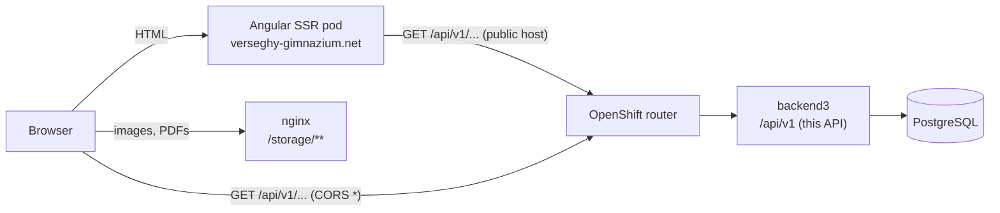
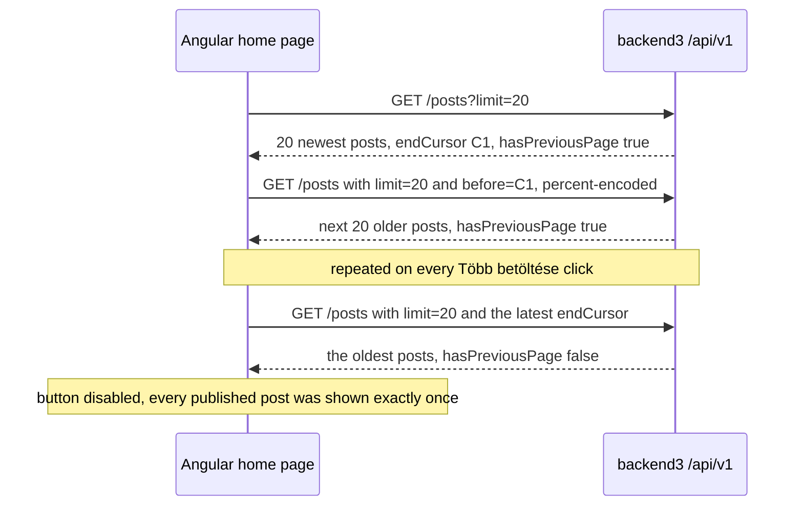

# Public read API v1

- Status: Proposed (2026-10-24). Specification for release 1. It applies the accepted ADRs and the recorded REST-draft defaults; the choices this document makes on its own are listed in [19.2](#192-choices-this-document-makes). They are implemented as written. The maintainer reviews them with the rest of the work once it is done (research: DECISIONS 13), and any change after that review is an ordinary PR to this file.
- Base URL: `https://backend3.microshift.verseghy-gimnazium.net/api/v1` ([ADR 0014](adr/0014-one-host-backend3-microshift-verseghy-gimnazium-net.md))
- Replaces: website_backend2's GraphQL endpoint, which serves the live Angular site 13 operations over 11 root fields.
- Consumer: website_frontend (Angular SSR pod and browser). website_frontend2 is out of scope (Q31), but the shape stays backend2-compatible so a later port is mostly a transport change.
- Machine-readable form: `GET /api/v1/openapi.json` ([ADR 0005](adr/0005-rust-dtos-are-the-api-contract-ts-rs-utoipa-openapi.md)).

This document specifies the public, unauthenticated, read-only JSON API that backend3 serves for the public website. It covers every endpoint, its parameters, its response shape, its ordering, paging, visibility, time-zone and caching rules, and its errors.

It has two jobs:

1. It is the contract the Angular site switches to. Field names and value formats are the ones backend2 emits today, so the Angular change is a transport change: about 10 service files, 3 environment files and `package.json` (research: SYNTHESIS §5.17.1).
2. It is the source of the specification tests that prove backend2 can be retired. The maintainer chose new tests written from this specification over ported backend2 snapshots or a dump-diff harness (research: DECISIONS 25b, [ADR 0019](adr/0019-scope-parity-tracking-retired-features-release-1-additions.md)). Section 17 lists the production-only data shapes the fixtures must contain so that this choice does not miss them.

**Which source wins.** The Rust DTOs are the source of truth for field names and types ([ADR 0005](adr/0005-rust-dtos-are-the-api-contract-ts-rs-utoipa-openapi.md)); utoipa generates the OpenAPI document from them, and a snapshot test pins it. This document is the source of truth for behaviour: visibility, ordering, paging, validation, time zones and caching. A change to the public API is one PR that updates this file, the DTOs, the OpenAPI snapshot and the specification tests together.

## Contents

1. [Architecture at a glance](#1-architecture-at-a-glance)
2. [Global conventions](#2-global-conventions)
3. [Visibility rules](#3-visibility-rules)
4. [Dates, times and time zones](#4-dates-times-and-time-zones)
5. [Pagination](#5-pagination)
6. [Schemas](#6-schemas)
7. [Endpoints](#7-endpoints)
8. [Errors](#8-errors)
9. [Caching](#9-caching)
10. [Size limits](#10-size-limits)
11. [Mapping to backend2 and the Angular site](#11-mapping-to-backend2-and-the-angular-site)
12. [REST draft decisions DEC-1 to DEC-18](#12-rest-draft-decisions-dec-1-to-dec-18)
13. [backend2 defects this API fixes](#13-backend2-defects-this-api-fixes)
14. [Behaviour changes visible on the site](#14-behaviour-changes-visible-on-the-site)
15. [Read counting for the dashboard](#15-read-counting-for-the-dashboard)
16. [Specification tests](#16-specification-tests)
17. [Test fixtures that must exist](#17-test-fixtures-that-must-exist)
18. [Notes for the Angular switch](#18-notes-for-the-angular-switch)
19. [Open items](#19-open-items)
20. [References](#20-references)

## 1. Architecture at a glance



- The browser and the SSR pod both call the public host. The SSR pod reaches it through the public router, as it reaches backend2 today (research: SYNTHESIS §1.4 F2).
- The API returns absolute media URLs. A separate nginx serves the files under `/storage/**` on the legacy media host and on `verseghy-gimnazium.net/storage`; if the volume co-mount test fails, a dedicated backend3 router serves them instead ([ADR 0015](adr/0015-media-separate-static-server-media-library-image-optimisatio.md)). Either way, media never come from `/api/v1`.
- backend3 reads PostgreSQL on every request ([ADR 0002](adr/0002-postgresql-as-the-database.md)). There is no server-side response cache ([ADR 0016](adr/0016-no-redis-in-memory-cache-postgres-queue-cronjob-tasks.md)), so an admin edit is visible on the next request, as it is today (research: SYNTHESIS §5.9).
- The Angular REST build is staged ahead and promoted in the cut-over window ([ADR 0003](adr/0003-cut-over-one-rehearsed-flip-then-a-read-only-parallel-run.md)). This API must answer with imported data before that promotion.

## 2. Global conventions

### 2.1 Transport

| Topic | Rule |
|---|---|
| Base path | `/api/v1`. The admin API lives under `/api/admin` and the admin UI under `/admin` on the same host ([ADR 0014](adr/0014-one-host-backend3-microshift-verseghy-gimnazium-net.md)). |
| Methods | `GET` only. `HEAD` is answered as axum answers it for `GET` routes. Any other method gets `405`. |
| Authentication | None. The API reads no cookie and sets no cookie. |
| Request body | None. |
| Response type | `application/json`, UTF-8. Non-ASCII characters are written as UTF-8, not as `\u` escapes. |
| Field names | camelCase, identical to backend2's wire names (DEC-1). |
| Field presence | Every field of a schema is always present. An empty scalar is `null`; an empty list is `[]`. Fields are never omitted. |
| Unknown query parameters | Ignored. |
| Repeated query parameters | The first value wins. |
| Query decoding | `application/x-www-form-urlencoded` rules: `+` is a space, `%2B` is `+`, `%23` is `#`. |
| Trailing slash | `/api/v1/posts/` is served exactly like `/api/v1/posts`. No redirect. The canonical form has no slash (DEC-10). |
| Compression | Responses are compressed when the client sends `Accept-Encoding` (Loco's compression middleware). Responses carry `Vary: Accept-Encoding`. |
| CORS | `Access-Control-Allow-Origin: *` on every `/api/v1/**` response, errors included. No credentials. The admin paths `/admin` and `/api/admin/**` send no CORS headers (DEC-18). A `GET` without custom headers is a CORS simple request, so the browser sends no preflight. |
| Security headers | The secure-headers set of [ADR 0023](adr/0023-operations-hardening-rate-limits-monitoring-backups-secrets.md) applies to `/api/v1` too. |
| Versioning | Adding a field or an endpoint stays in v1 (Angular ignores unknown fields). Removing or renaming a field, or changing a documented semantic, needs `/api/v2`. |

Loco's `cors` middleware is global and off by default (research: SYNTHESIS §6.6). backend3 keeps it off and adds a CORS layer to the public router only, so the cookie-authenticated admin API never answers with `Access-Control-Allow-Origin: *`. tower-http's `CorsLayer` is available through the tower-http features Loco already enables (research: SYNTHESIS §6.6). The bootstrap PR (Verseghy/website_backend3#186) kept Loco's middleware off. The JSON `404` that the router fallback sends for an unknown `/api/v1` path sets `Access-Control-Allow-Origin: *` itself (section 8), so it does not depend on the layer. Request tests pin the header on that `404`, and its absence on `/admin` and `/api/admin`. The `CorsLayer` comes with the first `/api/v1` routes, whose tests pin the headers on both path families (open item O-3).

### 2.2 Value formats

| Kind | Wire format | Example | Rule |
|---|---|---|---|
| Id | JSON integer | `600` | The legacy id value is preserved ([ADR 0009](adr/0009-clean-domain-schema-with-preserved-integer-ids.md)). Ids appear in public URLs (`/posts/{id}`, `/search/author/{id}`, `/search/label/{id}`), in the sitemap and in social-media caches. |
| Calendar day | `"YYYY-MM-DD"` | `"2026-09-01"` | No time, no offset (section 4). |
| Event time | `"YYYY-MM-DD HH:MM:SS"` | `"2026-09-28 08:00:00"` | Europe/Budapest wall clock. Space separator, no `T`, no fraction, no offset (section 4). |
| Instant (every instant except event times) | RFC 3339 in UTC with `Z` | `"2026-10-22T04:00:00Z"` | Today only `Notice.visibleUntil` ([ADR 0010](adr/0010-all-instants-stored-as-timestamptz.md), [ADR 0005](adr/0005-rust-dtos-are-the-api-contract-ts-rs-utoipa-openapi.md)). |
| Colour | `"#rrggbb"` | `"#1e88e5"` | Six hex digits. The Angular calendar's `getHueFromHEXColor` and the card hue code throw on anything else (research: SYNTHESIS §5.14). |
| Media URL | absolute URL | see 2.3 | Built from the configured storage base URL. |
| HTML | JSON string | `"<p>…</p>"` | Served verbatim (2.4). |

### 2.3 Media URLs

Every image or file field is an absolute URL:

```
{media.public_base_url}/{disk}/{stored path}
```

| Field | `{disk}` | Stored path today |
|---|---|---|
| `Post.indexImage` | `posts_images` | `index/<32 hex>.<ext>` on all 575 non-NULL legacy values |
| `Post.images[]` | `posts_images` | `<32 hex>.<ext>` |
| `Author.image` | `authors_images` | `<32 hex>.<ext>` |
| `Colleague.image` | `colleagues_images` | `<32 hex>.<ext>` |
| `Banner.image`, `DiaktollIssue.coverImage` | `uploads` or another media-library folder | free UTF-8 paths ([ADR 0015](adr/0015-media-separate-static-server-media-library-image-optimisatio.md)) |
| `DiaktollIssue.pdf` | `uploads` | `diaktoll/<file name>`: every Diáktoll PDF lives under `/storage/uploads/diaktoll/` ([ADR 0019](adr/0019-scope-parity-tracking-retired-features-release-1-additions.md) §5) |

Rules:

- `media.public_base_url` is a required configuration value without a trailing slash. It sits beside `media.root`, `media.tmp_dir` and `media.trash_dir` in the media settings of [ADR 0015](adr/0015-media-separate-static-server-media-library-image-optimisatio.md) §3, which use the same name. It is passed explicitly to the code that builds URLs; it is never read from the environment inside that code (engineering standard, [ADR 0008](adr/0008-code-layout-a-pure-src-domain-beside-loco-models.md)). Startup fails with a clear message when it is missing, is not an absolute URL, or ends with a slash. In production it is `https://backend.microshift.verseghy-gimnazium.net/storage`, the value backend2 uses today, because the Angular `environment.origin`, the service worker's `images` group and cached `og:image` URLs all point there (research: SYNTHESIS §5.15.1, §5.17.3).
- Each path segment is percent-encoded as an RFC 3986 path segment (unreserved characters kept, everything else as UTF-8 `%XX`); `/` separators are kept. Media-library paths contain spaces, accents, brackets and parentheses (research: SYNTHESIS §5.15.2). The legacy hex names contain only unreserved characters, so their URLs are byte-identical to backend2's.
- The URL for every imported row equals backend2's URL for that row. A rehearsal check verifies this (section 16.4).
- A missing file reference is `null`, never a directory URL (DEC-5d).

### 2.4 HTML content

`Post.content` and `Page.content` are content-v1 HTML strings ([editor.md](editor.md) §3). The read API does not rewrite or decode them: a body that backend3's write path stored is served verbatim. The Angular page renderer injects them with `bypassSecurityTrustHtml` (research: SYNTHESIS §5.14), so the server is the barrier. Every stored body has passed the server's sanitiser on write ([ADR 0013](adr/0013-rich-text-editor-and-html-sanitiser.md)), and the read path serves the stored bytes only when their integrity tag verifies; any other row is served as the sanitiser's output instead ([editor.md](editor.md) §8). Imported bodies arrive normalised to the editor's fixed point ([ADR 0017](adr/0017-legacy-data-import-normalisation-and-defect-resolution.md)) and are stored through the same write path.

### 2.5 Parameter parsing

axum's own `Path` and `Query` rejections answer `400 text/plain`, and Loco wraps only JSON-body rejections (research: SYNTHESIS §6.6). backend3 therefore extracts path and query values as strings and validates them in a pure parameter module that returns the JSON error envelope of section 8. That module has a unit test for every row below.

| Parameter | Accepted | Otherwise |
|---|---|---|
| `{id}` | ASCII digits only (no sign, no spaces), value 1 to 9,007,199,254,740,991 (2^53 − 1: ids are 64-bit in the schema, [ADR 0009](adr/0009-clean-domain-schema-with-preserved-integer-ids.md), and must stay exact as JSON numbers, [ADR 0005](adr/0005-rust-dtos-are-the-api-contract-ts-rs-utoipa-openapi.md)). Leading zeros are accepted: `007` is 7. | `400 invalid_id` |
| `{year}` | ASCII digits, 1 to 9999 (DEC-13) | `400 invalid_date` |
| `{month}` | ASCII digits, 1 to 12 | `400 invalid_date` |
| `{isoYear}` | ASCII digits, 1 to 9999 | `400 invalid_week` |
| `{isoWeek}` | ASCII digits, 1 to 53, and the week must exist in `isoYear` (53 only in long ISO years) | `400 invalid_week` |
| `{slug}` | Any percent-decoded string | No `400`. A slug that matches no visible page is `404 not_found`. A slug longer than 191 characters or containing U+0000 is answered `404` without a database query. |
| `limit` | ASCII digits, 1 to 100 | `400 invalid_limit` |
| `before` | A cursor (section 5.2) | `400 invalid_cursor` |
| `featured` | exactly `true` or `false` | `400 invalid_query` |
| `q` | 1 to 200 characters after trimming Unicode white space, no U+0000 | `400 invalid_query` |
| `token` | Any string up to 255 characters without U+0000 | Longer or with U+0000: `404 not_found` without a database query |

Rust's integer parsing accepts a leading `+`, so the digit check is explicit. PostgreSQL `text` cannot hold U+0000, so such values never reach a query.

## 3. Visibility rules

Visibility is a server-side invariant. No query parameter widens it; there is no "include unpublished" or "include deleted" switch. "In the trash" means soft-deleted under [ADR 0011](adr/0011-safety-net-soft-delete-revisions-and-an-activity-log-for-eve.md), which covers every admin-editable entity. Every public read filters the trash on every table it touches, embedded labels and authors included, and ADR 0011 refuses to trash a row that live rows still depend on.

| Entity | Public when | Effect on embedding responses |
|---|---|---|
| Post | `published` is true and the post is not in the trash. The nullable `publish_at` column exists but is ignored ([ADR 0018](adr/0018-content-model-publishing-pages-menu-tree-canteen-week-editor.md), research: DECISIONS 21). | Unpublished posts never appear in lists, search, the archive, or label and author pages. |
| Post, preview | `published` is false, the post is not in the trash, and its preview token equals `token` byte for byte | Only `GET /posts/{id}?token=` (7.3). A published post is never returned when a token is given. |
| Label | Not in the trash | A label in the trash disappears from every post's `labels`. `/labels/{id}` and `/labels/{id}/posts` answer `404`. |
| Author | Not in the trash | An author cannot be moved to the trash while a live post has it ([ADR 0011](adr/0011-safety-net-soft-delete-revisions-and-an-activity-log-for-eve.md)), so a live post always has a live author. This matters because the Angular templates dereference `post.author.*` without a null guard (research: SYNTHESIS §5.12). `/authors/{id}` and `/authors/{id}/posts` answer `404` for a trashed author. |
| Canteen day | Not in the trash | — |
| Dish | Not in the trash | A dish cannot be moved to the trash while a live day uses it ([ADR 0018](adr/0018-content-model-publishing-pages-menu-tree-canteen-week-editor.md)); if one were, it would disappear from `menus`. |
| Event | Not in the trash | — |
| Colleague | Not in the trash | — |
| Page | Its published flag is set (it is not hidden) and it is not in the trash ([ADR 0018](adr/0018-content-model-publishing-pages-menu-tree-canteen-week-editor.md)) | A `page_link` menu item whose page is not visible is omitted, with its children (DEC-4b). |
| Menu item | Not in the trash, every ancestor visible, and for `page_link` the target page visible | — |
| Notice | Not in the trash, and `visibleUntil` is null or later than now | — |
| Banner | Its visible flag is set and it is not in the trash (the flag is this document's addition, 19.2) | — |
| Diáktoll issue | Its published flag is set and it is not in the trash (the flag is this document's addition, 19.2) | — |
| Site settings | Always: one record, which has no trash ([ADR 0019](adr/0019-scope-parity-tracking-retired-features-release-1-additions.md)) | — |

**Sitemap.** backend3 also publishes `/storage/sitemap.xml` (research: DECISIONS 28, [ADR 0019](adr/0019-scope-parity-tracking-retired-features-release-1-additions.md) §4). It is a file on the uploads volume, not an `/api/v1` endpoint, but it uses this section's visibility rules: published posts and visible pages that are not in the trash. Each of the two rules is defined once in `src/domain/`, and both the sitemap selection and the endpoints of 7.3 and 7.12 use it. A test over the fixtures of 17.1 pins that the sitemap lists exactly the posts and pages that answer `200` on those endpoints.

Every legacy page is imported as published, because every one is publicly served today; editors may list pages to import as hidden ([data-migration.md](data-migration.md) D10, [ADR 0017](adr/0017-legacy-data-import-normalisation-and-defect-resolution.md)). The slugs the Angular templates hard-code must stay published: `menza-tajekoztatok-nyilatkozatok`, `menza-ugyintezes-etkezes-lemondas`, `akadalymentesitesi-nyilatkozat`, `hatartalanul`, `nemzeti-tehetseg-program`, `bazisintezmeny` and `beiskolazas` (research: SYNTHESIS §5.13). All seven exist in the legacy data.

## 4. Dates, times and time zones

Storage follows [ADR 0010](adr/0010-all-instants-stored-as-timestamptz.md): every instant is `timestamptz` (UTC), event start and end included. The wire formats below are what backend2 emits today, so the Angular code needs no change. The Angular calendar parses zone-less strings as local time with date-fns 1.30.1; a `Z` suffix would move evening events to another day for Budapest visitors. Post dates go through `format(new Date(date), 'YYYY-MM-DD')`, so a time part or an offset would shift the printed day in some zones (research: SYNTHESIS §5.6).

| Field | Meaning | Wire format | Rule |
|---|---|---|---|
| `Post.date` | Calendar day of the post | `YYYY-MM-DD` | Never null for a published post (DEC-5c). |
| `CanteenDay.date` | Calendar day of the menu | `YYYY-MM-DD` | — |
| `DiaktollIssue.issueDate` | Calendar day of the issue | `YYYY-MM-DD` | — |
| `Event.dateFrom`, `Event.dateTo` | Instants | `YYYY-MM-DD HH:MM:SS` | The stored instant converted to Europe/Budapest, printed without offset. Seconds are kept (136 legacy events carry non-zero seconds from the old date-time picker, research: SYNTHESIS §4.3.4). |
| `Notice.visibleUntil` | Instant | RFC 3339 in UTC with `Z`, for example `2026-10-22T04:00:00Z` | The public form of every instant other than event times ([ADR 0010](adr/0010-all-instants-stored-as-timestamptz.md)). The field is new, so no backend2 format constrains it. The Angular alert model holds a `Date`, and JavaScript `Date` parses this form in every engine, which the naive space-separated form does not guarantee. |
| Cursor date part | Post calendar day | `YYYY-MM-DD` | Section 5.2. |

Decision 9 says everything is `timestamptz` (research: DECISIONS 9). [ADR 0010](adr/0010-all-instants-stored-as-timestamptz.md) point 2 applies it to calendar days as well: `posts.date`, `canteen_days.date`, the Diáktoll issue date and the `day` of `public_read_counts` (section 15) are `timestamptz` values that hold the Europe/Budapest midnight of the day. The wire format stays `YYYY-MM-DD`. The keyset (5.3), archive grouping and month bounds (7.6, 7.7), canteen week range (7.8) and read-counter day (15) derive the day through the ADR 0010 conversion module, never with a bare `::date`. Wherever this API derives a calendar day from an instant, it takes the day in Europe/Budapest.

**Zone rules.**

- The zone is the IANA zone `Europe/Budapest`, a constant in `src/domain/`. Every conversion goes through the one conversion module of [ADR 0010](adr/0010-all-instants-stored-as-timestamptz.md), which uses a compiled-in time-zone database. The result never depends on the container's `TZ` or `/etc/localtime`.
- "Now" and "today" are Europe/Budapest. They are used by `/canteen/current`, notice expiry and the undated-draft preview rule (7.3).
- Code in `src/domain/` takes "now" as an argument; it never reads the clock ([ADR 0008](adr/0008-code-layout-a-pure-src-domain-beside-loco-models.md)). Tests inject fixed instants.
- Rendering an instant in Europe/Budapest is always well defined. In the autumn fall-back hour two different instants render to the same wall time (for example both `2026-10-25 02:30:00`); that is correct and expected.
- Grid and range bounds that this API defines as local midnights (the events grid, section 7.10) are converted to instants with the zone. Since 1984 midnight is never skipped or repeated in Europe/Budapest, because the clocks change at 02:00 and 03:00; the ADR 0010 conversion module refuses the few earlier days that have no midnight.
- Converting legacy wall times to instants, including wall times that fall into the spring gap or the autumn overlap, is the importer's job ([ADR 0017](adr/0017-legacy-data-import-normalisation-and-defect-resolution.md); [data-migration.md](data-migration.md) §5.2 takes the earlier instant in the autumn overlap). The importer must round-trip: for every imported event, rendering the stored instant gives back the legacy wall time.

## 5. Pagination

### 5.1 Which lists are paged

The post lists are paged with a keyset cursor: `GET /posts`, `GET /posts/search`, `GET /authors/{id}/posts` and `GET /labels/{id}/posts`. Every other list has a stated bound (section 10) and is returned whole; `/diaktoll` also has a hard cap of 100 issues.

### 5.2 Cursor

| Aspect | Rule |
|---|---|
| Format | Plain text `YYYY-MM-DD#<id>`, for example `2026-02-13#6`: the post's calendar day and id (DEC-7). This is backend2's format. |
| Opacity | Clients treat it as opaque and only feed `pageInfo.endCursor` back as `before`. The format may change inside v1 only if old cursors keep working. |
| Encoding in a URL | The `#` must be percent-encoded (`%23`) in the query string. |
| Decoding | Split at the first `#`. The left part must parse as `%Y-%m-%d`; the right part must be ASCII digits with a value 1 to 9,007,199,254,740,991 (2.5). |
| Errors | `400 invalid_cursor`, with description `Wrong cursor format` (no `#`), `Wrong date format in cursor` or `Invalid id in cursor` (backend2's messages, research: SYNTHESIS §5.5.1). |
| Stale cursor | A cursor whose post has since changed date, been unpublished or been trashed still works: it is a position in the ordering, not a reference to a row. |

### 5.3 Ordering and the keyset condition

Every post list is ordered `date DESC, id DESC`. With `before = (d, i)` the list returns only posts strictly older than the cursor:

```
date < d  OR  (date = d AND id < i)
```

This is the fixed form of backend2 PR #251. backend2's deployed condition `date <= d AND id < i` skips a post whose date is older than the cursor's but whose id is higher, a backdated post (research: SYNTHESIS §5.5.2).

The server fetches `limit + 1` rows. The extra row is never returned; it only sets `hasPreviousPage`.

### 5.4 Envelope and page info

```json
{
  "items": [],
  "pageInfo": { "endCursor": null, "hasPreviousPage": false }
}
```

| Field | Type | Rule |
|---|---|---|
| `items` | `PostSummary[]` | Ordered `date DESC, id DESC`. `[]` when nothing matches. |
| `pageInfo.endCursor` | string or null | Cursor of the last item. `null` when `items` is empty. |
| `pageInfo.hasPreviousPage` | boolean | `true` when at least one more post older than the last returned one exists **within the same filter** (featured, search term, author or label). `false` when `items` is empty. |

The name `hasPreviousPage` keeps backend2's reversed-Relay meaning, "older posts exist". The Angular home page reads exactly `endCursor` and `hasPreviousPage` and depends on that meaning (research: SYNTHESIS §5.5.1). backend2's `startCursor` and `hasNextPage` are not returned: no consumer reads them, and adding them later would be non-breaking.

### 5.5 Home paging, end to end



With the legacy data of 2026-10-23 (541 published posts) the home page reaches all 541 in 28 pages. With backend2's deployed condition it reaches 481; the other 60 stay reachable only through the archive, search, label and author pages and direct links (research: SYNTHESIS §5.5.3).

## 6. Schemas

Notation: `int` is a JSON integer; `string?` allows `null`; `T[]` is a JSON array and is never `null`. The examples use invented content and the production storage base URL.

### 6.1 `PostSummary`

A list item: home list, featured strip, search, author and label lists, archive month.

| Field | Type | Rule |
|---|---|---|
| `id` | int | Post id. |
| `title` | string | Never empty. |
| `description` | string? | Plain text, may contain newlines. `null` when absent; an empty string is also emitted as `null`. The card hides the paragraph when it is falsy. |
| `color` | string | `#rrggbb`. |
| `date` | string | `YYYY-MM-DD`. Never null (DEC-5c). |
| `indexImage` | string? | Absolute URL (2.3) or `null`. Never `null` for a published post: the admin requires an index image on every save, the schema refuses a published post without one, and the importer refuses one too, after editors give the one legacy case an image before the final dump ([ADR 0009](adr/0009-clean-domain-schema-with-preserved-integer-ids.md), [data-migration.md](data-migration.md) D3, [ADR 0017](adr/0017-legacy-data-import-normalisation-and-defect-resolution.md)). Only a draft preview can be `null`. Never a directory URL (DEC-5d). |
| `author` | `AuthorRef`? | Never `null` for a published post: the importer assigns authors to the legacy posts that lack one and the admin requires an author to publish (DEC-5e, [ADR 0017](adr/0017-legacy-data-import-normalisation-and-defect-resolution.md), [ADR 0018](adr/0018-content-model-publishing-pages-menu-tree-canteen-week-editor.md)). Always a live author (section 3). Can be `null` only in a preview of a draft that has no author yet. |
| `labels` | `LabelRef[]` | Visible labels of the post, ordered by label id descending, as backend2 orders them. Always carries `id` (the Angular site's home and search list queries do not select `labels { id }`, so the label chips on cards link to `label/undefined` today; research: SYNTHESIS §5.12). `[]` when none. |

`AuthorRef = { id: int, name: string, image: string? }`, where `image` is an absolute URL or `null`.

`LabelRef = { id: int, name: string, color: string }`.

```json
{
  "id": 612,
  "title": "Tanévnyitó ünnepség",
  "description": "Ünnepélyesen megnyitottuk a tanévet.",
  "color": "#1e88e5",
  "date": "2026-09-01",
  "indexImage": "https://backend.microshift.verseghy-gimnazium.net/storage/posts_images/index/0123456789abcdef0123456789abcdef.jpg",
  "author": { "id": 3, "name": "Szerkesztőség", "image": null },
  "labels": [
    { "id": 12, "name": "Ünnepségek", "color": "#8e24aa" },
    { "id": 1, "name": "Hírek", "color": "#43a047" }
  ]
}
```

### 6.2 `PostDetail`

`GET /posts/{id}`. All `PostSummary` fields, plus:

| Field | Type | Rule |
|---|---|---|
| `content` | string | HTML, served verbatim (2.4). `""` when the post has no body (DEC-5a); 28 published legacy posts have none. |
| `images` | string[] | Gallery as absolute URLs, in stored order. `[]` when none. The Angular slideshow puts each URL into a CSS `url()`, so percent-encoding (2.3) matters. Legacy object-shaped values arrive as arrays from the importer (section 17.2). If a stored value is somehow not an array of strings, the API emits `[]` and logs a warning; it never fails the whole post (DEC-5f). |
| `author` | `AuthorDetail`? | `AuthorRef` plus `description: string?`. |

```json
{
  "id": 612,
  "title": "Tanévnyitó ünnepség",
  "description": "Ünnepélyesen megnyitottuk a tanévet.",
  "color": "#1e88e5",
  "date": "2026-09-01",
  "indexImage": "https://backend.microshift.verseghy-gimnazium.net/storage/posts_images/index/0123456789abcdef0123456789abcdef.jpg",
  "images": [
    "https://backend.microshift.verseghy-gimnazium.net/storage/posts_images/fedcba9876543210fedcba9876543210.jpg"
  ],
  "content": "<p>Az ünnepségen a diákok műsorral készültek.</p>",
  "author": { "id": 3, "name": "Szerkesztőség", "description": null, "image": null },
  "labels": [
    { "id": 12, "name": "Ünnepségek", "color": "#8e24aa" },
    { "id": 1, "name": "Hírek", "color": "#43a047" }
  ]
}
```

`featured`, `published`, the preview token and every audit column are never on the wire.

### 6.3 `PostList`

The envelope of every paged post list (section 5.4): `{ items: PostSummary[], pageInfo: { endCursor: string?, hasPreviousPage: boolean } }`.

### 6.4 `Author` and `Label`

`Author = { id: int, name: string, description: string?, image: string? }`.

`Label = { id: int, name: string, color: string }`.

### 6.5 `ArchiveMonth`

`{ year: int, month: int, count: int }`. `month` is 1 to 12; `count` is at least 1.

```json
[ { "year": 2026, "month": 10, "count": 12 }, { "year": 2026, "month": 9, "count": 9 } ]
```

### 6.6 `CanteenDay`, `CanteenMenu`, `CanteenWeek`

| Field | Type | Rule |
|---|---|---|
| `CanteenDay.id` | int | Canteen day id. |
| `CanteenDay.date` | string | `YYYY-MM-DD`. At most one day per date ([ADR 0018](adr/0018-content-model-publishing-pages-menu-tree-canteen-week-editor.md)). |
| `CanteenDay.menus` | `CanteenMenu[]` | Visible dishes of the day, ordered by course (`type ASC`), then by the slot position the editor gave ([ADR 0018](adr/0018-content-model-publishing-pages-menu-tree-canteen-week-editor.md)); the importer gives legacy days positions by course, then dish id. The Angular page prints them in array order. `[]` is possible for legacy days. |
| `CanteenMenu.id` | int | Dish id. |
| `CanteenMenu.menu` | string | Dish name. |
| `CanteenMenu.type` | int | Course: 0 soup, 1 main dish, 2 dessert. |
| `CanteenWeek.isoYear`, `CanteenWeek.isoWeek` | int | The ISO week-numbering year and week. |
| `CanteenWeek.days` | `CanteenDay[]` | As in 7.8. |

```json
{
  "id": 1201,
  "date": "2026-09-28",
  "menus": [
    { "id": 140, "menu": "Zöldségleves", "type": 0 },
    { "id": 233, "menu": "Paprikás krumpli", "type": 1 },
    { "id": 51, "menu": "Túrós palacsinta", "type": 2 }
  ]
}
```

### 6.7 `Event`

| Field | Type | Rule |
|---|---|---|
| `id` | int | Event id. |
| `dateFrom`, `dateTo` | string | `YYYY-MM-DD HH:MM:SS`, Europe/Budapest (section 4). `dateTo` is never earlier than `dateFrom`; the admin validates it. |
| `title` | string | — |
| `description` | string? | — |
| `color` | string | `#rrggbb`, **never null**. backend2's schema declared it nullable, but a `null` stops the Angular calendar from rendering (research: SYNTHESIS §5.12). |

```json
{ "id": 300, "dateFrom": "2026-09-28 08:00:00", "dateTo": "2026-10-02 14:00:00", "title": "Témahét", "description": null, "color": "#43a047" }
```

### 6.8 `MenuItem`

| Field | Type | Rule |
|---|---|---|
| `id` | int | Menu item id. New: backend2 hid it. Useful as a list key (DEC-15). |
| `name` | string | Label shown in the sidebar. |
| `type` | string | `page_link`, `internal_link` or `external_link`. |
| `link` | string? | `null` for `page_link`; a site-relative path for `internal_link`; an absolute URL for `external_link`. |
| `slug` | string? | The linked page's slug for `page_link`; `null` for the other types. |
| `children` | `MenuItem[]` | Children of a root item. Always `[]` on a child: the menu resource has two levels (research: DECISIONS 23b). |

```json
{
  "id": 7,
  "name": "Rólunk",
  "type": "page_link",
  "link": null,
  "slug": "iskola-tortenet",
  "children": [
    { "id": 9, "name": "Munkatársak", "type": "internal_link", "link": "/misc/colleagues", "slug": null, "children": [] }
  ]
}
```

### 6.9 `Page`

| Field | Type | Rule |
|---|---|---|
| `id` | int | Page id. |
| `template` | string | Always `"page"`. There is one page type ([ADR 0018](adr/0018-content-model-publishing-pages-menu-tree-canteen-week-editor.md)). |
| `name` | string | The page title. backend2 returned the admin's internal name here, which in the new model is the internal note. The note is admin-only and never public. Angular fetches `name` but reads only `title`. |
| `title` | string | — |
| `slug` | string | New in the API. The Angular `Page` model already declares it and builds the BreadcrumbList JSON-LD URL from it; backend2 never returned it, so that URL ends in `/information/undefined` today (research: SYNTHESIS §5.12). |
| `content` | string | HTML, served verbatim (2.4). |
| `extras` | object | Always `{}` ("empty extras", research: DECISIONS 22). The legacy value is an all-null triple of meta fields on every row; Angular types `extras` as a free-form object and reads no key, so `{}` is not a visible change. |
| `seoDescription` | string? | New. The optional SEO description of the page model; `null` when not set. Angular ignores it today. |

```json
{
  "id": 12,
  "template": "page",
  "name": "Beiskolázás",
  "title": "Beiskolázás",
  "slug": "beiskolazas",
  "content": "<p>Felvételi tájékoztató.</p>",
  "extras": {},
  "seoDescription": null
}
```

### 6.10 `Colleague`

| Field | Type | Rule |
|---|---|---|
| `id` | int | — |
| `name` | string | Shown as stored, including a `Dr.` prefix. |
| `jobs`, `subjects`, `roles` | string? | Free text. |
| `awards` | string? | Newline-separated; the page splits on `\n`. |
| `image` | string? | Absolute URL or `null`. |
| `category` | int | 0 to 4 (table below). The Angular reducer indexes six buckets by this value and throws on anything outside 0 to 5 (research: SYNTHESIS §5.12). |

| `category` | Heading on the site |
|---|---|
| 0 | Vezetőség |
| 1 | Tanárok |
| 2 | Óraadók |
| 3 | Nevelő, oktató munkát közvetlenül segítők |
| 4 | Karbantartók, portások, takarítók |

### 6.11 `Notice` (release 1)

Home-page notices replace the hard-coded `ALERT_MESSAGES` array of the Angular alert service (research: SYNTHESIS §7.9.7; research: DECISIONS 29).

| Field | Type | Rule |
|---|---|---|
| `id` | int | — |
| `message` | string | Plain text, no HTML. |
| `link` | string? | A site-relative path or an absolute URL. |
| `priority` | string | `low`, `medium` or `high`: the values of the Angular `AlertMessagePriority` enum. |
| `visibleUntil` | string? | RFC 3339 in UTC with `Z` (section 4). `null` means no expiry. |

```json
{ "id": 4, "message": "Az iskola holnap zárva tart.", "link": null, "priority": "high", "visibleUntil": "2026-10-22T04:00:00Z" }
```

### 6.12 `Banner` (release 1)

Partner banners replace the three hard-coded images on the home page, each of which needed a frontend deploy to change (research: SYNTHESIS §7.9.7). The admin model also has a position ([ADR 0019](adr/0019-scope-parity-tracking-retired-features-release-1-additions.md) §5) and a visible flag (19.2); they decide order and visibility and are not on the wire.

| Field | Type | Rule |
|---|---|---|
| `id` | int | — |
| `image` | string | Absolute URL (2.3). |
| `alt` | string | Alternative text, never empty. |
| `link` | string | A site-relative path (today all three point at `/pages/<slug>`) or an absolute URL. |
| `height` | int? | Display height in CSS pixels, or `null` for the image's natural height. Two of today's banners set one. |

### 6.13 `SiteSettings` (release 1)

Contact details and the footer e-mails, which the two frontends show differently today (research: SYNTHESIS §7.9.7). The record's fields extend [ADR 0019](adr/0019-scope-parity-tracking-retired-features-release-1-additions.md) NEW-03 (19.2).

| Field | Type | Rule |
|---|---|---|
| `address` | string? | Postal address. |
| `phones` | `Phone[]` | Phone numbers in display order. `Phone = { label: string?, number: string }`; `label` is an optional caption. `[]` when none. |
| `contactEmail` | string? | The school's contact e-mail in the footer's contact block. |
| `footerEmail` | string? | The e-mail address on the footer's bottom line, for feedback about the website. |
| `omIdentifier` | string? | The school's OM identifier, a string because it has a leading zero. |

```json
{
  "address": "5000 Szolnok, Tisza park 1.",
  "phones": [ { "label": null, "number": "56/514-953" }, { "label": null, "number": "20/540-4896" } ],
  "contactEmail": "verseghygimnazium@verseghy.net",
  "footerEmail": null,
  "omIdentifier": "035992"
}
```

The values are the public school contact details the site's footer shows today; `footerEmail` is left empty in the example.

### 6.14 `DiaktollIssue` (release 1)

Issues of the student paper Diáktoll replace the one PDF hard-coded in the Angular viewer since 2022 (research: SYNTHESIS §7.9.7). The admin model also has a published flag (19.2); it decides visibility and is not on the wire. `coverImage` is also this document's addition (19.2).

| Field | Type | Rule |
|---|---|---|
| `id` | int | — |
| `title` | string | For example `2021 ősz`. |
| `issueDate` | string | `YYYY-MM-DD`, the issue's date. |
| `coverImage` | string? | Absolute URL of an optional cover image (2.3), or `null`. |
| `pdf` | string | Absolute URL of the PDF (2.3). The Angular viewer loads it with a cross-origin request, so `/storage` must answer with `Access-Control-Allow-Origin: *`, which [ADR 0015](adr/0015-media-separate-static-server-media-library-image-optimisatio.md) requires. |

### 6.15 `Error`

`{ error: string, description: string }`: Loco's `ErrorDetail` envelope (research: SYNTHESIS §6.6). `error` is one of the codes in section 8. `description` is English free text for humans; clients and tests match on `error` only.

## 7. Endpoints

All paths are relative to `/api/v1`. Every endpoint answers `500 internal_server_error` on a real failure; that row is not repeated below. "Tests" lists what the specification tests must pin for the endpoint, beyond the global rules of sections 2 to 5.

| # | Method and path | Response | Replaces |
|---|---|---|---|
| 7.1 | `GET /posts` | `PostList` | `posts(featured, before, last)` |
| 7.2 | `GET /posts/search` | `PostList` | `search(term, last)` |
| 7.3 | `GET /posts/{id}` | `PostDetail` | `post(id, token)` |
| 7.4 | `GET /authors/{id}`, `GET /authors/{id}/posts` | `Author`, `PostList` | `author(id) { posts }` |
| 7.5 | `GET /labels/{id}`, `GET /labels/{id}/posts` | `Label`, `PostList` | `label(id) { posts }` |
| 7.6 | `GET /archive` | `ArchiveMonth[]` | `archive { info }` |
| 7.7 | `GET /archive/{year}/{month}` | `PostSummary[]` | `archive { posts(year, month) }` |
| 7.8 | `GET /canteen/{isoYear}/{isoWeek}` | `CanteenDay[]` | `canteen(year, week)` |
| 7.9 | `GET /canteen/current` | `{ weeks: CanteenWeek[] }` | the Angular site's own week arithmetic |
| 7.10 | `GET /events/{year}/{month}` | `Event[]` | `events(year, month)` |
| 7.11 | `GET /menu` | `MenuItem[]` | `menu` |
| 7.12 | `GET /pages/{slug}` | `Page` | `page(slug)` |
| 7.13 | `GET /colleagues` | `Colleague[]` | `colleagues` |
| 7.14 | `GET /notices` | `Notice[]` | hard-coded Angular alert list |
| 7.15 | `GET /banners` | `Banner[]` | hard-coded Angular banners |
| 7.16 | `GET /settings` | `SiteSettings` | hard-coded Angular footer |
| 7.17 | `GET /diaktoll` | `DiaktollIssue[]` | hard-coded Angular Diáktoll viewer |
| 7.18 | `GET /openapi.json` | OpenAPI 3.1 document | backend2's GraphiQL page |

### 7.1 `GET /posts`: newest published posts, cursor-paged

Serves the home list, its "Több betöltése" button and the featured carousel.

| Parameter | In | Type | Default | Rule |
|---|---|---|---|---|
| `limit` | query | int | 20 | 1 to 100 |
| `before` | query | cursor | none | Only posts strictly older than the cursor (5.3) |
| `featured` | query | `true` or `false` | `false` | `true` keeps only featured posts. `false` or absent means **no filter** (all published posts), not "non-featured": backend2's semantics. |

Response `200`: `PostList`.

Semantics:

1. Visible posts (section 3), plus `featured = true` when asked.
2. With `before`, the keyset condition of 5.3.
3. `ORDER BY date DESC, id DESC`, `limit + 1` rows; the extra row only sets `hasPreviousPage`.
4. Authors and labels are loaded in batches for the whole page. The number of queries per request does not depend on `limit` (backend2 runs one author and one label query per post, research: SYNTHESIS §5.2).
5. No visible post at all gives `{ "items": [], "pageInfo": { "endCursor": null, "hasPreviousPage": false } }`.

Tests: paging with `limit=2` over the fixture visits every visible post exactly once, in order, including the backdated post (17.1); `hasPreviousPage` is false exactly on the last page; with `featured=true` the flag reflects featured posts only; the empty database gives the empty envelope; `featured=yes` and `limit=0`, `limit=101`, `limit=+5` give `400`.

### 7.2 `GET /posts/search`: substring search over published posts

Serves `/search/term/:term`. Semantics follow [ADR 0020](adr/0020-search-and-hungarian-ordering.md). The header search works today, so this endpoint preserves a working feature and makes it better; it does not repair a broken one (research: SYNTHESIS §5.8).

| Parameter | In | Type | Default | Rule |
|---|---|---|---|---|
| `q` | query | string | required | Trimmed. 1 to 200 characters. Missing, empty or white-space only gives `400 invalid_query` (DEC-3b). |
| `limit`, `before` | query | | | As 7.1 |

Response `200`: `PostList`.

Semantics:

1. Visible posts whose title, description or plain-text body contains `q` as a substring.
2. The plain-text body is the derived column of [ADR 0020](adr/0020-search-and-hungarian-ordering.md): tags stripped and entities decoded, maintained on every write. Search never runs over raw HTML.
3. Matching is case- and accent-insensitive: `unaccent(lower(column COLLATE hu_icu)) LIKE unaccent(lower(pattern COLLATE hu_icu)) ESCAPE '\'` ([ADR 0020](adr/0020-search-and-hungarian-ordering.md), Folding). The collation sits inside `lower()`, because under the C collation `lower()` leaves `Ü` and `Ő` unchanged. `UNNEP` matches `Ünnep`; `oszi` matches `Őszi`; `eredmenyek` matches `eredmények`.
4. `%`, `_` and the escape character `\` in `q` match literally (DEC-3a). backend2 passed them through as wildcards.
5. Internal white space is part of the substring: `q=tanév nyitó` matches only that sequence. There is no stemming, no word splitting and no ranking.
6. Ordering, paging and page info as 7.1. Results are newest first, not ranked by relevance.

Delta against backend2: the body is searched as text, so accented words inside bodies are found. backend2 runs `LIKE` over entity-encoded HTML, which cannot match 43 % of body word tokens (research: SYNTHESIS §5.8).

Tests: case and accent folding on all three fields, with each of á é í ó ö ő ú ü ű in upper and lower case; a word split by inline markup in the stored HTML (for example `<b>Ün</b>nep`) is found; an entity-encoded letter in a body is found by its decoded form; `50%` and `a_b` match only literally; tag names and attribute values (`href`, `class`) never match; an unpublished or trashed post never matches; `q` of 200 characters is accepted and of 201 is rejected; `q` containing `%00` gives `400`.

### 7.3 `GET /posts/{id}`: one post, or a draft in preview

Serves `/posts/:id` and `/posts/preview/:id?token=`.

| Parameter | In | Type | Rule |
|---|---|---|---|
| `id` | path | int | 2.5 |
| `token` | query | string | Optional preview token (2.5) |

| `token` | Returns `200 PostDetail` when | Otherwise |
|---|---|---|
| absent | the post is visible (section 3) | `404 not_found` |
| present, any value | the post is unpublished, not in the trash, and its preview token equals `token` byte for byte | `404 not_found` |

Rules:

- A published post is never returned when a token is given, as in backend2 (research: SYNTHESIS §5.4). The Angular page navigates to `/404` on any error, so `404` keeps its behaviour.
- An empty `token=` counts as present and matches nothing.
- Token format is the admin's concern ([ADR 0018](adr/0018-content-model-publishing-pages-menu-tree-canteen-week-editor.md)): a token is created with the draft and can be regenerated, which invalidates the old link. New tokens must be URL-safe because every hop on the way, the Angular router included, turns `+` into a space. Legacy tokens are 80 characters of `[A-Za-z0-9]`, are already URL-safe and are imported unchanged (research: SYNTHESIS §5.7).
- A preview of a legacy draft without a date renders `date` as today's Europe/Budapest date: the value the admin would set on the next save (research: DECISIONS 21). A preview of a draft without an author renders `author: null` (open item O-6).
- Preview responses carry `Cache-Control: no-store` and no `ETag`, and are not counted (section 15).

Tests: a published post by id; an unpublished post without a token gives `404`; the right token gives the draft; a wrong token, an empty token and the token of another draft give `404`; a published post with its old token gives `404`; a trashed draft with its token gives `404`; a legacy 80-character token works; headers on preview responses.

### 7.4 `GET /authors/{id}` and `GET /authors/{id}/posts`

Serve `/search/author/:id`. The Angular site uses only the post list; `/authors/{id}` exists because GraphQL exposed `author(id)` and a page heading may want it.

- `GET /authors/{id}`: `200 Author`, or `404 not_found` when the author does not exist or is in the trash.
- `GET /authors/{id}/posts`: `200 PostList` of the author's visible posts, with `limit` and `before` as in 7.1, ordered as 7.1. `404 not_found` when the author does not exist or is in the trash. An existing author without posts gives `200` with empty `items`.
- No `featured` parameter (DEC-8).

Delta against backend2: the list is paged (DEC-6b). backend2 returns the whole list ordered by date only. A missing author is now an HTTP `404`, which reaches the Angular branch that shows "Nincs találat!"; today the page shows "Ismeretlen hiba történt!" (research: SYNTHESIS §5.17.2).

Tests: an author with more than `limit` posts pages completely; page info is computed within the author; posts with the same date are ordered by id descending; an author in the trash, whose posts are all in the trash too, gives `404` on both paths.

### 7.5 `GET /labels/{id}` and `GET /labels/{id}/posts`

Serve `/search/label/:id`. The same rules as 7.4, with "posts carrying the label" in place of "posts of the author". A label in the trash gives `404` on both paths and disappears from every post's `labels`.

Tests: as 7.4; a post with several labels appears once in each label's list; page info is computed within the label (backend2 reports `hasPreviousPage: true` for a label with a single post).

### 7.6 `GET /archive`: months that have published posts

Serves the `/archive` page's month list. No parameters.

Response `200`: `ArchiveMonth[]`, one row per (year, month) of the `date` of visible posts, ordered `year DESC, month DESC`. `count` is the number of visible posts in that month. Months without posts are absent.

There is no 1970 bucket: the legacy `1970-01-01` dates exist only on drafts and the importer turns them into `NULL` (research: DECISIONS 20).

Tests: counts per month; a trashed or unpublished post is not counted; ordering across a year boundary; the empty database gives `[]`.

### 7.7 `GET /archive/{year}/{month}`: the posts of one month

Serves an opened month panel on `/archive`.

| Parameter | In | Type | Rule |
|---|---|---|---|
| `year` | path | int | 1 to 9999, else `400 invalid_date` |
| `month` | path | int | 1 to 12, else `400 invalid_date` |

Response `200`: `PostSummary[]` (a plain array, not paged) of visible posts with `first day of month <= date < first day of next month`, ordered `date DESC, id DESC`. The `id DESC` tie-break is new. An empty month gives `[]`. The page reads `id`, `title`, `date` and `description`.

Tests: month bounds (the first and last day of a month are inside, the first day of the next month is outside); December rolls over into January of the next year; `year=0`, `year=10000`, `month=0`, `month=13` and `month=ab` give `400`; `year=1` and `year=9999` give `200`.

### 7.8 `GET /canteen/{isoYear}/{isoWeek}`: one ISO week of menus

The primitive behind the canteen page.

| Parameter | In | Type | Rule |
|---|---|---|---|
| `isoYear` | path | int | ISO week-numbering year, 1 to 9999 |
| `isoWeek` | path | int | 1 to 52, or 53 in a long ISO year. A week that does not exist gives `400 invalid_week`, never `500` and never `[]`. |

Response `200`: `CanteenDay[]` for Monday to Sunday of that ISO week, `ORDER BY date ASC`. Only days that have a visible row are returned; missing weekdays are not padded. ISO week 1 of 2026 runs from 2025-12-29 to 2026-01-04.

backend2 answers HTTP 500 for a week that does not exist (fixed by backend2 PR #258, research: SYNTHESIS §5.11). The Angular site sends the calendar year with `getISOWeek(now) + 1`, so it asks for such a week in the last days of December. The table shows what that means and what this API answers:

| Budapest date | Angular sends today | backend2 before #258 | backend3 for the same request | Correct weeks (7.9) |
|---|---|---|---|---|
| 2025-12-22 to 2025-12-28 | (2025, 52) and (2025, 53) | 500 | `400 invalid_week` for (2025, 53) | 2025-W52, 2026-W01 |
| 2025-12-29 to 2025-12-31 | (2025, 1) and (2025, 2) | wrong weeks from January 2025 | the same wrong weeks (the request is valid) | 2026-W01, 2026-W02 |
| 2026-12-28 to 2026-12-31 | (2026, 53) and (2026, 54) | 500 | `400` for (2026, 54) | 2026-W53, 2027-W01 |
| 2027-01-01 to 2027-01-03 | (2027, 53) and (2027, 54) | 500 | `400` for both | 2026-W53, 2027-W01 |

The rewrite does not deploy #258 to backend2 ([ADR 0026](adr/0026-backend2-unchanged-and-running-until-decommissioning.md)). backend3 answers these requests with `400 invalid_week`.

The server cannot repair a wrong request. The Angular adapter must therefore use `/canteen/current` (7.9) or compute the ISO week-year itself (section 18).

Tests: the week that spans the new year returns days from both calendar years; 2026-W53 exists, 2025-W53 does not; weeks 0 and 54 give `400`; a legacy day with no dishes gives `menus: []`; two dishes of one course are ordered by their slot position, not by id; a dish in the trash is absent (defensive, the admin refuses it); a Saturday row inside the week is returned.

### 7.9 `GET /canteen/current`: this week and next

The Angular site computes "this ISO week and the next" itself and gets it wrong at the year end (7.8; research: SYNTHESIS §5.11.2). This endpoint moves the arithmetic to the server, for every client (DEC-9). No parameters.

Response `200`:

```json
{
  "weeks": [
    { "isoYear": 2026, "isoWeek": 53, "days": [] },
    { "isoYear": 2027, "isoWeek": 1, "days": [] }
  ]
}
```

Rules:

- `weeks` always has exactly two entries: the ISO week that contains today in Europe/Budapest, then the following ISO week. `days` follows 7.8.
- On Saturday and Sunday "this week" is still the week that contains today, as on the Angular page today.
- The answer changes at Monday 00:00 Europe/Budapest, not at 00:00 UTC.

Tests, with an injected clock: 2025-12-22 gives 2025-W52 and 2026-W01; 2025-12-30 gives 2026-W01 and 2026-W02; 2026-12-28 gives 2026-W53 and 2027-W01; 2027-01-02 gives 2026-W53 and 2027-W01; 2027-01-04 gives 2027-W01 and 2027-W02; an instant on a Sunday at 23:30 UTC in summer time is already the next Monday in Budapest and gives the next week.

### 7.10 `GET /events/{year}/{month}`: events on a month's calendar grid

Serves `/events`. The calendar asks for the month it shows, displays Monday-to-Sunday rows including days of the neighbouring months, and filters again on the client. Fetching too much is harmless; fetching too little loses events.

| Parameter | In | Type | Rule |
|---|---|---|---|
| `year` | path | int | 1 to 9999, else `400 invalid_date` |
| `month` | path | int | 1 to 12, else `400 invalid_date` |

Response `200`: `Event[]`.

Semantics (the fixed form of backend2 PRs #248 and #249):

1. `start` is 00:00 Europe/Budapest of the Monday on or before the 1st of the month.
2. `end` is 00:00 Europe/Budapest of the first Monday on or after the 1st of the next month. It is exclusive.
3. Both are converted to instants (section 4). An event is returned when `dateTo >= start` and `dateFrom < end`.
4. `ORDER BY dateFrom ASC, id ASC`. The `id` tie-break is new.
5. Date arithmetic is checked. No year in 1 to 9999 can cause an error.

| Month | Grid `[start, end)` | backend2's deployed end |
|---|---|---|
| September 2026 (starts on a Tuesday) | 2026-08-31 to 2026-10-05 | Sunday 2026-10-04 00:00, so events on that Sunday are lost |
| May 2026 (ends on a Sunday) | 2026-04-27 to 2026-06-01 | Sunday 2026-06-07 00:00, a spare week |
| February 2027 (February and March both start on a Monday) | 2027-02-01 to 2027-03-01 | Sunday 2027-03-07 00:00, a spare week |

The newest legacy event is from January 2023, and the Angular header link to `/events` is disabled, so the fix has no visible effect today (research: SYNTHESIS §5.11).

Tests: an event on the last Sunday of the grid is returned; an event that starts before `start` and ends inside is returned; an event that ends exactly at `start` is returned (inclusive) and one that starts exactly at `end` is not; summer-time and winter-time events render their wall times; an event stored inside the autumn overlap renders its wall time; equal `dateFrom` values are ordered by id; a trashed event is absent; `month=13` gives `400`.

### 7.11 `GET /menu`: the navigation tree of the information pages

Serves the `/information` redirect guard and the sidebar of `/information/:slug`. No parameters.

Response `200`: `MenuItem[]`, the whole tree in one response (backend2 needed one query per item).

Semantics:

1. Visibility per section 3. An item in the trash hides its children. A `page_link` item whose page is missing, hidden or in the trash is omitted together with its children (DEC-4b); otherwise the sidebar would build `/information/null`.
2. Two levels: root items and their children (research: DECISIONS 23b). Every child has `children: []`.
3. Siblings are ordered by their stored position, then by id ([ADR 0018](adr/0018-content-model-publishing-pages-menu-tree-canteen-week-editor.md)). The importer assigns positions that reproduce today's served order, in which the 5 legacy items without a nested-set position come first in their section (research: DECISIONS 23b; expected order in 17.2).
4. `slug` for a `page_link` is the visible page's slug; `link` and `slug` otherwise follow 6.8.

The Angular guard on `/information` redirects to the first root item of type `page_link`, which is `iskola-tortenet` today.

Tests: the order of roots and children; `page_link`, `internal_link` and `external_link` items render their fields; a `page_link` to a hidden page and to a trashed page is omitted; a trashed root hides its children; the response has no third level.

### 7.12 `GET /pages/{slug}`: a CMS page

Serves `/information/:slug` and `/pages/:slug`.

| Parameter | In | Type | Rule |
|---|---|---|---|
| `slug` | path | string | Exact byte match (DEC-14) |

Response `200`: `Page`. `404 not_found` when no visible page has exactly this slug.

Rules:

- Slugs are unique in the schema, so no "which row wins" rule is needed (DEC-14). The 39 legacy slugs are unique and all match `^[a-z0-9-]+$`.
- Matching is exact. backend2 matches through a case- and accent-insensitive collation, so `/pages/Beiskolazas` finds a page today and gets `404` here. Every slug the Angular templates hard-code is lower-case ASCII.
- Behaviour change accepted: an unknown slug on `/information/:slug` renders a blank article today; with `404` the Angular page redirects to `/404`. `/pages/:slug` renders nothing today for an unknown slug (backend2 returns `null`); with `404` it also redirects to `/404`.

Tests: a published page; a hidden page and a trashed page give `404`; an upper-case variant of a slug gives `404`; `name` equals `title` and the internal note appears nowhere in the body; `extras` is `{}`; `template` is `page`.

### 7.13 `GET /colleagues`: staff list

Serves `/misc/colleagues`. No parameters.

Response `200`: `Colleague[]` of visible colleagues as one flat list. The site groups them by `category` (6.10); the API does not group.

Ordering ([ADR 0020](adr/0020-search-and-hungarian-ordering.md)): by `name` with the ICU collation for Hungarian (`hu`), after removing a leading `Dr. ` for the comparison only; ties by id. backend2 does the same in process, but only when `name` is selected (research: SYNTHESIS §5.4). Hungarian order differs from byte order: a long vowel sorts with its short pair (`Ábrahám` before `Adorján`); `ö`, `ő`, `ü` and `ű` are letters of their own after `o`, `ó`, `u` and `ú` (`Ormos` before `Őszi`); `cs`, `dz`, `dzs`, `gy`, `ly`, `ny`, `sz`, `ty` and `zs` are letters of their own after their first letter (`Cukor` before `Csonka`).

The Angular reducer re-sorts each bucket with a plain string comparison and pins one name first (research: SYNTHESIS §5.8). That is client behaviour; the API order is still the contract for every other consumer.

Tests: the Hungarian order fixture of 17.1 comes back in exactly that order; the `Dr. ` prefix is ignored for sorting and kept in `name`; every category value 0 to 4 appears; `awards` keeps its newlines.

### 7.14 `GET /notices` (release 1)

Serves the home-page alert strip. No parameters.

Response `200`: `Notice[]` of visible notices (section 3), ordered by priority (`high`, `medium`, `low`), then newest first by id. A notice disappears on the first request after its `visibleUntil`; there is no server cache to wait for.

Tests: an expired notice is absent; a notice whose `visibleUntil` is exactly now is absent; a notice without expiry is present; the priority order; `visibleUntil` is rendered in UTC with `Z`, in winter and in summer.

### 7.15 `GET /banners` (release 1)

Serves the partner banners on the home page. No parameters.

Response `200`: `Banner[]` of visible banners (section 3), ordered by the editor-defined position, then id. [ADR 0019](adr/0019-scope-parity-tracking-retired-features-release-1-additions.md) seeds today's three banners at the cut-over.

Tests: order; a hidden banner and a trashed banner are absent; an image path with spaces and accents is percent-encoded.

### 7.16 `GET /settings` (release 1)

Serves the footer's contact block. No parameters.

Response `200`: `SiteSettings`, a single object. [ADR 0019](adr/0019-scope-parity-tracking-retired-features-release-1-additions.md) seeds it from the values today's footer shows. A field nobody filled is `null`; `phones` is then `[]`.

Tests: the empty record; a filled record with two phone numbers, one with a label; the leading zero of `omIdentifier` survives.

### 7.17 `GET /diaktoll` (release 1)

Serves `/misc/diaktoll`. No parameters.

Response `200`: `DiaktollIssue[]` of published issues that are not in the trash (section 3), ordered `issueDate DESC, id DESC`, at most the 100 newest (section 10). [ADR 0019](adr/0019-scope-parity-tracking-retired-features-release-1-additions.md) seeds one issue for the legacy PDF under `/storage/uploads/diaktoll/`, so the page keeps its only issue when the Angular viewer switches. Its path does not change (research: DECISIONS 26).

Tests: order; an unpublished issue and a trashed issue are absent; with 101 published issues only the 100 newest are returned; `coverImage` is `null` when not set; the `pdf` URL for the legacy file is byte-identical to the URL the Angular viewer hard-codes today.

### 7.18 `GET /openapi.json`

The OpenAPI 3.1 document that utoipa generates from the DTOs ([ADR 0005](adr/0005-rust-dtos-are-the-api-contract-ts-rs-utoipa-openapi.md)). It replaces backend2's GraphiQL page as the browsable description and the draft hand-written YAML of research: gap-10 §8. An insta snapshot pins it; a test checks that every `/api/v1` route that `cargo loco routes` lists is documented in it. The Backstage catalogue entity of the API points at it.

Operational endpoints (`/_ping`, `/_health`, `/_readiness`, `/metrics`) are not part of this contract; [ADR 0014](adr/0014-one-host-backend3-microshift-verseghy-gimnazium-net.md) and [ADR 0023](adr/0023-operations-hardening-rate-limits-monitoring-backups-secrets.md) decide what is routed publicly.

## 8. Errors

Every `4xx` and `5xx` body under `/api/v1` is `application/json` in the `Error` shape (6.15), produced through Loco's `ErrorDetail` (DEC-11). User input never causes a `500`.

| HTTP | `error` | When | Example `description` |
|---|---|---|---|
| 400 | `invalid_limit` | `limit` is not digits or is outside 1 to 100 | `limit must be an integer between 1 and 100` |
| 400 | `invalid_cursor` | `before` cannot be decoded (5.2) | `Wrong cursor format` |
| 400 | `invalid_query` | `q` missing, empty after trimming, longer than 200 characters or containing U+0000; `featured` is not `true` or `false` | `q must not be empty` |
| 400 | `invalid_id` | a path `{id}` that 2.5 rejects | `id must be a positive integer` |
| 400 | `invalid_date` | `year` or `month` that 2.5 rejects | `month must be between 1 and 12` |
| 400 | `invalid_week` | `isoYear` or `isoWeek` that 2.5 rejects, or a week that does not exist in that year | `week 53 does not exist in 2025` |
| 404 | `not_found` | the resource does not exist or is not visible (section 3); a wrong or stale preview token; an unknown path under `/api/v1` | `Resource was not found` |
| 405 | none | a method other than `GET` or `HEAD` | axum's default; clients must not rely on a body |
| 500 | `internal_server_error` | a database failure or a bug | no internal details |

Rules:

- Validation runs before any database query, in the pure parameter module of 2.5.
- When several parameters are wrong, the first failing check in this order wins: path parameters, then `limit`, `before`, `featured`, `q`. Tests pin the order so the code stays deterministic.
- An unknown path under `/api/v1` answers the JSON `404`. Loco's `fallback` middleware cannot produce it: it is a development welcome page, off in every environment ([ADR 0004](adr/0004-admin-ui-lives-in-admin-and-ships-in-the-backend3-image.md) §3). The router's own fallback (`src/controllers/not_found.rs`) answers an unknown `/api/v1` path with this `404`, and an unknown `/api/admin` path with the admin error envelope (Verseghy/website_backend3#186, open item O-3).
- Error responses carry `Cache-Control: no-store`, no `ETag`, and the CORS header.

## 9. Caching

There is no server-side response cache. Every request reads PostgreSQL, so an admin edit is visible on the next request ([ADR 0016](adr/0016-no-redis-in-memory-cache-postgres-queue-cronjob-tasks.md)). Browsers and the SSR pod may keep a copy but must revalidate it (DEC-12).

| Response | `Cache-Control` | `ETag` | Notes |
|---|---|---|---|
| `200` from any public endpoint, `openapi.json` included | `no-cache` | weak, `W/"<hash of the JSON body>"` | A request with a matching `If-None-Match` gets `304 Not Modified` without a body. |
| `200` preview (`/posts/{id}?token=`) | `no-store` | none | Unpublished content must not stay in any cache. |
| `4xx`, `5xx` | `no-store` | none | — |

Rules:

- Loco's `etag` middleware compares `If-None-Match` with the `ETag` that the response already carries; it never hashes bodies itself (research: SYNTHESIS §6.6). backend3 therefore puts the `ETag`, a hash of the serialised JSON, on every public response it builds, so that the middleware has something to compare. A `304` saves bandwidth, not the database query.
- The `ETag` is weak because the same JSON can be sent gzip-compressed or not; a strong validator would have to differ per content coding.
- `Vary: Accept-Encoding` comes from the compression middleware.
- backend2 sends no caching headers at all, and its responses are `POST`s that no browser caches (research: SYNTHESIS §5.9). `no-cache` keeps the "edits are visible at once" behaviour while letting browsers revalidate cheaply.
- The Angular service worker caches no API response today: its four `dataGroups` match unused legacy `/api/posts/**`-style paths on the legacy host, not this host (research: SYNTHESIS §5.9). Nothing in this API depends on the service worker.
- Release 1 caches no public response ([ADR 0016](adr/0016-no-redis-in-memory-cache-postgres-queue-cronjob-tasks.md)). A later PR may use the in-memory cache only with a measurement that shows the need, such as p95 latency or database load. It never caches whole list responses, keeps values well below 64 KiB, gives every public entry an expiry of at most 60 seconds, and stays correct with the `Null` cache. That PR updates this section, because "visible on the next request" becomes "visible within a minute".

## 10. Size limits

Paged lists are capped per request. Every other list has the stated bound in the table below, and `/diaktoll` also has a hard cap. These caps and bounds are the "capped public list sizes" of [ADR 0023](adr/0023-operations-hardening-rate-limits-monitoring-backups-secrets.md) §4, which lists the same unpaged lists. Per-source connection and request limits are set on the router from day one, under [ADR 0023](adr/0023-operations-hardening-rate-limits-monitoring-backups-secrets.md) §7.

| Endpoint | Paged | Default | Maximum | Natural size (legacy data, 2026-10-23) |
|---|---|---|---|---|
| `/posts`, `/posts/search`, `/authors/{id}/posts`, `/labels/{id}/posts` | yes | 20 | 100 per request | 541 published posts; the busiest author has 88, the busiest label 48 |
| `/archive` | no | — | — | one row per month since 2014-11: about 100 rows |
| `/archive/{year}/{month}` | no | — | — | the posts of one calendar month: at most a few dozen (87 in the busiest year) |
| `/canteen/{isoYear}/{isoWeek}` | no | — | — | at most 7 days |
| `/canteen/current` | no | — | — | 2 ISO weeks: at most 14 days |
| `/events/{year}/{month}` | no | — | — | events overlapping 4 to 6 weeks |
| `/menu` | no | — | — | 2 levels; 23 items |
| `/colleagues` | no | — | — | 70 |
| `/notices` | no | — | — | unexpired notices only (section 3); none at the cut-over |
| `/banners` | no | — | — | editor-curated; three at the cut-over |
| `/diaktoll` | no | — | the 100 newest issues | one issue at the cut-over |
| `q` | — | — | 200 characters | — |

The SSR pod reaches this API through the public router from inside the cluster (research: SYNTHESIS §1.4 F2), so the router probably sees every server-side render from one source address. Router limits per source address must leave room for that traffic (open item O-5).

## 11. Mapping to backend2 and the Angular site

The live Angular site sends 13 GraphQL operations from 10 files (research: SYNTHESIS §5.1). Paths below are relative to `website_frontend@f74c765:apps/frontend/src/app/`.

| # | backend2 operation (variables sent today) | Angular file | Angular route | REST v1 |
|---|---|---|---|---|
| 1a | `Posts {featured: false, last: 20}` | `modules/home/services/request.service.ts` | `/` post list | `GET /posts?limit=20` |
| 1b | `Posts {last: 20, before: endCursor}` | same | `/` "Több betöltése" | `GET /posts?limit=20&before=<endCursor>` |
| 1c | `Posts {featured: true, last: 20}` | same | `/` featured carousel | `GET /posts?featured=true&limit=20` |
| 2 | `Post {id}` and `Post {id, token}` | `modules/posts/services/request.service.ts` | `/posts/:id`, `/posts/preview/:id?token=` | `GET /posts/{id}`, `GET /posts/{id}?token=` |
| 3 | anonymous `archive { info }` | `modules/archive/archive.service.ts` | `/archive` | `GET /archive` |
| 4 | `Archive {year, month}` | same | `/archive`, opened panel | `GET /archive/{year}/{month}` |
| 5 | `CanteenTwoWeeks {year1, week1, year2, week2}` | `modules/canteen/services/canteen.service.ts` | `/canteen` | `GET /canteen/current` (or two `GET /canteen/{isoYear}/{isoWeek}`) |
| 6 | `EventsSeptember {year, month}` | `modules/events/services/request.service.ts` | `/events` | `GET /events/{year}/{month}` |
| 7 | `Page {slug}` | `modules/information/service/request.service.ts` | `/information/:slug` | `GET /pages/{slug}` |
| 8 | anonymous `menu` | same | `/information` guard, `/information/:slug` sidebar | `GET /menu` |
| 9 | `Page {slug}` (byte-identical to 7) | `modules/pages/services/request.service.ts` | `/pages/:slug` | `GET /pages/{slug}` |
| 10 | anonymous `colleagues` | `modules/misc/services/colleagues.service.ts` | `/misc/colleagues` | `GET /colleagues` |
| 11 | `AuthorQuery {authorID}` (no paging arguments) | `modules/search/services/search.service.ts` | `/search/author/:id` | `GET /authors/{id}/posts` |
| 12 | `LabelQuery {labelID}` (no paging arguments) | same | `/search/label/:id` | `GET /labels/{id}/posts` |
| 13 | `TermQuery {term}` with `last: 20` | same | `/search/term/:term` | `GET /posts/search?q=<term>&limit=20` |
| new | hard-coded `ALERT_MESSAGES` | `modules/home/services/alert.service.ts` | `/` alert strip | `GET /notices` |
| new | hard-coded images | `modules/home/components/banners/banners.component.html` | `/` banners | `GET /banners` |
| new | hard-coded contact block | `components/footer/footer.component.html` | footer of every page | `GET /settings` |
| new | hard-coded PDF URL | `modules/misc/modules/diaktoll-viewer/components/viewer/viewer.component.html` | `/misc/diaktoll` | `GET /diaktoll` |

`GET /authors/{id}` and `GET /labels/{id}` keep the GraphQL root fields `author(id)` and `label(id)` available; the Angular site does not call them.

backend2's 11 root fields map as follows: `posts`, `search` and `post` to 7.1 to 7.3; `author` and `label` to 7.4 and 7.5; `archive` to 7.6 and 7.7; `canteen` to 7.8 and 7.9; `events` to 7.10; `menu` to 7.11; `page` to 7.12; `colleagues` to 7.13.

## 12. REST draft decisions DEC-1 to DEC-18

The REST draft (research: gap-10 §6) left 18 decisions open with a recorded default each. The maintainer's answers of 2026-10-24 did not re-ask them: the recorded defaults stand unless an answered question overrides them (research: QUESTIONS, Appendix C). research: QUESTIONS Appendix C names three as touched (DEC-16 by Q38, DEC-17 by Q9, the menu order by Q23b). The answers of 2026-10-24 also bear on DEC-3a, DEC-4a, DEC-4b, DEC-5c to DEC-5f, DEC-6a and DEC-18, as the "Decided by" column shows.

| ID | Question | Chosen | Decided by |
|---|---|---|---|
| DEC-1 | Field naming | camelCase, byte-identical to backend2 (`indexImage`, `dateFrom`, `pageInfo.endCursor`, `hasPreviousPage`) | recorded default |
| DEC-2 | List envelope and cursor parameter | `{ items, pageInfo }` and `?before=` | recorded default |
| DEC-3a | `%` and `_` in a search term | escaped, matched literally | recorded default; Q38 |
| DEC-3b | Empty search term | `400 invalid_query` | recorded default |
| DEC-4a | Soft-deleted rows | excluded everywhere. The trash is now real for every entity, so this filter is no longer a no-op | recorded default; Q11, Q11b |
| DEC-4b | `page_link` to a missing or deleted page | the item is omitted, with its children; hidden pages count as not visible | recorded default; Q22 |
| DEC-5a | Post `content` NULL | `""` | recorded default |
| DEC-5b | Colleague `category` or `name` NULL | `0` and `""` on the wire; the schema forbids NULL | recorded default |
| DEC-5c | Post `date` NULL or `1970-01-01` | never null for a published post; the importer turns the draft-only 1970 dates into NULL; publishing requires a date that defaults to today; a preview of an undated draft shows today | recorded default; Q20, Q21 |
| DEC-5d | `index_image` NULL | `indexImage: null`, never a directory URL. Only a draft can have none: domain validation requires an index image on save, `CHECK (NOT published OR index_image IS NOT NULL)` backs it ([ADR 0009](adr/0009-clean-domain-schema-with-preserved-integer-ids.md)), and the legacy D3 post gets an image before the final dump ([ADR 0017](adr/0017-legacy-data-import-normalisation-and-defect-resolution.md)) | recorded default; Q20 |
| DEC-5e | `author_id` NULL | nullable on the wire; never null for a published post (importer resolution list, publish requires an author); an author cannot be trashed while a live post has it ([ADR 0011](adr/0011-safety-net-soft-delete-revisions-and-an-activity-log-for-eve.md)) | recorded default; Q20 |
| DEC-5f | `images` neither array nor object | `[]` and a warning; the importer turns object-shaped values into arrays | recorded default; Q19, Q20 |
| DEC-6a | Page size | default 20, 1 to 100, otherwise `400` | recorded default; Q35 |
| DEC-6b | Author and label lists | paged like `/posts` | recorded default |
| DEC-7 | Cursor format | readable `YYYY-MM-DD#id`, opaque to clients | recorded default |
| DEC-8 | `featured` on author and label lists | not offered | recorded default |
| DEC-9 | `/canteen/current` | offered, computed in Europe/Budapest; `/canteen/{isoYear}/{isoWeek}` stays the primitive | recorded default |
| DEC-10 | Trailing slash | trimmed before routing, both forms served, no redirect | recorded default |
| DEC-11 | Error envelope | Loco `ErrorDetail` with the codes of section 8 | recorded default |
| DEC-12 | Caching headers | `Cache-Control: no-cache` plus an `ETag` (weak, set by backend3, section 9) | recorded default |
| DEC-13 | Year range | 1 to 9999 for the archive, events and canteen paths | recorded default |
| DEC-14 | Slug matching | exact byte match; slugs unique in the schema; the importer fails on duplicates | recorded default |
| DEC-15 | Expose `MenuItem.id` and `Page.slug` | both exposed | recorded default |
| DEC-16 | Engine-dependent search behaviour | PostgreSQL: derived plain-text column, `unaccent(lower(x COLLATE hu_icu))` on both sides of `LIKE … ESCAPE '\'` with escaped wildcards (ADR 0020, Folding); ICU `hu` collation for names | Q38, [ADR 0020](adr/0020-search-and-hungarian-ordering.md) |
| DEC-17 | Date-time format | naive `YYYY-MM-DD HH:MM:SS` in Europe/Budapest on the wire; `timestamptz` in storage | Q9, [ADR 0010](adr/0010-all-instants-stored-as-timestamptz.md) |
| DEC-18 | CORS | `Access-Control-Allow-Origin: *`, no credentials, on `/api/v1` only | recorded default; Q16 (one host) |

Points that the draft left outside its register, and how they are settled:

| Point | Settled as | Decided by |
|---|---|---|
| Order of the 5 menu items without a position | the importer reproduces today's served order (those items first, in their legacy physical order); the API orders by position. The draft's "unpositioned items last" is not adopted. | Q23b, [ADR 0018](adr/0018-content-model-publishing-pages-menu-tree-canteen-week-editor.md) |
| Preview-token format for new drafts | URL-safe, created with the draft, regenerable; legacy tokens imported unchanged | Q21, [ADR 0018](adr/0018-content-model-publishing-pages-menu-tree-canteen-week-editor.md) |
| Entity encoding of stored HTML | normalised once at import to the editor's fixed point | Q19, [ADR 0017](adr/0017-legacy-data-import-normalisation-and-defect-resolution.md) |
| How the OpenAPI document is produced | code-first utoipa, served at `/api/v1/openapi.json`; the draft's hand-written `openapi.yaml` is not adopted | Q4, [ADR 0005](adr/0005-rust-dtos-are-the-api-contract-ts-rs-utoipa-openapi.md) |
| Public host | `backend3.microshift.verseghy-gimnazium.net` | Q16, [ADR 0014](adr/0014-one-host-backend3-microshift-verseghy-gimnazium-net.md) |
| Page `extras` | `{}` | Q22, [ADR 0018](adr/0018-content-model-publishing-pages-menu-tree-canteen-week-editor.md) |

## 13. backend2 defects this API fixes

backend2's semantics are the baseline, but these behaviours are deliberately not reproduced. Most have a fix branch in website_backend2 with an approved PR (#248 to #259); none is merged as of 2026-10-24 (research: SYNTHESIS §5.11). The rewrite merges none of them: website_backend2 stays unchanged ([ADR 0026](adr/0026-backend2-unchanged-and-running-until-decommissioning.md)), and backend3 fixes these behaviours in its own API.

| # | backend2 behaviour | backend3 v1 | Reference |
|---|---|---|---|
| 1 | The `before` condition `date <= d AND id < i` skips backdated posts: 60 of 541 published posts never appear in home paging | keyset `date < d OR (date = d AND id < i)` (5.3) | PR #251 |
| 2 | `hasPreviousPage` of a filtered list (featured, search, author, label) is computed from all published posts | computed within the filter, from the `limit + 1` row | PR #257 |
| 3 | No published post at all gives an error | empty envelope | PR #252 |
| 4 | A nonexistent ISO week answers HTTP 500, which the Angular site requests in the last days of December | `400 invalid_week`, plus `/canteen/current` | PR #258 |
| 5 | The events grid ends on the Sunday at 00:00: events on that Sunday are lost, and a spare week is added when the next month starts on a Monday | grid ends at the first Monday on or after the next 1st | PR #248 |
| 6 | Date arithmetic for extreme years can answer 500 | years limited to 1 to 9999, checked arithmetic, `400` | PR #249 |
| 7 | `deleted_at` is ignored on pages and menu items | trash excluded on every entity | PRs #255, #256 |
| 8 | A menu item's `slug` is filled only when `link` is also selected | REST has no field selection; `slug` is always resolved | PR #259 |
| 9 | A trailing slash gives 404 | trimmed before routing | PR #254 |
| 10 | A post without an index image gets the directory URL `…/posts_images/` as `indexImage` | `indexImage: null` instead of a directory URL | DEC-5d |
| 11 | `%` and `_` in a search term are wildcards; an empty term matches every post | literal; empty term `400` | DEC-3a, DEC-3b |
| 12 | Slugs match through a case- and accent-insensitive collation and are not unique | exact match, unique | DEC-14 |
| 13 | Colleagues are sorted in Hungarian order only when `name` is selected | always | 7.13 |
| 14 | No tie-break in the archive month, events, dishes of one course, and the author and label lists (which are sorted by date only) | an `id` tie-break on every order | 7.1, 7.7, 7.8, 7.10 |
| 15 | Relay names with other meanings: `last` is the same as `first`, `before` the same as `after`, `hasPreviousPage` means "older posts exist" | one `limit` and one `before`; `pageInfo` keeps only `endCursor` and `hasPreviousPage`, with the same meaning | 5.4 |
| 16 | A malformed `images` value fails the whole post | `[]` and a warning | DEC-5f |
| 17 | `Page` has no `slug`, so the Angular JSON-LD URL ends in `/information/undefined` | `slug` returned | DEC-15 |
| 18 | One author query and one label query per post: about 90 SQL statements for one home page | batch loading, a constant number of queries | 7.1 |
| 19 | Search runs `LIKE` over entity-encoded HTML, so terms with á é í ó ö ú ü cannot match most bodies | derived plain-text column | 7.2, [ADR 0020](adr/0020-search-and-hungarian-ordering.md) |
| 20 | `Event.color` is nullable in the schema | never null | 6.7 |
| 21 | The internal page name is part of the public `Page` | `name` carries the title; the internal note is admin-only | 6.9 |

Angular-side defects that this API shape absorbs without a component change:

| Angular behaviour | How the API absorbs it |
|---|---|
| Home and search list queries do not select `labels { id }`, so label chips on cards link nowhere | every `LabelRef` carries `id` |
| The canteen service sends the calendar year with `getISOWeek(now) + 1` | `/canteen/current`; `400`, never `500`, for impossible weeks |
| The information page builds its JSON-LD URL from a `slug` the API never sent | `Page.slug` |
| Templates assume a non-null `post.author` | an author on every published post (import resolution, publish rule, and ADR 0011's refusal to trash an author with live posts) |
| `TermQuery` declares `$term: Int!` and works only because backend2 does not enforce variable typing | REST takes `q` as a string |

## 14. Behaviour changes visible on the site

Payload names stay the same, yet visitors will notice these changes when the Angular REST build goes live. Each is intended.

| Area | Today | After the switch | Cause |
|---|---|---|---|
| Author and label pages | the whole list at once | the first 20, unless the adapter keeps paging (section 18) | DEC-6b |
| Unknown author or label | "Ismeretlen hiba történt!" | "Nincs találat!" | HTTP `404` reaches the Angular `error.status === 404` branch |
| Unknown slug on `/information/:slug` | blank article | redirect to `/404` | 7.12 |
| Unknown slug on `/pages/:slug` | empty page | redirect to `/404` | 7.12 |
| Slug in a different letter case | the page is found | `404` | DEC-14 |
| Search for accented words in bodies | not found | found | 7.2 |
| Search with `%` or `_` | wildcard match | literal match | DEC-3a |
| White-space-only search term | newest posts | error message | DEC-3b |
| Canteen page in the last days of December | error or wrong weeks | the correct two ISO weeks | 7.9 |
| Label chips on post cards | broken links | working links | 13 |
| Dates of posts created before 2022-01-21 (181 posts) | stored one day early on many of them | moved one day later, as the editor-signed resolution list says; a post on the last day of a month moves to the next month in the archive | [ADR 0017](adr/0017-legacy-data-import-normalisation-and-defect-resolution.md) |
| Dates with two canteen rows | the first of two rows | the one resolved day | [ADR 0017](adr/0017-legacy-data-import-normalisation-and-defect-resolution.md) |
| Published post without an index image | a broken image and a broken `og:image` | the post shows the index image that editors set in the old admin before the final dump; no published post is served without one | [data-migration.md](data-migration.md) D3, [ADR 0017](adr/0017-legacy-data-import-normalisation-and-defect-resolution.md) |
| Pages an editor hides | every page is public by URL | hidden pages answer `404` | [ADR 0018](adr/0018-content-model-publishing-pages-menu-tree-canteen-week-editor.md) |
| Information page JSON-LD | `/information/undefined` | `/information/<slug>` | DEC-15 |
| Notices, banners, contact details, Diáktoll | change only with a frontend deploy | edited in the admin, live on the next request | [ADR 0019](adr/0019-scope-parity-tracking-retired-features-release-1-additions.md) |
| Requests per data load | one or two `POST`s | one `GET`, revalidated with `ETag` | section 9 |

The backdated-posts fix reaches visitors with backend3 at the flip (5.3). The rewrite does not deploy #251 to backend2 ([ADR 0026](adr/0026-backend2-unchanged-and-running-until-decommissioning.md)).

## 15. Read counting for the dashboard

The admin dashboard shows self-hosted traffic counts: backend3 counts public API reads per post and per page, without cookies (research: DECISIONS 27). [ADR 0019](adr/0019-scope-parity-tracking-retired-features-release-1-additions.md) §6 defines the counter; this table restates the rules that touch this API so the specification tests cover them.

| Rule | Value |
|---|---|
| Counted | `GET /posts/{id}` without `token` that answers `200` or `304`; `GET /pages/{slug}` that answers `200` or `304` |
| Not counted | `HEAD`, previews, errors, list endpoints, search, every other endpoint |
| Stored | `(day, resource, resource_id, reads)` in `public_read_counts`, where `day` is the Europe/Budapest calendar day ([ADR 0019](adr/0019-scope-parity-tracking-retired-features-release-1-additions.md)) |
| Never stored | IP addresses, user agents, referrers or any identifier. No cookie is read or set, and the response is identical whether or not it was counted. |
| Request path | Counting adds no database write and no failure mode to the read. Increments build up in process memory and are flushed every 60 seconds and at shutdown with an additive upsert; a crash may lose at most one interval, which is acceptable for statistics. |
| Meaning | API reads, not visitors. The Angular site usually fetches a post twice per page view (once during server-side rendering and once in the browser after hydration), and crawlers are counted. The dashboard labels the numbers accordingly. |

## 16. Specification tests

The maintainer chose new tests written from this specification as the proof that backend2 can be retired, instead of ported backend2 snapshots or a dump-diff harness (research: DECISIONS 25b, [ADR 0019](adr/0019-scope-parity-tracking-retired-features-release-1-additions.md)). This section says how those tests are organised; the "Tests" paragraphs of section 7 and the fixtures of section 17 say what they cover.

### 16.1 Layers

| Layer | Where | What | How |
|---|---|---|---|
| Pure helpers | `src/domain/` ([ADR 0008](adr/0008-code-layout-a-pure-src-domain-beside-loco-models.md)) | cursor encode and decode, parameter parsing (2.5), ISO week range and `current` weeks, month range, events grid, search-pattern escaping, the colleague sort key's `Dr. ` stripping, Europe/Budapest rendering, URL segment encoding | unit tests for every documented row and example; property tests: cursor round trip, "no year in 1 to 9999 and no month in 1 to 12 errors", "the grid always starts on a Monday at local midnight and covers the whole month", "escaped patterns match only themselves" |
| Endpoint specification tests | `tests/requests/public_*.rs` | every rule of sections 2 to 15, one test per rule, named after the rule (for example `home_paging_visits_every_published_post_once`) | Loco request tests against PostgreSQL, seeded with the fixtures of 17.1. Collation, `unaccent` and `timestamptz` behaviour exist only in PostgreSQL, so these tests never run on SQLite. CI runs them against PostgreSQL ([ADR 0022](adr/0022-builds-and-ci-pac-for-production-images-github-actions-for-p.md)). |
| Contract snapshot | `tests/` | the OpenAPI document; every `/api/v1` route documented | insta snapshot; "a snapshot change is an API change" ([ADR 0005](adr/0005-rust-dtos-are-the-api-contract-ts-rs-utoipa-openapi.md)) |
| Import path | importer tests ([ADR 0017](adr/0017-legacy-data-import-normalisation-and-defect-resolution.md)) | the legacy shapes of 17.2 go through the import task and come out right **through this API** | synthetic rows in the legacy source format (ADR 0017 defines the source-side test setup), imported, then asserted with the same request helpers as the endpoint tests |

### 16.2 Conventions

- Tests assert parsed JSON values, field by field or with an insta snapshot of backend3's own output. They never compare against backend2 output.
- Every list test asserts the full order, not only membership.
- Every response body is also validated against the component schema that the OpenAPI document declares for it ([ADR 0005](adr/0005-rust-dtos-are-the-api-contract-ts-rs-utoipa-openapi.md)).
- Time-dependent tests inject "now"; none reads the wall clock.
- Tests that check headers assert `Content-Type`, `Cache-Control`, `ETag` presence, `Access-Control-Allow-Origin` and, for the admin paths, its absence.
- The test harness refuses any database that is not local ([ADR 0024](adr/0024-ai-maintainability-instruction-files-the-loco-skill-guardrai.md)).
- All fixture content is synthetic. No production row, name or file is copied into the repository.

### 16.3 Global tests

Beyond the per-endpoint lists of section 7, these apply to every endpoint: the trailing-slash form answers the same; `POST` answers `405`; unknown query parameters are ignored; the first of a repeated parameter wins; every field of every schema is present in every response; CORS header on success and on error; JSON error envelope on every `4xx`; `If-None-Match` with the returned `ETag` gives `304` with an empty body; user input never produces `500` (a property test feeds random strings to every parameter).

### 16.4 Checks on the rehearsal import

The nightly import rehearsals ([ADR 0003](adr/0003-cut-over-one-rehearsed-flip-then-a-read-only-parallel-run.md)) run against copies of the production dump, on the LAN-only staging environment. They are invariant checks of backend3's own answers, not a diff against backend2:

- home paging reaches every published post exactly once;
- every published post id answers `200` on `/posts/{id}`, with a non-null `author`, `date` and `indexImage`;
- every slug the Angular templates hard-code (section 3) answers `200`, and every `page_link` in `/menu` resolves to a page that answers `200`;
- `/menu` lists the items in today's served order (17.2);
- every media URL in every response equals what backend2's rule `{STORAGE_BASE_URL}/{disk}/{stored value}` gives for the legacy row (2.3), and points at a file that exists in the uploads snapshot;
- `/canteen/{isoYear}/{isoWeek}` returns at most one day per date for every week in the data;
- every event renders back to its legacy wall time.

Because these checks run on staging copies of production data, their outputs stay in the private runbooks, never in this repository.

## 17. Test fixtures that must exist

backend2's test seed does not look like production. It stores literal accents where production stores entities. Its menu `lft` starts at 1 and is never NULL, while production starts at 2 and has 5 NULLs. It has one object-shaped gallery and one null-author post, but none of the NULL index image, NULL bodies or duplicate canteen days of the real data (research: QUESTIONS Q25, SYNTHESIS §5.18). The maintainer accepted that new tests replace the dump-diff harness, on the condition that these production-only shapes are in the fixtures (research: DECISIONS 25b). [ADR 0019](adr/0019-scope-parity-tracking-retired-features-release-1-additions.md) §2 lists the shapes; this section turns each into concrete fixtures. A fixture listed here is mandatory; the PR that implements an endpoint adds the fixtures its tests need, under the name used here.

All fixture content is invented. Counts in the "Production" column are aggregates from the 2026-10-23 dump (research: SYNTHESIS §4.6.5, §5.4.2), except where a cell names the research's 500-post harvest. They show why the shape matters; no production row is copied.

### 17.1 Seed fixtures (written into backend3's schema)

These are shapes the new schema allows. The endpoint specification tests (16.1) load them.

**Posts, authors, labels**

| Fixture | Shape | Pins |
|---|---|---|
| Backdated post | a published post whose `date` is older than that of a published post with a lower id | the keyset condition (5.3); full paging with `limit=2` |
| Same-day posts | three published posts on one date | `id DESC` tie-break; the `date = d AND id < i` branch of the cursor |
| Featured posts | three featured published posts and one featured draft | `featured=true` filter and its page info |
| No index image | a draft without an index image, read through its preview token | `indexImage: null` |
| Published post without index image | not a seed fixture: a database test writes one directly and asserts that `CHECK (NOT published OR index_image IS NOT NULL)` ([ADR 0009](adr/0009-clean-domain-schema-with-preserved-integer-ids.md)) refuses it | no published post reaches the API without an index image |
| Empty body | a published post with an empty body | `content: ""` (28 published legacy posts) |
| No description | a published post without a description | `description: null` (139 published legacy posts) |
| Gallery | a post with three gallery files in a set order, one with an upper-case `.JPG` extension and one non-image file (`.pdf`) | `images` order, URL building, case kept; non-image entries exist in legacy data |
| Label counts | a post with no labels and a post with six labels | `labels: []`; order by label id descending |
| Trashed label | a published post that carries a label in the trash | the label is dropped from `labels`; `/labels/{id}` is `404` |
| Trashed author | an author in the trash whose only post is in the trash too | `/authors/{id}` and `/authors/{id}/posts` are `404`; the post appears nowhere |
| Busy author and label | an author and a label with more posts than the test's `limit` | complete paging, page info within the filter |
| Lonely label | a label with exactly one post | `hasPreviousPage: false` |
| Author without posts | an author with no posts | `200` with empty `items` |
| Draft with legacy token | an unpublished post with an 80-character alphanumeric token | preview with the legacy format |
| Draft with new token | an unpublished post with a token generated the new way | preview with the new format |
| Undated draft | an unpublished post without a date | preview shows today's Budapest date |
| Draft without author | an unpublished post without an author | preview shows `author: null` |
| Trashed posts | a published post and a draft with a token, both in the trash | excluded everywhere, preview `404` |
| Search texts | a title `Ünnepség`; a description `ŐSZI KIRÁNDULÁS`; a body `<p>Eredm&eacute;nyek</p>`; a body `<p><b>Ün</b>nep</p>`; a body whose only `ünnep` is inside an attribute value; a title `50% kedvezmény`; a title `a_b` | 7.2 folding, decoding, tag stripping, literal wildcards |
| Month edges | published posts on 2025-12-31, 2026-01-01, 2026-01-31 and 2026-02-01 | archive counts and month bounds |

**Canteen**

| Fixture | Shape | Pins |
|---|---|---|
| New-year week | days on 2025-12-22, 2025-12-29, 2025-12-31, 2026-01-02 and 2026-01-05 | 2025-W52, 2026-W01 across two calendar years, 2026-W02 |
| Long year | days in 2026-W53 (2026-12-28 to 2027-01-01) and 2027-W01 | week 53 exists in 2026 |
| Day without dishes | a day with no dishes | `menus: []` (one legacy day) |
| Day with one dish | a day with only a main dish | one entry (15 legacy days) |
| Same course twice | a day with two main dishes whose slot positions are the reverse of their id order | ordered by position |
| Trashed dish | a dish in the trash still linked to a day (written directly; the admin refuses it) | absent from `menus` |
| Trashed day | a day in the trash | absent |
| Weekend row | a Saturday row | returned inside its week |

**Events**

| Fixture | Shape | Pins |
|---|---|---|
| Last grid Sunday | an event on 2026-10-04 | included in September 2026 |
| Across the grid start | an event from 2026-08-25 to 2026-09-01 | included |
| Touching the edges | an event that ends exactly at the grid start; one that starts exactly at the grid end | inclusive start, exclusive end |
| All-day convention | an event from `00:01:00` to `23:59:00` local time | rendered unchanged |
| Odd seconds | an event at `00:00:52` local time | seconds kept (136 legacy events) |
| Summer and winter | one event in July, one in January | `+02:00` and `+01:00` conversions both render the local wall time |
| Autumn overlap | an event whose stored instant is inside the hour that repeats on 2026-10-25 | renders `2026-10-25 02:xx:xx` |
| Same start | two events with equal `dateFrom` | `id ASC` |
| Trashed event | an event in the trash | absent |

**Colleagues**

| Fixture | Shape | Pins |
|---|---|---|
| Hungarian order | inserted shuffled: `Ábrahám Éva`, `Adorján Kata`, `Dr. Cinege Bálint`, `Cukor Dénes`, `Csonka Ilona`, `Ormos Péter`, `Őszi Gábor`, `Zala Ottó`, `Zsoldos Mária` | returned in exactly this order; byte order would put `Ábrahám` and `Őszi` last and `Csonka` before `Cukor` |
| Categories | at least one colleague in each category 0 to 4 | `category` values |
| Awards | an `awards` value with two lines | newline kept |
| Trashed colleague | a colleague in the trash | absent |

**Pages and menu**

| Fixture | Shape | Pins |
|---|---|---|
| Visible page | a published page with an internal note that differs from its title and an SEO description | `name` is the title; the note never appears; `seoDescription` |
| Hidden page | a hidden page | `404`; `page_link` to it omitted |
| Trashed page | a page in the trash | `404`; `page_link` to it omitted |
| Hard-coded slug | a page with one of the seven slugs of section 3 | the exact slug answers `200`; an upper-case variant answers `404` |
| Unlinked page | a published page that no menu item links to, plus a hidden page that no menu item links to | the first answers `200` on `/pages/{slug}` and does not appear in `/menu`; the second answers `404` ([ADR 0019](adr/0019-scope-parity-tracking-retired-features-release-1-additions.md) shape 16) |
| Menu tree | two `page_link` roots; under them a `page_link`, an `internal_link` and an `external_link`; positions that differ from id order | order by position; field rules of 6.8 |
| Menu edge cases | a trashed child; a trashed root with children (written directly; the admin refuses it); a `page_link` child to the hidden page | omitted items and subtrees |

**Release-1 additions**

| Fixture | Shape | Pins |
|---|---|---|
| Notices | one `high` with a future expiry, one `medium` without expiry, one `low`, one expired, one that expires exactly at the test's "now", one in the trash; expiries in winter and in summer | filter, order, UTC rendering |
| Banners | three visible banners whose positions differ from id order, one hidden, one in the trash, one image path with a space and an accent | order, visibility, URL encoding |
| Site settings | an empty record, and a filled record with two phone numbers (one labelled) and a leading-zero `omIdentifier` | `null` fields, phone shape, string identifier |
| Diáktoll issues | two published issues, one with a cover image and one at the legacy path `uploads/diaktoll/ujsag_final_2021osz.pdf`; one unpublished; one in the trash | order, visibility, URL equal to today's hard-coded one |

### 17.2 Import-path fixtures (legacy shapes through the importer)

These shapes exist only in the legacy data; the new schema or the admin forbids most of them. They are written in the legacy source format, run through the import task with a synthetic resolution list ([ADR 0017](adr/0017-legacy-data-import-normalisation-and-defect-resolution.md); the D-numbers below are the defect ids of [data-migration.md](data-migration.md) §8), and then asserted through this API.

| Legacy shape | Production (2026-10-23) | Fixture | Expected through the API |
|---|---|---|---|
| Entity-encoded body | 485 of 513 non-empty published post bodies, 27 of 29 non-empty draft bodies and 38 of 39 pages store á é í ó ö ú ü as `&aacute;`-style entities, while ő and ű stay literal | `<p>Eredm&eacute;nyek &ouml;sszes&iacute;t&eacute;se: ő és ű</p>` in a post and in a page | the body is served decoded (`Eredmények összesítése: ő és ű`); `q=eredmenyek` and `q=összesítés` find the post |
| Legacy embeds and `<center>` | 20 YouTube and padlet iframes in 19 posts; 8 `div[data-oembed-url]` wrappers in 7 posts (published posts; drafts add 1 iframe and 1 wrapper) | a body with a YouTube iframe inside `<center>`, and one with an oEmbed wrapper | the embeds are kept in the editor's form ([ADR 0013](adr/0013-rich-text-editor-and-html-sanitiser.md)); no `<center>` remains |
| Inline `data:` images | 16 in 6 posts, 1 in a page | a body with one `data:image/png` image | the body references a file under `/storage/uploads/posts/<id>/` and contains no `data:` URL |
| Links to the dead host | on the 2026-10-23 dump, 11 published and 4 draft posts and 1 page contain the host (row level). The 500-post harvest found 15 attributes (14 `img src`, 1 `href`) in 5 posts, plus 1 `href` in a page | `` | the reference becomes `/storage/uploads/a.jpg` |
| Published post without author (D2) | 3 posts | one such post with a resolution entry; a second one without | the first renders the resolved author; the second makes the import stop, because the schema requires an author to publish |
| Draft without author | 4 drafts | one such draft | imported; preview shows `author: null` |
| Published post without index image (D3) | 1 post | one such published post without an image; and a variant where the image was set in the source and the resolution entry's precondition matches | the first makes the import stop and name the post; the second imports, and the API serves its `indexImage` |
| Published post with NULL body (D4) | 28 posts | one such post | `content: ""` |
| Object-shaped gallery | 36 published posts, numeric-string keys up to `"191"`, up to 173 entries | `{"10": "c.jpg", "2": "b.jpg", "0": "a.jpg"}` | `images` lists `a.jpg`, `b.jpg`, `c.jpg`: numeric key order, which is the order backend2 serves (research: SYNTHESIS §4.10 R8) |
| Non-image gallery entries | 5 entries (`.pdf`, `.mp3`, an unknown extension) | an array with a `.pdf` entry | kept as a URL |
| Menu items without a position (D9) | 5 of 23 items have NULL `lft`, `rgt` and `depth`; today they are served first in their section, in physical table order, not id order | a section with three positioned children and two unpositioned ones whose served order is not their id order | the two unpositioned children come first in today's served order, then the positioned ones by `lft`. How the importer learns that order is set by [ADR 0018](adr/0018-content-model-publishing-pages-menu-tree-canteen-week-editor.md) §3.6 and [data-migration.md](data-migration.md) §6.11. |
| `internal_link` with a dangling `page_id` | 3 items | one such item | `slug: null`, `link` kept, item present |
| Duplicate canteen days (D6) | 8 dates, 16 rows; 4 pairs with identical dishes, 4 with different dishes | one identical pair and one differing pair, with resolution entries; a third pair without one | one day per date with the resolved dishes; the unresolved pair makes the import fail |
| Days breaking the 2-3 dish rule (D7) | 1 day with no dish, 15 with one | one of each | imported as they are; the 2-3 dish rule applies to new writes in the admin (research: DECISIONS 39) |
| Duplicate label names (D8) | 2 groups, 5 rows (same name under the legacy collation) | two labels whose names differ only in case, on different posts | merged by the import rule (D8): one label; each post carries it once |
| 1970 and NULL dates on drafts (D5) | 11 and 5 drafts | one of each | both have no date; preview shows today |
| Posts dated one day early (D1) | posts created before 2022-01-21; 181 rows in scope of the repair | a post created on 2021-10-01 10:00 UTC with date 2021-09-30 | `date` is `2021-10-01`; the archive counts it in 2021/10 |
| Event wall times | 293 events stored as naive Budapest wall time, 136 with odd seconds | events at `2019-03-15 00:00:52`, `2019-07-01 23:59:00` and `2019-12-01 00:01:00`, and one on the day of a daylight-saving change | rendered byte-identical |
| Legacy preview token | 573 drafts and posts, 80 characters of `[A-Za-z0-9]` | one draft with such a token | preview works with the token unchanged |
| Page `extras` | the all-null meta triple on all 39 pages | one page | `extras: {}`, `template: "page"` |
| `Dr. ` prefix | 3 colleagues | two colleagues, one with the prefix | sorted ignoring the prefix |
| Upper-case extensions | 20 `.JPG`, 1 `.PNG` index images | one `.JPG` index image | the URL keeps the case |

Expected menu order on the rehearsal import (today's served order, research: SYNTHESIS §4.3.7; the same table is in [ADR 0018](adr/0018-content-model-publishing-pages-menu-tree-canteen-week-editor.md) §3.6):

| Root | Children in order |
|---|---|
| Rólunk | Az iskola nyitvatartása · Iskolatörténet · Archívum · Tablók · Alapítvány · Iskolapszichológus · Fejlesztők · Munkatársak |
| További információk | Versenyeredmények · Szegő-verseny 1994-2023 · Egyetemi tanárok lettek · Adatvédelem · Tagozatok · Búvárkodj a biológiában verseny · Tarján Imre Emlékverseny · Szegő Gábor Matematikaverseny · Közösségi szolgálat · OKTV eredmények · Statisztikák · Dokumentumok · Beiskolázás |

The first child of Rólunk and the first four children of További információk are the five items without a legacy position.

## 18. Notes for the Angular switch

The switch happens in website_frontend, in a PR left for human review (research: DECISIONS R2). Its image is built ahead and promoted in the cut-over window ([ADR 0003](adr/0003-cut-over-one-rehearsed-flip-then-a-read-only-parallel-run.md)). The file-by-file plan is in research: SYNTHESIS §5.17.1; these are the points where this specification constrains it.

| Area | What the adapter must do |
|---|---|
| Base URL | `environment*.ts` get `apiURL: 'https://backend3.microshift.verseghy-gimnazium.net/api/v1'` in place of `gqlURL`. `environment.origin` stays, because the media host does not change. |
| Query encoding | Percent-encode every value with `encodeURIComponent` (or a custom `HttpParameterCodec`). The cursor contains `#`, and a search term may contain `+`; Angular's standard codec un-escapes some characters, and its handling of `+` in 14.2.12 is not verified (research: gap-10 §13). |
| Home | `GET /posts?limit=20[&before=…]` and `GET /posts?featured=true&limit=20`; keep the public service methods so components do not change. |
| Author and label pages | To keep "all posts at once", loop with `before` while `hasPreviousPage` is true. `limit=100` alone will not be enough for long: the busiest author already has 88 posts. |
| Canteen | `GET /canteen/current`, mapping `weeks[0].days` and `weeks[1].days` to the two weeks the page shows. This removes the year-end defect without touching the component. |
| Errors | HTTP errors now carry `.status`, so `404` reaches the "Nincs találat!" branch on the search page and the `/404` redirect on the information page. |
| Release-1 data | The alert service, the banners component, the footer and the Diáktoll viewer read `/notices`, `/banners`, `/settings` and `/diaktoll` instead of hard-coded values (research: DECISIONS 29). |
| Dependencies | `apollo-angular`, `@apollo/client`, `graphql` and `crypto-hash` go. |
| Service worker | Optional: remove the four dead `dataGroups`. If `dataGroups` are added for `/api/v1`, use the `freshness` strategy; `performance` would serve stale content for days after an admin edit. |
| SSR double fetch | Optional: `TransferHttpCacheModule` can now reuse the server's `GET`s in the browser, which also brings read counts (section 15) closer to page views. |
| Catalogue | `catalog-info.yaml` `consumesApis` points at the backend3 API entity instead of `backend2-graphql`. |

## 19. Open items

### 19.1 Unknowns and unverified mechanisms

| ID | Item | Why it matters | How it will be settled |
|---|---|---|---|
| O-1 | Settled: the utoipa 6 x Loco 1.2.0 spike of [ADR 0005](adr/0005-rust-dtos-are-the-api-contract-ts-rs-utoipa-openapi.md) §5 passed P1-P5 ([openapi-spike.md](openapi-spike.md)), so utoipa generates the document from the DTOs. | It decides how `openapi.json` is produced, not what this API returns. | Nothing is left to settle. The row stays so that the other items keep their numbers. |
| O-2 | Settled by the bootstrap PR (Verseghy/website_backend3#186): the trailing-slash mechanism. `App::serve` wraps the finished router in tower-http's `NormalizePathLayer::trim_trailing_slash()` (`trim_trailing_slash` in `src/app.rs`), so the slash is trimmed before routing. `/api/v1/posts/` is served like `/api/v1/posts`, with no redirect, and `/admin/` is served as before. The request tests in `tests/requests/trailing_slash.rs` cover both path families. | DEC-10 | Nothing is left to settle. The row stays so that the other items keep their numbers. |
| O-3 | The JSON `404` is settled by the bootstrap PR (Verseghy/website_backend3#186). Loco's `fallback` middleware is a development welcome page, not the JSON envelope, so it is off, and the router's own fallback answers unknown `/api/v1` paths with the `404` of section 8, including `Access-Control-Allow-Origin: *`. Loco's global `cors` middleware stays off. Request tests pin the header on that `404` and its absence on `/admin` and `/api/admin`. Still to come: the `CorsLayer` on the `/api/v1` routes, scoped as [ADR 0014](adr/0014-one-host-backend3-microshift-verseghy-gimnazium-net.md) decides. | 2.1, section 8 | The first `/api/v1` slice adds the `CorsLayer` to its routes, with header tests on both path families. |
| O-4 | Whether the production PostgreSQL image provides `unaccent` and an ICU `hu` collation is unverified (research: SYNTHESIS §8 O16). [ADR 0020](adr/0020-search-and-hungarian-ordering.md)'s probe found both in a PostgreSQL 16.14 image; the production image is chosen under [ADR 0002](adr/0002-postgresql-as-the-database.md). | 7.2 and 7.13 depend on both. | The PostgreSQL deployment PR runs the search and collation fixtures of 17.1 against the production image. If the chosen image lacks either object, the [ADR 0020](adr/0020-search-and-hungarian-ordering.md) migration fails loudly (there is no fallback), and the PostgreSQL deployment PR switches to an image that provides both ([ADR 0002](adr/0002-postgresql-as-the-database.md)). |
| O-5 | Server-side renders reach the router from one in-cluster source. Per-source router limits could throttle the SSR pod. | Section 10; the public site would fail under its own SSR traffic. | [ADR 0023](adr/0023-operations-hardening-rate-limits-monitoring-backups-secrets.md) §7 puts per-source connection and request limits on the `backend3-api-v1` Route from day one (initial values: 100 concurrent connections, 100 new connections per 3 s, 1000 requests per 10 s). The SSR source address and peak rate are measured in production before the flip, because hub staging has its own router and no production traffic ([ADR 0014](adr/0014-one-host-backend3-microshift-verseghy-gimnazium-net.md), follow-up work; [ADR 0023](adr/0023-operations-hardening-rate-limits-monitoring-backups-secrets.md) §7). The limits stay at least 3 times above that peak. |
| O-6 | A preview of a draft without an author returns `author: null`, which the Angular post template cannot render. | Previews of such drafts would fail. | The posts slice of [ADR 0018](adr/0018-content-model-publishing-pages-menu-tree-canteen-week-editor.md) either requires an author before the admin offers a preview link or keeps this documented limitation. |
| O-7 | The fields of `Banner`, `SiteSettings` and `DiaktollIssue` extend ADR 0019 §5 (19.2), but the Angular components that will read them are not written yet. | They may need a field that is missing here. | The slice that needs one adds it here as an additive change, and to ADR 0019 §5 in the same PR. |
| O-8 | Settled: the storage type of calendar days. [ADR 0010](adr/0010-all-instants-stored-as-timestamptz.md) point 2 applies decision 9 (research: DECISIONS 9) to `posts.date`, `canteen_days.date`, the Diáktoll issue date and the `day` of `public_read_counts`: each is a `timestamptz` that holds the Europe/Budapest midnight of the day. | The wire format stays `YYYY-MM-DD`; every derivation of a day goes through the ADR 0010 conversion module (section 4). | Nothing is left to settle. The row stays so that the other items keep their numbers. |
| O-9 | Settled: post 70, the one published post without an index image. Option A of research: QUESTIONS 20, which research: DECISIONS 20 chose, gives it an index image. [ADR 0009](adr/0009-clean-domain-schema-with-preserved-integer-ids.md), [ADR 0017](adr/0017-legacy-data-import-normalisation-and-defect-resolution.md), [data-migration.md](data-migration.md) D3, [ADR 0019](adr/0019-scope-parity-tracking-retired-features-release-1-additions.md) §2 row 4 and [parity.md](parity.md) POS-H13 agree: editors set the image in the current admin before the final dump, and the importer refuses a published post without one. | No published post is served with `indexImage: null` (6.1, DEC-5d). | Nothing is left to settle. The row stays so that the other items keep their numbers. |

### 19.2 Choices this document makes

These points are not fixed by an ADR or by a recorded REST-draft default. This document settles them so that the specification tests can be written; each can change in review without touching an ADR, except that a change to the release-1 fields also updates ADR 0019 §5. ADRs 0011, 0014 and 0018 settle the trash rules, CORS scoping, the page fields and dish order, and ADR 0019 §5 settles which release-1 features exist; they are not repeated here.

| Choice | Where | Why |
|---|---|---|
| Strict parameter parsing: digits only, ids up to 2^53 − 1, U+0000 rejected, tokens up to 255 characters, a fixed check order | 2.5, 8 | Deterministic `400`s, and no user input that reaches the database as an error. |
| Percent-encoding of media path segments | 2.3 | Media-library paths contain spaces and accents; legacy URLs stay byte-identical. |
| A preview of an undated draft shows today's date | 7.3 | Keeps `date` non-null on the wire; it is the value the admin sets on save. |
| An empty `description` is emitted as `null` | 6.1 | One empty value instead of two. |
| Weak `ETag` computed by backend3 | 9 | Loco's middleware does not compute one; compression changes the bytes. |
| Wire names of the release-1 endpoints: the paths `/notices`, `/banners`, `/settings` and `/diaktoll`, and fields such as `contactEmail`, `footerEmail`, `phones[].label`, `issueDate`, `coverImage` | 6.11 to 6.14, 7.14 to 7.17 | [ADR 0019](adr/0019-scope-parity-tracking-retired-features-release-1-additions.md) §5 sets the stored fields and leaves paths and wire shapes to this document. |
| Release-1 fields that research: DECISIONS 29 does not name: the Banner visible flag; the Diáktoll published flag and optional cover image; a second e-mail, `footerEmail`, for the website-feedback line at the bottom of the Angular footer (`website_frontend@f74c765:apps/frontend/src/app/components/footer/footer.component.html`); optional phone labels | 3, 6.12 to 6.14, 7.15, 7.17 | DECISIONS 29 names the features but not these fields. The flags let editors hide a banner or an issue without moving it to the trash, and the footer's bottom line shows a different address from its contact block. [ADR 0019](adr/0019-scope-parity-tracking-retired-features-release-1-additions.md) §5 and [parity.md](parity.md) NEW-02 to NEW-04 list these fields, so the admin slices build them. |

## 20. References

Research (private, Verseghy/runbooks, `verseghy-website-rewrite/`):

- research: SYNTHESIS §1.4 (data flows), §4.3 to §4.10 (tables, anomalies, risk list), §5 (public API contract, in full), §6.6 (Loco HTTP layer), §7.9.7 (hard-coded frontend content), §8 (open items O16, O61)
- research: gap-10 (the REST draft, decisions register DEC-1 to DEC-18, OpenAPI draft)
- research: frontend-contract (per-page needs of the Angular site, field assumptions)
- research: backend2-api (query-by-query semantics, pagination model)
- research: gap-12 (preview tokens and `+` decoding)
- research: DECISIONS (the maintainer's answers of 2026-10-24) and QUESTIONS (the options offered)

Public code:

- `website_backend2@7ba71da:src/graphql/resolvers/` and `src/utils/paginate.rs`: backend2's deployed semantics
- Verseghy/website_backend2 PRs #248 to #259: the fix branches (`fix/posts-cursor-backdated`, `fix/canteen-invalid-week`, `fix/events-calendar-grid-end`, `fix/calendar-grid-earliest-month` and others)
- `website_frontend@f74c765:apps/frontend/src/app/modules/`: the services listed in section 11
- `website_backend@0dead98:app/Models/Posts.php`: the legacy preview token and link

Design documents in this repository:

- [ADR index](adr/README.md); in particular ADRs [0003](adr/0003-cut-over-one-rehearsed-flip-then-a-read-only-parallel-run.md), [0005](adr/0005-rust-dtos-are-the-api-contract-ts-rs-utoipa-openapi.md), [0010](adr/0010-all-instants-stored-as-timestamptz.md), [0011](adr/0011-safety-net-soft-delete-revisions-and-an-activity-log-for-eve.md), [0014](adr/0014-one-host-backend3-microshift-verseghy-gimnazium-net.md), [0015](adr/0015-media-separate-static-server-media-library-image-optimisatio.md), [0017](adr/0017-legacy-data-import-normalisation-and-defect-resolution.md), [0018](adr/0018-content-model-publishing-pages-menu-tree-canteen-week-editor.md), [0019](adr/0019-scope-parity-tracking-retired-features-release-1-additions.md), [0020](adr/0020-search-and-hungarian-ordering.md) and [0026](adr/0026-backend2-unchanged-and-running-until-decommissioning.md)
